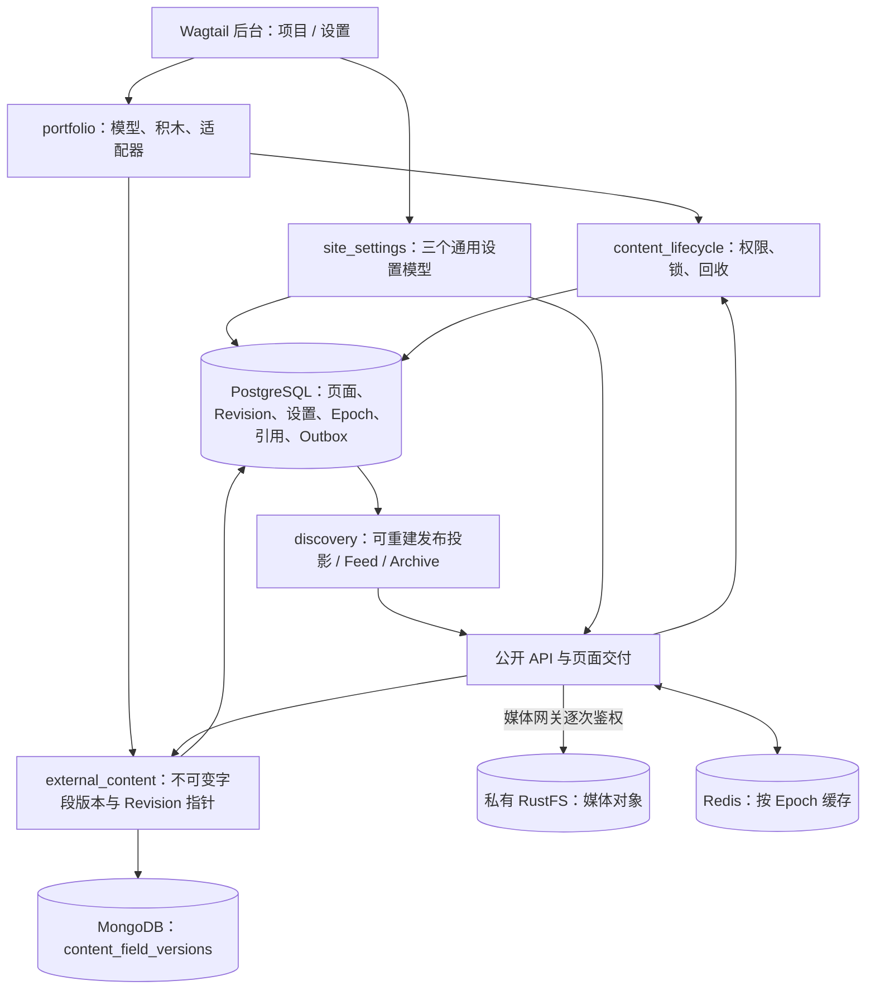

# portfolio 作品集与项目展示系统 + site_settings 全局导航与社交链接系统架构与实现方案

| RFC 属性 | 内容 |
|---|---|
| 标识 | MYBLOG-RFC-PORTFOLIO-SETTINGS-01 |
| 规范形式 | Google Engineering RFC 风格：背景、目标、不变条件、方案、替代方案、风险、验证、发布与回退 |
| 状态 | 用户已正式同意方案；8 项源码级加固已纳入合同，待 Gemini Argon 最终放行审核；业务实现与运行验收尚未完成 |
| 日期 | 2026-11-07 |
| 需求路线 | A：先实现 `portfolio` 与 `site_settings` |
| 当前代码基线 | `main`，`c19827040e420f7befe36dd545e43de3db9dbebf` |
| 起草职责 | 总体架构、数据契约、生命周期与验证设计；角色称谓不作为底层模型身份的证明 |
| 本次授权 | 核对源码并最终加固本 RFC；不实施业务代码、不生成或应用迁移、不连接真实服务、不提交、不推送 |
| 批准顺序 | 用户已同意方案 → 本轮按所提供的专家意见加固文档 → Argon 最终放行审核 → 按明确授权分任务实施 → 独立代码审查与验收 |

文中“必须”是已获用户同意的方案及本轮明确要求的验收合同。“现有”仅表示已读到对应代码，不表示它已在本次任务中运行通过。Revision 指 Wagtail 页面历史版本；Epoch 指 PostgreSQL 保存的内容变化代次；Outbox 指与业务数据同事务保存的待处理任务表。用户消息实际列出 8 项加固措施，本文按 8 项完整纳入；纳入文档不等于已修复源码或已获专家最终放行。

## 1. Executive Summary：提案摘要

新增 `portfolio` 业务应用，采用“聚合页 + 独立项目页”，项目正文沿用 Plan A：MongoDB 保存不可变字段版本，PostgreSQL 页面行和 Revision 仅保存正文占位及版本指针。项目通过适配器接入既有搜索、订阅和归档；评论、回收与媒体保护继续走公共服务。

新增 `site_settings` 业务应用，采用 Wagtail `BaseGenericSetting` 管理导航、社交链接和页脚。三个设置模型是全安装范围的通用设置，公开输出再按当前 Site 过滤页面链接。设置属于有大小上限的结构化配置，保存在 PostgreSQL；不把页面正文重新塞回 SQL，也不为少量配置另建 MongoDB 发布流程。

本方案不能直接复制现有 `GuidePage` 的保存与 API 写法。当前代码中发现正文先写后清空、只读隔离设置未生效、评论锁未覆盖写事务、权限异常被吞掉等接入风险。第 3 节列出需要先修复或证明已有其他入口覆盖的事项；它们是实施依赖，不是本次已完成的修复。

## 2. Context & Invariants：背景、目标和不变条件

### 2.1 当前项目的复用边界

S0～S12 已有身份、公共积木、MongoDB 字段版本、受控媒体、原树回收、搜索投影、评论、订阅与归档等资产。本 RFC 复用这些模块，不创建第二套发布状态、正文仓库或评论表。仓库说明中的“96 项单测、36 项演练通过”属于历史记录，本次没有重跑，不能据此断言新增项目页已安全。

本轮在指定 WSL2 路径与 `wagtailblog-test` 环境只读核对包元数据：Wagtail 8.1、Django 6.1.2、django-modelcluster 6.5；依赖范围为 `wagtail>=8.1,<8.2`、`Django>=6.1,<6.2`，驱动固定 `psycopg[binary]==3.3.7`。正式实施时必须重新记录实际安装版本与候选提交，不能仅凭 requirements 范围复现本次源码行号。

只读参考 `wagtailblog2/wagtailblog3/apps/portfolio/models.py`：其 `PortfolioPage(Page)` 将作品集作为单个 SQL StreamField 页面，缺少独立项目模型及本项目的存储与生命周期契约。旧 `base/models.py` 中 `NavigationSettings` 实际仅管理社交链接，页脚采用独立 Snippet。保留其后台可编辑、排序和域名识别的产品思路，重新设计本项目模型；不导入旧站内容、迁移、凭据或运行配置。

### 2.2 Goals：本期目标

1. 后台创建作品集大厅和独立项目，支持技术标签、项目状态、作者、封面及专属内容块。
2. 项目进入全站及类型、标签、作者订阅，进入时间线归档；大厅不进入订阅和归档。
3. 提供可供 Ajax 使用的项目列表、项目详情和统一全局设置 API。
4. 项目具备草稿、审核、批准版本发布、历史比较、复制、别名、回收和恢复的明确规则。
5. 导航、社交链接和页脚可在后台排序维护；设置变化与缓存代次同事务提交。
6. 以真实 PostgreSQL 并发和 Wagtail 8.1 生命周期测试证明高风险合同。

### 2.3 Non-goals：本期不纳入

不实现第三方仓库数据抓取、在线执行代码、任意 HTML/SVG 上传、项目 CI/CD 管理、旧站数据迁移、多租户独立配置、设置审核发布工作流。GitHub Star 徽标仅作安全链接或人工维护的展示数据；自动同步另行设计和授权。

本期前台提供可用模板与稳定 API，不扩展为大型视觉改版。

### 2.4 必须保持的不变条件

| 编号 | 合同 |
|---|---|
| INV-01 | PostgreSQL/Wagtail 的 `live`、`live_revision_id`、当前树位置、权限和回收状态决定能否公开；MongoDB 和搜索结果不能自行决定发布 |
| INV-02 | `ProjectPage.body` 的 SQL 表示恒为 `[]`；对应 Revision 的 `content["body"]` 也恒为 `[]`，实际正文仅在 MongoDB 不可变版本中 |
| INV-03 | 正文读取绑定 `(document_uuid, field_name, version_id, schema_version, content_hash)`；公开请求不能退回最新草稿或“最新 Mongo 版本” |
| INV-04 | 草稿保存、历史预览、比较、恢复不能改变当前正式发布版本；批准 A 后生成 B，发布仍必须使用批准 A |
| INV-05 | 回收保留原树节点与历史引用；恢复生成未发布新草稿；超期物理清理由既有受控服务执行 |
| INV-06 | RustFS 全桶私有；公开的是经过应用权限检查的交付路径，不是桶 URL、对象 key 或长期签名 URL |
| INV-07 | Redis、搜索和设置缓存均可丢弃重建；任何缓存命中及 304 都必须有足够的新鲜元数据证明其仍适用 |
| INV-08 | 评论写入的页面共享锁与业务写入处于同一事务；生命周期与权限写入遵守统一锁顺序 |
| INV-09 | SQL 回滚不等于 MongoDB/RustFS 回滚；跨存储失败保留对象待对账，不立即物理删除 |
| INV-10 | 公共服务不反向导入 `portfolio.ProjectPage`；业务应用负责注册能力，公开 API 白名单输出 |

“2 字节”仅指 `octet_length(body::text)=2` 的 JSON 文本 `[]`，不是 jsonb、行、索引或 WAL 的实际物理占用。搜索纯文本副本仍占 SQL 空间；Plan A 消除的是完整 StreamField 正文及 Revision 中的重复存储。

## 3. Current State & Gaps：当前源码与实施前置项

以下位置是本次读取的代码证据。行号对应上述基线，后续修改后由审查者刷新。

| 资产或缺口 | 当前证据 | 对本 RFC 的影响 |
|---|---|---|
| 抽象页面身份与回收字段 | `content_lifecycle/models.py:19`、`:109` | 两种新页面直接继承；不重复声明 `document_uuid/is_recycled` |
| 首页子页白名单 | `home/models.py:7` | 当前只有博客；需增加 `portfolio.PortfolioIndexPage` 才能后台创建 |
| 原生能力声明与注册 | `discovery/contracts.py:20`、`discovery/registry.py:19` | 项目自注册即可获得现有 Feed/Archive 路由 |
| 发布快照投影 | `discovery/projection.py:39` | 已用 `live_revision.as_object()`；仍需并发重验生效版本与当前路径 |
| 正文先写后清空 | `blog/models.py:203`、`:267`，`guides/models.py:361`、`:399` | 现有流程先执行原生保存，再 UPDATE 为 `[]`；不能作为“正文从不进入 SQL”的实现 |
| 指针与哈希读取 | `external_content/revision.py:56`、`external_content/store.py:180` | 当前读取未强制校验页面 UUID；只比较记录中的 hash 与期望值，未重算 payload 指纹 |
| Mongo 幂等并发分支 | `external_content/store.py:159` | DuplicateKey 分支仅对比 hash，需同时核对 UUID、字段、模型、schema |
| Mongo 索引创建错误被记录后继续 | `external_content/store.py:84` | 唯一索引未就绪不能声称具有并发幂等保证；写入准备失败须阻断对应操作 |
| 公共资格过滤 | `content_lifecycle/public_access.py:20`、`discovery/feeds.py:105` | 可复用祖先限制/回收批量检查；需补当前节点存在、live、Revision、实际路径和缺失路径拒绝规则 |
| 搜索隔离级别判断 | `discovery/query.py:92` | 进入 `atomic()` 后判断 `not connection.in_atomic_block` 恒不成立，不能声称开启了 REPEATABLE READ |
| 自定义过滤仅有声明 | `discovery/contracts.py:83`、`discovery/query.py:80` | `extra_filters` 存在，但当前执行器没有消费项目状态；不能只填 `allowed_filters` 就声称已支持 |
| 既有详情 API 取当前模型 | `api/views.py:389` | 不能照抄 `.first()`、模型元数据与水合正文混用；项目 API 全部从核验后的发布快照构建 |
| 评论 Site 校验吞异常 | `comments/access.py:50` | `except Exception: pass` 会吞掉自身抛出的 PermissionDenied；必须修复后才开放项目评论 |
| 评论共享锁在写事务外 | `comments/api/views.py:194`、`comments/services.py:49` | 当前访问校验先于服务内 `atomic()`；不能保证共享锁一直持有到评论提交 |
| 生命周期协调锁覆盖 | `content_lifecycle/guard.py:12`、`content_lifecycle/models.py:40` | 回收/媒体部分使用 guard；基类 `publish()` 本身未包 guard，需核对所有发布入口 |
| 信号同步失败被吞 | `discovery/signals.py:28`、`:52` | 涉及撤权与缓存失效时不可只记录后继续；缺失 Epoch 的撤权不得成功提交 |
| 回收恢复仅回填正文 | `content_lifecycle/recycle.py:339` | 新项目作者、标签、状态和封面也须按选定快照恢复，不能只恢复 `body` |
| 恢复替代父级缺少类型检查 | `content_lifecycle/recycle.py:271`、`:317` | 移动前强校验 `page.can_move_to(parent)`，并重验父级资格及权限 |
| 人物删除尚无业务保护 | `people/models.py:19`；Blog/Guide 人物外键已为 CASCADE | 新项目同样采用 CASCADE；补 `Person.delete()` 与 `pre_delete` 的活跃/历史引用保护，不能改用 PROTECT |
| 选择器与媒体引用登记 | `content_blocks/blocks/media.py:42`、`media_library/references.py:23`、`guides/models.py:459` | 整数 PK 必须解析为对应资源 UUID；Tracker 和调用方均不得吞异常 |
| 草稿修剪实现不完整 | `content_lifecycle/reconciliation.py:289` | 默认仍为 10，虽有删除引用语句，但缺少整个修剪操作的明确事务及工作流保护；落实 20 个草稿合同与同事务清理 |
| 别名绑定已有模型 | `content_lifecycle/models.py:145` | 表存在不等于创建、同步、转换和读取均已使用；必须核查实装 |
| 设置单例与公开读取 | 本机 `wagtail/contrib/settings/models.py:178`、`:192` | 原生 `_get_or_create()` 先查再创建；补数据库约束与并发 get_or_create；公开 GET 禁用 load |
| 工作流终审目标 | 本机 `wagtail/workflows.py:25`、`wagtail/models/workflows.py:323`、`:383` | 默认完成动作发布最新 Revision；必须开启编辑后重审，并用自定义完成动作固定审批版本 |
| 测试数据库隔离 | `tests/test_feed_and_archive.py:41`、`tests/test_comments.py:45` | 现有部分 `unittest.TestCase` 直接读写配置库；不可未经授权运行其默认命令 |

上述缺口先构成 P0 依赖任务。优先最小修复实际影响本期的共用入口，不借机重写整套 S0～S12。已有行为若经后续源码核查证明由其他入口覆盖，应提交证据并修订本表，而不是重复实现。

## 4. Proposed Architecture：模块和数据流



领域边界：

- `portfolio` 管项目业务，不管理桶策略、通用回收或评论审核。
- `site_settings` 管结构化公共配置，不决定被选中页面的公开资格。
- `external_content` 管字段版本写入、校验与水合，不决定哪个版本正式发布。
- `discovery` 管可重建的查询投影，不以投影中的旧 `is_live` 替代当前 Page 状态。
- `content_lifecycle` 管统一访问资格、锁和受控回收；媒体读写仍走 `media_library`。

## 5. portfolio：模型设计

### 5.1 页面层级

```text
Wagtail 根节点 Page（技术树根，不作为普通项目）
├─ HomePage（默认当前 Site 根）
│  └─ PortfolioIndexPage
│     └─ ProjectPage
└─ PortfolioIndexPage（可作为另一 Site 的根或其所在树的入口）
   └─ ProjectPage
```

`PortfolioIndexPage(CustomBasePage)`：

- `parent_page_types = ["wagtailcore.Page", "home.HomePage"]`，不允许无限嵌套大厅。
- `subpage_types = ["portfolio.ProjectPage"]`；补齐 `HomePage.subpage_types` 的对应白名单。
- `allow_comments=False`；保存简短 `intro`，上限建议 2,000 字符。
- 大厅适配器显式声明 `feed_enabled=False`、`archive_enabled=False`、`supported_dimensions=()`。只写页面类属性不会被当前发现引擎读取。
- 大厅列表使用与项目列表 API 相同的服务，按当前 Site 与大厅后代过滤，不遍历水合全部正文。
- 第一版允许多个大厅；不引入会阻止新建或原树恢复的全局 `max_count=1` 限制。

`ProjectPage(CustomBasePage)`：

- `parent_page_types = ["portfolio.PortfolioIndexPage"]`，`subpage_types=[]`。
- 继承身份和回收字段，显式 `allow_comments=True`。
- 不在项目表新增第二个 `published_version`；正式版本沿用 `live_revision_id`。

### 5.2 字段与关系

| 字段或关系 | 存储与约束 | 用途 |
|---|---|---|
| `title/slug/seo_title/search_description` | Wagtail 原生字段 | 标题、路径与 SEO |
| `authored_on` | DateField，默认当前站点日期 | 订阅、归档和项目成文时间；与发布时间分开 |
| `summary` | 有界 TextField，建议最大 1,000 字符 | 列表、Feed 摘要 |
| `project_status` | `planning / active / maintenance / archived`，默认 active | 业务进展；`archived` 不代表下架或回收 |
| `featured_image` | FK CustomImage，null/blank，SET_NULL | 封面；写入历史引用索引 |
| `body` | StreamField(ProjectStreamBlock)，SQL 恒为 `[]` | 长正文及结构化项目块 |
| `tags` | ClusterTaggableManager，经 `ProjectPageTag` | 共用 taggit 词库；不再造技术标签库 |
| `authors` | `ProjectPagePerson(Orderable)` + ParentalKey + Person | 有序作者及贡献角色，随 Revision 保存 |
| `started_on/completed_on` | 可选 DateField | 校验结束日期不早于开始日期 |

`ProjectPagePerson.person` 必须为 `models.ForeignKey(Person, on_delete=models.CASCADE, ...)`，严禁使用 `models.PROTECT`。`page` 使用 `ParentalKey("portfolio.ProjectPage", on_delete=models.CASCADE, related_name="authors")`。人物防误删属于删除服务的业务检查，不能借外键 PROTECT 实现。

原因已在本机 django-modelcluster 6.5 源码核实：`modelcluster.models.model_from_serializable_data()` 遇到历史 Revision 中已删除的外键对象，仅处理 CASCADE、SET_NULL 和 DO_NOTHING；PROTECT 会进入未支持分支抛出普通 Exception。cluster 子关系以 `strict_fks=True` 还原时，CASCADE 会跳过悬空作者子记录，使历史页面可继续反序列化；不能关闭外键检查、创建假人物或修改历史 Revision 来掩盖问题。

防误删必须同时覆盖 `Person.delete()` 和 `pre_delete` 信号，复用同一引用检查。信号覆盖 `QuerySet.delete()` 与 Django 删除收集器，不能只保护后台单个删除按钮。检查包含所有已注册页面类型的当前作者关系，以及仍保留的草稿、正式、排期、工作流、历史和回收快照 Revision；历史引用按页面模型及真实作者字段解析原始 `Revision.content`，不能只查当前子表、字符串模糊匹配，或调用 `as_object()` 后误把已被过滤的作者当作无引用。

存在引用或无法完成检查时拒绝删除，并返回可定位的引用说明。人物删除、作者关系写入、Revision 保存及修剪遵守第 11 节协调锁，在同一事务内重查，防止检查后新引用并发进入。原始 SQL 绕过 ORM 的删除不属于受支持入口。作者快照与当前人物显示名称变更规则必须测试，不把其他页面当前草稿关系读入正式版本；历史悬空关系可安全读取不代表允许正常删除仍被引用的人物。

`TechStackBlock` 的版本 Badge 是展示内容；可筛选技术标签以 `tags` 为准。后台说明清楚两者用途，不根据徽标文本在公开请求中扫描 MongoDB。

新增条件唯一索引只在有具体业务需要时采用。不能对 `ProjectPage.slug` 加全表唯一约束；Wagtail 的 slug 通常在同级中唯一。

### 5.3 草稿与发布校验

草稿允许暂缺封面、仓库地址和正文，方便逐步编辑；已填内容仍须满足 URL、字段长度和块结构安全校验。发布至少要求标题、成文日期、有效 `project_status`、一段有效正文或项目描述；封面与开源仓库均可选，支持未开源项目。

发布强校验运行在实际目标 Revision 反序列化对象上。后台表单、`revision.publish()`、审核完成、定时发布均执行同一校验；不能使用原生新 Page 的默认 `live=True` 判断用户是否点击“发布”。

## 6. Plan A：从写入前脱水到精确水合

### 6.1 扩展方式

新增可选择接入的 `external_content` 正文生命周期组件，例如 `ExternalStreamPageMixin`，首个使用者为 `ProjectPage`。其字段声明为 `external_stream_fields={"body": ProjectStreamBlock}`。不在业务页复制现有数百行保存代码，也不在本任务中自动把 Blog/Guide 全部迁移到新组件。

组件必须覆盖 `save()`、`serializable_data()` 的持久化使用、`save_revision()`、`with_content_json()`，并为 copy、alias 和恢复提供明确的身份上下文。实现前由 Argon 对照本机 Wagtail 方法调用图确定最小覆盖点，不修改 site-packages 或对整个 Wagtail 做 monkey patch。

### 6.2 精确保存时序：页面行与 Revision 首次写入均脱水

`ExternalStreamPageMixin.save()` 的顺序固定为“保存 `raw_body` → 校验完整输入 → 临时置 `body=[]` → 原生保存 → `finally:` 恢复 `raw_body`”。页面第一次由 `add_child()` 写入 SQL 时也走此顺序，不能等首次 Revision 创建后再清空页面表。目的性伪代码如下，校验适配器须按本机 Wagtail 的 `clean` 参数和草稿规则实现：

```python
def save(self, clean=True, **kwargs):
    raw_body = self.body
    try:
        # 先对真实输入执行适用的 Wagtail、块结构与媒体校验。
        self.validate_external_save_input(clean=clean)
        self.body = []
        # 校验已完成，避免原生 clean 对占位正文重复执行发布正文检查。
        return super().save(clean=False, **kwargs)
    finally:
        self.body = raw_body
```

`validate_external_save_input` 是待实现的内部适配器，不是 Wagtail 已有 API。不得借 `clean=False` 跳过业务安全校验；原生元数据更新要求的最小校验、正文结构/媒体校验与发布强校验分开执行。`body == []` 是 SQL 存储约束，不能在真实内存正文上直接判定而拒绝所有非空正文：保留其他模型校验，对该项约束按占位存储值校验。失败后恢复内存正文不代表事务已提交，调用方仍须处理回滚后的其他内存元数据。

`save_revision()` 与 `serializable_data()` 的精确配合顺序：

1. 在内存保留 `raw_body`，完成适用的原生字段、cluster 子关系、块与媒体校验，形成确定的 `body_payload` 和完整媒体引用。空正文也写一个明确版本，不能解释为沿用旧正文。
2. 取得稳定 `operation_id`，绑定 actor、page/document UUID、action、输入摘要。进入统一 SQL 事务，按第 11 节锁定并重验权限；通过 `OperationResult` 判定完成重放、输入冲突与并发请求。新页面身份只创建一次，失败重试不能借新 UUID 绕过回执。
3. 调用 `MongoContentStore.save_field_version()` 追加不可变版本，指定 `model_label="portfolio.ProjectPage"`、`field_name="body"`、schema=1，hash 沿用 `calculate_payload_hash()`。此时获得指针，不依赖尚未创建的 Revision ID 生成幂等键。
4. 设置仅限本次调用的序列化上下文，包含原始正文与已核验指针，再进入原生 `save_revision()`。原生校验看到的仍是真实正文；不能在校验前把整个页面对象长期变成空正文。
5. 原生调用 `self.serializable_data()` 时，组件临时将 `body=[]`，调用 `super().serializable_data()` 保留其他字段、tags 与 authors，再向返回字典写入 `_external_field_pointers`，强制 `content["body"]=[]`；在 `finally:` 恢复内存 `raw_body`。返回给原生 `Revision.objects.create(content=...)` 的字典已经完成脱水，因此首次 INSERT 就没有正文。覆盖允许覆写的草稿时同样在 UPDATE 前脱水。
6. 原生保存 latest_revision 等元数据期间触发的 `save()` 同样遵守上述时序。封面和所有嵌套块的 `MediaReferenceTracker.register_revision_references()`、修剪和操作回执写入同一 SQL 事务；引用解析、登记、指针或 SQL 任何一步失败均整体回滚。
7. 退出时在 `finally:` 清理本次序列化上下文并恢复内存正文，防止下一次保存误用旧指针；成功返回该 Revision。草稿保存不改变 `live_revision_id`，不进入公开投影或缓存。

不能先创建含正文 Revision 再 `revision.save(update_fields=["content"])` 清空；也不能先写页面正文再 UPDATE 清空。`serializable_data()` 必须在真正序列化字段之前临时置空，并在返回前注入有效指针。历史比较、copy/update_aliases 等其他序列化入口只能使用已验证的 Revision/身份上下文；上下文缺失时拒绝持久化，不能返回缺指针空壳。Wagtail 表单、日志和预览中的内存对象仍须可用。

### 6.3 完整性与数据库保护

ProjectPage 表增加 `body == []` 的 CheckConstraint 作为最后保护。实现时确认其 jsonb 表达式由 Django 生成的 SQL 正确；模型批量 `.update(body=非空)` 应失败。Revision 为共享表，不给所有 Page 的 Revision 加项目特有约束；通过项目保存组件、原生动作回归及 SQL 参数捕获证明 Revision 从首次 INSERT 起即已脱水。

读取不仅比较 Mongo 记录的 `content_hash`，还要重算 `payload` 哈希，与记录值及 Revision 指针三方一致，并核对 document UUID、字段、模型标签、schema。SHA-256 用于完整性校验，不宣称能抵御攻击者同时修改两库及其 hash。

Mongo 唯一索引必须确实存在并可用；并发重复键重放也须核对完整身份。缺失索引或初始化失败应使相应正文写操作失败，不能只记录日志后继续。

### 6.4 `with_content_json()`：唯一历史内容还原入口

该入口调用 super 保留当前树、权限相关状态和基类身份/回收状态，再只按传入 content 中的指针读取正文。`_hydrated_from_revision` 必须伴随实际 Revision/指针身份，不可只用一个布尔值表示任意内容都已水合。

| 场景 | 选定内容 |
|---|---|
| 公开项目页、详情 API | 已核验 `live_revision` |
| 后台继续编辑 | Wagtail 选定的最新草稿 Revision |
| 历史预览、版本比较 | 经对象权限校验的指定 Revision，且 object_id/content_type 属于当前页面 |
| 审核或排期发布 | 被批准的目标 Revision，不能再查询最新草稿替换 |
| 回收恢复 | `RecycleEntry.snapshot_revision_id` 指定快照，生成新草稿 |

Mongo 不可用、版本缺失、hash/UUID/schema 不符：公开详情返回可重试的 503 且不缓存，后台保留用户输入并报错，恢复或发布整体失败；没有通用的“捕获异常后当作空正文”分支。

“毫秒级水合”为性能目标，不作为已达成事实。需分别测量热连接、冷启动、不同正文大小与块中媒体解析 SQL；单页一次按字段取版本，禁止逐块读取 Mongo。

### 6.5 幂等、跨库失败与版本保留

| 失败点 | 处理合同 |
|---|---|
| Mongo 写失败或结果不确定 | 不提交新 Revision；按同 operation_id 查询/重试，不改变正式发布 |
| Mongo 成功、SQL 回滚 | 保留未绑定版本；通过 operation_id 与 SQL 回执/全量指针对账确认，不立即删除 |
| SQL 提交成功、响应丢失 | 重放返回同一操作结果与 Revision，不再次追加逻辑相同的正文版本 |
| 搜索投影失败 | SQL 发布版本仍为正式版本；记录可重试任务，公开查询拒绝使用不匹配的旧投影 |
| 已提交 purge 事件消费失败 | Outbox 保留并重试；不得回填已删除 SQL 页面，也不能报告跨库销毁完成 |

沿用 RECYCLE-RETENTION-03：从未发布页面的普通草稿保留最近 20 个；正式、已批准、正在工作流中及回收快照引用版本必须受到保护，不能仅按 object_id 删除共享 Revision。删除 SQL 草稿不立即删除 Mongo 字段版本。

`prune_page_draft_revisions(page_id, keep_recent_drafts=20)` 必须统一默认值和所有调用入口。候选版本同时限定页面的 object_id 与 content type，按 `created_at DESC, id DESC` 稳定排序；受保护版本单独保留，不挤占普通草稿窗口。工作流保护必须查真实 WorkflowState/TaskState 引用，不能从函数注释推断已覆盖。

修剪在同一 SQL 事务、全局 guard 与页面锁内进行。先确定并重验最终淘汰的 Revision ID 集合，再仅删除这些 `(page_id, revision_id)` 对应的 `MediaReferenceRecord`，随后删除 Revision；任何一步失败均回滚。`MediaReferenceRecord.revision_id` 当前是整数列，并无数据库外键级联，必须显式清理。保留版本的引用不能误删；修剪不得物理删除 Mongo 版本、RustFS 对象或图片记录。现有函数虽有清引用语句，尚不足以证明整体事务、20 个窗口及工作流保护满足合同。

孤儿对账必须考虑所有页面类型、所有受保护历史版本、复制/别名绑定和在途操作，且经过宽限期；现有对账器没有证明能覆盖 Mongo 孤儿识别的全部条件，此项不能宣称已完成。

## 7. 专属积木与媒体合同

`portfolio/blocks.py` 定义 `ProjectStreamBlock`，组合 `get_common_stream_blocks()` 和下列项目块。复用实际类名 `CustomMermaidBlock`、`CustomCodeBlock`、`CustomTableBlock`，不引入同名平行实现。

| 积木 | 字段与行为 |
|---|---|
| `TechStackBlock` | 有限列表：name、category(language/framework/tool)、version；标签和版本按纯文本转义，徽标由本地样式绘制 |
| `RepositoryBlock` | repository_url、demo_url、license、可选人工 stars_count；GitHub/Gitee 为 URL 元数据，不发起服务器端抓取 |
| `ScreenshotGalleryBlock` | 有限 ListBlock，项含 ImageChooserBlock、caption、alt_text；最多建议 20 项，保留稳定 block ID 与 item ID |
| 通用结构块 | Mermaid、代码、表格、图像、文档及普通正文；沿用公共净化和文本提取 |

每个块同时实现 Wagtail `clean()` 校验和本项目实际调用的 `validate_value/render_clean/render_basic/extract_text/extract_media_refs` 入口；`BlockContract` 文档中的 validate/render 命名与既有实现不同，实施时明确桥接，不仅声明符合 Protocol。

嵌套图库的每个图片引用输出 `CustomImage.public_id`，保留 `body.<block-id>.screenshots.<item-id>.image` 路径。加固公共 `content_blocks.blocks.media._resolve_asset_id`，明确传入的资源模型或 asset_type，规则如下：

- CustomImage 实例取其 `public_id` 并校验 UUID；整数 PK（含 chooser 原始序列化中的十进制字符串）批量或按已建映射查询 `CustomImage`，自动转换为对应 `CustomImage.public_id` UUID。
- UUID 输入也须验证对应类型资源存在；空值仅在字段允许为空且确实没有选择时返回空引用。bool、非法格式、已删除 PK、错误类型对象、查询失败均立即抛 `ValidationError`，由外层保存事务回滚，不能 `str(整数)` 后冒充 UUID。
- `_resolve_asset_id` 也供文档、音视频与步骤配图调用，整数解析必须按明确资源类型分派；不可把不同表中相同整数 PK 一律当图片。图库和封面显式使用 CustomImage，嵌套重复 ID 可去重查询并保留每条引用路径。

封面、图库及通用媒体块在 Revision 保存时同事务登记引用。`MediaReferenceTracker.register_revision_references()` 严禁吞异常：无效、悬空或缺 ID 的非空引用必须报错，不允许 `except Exception: continue` 或静默丢弃。提取器、Tracker 与调用方都须传播失败，不能照抄 GuidePage 捕获 ref_exc 后继续的写法。登记先校验完整集合，再在事务中替换该 Revision 的引用；失败保留旧记录并撤销本次 Revision/回执。

历史草稿、正式版本和回收快照引用阻止物理删除；第 6.5 节 20 个草稿修剪必须同步清理被淘汰版本的引用，避免已不存在的 Revision 使媒体永久无法清理。引用归零仍不代表获准立即删除对象，继续遵守宽限期、全站引用检查及受控删除授权。

公开 `blocks` 使用专用输出序列化器，将媒体整理为 `{public_id, alt_text, caption, url}`；不直接输出 chooser 的内部 PK、storage key 或整份 Mongo 原始元数据。链接由媒体网关生成，派生图也必须通过受控交付。

`safe_html` 由块的受控模板/渲染器生成并通过 `content_blocks.sanitizer`；`mark_safe` 只是标记，不能替代净化。Mermaid 使用严格模式且不允许脚本/事件或任意 HTML 注入。标题、Badge、License、图注、源码都经过各自上下文转义。

全桶私有不等于所有媒体业务权限都是私有：当前媒体网关依据资源 `visibility` 逐次鉴权，不自动继承页面私密性。发布公开项目时必须检查媒体公开资格；私密草稿截图若仍标 public，会有独立公开交付语义，后台须显式提示并按媒体策略处理。

## 8. 通用发现、订阅与归档

### 8.1 项目适配器

```python
class ProjectPageAdapter:
    type_key = "project"
    model_label = "portfolio.ProjectPage"
    schema_version = 1
    extractor_version = 1
    capabilities = PublicListingCapabilities(
        public_type_slug="project",
        feed_enabled=True,
        archive_enabled=True,
        supported_dimensions=("type", "tag", "author"),
    )
```

适配器必须完整实现当前 `TypeAdapterContract`：`allowed_filters`、`weight_profile` 和 `extract(published_snapshot)`。在 `PortfolioConfig.ready()` 注册项目和大厅适配器；ready 只导入注册，不连接服务、不重建索引。

`PublishedPayload` 提供标题、summary、authored_on、正文提取文本、标签及 `extra_data`。后者存 `project_status`、有界作者展示数据、`author_slugs`、封面 public_id、slug；不存整份 blocks。作者标识优先稳定 Person public_id，并兼容当前 Feed 使用的 author_slugs 规则。

正文必须已经由目标 Revision 水合；适配器不得发现空 body 就按“当前最新版”再次水合。空正文、缺指针和水合失败是三个不同状态。

### 8.2 自动接入范围

注册后沿用现有路由：

- `/feed/`、`/feed/type/project/`、`/feed/tag/<slug>/`、`/feed/author/<slug>/`。
- `/feed/atom/`、`/feed/atom/type/project/` 及对应标签/作者 Atom 路由。
- `/api/v1/archives/?type=project`，支持既有标签、年份过滤；项目未声明 topic，不伪装为 GuideTopic。

新增 project 类型不需要在 Feed/Archive 中增加 `if ProjectPage`。为纠正已有 BLK 安全缺口而修改公共实现，与“新增页面不侵入核心业务分支”是两件事；前者仍须明确代码归属并回归 Blog/Guide。

### 8.3 发布投影与权限的新鲜度

投影构建在发布写事务或可靠 Outbox 消费中，从 DB 重读当前 `live_revision_id`，核对 Revision object_id、base/content type、文档 UUID，再反序列化。提交投影前重验该版本仍生效；旧任务不能覆盖新发布、下架或回收状态。

当前 `publication_generation` 有默认值不代表已有完整代次校验。第一版至少以“当前 live_revision_id 相等 + 页面锁”防旧任务覆盖；若引入代次，生产者和消费者必须一起实现，不能只新增字段或依赖固定值 1。

列表、Feed、归档、导航和公开详情共享公开资格服务：当前页面存在、在当前 Site 内、非 Alias、自身已发布且有 live_revision、未到未来成文日期、无自身/祖先回收或访问限制。批量使用当前实际 path；空 path、缺失 Page、缺失 Revision 一律不进入公开结果。

普通祖先 `live=False` 是否连带使子页不可访问，应遵循 Wagtail 当前路由与已批准规则；本 RFC 不把“所有祖先 live=True”作为未经确认的新限制。祖先回收和访问限制必须阻断。

权限过滤先于 count、分页和归档分桶，避免总数泄漏。来源投影与 Page Revision 不一致时排除并请求修复；PostgreSQL 失败则返回 503，不能从 Redis 猜测公开资格。

`supported_dimensions` 当前主要是声明，不能假定引擎已强制消费全部维度；新增适配器需通过协议测试，未支持的维度须明确拒绝或无匹配，不应让声明掩盖实际行为。

## 9. RESTful JSON API 合同

### 9.1 公共规则

GET/HEAD 只读，不在缺少配置、Epoch 或投影时创建数据。解析当前受信任 Site；无可用 Site 返回 404，绝不退化为跨站全表查询。公开接口对登录用户也返回相同的公共版本；后台预览使用有权限的 Wagtail 入口。

错误形态保持 `{status:"error", code:<数字>, error:<稳定标识>, message:<中文>}`。400 输入不合法，404 未找到或不公开，409 路径标识冲突，429 限流，503 依赖不可用。错误响应不共享缓存。

### 9.2 `GET /api/v1/projects/`

| 参数 | 合同 |
|---|---|
| `tag` | 一个统一技术标签 slug；不存在返回空列表 |
| `status` | project_status 枚举；非法值 400 |
| `index` | 可选 PortfolioIndexPage ID，必须属于当前 Site 且符合公开资格 |
| `cursor` | 可选分页游标，绑定规范化过滤条件、Site、排序及 Epoch |
| `page_size` | 默认 20，范围 1～50；非法输入 400 |
| `sort` | `authored_desc`（默认）或 `authored_asc`；page_id 作为稳定次级排序 |

状态和标签过滤使用发布投影，不读当前项目模型的草稿关系。现有 `ContentQuery.extra_filters` 尚未执行筛选；本期须添加受适配器白名单限制的过滤处理，或在 portfolio 查询服务中对同一发布候选集执行等价 SQL，方案选定后禁止两套口径。推荐最小扩展 ContentQuery，并补共享公开资格与真实快照入口。

列表不水合 MongoDB 正文。返回字段：

```json
{
  "status": "success",
  "epoch": 42,
  "total_count": 1,
  "page_size": 20,
  "next_cursor": null,
  "cursor_reset": false,
  "items": [
    {
      "id": 123,
      "document_uuid": "00000000-0000-4000-8000-000000000123",
      "title": "个人内容平台",
      "slug": "my-content-platform",
      "url": "/portfolio/my-content-platform/",
      "authored_on": "2026-11-07",
      "project_status": "active",
      "summary": "项目解决的问题与主要能力。",
      "tags": [{"id": 7, "name": "Python", "slug": "python"}],
      "authors": [],
      "featured_image": null
    }
  ]
}
```

游标跨过滤条件不可复用；Epoch 改变时按既有 RECYCLE-DISCOVERY-02 返回第一页及 `cursor_reset=true`。不得返回负 offset 或接受无限大 offset；现有 offset 游标不是千万级 keyset 分页，不能据此宣称超大规模分页性能。

### 9.3 `GET /api/v1/projects/<slug>/`

slug 在当前 Site 内查询，只有一个公开候选时可直接解析；同一 Site 不同大厅有重名时，客户端加 `?index=<大厅ID>`，否则返回 409 `ambiguous_project_slug`，不能 `.first()` 随机取页。主身份仍是 page ID/document_uuid，slug 可变。

路由须支持项目允许的 Unicode slug。实施选择 `<str:slug>` 并作 Wagtail 等价校验，或明确限制后台 slug 为 ASCII；推荐前者，不直接照抄仅匹配 ASCII 的 Django `<slug:slug>`。

返回 `data`：列表元数据、`effective_revision_id`、项目日期、作者、标签、媒体描述、`blocks` 和 `safe_html`。blocks 项为 `{id, type, schema_version, value}`，value 经公开输出序列化；不公开 `_external_field_pointers`、operation_id、内部版本集合或后台字段。

标题、summary、状态、作者、标签、封面和正文全部来自同一个已选定发布 Revision；URL 用当前有效树位置计算。不能只水合正文、其余字段用当前页面草稿。

### 9.4 项目缓存与 HTTP 协商

列表 key 示例：`api:projects:v1:s{site}:l{locale}:e{epoch}:d{site_today}:{params_hash}`；详情 key 加 `page_id` 和 `live_revision_id`。参数需白名单规范化并完整入 hash。

每次先只读查询当前 Epoch 和公共资格，再判断缓存或弱 ETag。304 同样先完成 Site、参数、路径歧义及资格验证，不能把原本 404/409 的请求返回 304。详情 ETag 还应包含内容 schema/渲染器版本；列表 ETag 包含规范化参数和站点日期。

公开响应使用 `Cache-Control: public, no-cache, must-revalidate`，使浏览器/CDN 复用前必须协商；不使用会允许撤权后继续新鲜命中的 `max-age=60`。Redis TTL 用于旧 key 的空间回收，不用于决定何时撤权生效。Redis 故障回源 SQL/Mongo；不能回用旧 Epoch 数据。

公开列表/设置限流建议 60 次/分钟/IP，详情 120 次/分钟/IP，沿用现有限流入口与代理 IP 信任配置。公共读限流失败可降级放行；评论风控失败仍为 503，二者不能混用。

## 10. site_settings：全局设置与公开输出

### 10.1 模型、注册与边界

建立独立 `site_settings` 应用，新增 `wagtail.contrib.settings` 到 INSTALLED_APPS。三个模型分别继承 `BaseGenericSetting`，用 `register_setting` 注册，使用各自 change 权限。

`BaseGenericSetting` 是全安装范围设置；不是每个 Site 一份。若将来需要站点独立社交与备案信息，另提 `BaseSiteSetting` 迁移方案。本期不同 Site 共享配置内容，但页面链接仍只输出当前 Site 可公开的目标。

每个模型增加 `singleton_key = models.PositiveSmallIntegerField(default=1, unique=True)`，同时具有值为 1 的 CheckConstraint，防并发产生多个“单例”。字段不放入可编辑 panels，也不接受客户端传入不同 key；`BaseGenericSetting` 自身的 `.first()` 约定不是数据库唯一性证明。

本轮要求的 `CheckConstraint(check=Q(singleton_key=1))` 表达的是“只允许 key=1”的合同。本机 Django 6.1.2 的构造函数只接受 `condition`，已无 `check` 参数；实施必须写为以下等价形式，并为三个具体模型生成互不冲突的约束名，不能直接复制旧关键字导致模型导入崩溃：

```python
singleton_key = models.PositiveSmallIntegerField(default=1, unique=True)

class Meta:
    constraints = [
        models.CheckConstraint(
            condition=Q(singleton_key=1),
            name="%(app_label)s_%(class)s_singleton_key_one",
        ),
    ]

@classmethod
def _get_or_create(cls):
    # 初始化也是写入口，先获取 global 行锁；上下文退出才可提交。
    with content_mutation_guard(timeout_seconds=3):
        instance, _created = cls.objects.get_or_create(singleton_key=1)
        return instance
```

三个模型可继承项目内的共同抽象设置基类以复用该合同；保留各自模型权限和必要 Meta 配置。原生 `_get_or_create()` 需要返回模型实例，严禁把 `(instance, created)` 元组直接返回。数据库 UNIQUE 是并发 get_or_create 的最终保证，CHECK 排除其他 key；初始化及授权后台 `.load()` 均执行同一写入锁顺序。授权迁移或初始化阶段创建三个空行，公开读取不得负责补行。

公开 API 一律使用 `SettingModel.objects.filter(singleton_key=1).first()`；禁止调用 `.load()`、`_get_or_create()`、`get_or_create()` 或会隐式 load 的模板标签/context processor。缺行返回确定空结构。这样在 `REPEATABLE READ READ ONLY` 事务中也不发生 INSERT，避免 `ReadOnlySqlTransaction`。缺行不属于异常降级，不得捕获只读事务错误后再重试写入。

设置模型存有界 StreamField 配置：建议每份 JSON 序列化后不超过 64 KiB，服务与表单均校验。不包含任意正文或富 HTML。模型保存包装 `transaction.atomic()`，保证该模型的行更新与 post_save Epoch 变更同事务；原生设置 EditView 已有外层 atomic，但不能只依赖后台入口。

### 10.2 `NavigationSettings`

`main_navigation`：StreamField，最多 20 个顶层项，每项最多 20 个子项，固定两级，拖拽排序。两级定义避免无限递归块和不可控 JSON 深度。

单项含稳定 block ID、label、link_type、PageChooserBlock 页面或 external_url 二选一、可选 badge_text、badge_style 白名单、open_in_new_tab，以及 children。一级可为纯分组（自身无 URL、有子项）；叶子必须有唯一目标。不接受用户提供 CSS class、原始 SVG 或 HTML。

选择器不限于 BlogPage/ProjectPage，可链接其他页面类型；最终仍由统一公开资格服务校验。聚合页不参与 Feed，不影响其作为导航目标。

明确 label 属于设置发布的文字，不从当前 Page.title 自动读取，防草稿标题泄漏。导航序列化必须先遍历两级配置，收集去重后的 `page_id` 集合，再在第 11.2 节同一只读快照中批量核验：

1. 用 `Page.objects.filter(pk__in=page_ids, live=True, live_revision_id__isnull=False)` 批量取当前页面、实际 path 与 Revision 身份，核对页面和 Revision 确实存在、属于当前 Site，排除别名及损坏路径。
2. 批量取得候选及祖先的回收状态，包括 `RecycleEntry` 的 recycled/restoring 和具体模型 `is_recycled`。任一适用节点被回收则排除。
3. 批量检查候选与祖先的 `PageViewRestriction`；任何密码、登录或分组限制均不进入匿名菜单，即使当前请求者为管理员。其他公开资格沿用第 8.3 节，不用 chooser 编辑权限替代公开权限。
4. 建立 `page_id → 可用公开 URL` 映射后按原 block 顺序输出，只为通过核验的目标计算 URL。失效项自动隐藏或移除，不返回空 href、旧 URL、目标 title 或占位链接。

子项继续独立校验。无自身链接的分组保留仍有效子项，空分组删除；父项本来有页面链接但该链接失效时，只能在仍有有效子项时降为无链接分组，否则移除。外链按 URL 规则校验，页脚页面链接复用同一批量服务。数据库错误应返回 503，不能误判为空菜单并缓存；目标缺失、下架或受限则是正常的逐项过滤。查询次数应随类型批次增长，不能每个菜单项一次查页面和祖先。

### 10.3 `SocialMediaSettings`

`social_links`：最多 30 项；platform 为 github、x、bilibili、zhihu、email、website；项含 label、url、enabled，支持排序及规范化去重。

URL 规则：

- HTTP(S) 类型只允许 HTTPS；禁止 userinfo、控制字符、协议相对地址、javascript/data/file、无有效主机的链接。
- 标准化 scheme/host 大小写、IDNA 主机和默认端口；保留大小写敏感 path/query，不盲目删除账号路径、查询串或全部尾斜杠。
- X/Twitter 仅在已识别的主机规则内归一；未知子域不自动视为可信平台。域名匹配使用完整主机或点边界，`github.com.evil.example` 不匹配 GitHub。
- 邮箱使用 EmailField 等价校验，再由服务生成 `mailto:`；不接受任意 mailto headers 或换行注入。
- 图标仅根据受控域名映射返回本地 `icon_key`；未知主机使用 link。不请求远端 favicon、不内联外部 SVG、不抓取 URL 页面。

库地址/Demo、普通外链与邮箱应共享纯校验辅助函数的可适用部分，不混用不同 scheme 的许可集合。用户填写的“GitHub”平台名称不能覆盖真实域名的 icon_key 判定。

### 10.4 `FooterSettings`

字段包括 `icp_number`、`public_security_number`、`copyright_owner`、`copyright_start_year`、可选 `copyright_end_year` 和 `footer_links`。备案号是展示信息，不承诺系统自动验证其备案资格。

备案展示目标使用固定受信任主机的链接生成器；公安备案 URL 参数由校验后的编号编码，禁止直接拼接任意 URL。页脚链接复用导航叶子块和公开资格规则。

结束年份未填时采用站点当前年份；校验起止顺序。输出和缓存键纳入站点当前日期，保证跨年后即使没有 post_save 也更新版权声明。

### 10.5 保存、Epoch 与一致性

三个模型注册带 `dispatch_uid` 的 post_save，成功保存时直接在当前 SQL 事务调用 `ContentDiscoveryEpoch.increment_epoch()`。信号失败必须抛出并回滚设置，不能吞异常，也不能仅在 on_commit 回调中递增。

所有设置保存入口必须在取得任何设置行锁或写入之前，进入 `content_mutation_guard(timeout_seconds=3)`：其内部 `transaction.atomic()` 首先设置 `SET LOCAL lock_timeout = '3s'`，再获取 `ContentMutationGuard(name="global")` 的 FOR UPDATE 行锁。随后才允许锁设置行、核验 version、保存及更新 Epoch。模型 `save()`、授权后台保存、初始化 `_get_or_create()` 与程序式保存均须覆盖；post_save 中才补 guard 已经太晚。

模型 save 包装同样覆盖程序式调用，防“设置先 autocommit、Epoch 后提交”的窗口。允许已授权调用方在一个外层事务依次保存多个设置模型时，也必须在第一次设置写入前取得 global guard，并一直持有到外层事务结束。多模型服务预先按稳定顺序锁完全部目标设置行，再执行第一次 save/Epoch 更新，不能拿到 Epoch 锁后临时追加其他设置锁。批量保存仅接受已初始化的单例；缺行时拒绝本批保存，由授权初始化入口先完成各单例创建，再重新开启批次，避免初始化信号提前锁 Epoch。已获得 guard 的同事务嵌套保存不得另开连接，或倒回取得其他更早顺序的锁。`QuerySet.update()`/bulk_create 等绕开 save 的写入不作为受支持管理入口，数据修复必须使用有审计的服务并同事务更新 Epoch。

原死锁反例为事务 T1 锁 Navigation → Epoch → 等待 Footer，事务 T2 锁 Footer → 等待 Epoch。两个事务在第一条设置写入前争用同一 global guard 后，不会形成这种交叉等待；`lock_timeout=3s` 负责有界失败，锁顺序负责防止该环路，二者不能互相替代。超时在 atomic 外返回明确可重试错误，事务中的设置、version、Epoch 全部回滚。

并发编辑采用模型 `version` 乐观检查：表单携带读取版本，保存服务在设置行锁内核验后更新；陈旧表单返回可修正的冲突提示，不静默覆盖。三个模型独立保存、分别即时生效，不承诺跨三个编辑页的一次原子提交。

一次有效保存递增一次即可；重复信号注册不得造成倍增。回滚时设置、version、Epoch 均不改变。页面下架/移动、限制变化、Site 根变动同样必须更新全局 Epoch，因为它们会改变导航公开结果。

保留 `api:site_settings:{epoch}` 命名空间，完整 key 为 `api:site_settings:{epoch}:v1:s{site}:l{locale}:d{site_today}`。原始 key 只含 Epoch 会跨 Site 混用导航，因此不能直接使用。

“瞬间失效”定义为事务提交后新开始的读取使用新 Epoch，旧 key 不再选用；不承诺正在执行的旧快照请求被撤回，也不通过扫描 Redis 同步删除所有旧 key。TTL 只负责回收空间。

### 10.6 `GET /api/v1/site/settings/`

响应固定为 `{status, epoch, data:{navigation, social_links, footer}}`，子结构缺配置返回空数组/null/确定默认值，不创建 SQL 行。只输出公共配置；不序列化模型所有字段、管理员权限或内部版本字段。

读取事务必须在第一条业务 SELECT 前设置 REPEATABLE READ READ ONLY，以同一快照读取 Epoch、三份设置和页面链接资格，再组装结果。不能用全局设置对象的跨请求缓存携带 ORM 实例或 request。

弱 ETag 示例 `W/"settings:v1:s{site}:l{locale}:e{epoch}:d{date}:r{renderer_version}"`；字段规范化后可用摘要压缩长度。使用 Django 条件请求工具处理 If-None-Match、多个 ETag 和 HEAD；304 保留 ETag、Cache-Control 以及必要的 Vary。返回前验证当前 Site 和公开输出适用性。

公开配置不按用户定制；语言参与输出时以语言参数/实际语言代码作为缓存维度，必要时 `Vary: Accept-Language`。主机输出使用配置的 Site canonical origin，不能把任意请求 Host 注入共享缓存。

匿名读与管理员读此 API 的结果相同；后台设置编辑与预览仍走 Wagtail 权限和 CSRF，不放入公共 Redis 缓存。设置模型类的 `.load(request)` 仅可用于已授权后台初始化/编辑场景，且受第 10.1、10.5 节保护；公开 API 和前台模板必须复用同一 `.filter(singleton_key=1).first()` 只读服务，避免 context processor 隐式创建行。

## 11. 锁顺序与并发合同

### 11.1 保留现有生命周期协调方式

本期不废除 `ContentMutationGuard`，也不将评论重新串行化到全局锁。统一顺序为：

```text
生命周期 / 媒体权限 / 人物与作者引用写：
  transaction.atomic
  → SET LOCAL lock_timeout = '3s'
  → ContentMutationGuard(global) FOR UPDATE
  → 所有相关 wagtailcore_page 行按主键升序 FOR UPDATE
  → 对应业务子表 / 媒体资产及引用（类型、主键稳定排序）
  → 发布投影 / Outbox / 操作回执
  → ContentDiscoveryEpoch(global) FOR UPDATE
  → COMMIT

评论写：
  transaction.atomic
  → 目标页、必要祖先与 Alias 源链的 Page 行按主键升序 FOR SHARE
  → 锁内重新核验 Site / live_revision / 权限 / 回收状态
  → 根评论、目标评论按约定稳定顺序 FOR UPDATE
  → CommentVersion / reaction / 计数
  → COMMIT

设置写：
  transaction.atomic
  → SET LOCAL lock_timeout = '3s'
  → ContentMutationGuard(global) FOR UPDATE
  → 本次涉及设置行（模型标签、主键稳定排序）FOR UPDATE
  → version 冲突校验与设置保存
  → ContentDiscoveryEpoch(global) FOR UPDATE
  → COMMIT
```

评论不获取全局 guard。锁超时统一 3 秒，可重试错误必须明确返回；数据库异常应在 atomic 外捕获，不能在已失败事务中继续查询。

设置参与生命周期或同事务多模型写入时，最外层入口须先拿 global guard；如还涉及 Page，先锁 Page，再锁设置/业务子表，Epoch 最后。不得先由调用方 `select_for_update()` 锁设置，再调用模型 save 补 guard。单次批量操作预先收集并排序锁集合；同事务再次更新已持有锁可以复用，目标集合不完整则在首次 Epoch 更新前补齐，之后拒绝倒序追加。原生工作流审批入口同样必须在 WorkflowState/TaskState 的写入或行锁之前取得 guard，再依 Page → 工作流状态/Revision 的稳定顺序执行；仅在完成回调中补锁不能证明完整调用链无死锁。

只锁目标页不足以证明祖先回收/权限写与评论互斥，因此相关生命周期操作必须锁它修改的祖先或目标行，评论锁对应祖先。范围以实际参与判定的当前链为准，树移动在锁后重读，变化则重试，不能在旧 path 上继续。

任何路径取得 Epoch 锁后不得再倒回取 Page、媒体或设置锁。全局 guard 也不会自动阻止绕过入口的 ORM 写；直接 Wagtail action、工作流、定时发布、限制组变更都要纳入入口清单。

权限撤销事务必须在修改 PageViewRestriction 或其 groups 关系之前开始，锁定相应 Page 后再写限制和 Epoch；单独在 post_save 中开启 atomic 无法把此前已 autocommit 的限制写入拉回同一事务。公共权限写服务与原生后台入口须一起核对。

### 11.2 公共读快照

提供统一只读快照入口，进入 atomic 后、第一次查询前设置事务隔离。调用者已在事务中时，必须知道其隔离级别是否符合合同；不能吞掉 SET TRANSACTION 错误继续声称得到快照。Django TestCase 外层事务与生产请求差异要单独测试。

读请求以同一 PostgreSQL 快照为一致性边界；提交前已开始的读允许完成旧快照。不能承诺通过 Epoch 就能终止已经发出的页面或媒体字节。

## 12. Wagtail 8.1 生命周期与 BLK-01～BLK-08

| 编号 | 本期适配与验收 |
|---|---|
| BLK-01 祖先回收 | 项目页面、列表、导航、搜索、Feed、归档、评论检查 RecycleEntry 与具体模型标志；父大厅回收即隔离项目 |
| BLK-02 未来排期 | 首次排期且未上线不公开；已有正式 A、未来排期 B 时继续公开 A；`authored_on <= site_today` 另行检查，不能替代 go_live_at |
| BLK-03 别名 | 新身份不复制 document_uuid；别名不进入公开项目列表/Feed/归档；别名读取按源发布绑定，回收别名不被源发布唤醒 |
| BLK-04 草稿隔离 | 所有公开字段来自选定 live_revision；发布批准 A 后的 B 草稿不可渗入；跨页面指针拒绝 |
| BLK-05 Epoch 只读 | GET 只调用 get_current_epoch_readonly，无行返回基线 1；首次写递增为 2，无 GET 初始化写 |
| BLK-06 单快照 | 第一条业务 SQL 前设置隔离；列表、count、facets、Epoch 同快照；不能依赖当前恒不成立判断 |
| BLK-07 XML 安全 | 沿用 SafeAtom1Feed 等公共生成器，项目标题/摘要/作者/标签控制字符测试；summary type=text |
| BLK-08 同事务代次 | 设置、发布/下架、权限、移动、回收和必要维度变更同步更新 Epoch；错误不能只记录而提交撤权 |

### 12.1 Copy 与 Alias 的专门合同

普通复制生成全新 document_uuid、独立 Mongo 字段版本、新草稿 Revision，`copy_revisions=False`。显式请求复制完整历史在本期拒绝，不默默忽略参数。递归复制大厅时不复制已回收后代；基类当前注释不等于其实现已完成该过滤。

从源页面复制时，需要在源锁内明确选择 Wagtail copy 动作使用的 Revision，并验证源 UUID，然后向新 UUID 重存字段版本。不能先用新页面身份水合旧指针，也不能复制一个 SQL 中为 `[]` 的空壳。

别名保留独立节点身份；其正文来自 `AliasPublicationBinding` 绑定的源 UUID/源 Revision，而不是别名 UUID 对应的 Mongo 正文。创建、源更新、源下架、别名回收和转换须在统一生命周期入口中维护该绑定。`with_content_json()` 遇别名时仅在验证绑定后允许读取源指针，不能普遍放松 UUID 检查。

别名转普通项目页：先验证源绑定、重存到独立 UUID、创建自有 Revision、登记媒体引用，再完成转换；全部 SQL 同事务。源页面 purge 不得删除仍受别名绑定保护的字段版本；受控销毁需先处理绑定依赖，默认拒绝破坏仍需内容的活动别名。

本期不接受“别名被 Feed 排除，所以无需测试前台读取/转换”的替代论证。如果 Wagtail 动作入口无法安全接入上述合同，项目别名能力暂不开放，并作为显式未完成项交用户确认，不能以空正文方式交付。

### 12.2 回收、恢复与 30 天清理

复用 `RecycleService`、后台回收站与 `purge_expired_recycled_pages`。回收撤销排期和工作流，保留原树占位；恢复先规划父级、slug、页面类型与深度冲突，后生成新草稿，不能恢复即发布。

`RecycleService.restore_page_or_subtree()` 必须替换仅回填 intro/body 的恢复逻辑。先核验 `snapshot_revision_id` 对应页面 object_id、content type 与 document_uuid，再经 `snapshot_rev.as_object()` 得到精确 `snapshot_obj`，按注册的页面类型字段合同恢复。不得以当前模型字段或最新草稿代替快照；快照、水合、关系或校验失败时整批回滚。

ProjectPage 恢复至少完整覆盖以下主表和子表内容，空值及空集合也必须覆盖当前值：

| 来源 | 必须恢复的内容 |
|---|---|
| `snapshot_obj` 的页面业务字段 | `title`、`seo_title`、`search_description`、`project_status`、`summary`、`started_on`、`completed_on`、`authored_on`（成文日期）、`featured_image`，以及该类型后来新增并注册的业务字段 |
| `snapshot_obj.body` | 根据快照指针校验并水合后生成新的草稿指针；页面表和新 Revision 仍按第 6.2 节写入 `[]` |
| `snapshot_obj.tags` / `ProjectPageTag` | 按快照替换标签及 through 子关系，不能保留回收后被改写的当前标签 |
| `snapshot_obj.authors` / `ProjectPagePerson` | 恢复完整有序作者关系，包括 person、贡献角色、sort_order 和其他业务列；不能只复制 Person ID 列表 |

使用显式类型合同覆盖全部业务字段，或以模型元数据配合严格的身份/安全字段排除表实现；不可把 `snapshot_obj.__dict__` 原样回灌。Page PK、document_uuid、当前权限、经规划的 path/depth/numchild/url_path、解决冲突后的 slug、live/live_revision、排期与工作流状态均不从历史覆盖。子关系重建绑定当前页面，保留其他页面的关系和共享 Person/Tag 记录，不能复用旧父对象而移动别人的子行。

恢复顺序固定为：全局 guard 与相关 Page 锁 → 规划并校验父级及 slug → 校验并还原快照 → 同步业务字段和 cluster 子关系 → 必要移动及 URL 更新 → 主表/子表落库 → 新草稿 Revision 与媒体引用 → 批次状态、Outbox 和 Epoch。不能仅给内存 `page.authors/tags` 赋值并假定 `save_revision()` 会提交子表；本机原生方法最后仅保存一组元数据，须显式执行 cluster 关系提交并验证数据库结果。

指定 `target_parent_id` 时，移动前必须强校验 `page.can_move_to(parent)`，返回 False 即抛 `ValidationError`；即使目标看似原父级也不能跳过替代父级校验。还需核验目标存在、未回收、非自身/后代、符合 Site/深度/slug 规则，以及 actor 对源与目标的移动/添加权限；`can_move_to()` 不代替用户权限检查。项目只可挂到 PortfolioIndexPage，严禁借恢复接口直接挂到 Root/Home 等越级位置。父级随子树恢复时逐级重验合法关系，不能在执行 `move()` 后才检查。

恢复最终强制 `live=False`、`live_revision=None`、`has_unpublished_changes=True`、排期清空且不重启旧工作流；不改变身份或复活旧批准版本。以数据库主表、tags/authors 子表、新 Revision 三者逐字段比对快照，并覆盖 Blog/Guide 的 intro、正文和各自业务关系回归。

30 天超期允许进入既有受控永久清理流程；手动提前清空仍须对象权限与确认。SQL 删除与 page.purged Outbox 同事务，提交后才清理 Mongo。项目 purge 不立即删除图库文件；媒体仍需全站零引用、宽限期和独立受控删除许可。测试须覆盖任务重试、重复 purge、嵌套批次以及恢复与清理同时发生。

本次不执行现有清理命令；该命令若不加 dry-run 会进行真实删除，不能作为普通检查运行。

### 12.3 评论复用

不新增 ProjectComment。现有 `Comment.page` 关联 Wagtail Page，项目类声明 allow_comments 后通过同一服务挂载。

待审核版本、审核 CAS、软删除、二级回复与反垃圾策略沿用既有契约。`is_publicly_visible` 只有实际 false→true/true→false 跃迁才改变公开回复计数；已公开评论换批准版本不重复加一。项目下架/回收使整组评论不可交付，不批量翻转每条评论的审核状态；恢复草稿仍不可访问，重新发布后按原审核状态交付。

必须先修复第 3 节的 Site 异常和锁事务边界，才能宣称“无缝挂载”。服务直接调用也需受约束的访问上下文，不能只保护 HTTP 外层。

### 12.4 工作流终审固定审批版本

必须在 `myblog/settings/base.py` 显式配置以下两项，完成动作由公共生命周期模块提供，避免仅 portfolio 生效或公共模块反向导入项目类：

```python
WAGTAIL_WORKFLOW_REQUIRE_REAPPROVAL_ON_EDIT = True
WAGTAIL_FINISH_WORKFLOW_ACTION = (
    "content_lifecycle.workflows.publish_approved_revision"
)
```

`content_lifecycle/workflows.py` 是待新增文件。完成函数签名遵循 Wagtail 的 `publish_approved_revision(workflow_state, user=None)`；不能假设原生回调会直接传入 task_state。通过锁内重读的 `workflow_state.current_task_state` 取得最终任务，固定 `approved_revision = task_state.revision`，最终只允许 `approved_revision.publish(user=user)`。Wagtail 在定义 WorkflowState 时导入该函数，回调模块顶层不得反向导入尚未完成初始化的 Wagtail 模型；模型依赖在函数执行时按需加载，并以启动检查验证无循环导入。

具体执行合同：

1. 最外层审批动作在任何状态写入之前按第 11 节取得 guard、Page 及 WorkflowState/TaskState/Revision 锁；保持同一事务覆盖任务批准、`WorkflowState.finish()`、页面发布、媒体检查、Outbox 与 Epoch。回调须核验在受支持的锁上下文内执行。未覆盖的原生入口不能开放给项目工作流。
2. 核对最终 task_state 属于该 workflow_state，任务确已获准完成，revision 存在，且 object_id、content type、页面身份一致。默认终审必须为 APPROVED；SKIPPED 不自动当作内容批准，缺失、被取消/拒绝或目标不明均抛出可修正异常，不能回退到最新草稿。
3. 所有必须的审批任务须对同一个固定 Revision 达成当前流程的有效批准。开启编辑后重审后，新草稿 B 在终审前出现须重新走 B 的审批；不能用 A 的任务批准覆盖 B。若 A 已完成批准且其后才产生 B，A 的发布动作仍只能使用 A，B 保持未审草稿。
4. 完成动作禁止用 `content_object.get_latest_revision().publish()`、latest_revision 或前端传来的 Revision ID 替换固定目标。对目标执行第 5.3、6.4 节的发布校验与精确水合；审批引用版本不得原地覆写或被草稿修剪删除。
5. 任何发布失败必须使 workflow/task 状态与本次 SQL 发布结果整体回滚，不能留下“已批准但错误版本已发布”。重复完成动作通过稳定工作流/任务/Revision 操作身份重放，不重复发布或重复登记任务；成功必须由目标发布绑定和操作回执证明。已获正式发布权限者主动发布新版本仍走独立授权流程，不能伪装成工作流批准。

本机 `wagtail/workflows.py:25` 的默认完成动作直接发布 `get_latest_revision()`，所以仅设置重审开关不足以替代自定义动作。`WorkflowState.finish()` 在调用 on_finish 前已把自身状态设为 approved；回调应按此时序校验，不能要求它此时仍为 in_progress，也不能等 `workflow_approved` 事后信号才纠正发布对象。该配置全局影响页面及参与工作流的其他对象，必须回归 Blog/Guide；不支持的非 Page 审核对象应明确拒绝或另行提供同等固定版本适配，不能静默退回默认动作。

## 13. Alternatives & Trade-offs：替代方案

| 方案 | 收益 | 代价 / 结论 |
|---|---|---|
| A：本提案，独立项目页 + 原生设置 + 复用公共能力 | 与现有身份、Revision、评论及回收一致；后续类型可继续注册 | 需要先补公共安全缺口；推荐 |
| B：复制旧 PortfolioPage 与导航代码 | 初始代码较少 | 项目无独立发布/评论/订阅身份、正文重回 SQL；不采用 |
| C：另建项目数据库/API 与设置发布系统 | 可独立演化 | 重建权限、版本、媒体引用和回收，增加两套事实来源；本期不采用 |

设置保存 SQL 是有界配置的明确例外，不是放弃正文脱水。原生设置即时保存可减少本期复杂度，但没有页面式历史发布流程；若用户要求导航审核或一键回退历史配置，需要单独增加版本化设置合同。

统一全局 Epoch 保持实现简单，但一次设置保存会使搜索游标重置、更多旧缓存失效；这是本期接受的成本。未来如有实际高写入压力，再拆出设置代次，并定义组合 ETag，不提前增加全局代次系统。

## 14. Security, Reliability & Performance

公开接口最小字段输出、默认拒绝未知权限状态，限制正文体积、图库数量、URL 长度和配置总量。仓库/Demo URL 不触发服务器请求，避免引入新 SSRF 抓取通道；外链新窗口由受控渲染器添加必要 rel。

导航选择器的编辑权限不能替代目标公开权限；全局设置管理员只允许修改被授予 change 权限的设置。项目编辑、发布、回收和媒体操作继续使用 Wagtail 对象权限，不以 is_staff 一概授权。

项目列表、Feed、归档和设置 API 不应读取 MongoDB 正文；详情每个外置字段最多一次版本读取，媒体 chooser 批量解析。以 SQL/Mongo 调用数、p50/p95、正文大小和并发数报告性能，不承诺未经测量的“亚毫秒”“千万级”指标。

设置与列表使用有界 Redis TTL。缓存错误降级回源；SQL 权限状态读失败不能降级为公开；媒体存储失败不回退裸桶地址。503 不缓存为成功内容。

指标至少包括：水合缺失/hash错误、幂等冲突、锁等待与超时、投影 Revision 不一致、Outbox pending/failed、媒体引用登记失败、settings 缓存命中与回源、公开过滤拒绝原因。日志只记非敏感操作标识，不写正文、凭据或完整私密 URL。

## 15. Test Plan：验收矩阵

下表是待实施的测试设计，没有声称已经运行。

| 组 | 必须覆盖 | 通过证据 |
|---|---|---|
| P-01 模型和树 | Root/Home 两种合法入口；非法父级；大厅无评论与订阅 | 实际模型 + Wagtail can_create_at/can_move_to 与后台创建 |
| P-02 脱水 | 初次 add_child、草稿、发布、排期、恢复、复制；空正文；校验/INSERT/序列化失败 | 页面与 Revision 首次 INSERT 参数即为 `[]`、指针已在 content；finally 恢复 raw_body 且不残留旧上下文 |
| P-03 完整性 | UUID/模型/schema/hash 不符；payload 改而 hash 未改；Mongo 不可用 | 明确失败且无部分 SQL 提交，无假空文 |
| P-04 幂等 | 同操作重试、并发重试、异 actor/input、Mongo 成功 SQL 失败、响应丢失 | 一份逻辑版本/回执；冲突拒绝；失败版本保留 |
| P-05 Revision 与工作流 | A 审批完成后 B 草稿；终审前编辑为 B；伪造 latest_revision；拒绝/取消/重复终审；历史还原/定时发布 | 前者只能发布审批 A，后者必须重新审批 B；发布失败回滚任务状态，不能把未审 B 当 A 发布 |
| P-06 媒体 | 嵌套图库/封面/历史/回收引用；整数/字符串 PK、UUID、坏 PK、错误资源类型；Tracker 与提取器故障 | PK 精确转 CustomImage.public_id；失败抛 ValidationError，Revision/引用/回执一起回滚；无裸桶 URL |
| P-07 复制与别名 | 新 UUID、重存、回收子页排除、源/别名回收、转换、源 purge | 不共享错误身份；转换无空文；绑定保护有效 |
| P-08 回收恢复 | 单页/大厅子树；回收后改写业务字段、日期、封面、标签/作者；空集合；合法/非法替代父级；30 天边界 | 主表、标签及有序作者子表、新 Revision 逐字段等于快照；非法 can_move_to/无权限整批回滚，无越级挂载，排期不复活 |
| P-09 自动接入 | 注册真实 ProjectPageAdapter；RSS/Atom/type/tag/author/archive | 核心无 ProjectPage 分支；大厅被排除；XML 合规 |
| P-10 API 过滤 | status/tag、游标、空结果、跨 Site、Unicode、重名 slug | count/分页与权限同口径；400/404/409 明确 |
| P-11 草稿隔离 | 发布后修改 title/status/tags/authors/cover/body | 列表/详情/Feed/归档不出现未发布字段 |
| P-12 人物保护与反序列化 | 实例删除、QuerySet 删除；仅历史/工作流/回收快照引用；构造悬空人物历史内容；并发新增作者 | 活跃/历史引用阻止删除；CASCADE 丢弃悬空子行且历史预览/恢复不抛未捕获异常；不修改原 Revision |
| P-13 草稿修剪与引用 | 从未发布页超 20 个普通草稿；带正式/排期/工作流/回收保护版本；删除中途失败；同 object_id 不同 content type | 确定淘汰集对应 MediaReferenceRecord 同事务清理；保留/其他类型引用不变；失败整体回滚，无物理跨库删除 |
| S-01 设置单例与权限 | 双连接并发初始化；尝试 key=2/重复 key=1；各 change 权限、匿名 POST；三表均缺行的 READ ONLY GET/HEAD | 至多一行且 key=1；_get_or_create 返回实例；公开查询仅 filter().first()、零 INSERT/UPDATE/DDL，无 ReadOnlySqlTransaction |
| S-02 配置校验 | 两级上限、排序、二选一、URL/域名伪装、邮箱注入、总大小 | 明确字段级错误，安全且规范化去重 |
| S-03 导航过滤 | 热缓存后目标删除/下架/live_revision 缺失/别名/跨站/祖先回收/PageViewRestriction；无效父链接、有序有效子项 | 批量核验 page_id；失效项消失、空分组删除；不泄漏目标 URL/title，无按项 N+1；旧 ETag 不掩盖变化 |
| S-04 缓存事务 | 保存、回滚、旧 ETag、并发读写、Redis 故障、重复注册 | Epoch 同事务；回滚无新代次；正确 200/304 |
| S-05 日期与站点 | 跨年、语言、不同 Site 相同 Epoch、Host 变化 | 不串缓存；版权年份更新；canonical origin 稳定 |
| C-01 评论复用 | 项目根评论、回复、版本审核、重复审核、删除、重发 | CAS 与 is_publicly_visible 计数正确 |
| C-02 PostgreSQL 并发 | 评论与下架/祖先回收/限制变更；A/B 发布与旧投影；T1 同事务 Navigation→Footer、T2 Footer→Navigation；并发单例创建 | 双连接屏障证明无锁后越权写/旧投影覆盖，设置事务首把业务锁为 global guard、全部设置锁早于 Epoch；无交叉死锁；3s 超时可重试且无部分提交 |
| C-03 多类型回归 | Blog/Guide/Project 及大厅组合，权限撤销后的热缓存 | 所有入口一致；未来类型只注册即可接入 |

真实并发使用 PostgreSQL `TransactionTestCase` 或等价独立连接测试，以屏障控制事务时序；不能用 SQLite、Mock 锁或仅启动两个线程证明 FOR SHARE 正确。服务集成串行运行，隔离 Mongo 数据库、Redis key prefix 和 RustFS 测试前缀。

新增测试采用 Django test runner 管理的临时库 `POSTGRES_TEST_DB`（默认 `test_myblog`），不使用手工探针库 `myblog_test`，更不访问旧站数据。现有直接读写配置库的 unittest 在修复隔离前不纳入自动执行。

批准实施与测试 IO 后的计划命令：

```bash
cd /mnt/f/openclaw/workspace/wagtail/myblog
test "$PWD" = /mnt/f/openclaw/workspace/wagtail/myblog || exit 1
export MYBLOG_ENV_FILE=.env.test
PYTHON=/root/anaconda3/envs/wagtailblog-test/bin/python

"$PYTHON" -m compileall -q portfolio site_settings external_content content_lifecycle discovery comments api home
"$PYTHON" manage.py check
"$PYTHON" manage.py test tests.test_portfolio tests.test_site_settings --noinput
git diff --check
```

这些模块与命令属于实施计划，当前新模块尚不存在。测试创建临时 schema 同样需要明确测试授权。migration 检查、生成和实际 migrate 另行授权后执行，不能把检查命令清单当成执行许可。

## 16. Implementation Plan、迁移与文件归属

### 16.1 分任务顺序

1. **A0：专家最终审核合同。** 用户已正式同意方案；Argon 对第 18 节 8 项加固及原有检查逐项核对，给出通过/不通过/未验证。未通过项先修订，不能以“用户已同意”替代技术放行。
2. **A1：必要公共修复。** 先修复指针/哈希、公开资格/快照、评论锁、人物删除保护、全量恢复、媒体解析/引用与修剪、工作流固定版本和撤权 Epoch，补跨类型回归；高风险改动独立审查。
3. **A2：项目模型与正文组件。** 新建 portfolio、积木、适配器和 opt-in 正文组件，完成 Revision、复制、别名、媒体与回收测试。
4. **A3：项目交付。** 实现独立项目 API/查询/序列化与最小模板，接入现有 routes，验证订阅和归档。
5. **A4：设置系统。** 模型、块、校验、保存事务、只读公开服务、缓存和 API；与 A2 可有独立文件任务，但共享入口由集成负责人串行修改。
6. **A5：集成验收。** 数据库迁移审核、授权的隔离服务测试、原生后台交互、并发与故障演练，用户确认后再讨论提交或部署。

### 16.2 建议文件归属

| 任务归属 | 新增或限定修改文件 | 责任 |
|---|---|---|
| 项目常规实现 | `portfolio/{apps,models,blocks,adapters,services,serializers,views,urls,lifecycle}.py`、其 templates、migrations | 项目业务、API 和 Wagtail 桥接 |
| 设置常规实现 | `site_settings/{apps,models,blocks,validators,signals,services,views,urls}.py`、其 migrations | 单例约束、_get_or_create 实例返回、先 guard 后写、只读输出与导航批量过滤 |
| 经明确指派的高风险实现者 | `external_content` 新正文组件及 store/revision；`content_lifecycle/{recycle,reconciliation,guard,workflows}.py`（workflows 待新增）、必要 comments 修改 | 首次写入脱水、身份、全量恢复、修剪事务、固定审批版本与统一锁顺序 |
| 经明确指派的人物/媒体实现者 | `people/{models,signals,apps}.py`（signals 按需新增）、`content_blocks/blocks/media.py` 及实际调用点、`media_library/references.py` | 人物活跃/历史引用保护、类型明确的 PK→UUID 解析、登记失败回滚；与公共事务任务串行集成 |
| 集成负责人单独修改 | `home/models.py`、`myblog/settings/base.py`、`api/urls.py`、必要 discovery 与原生后台/审批桥接入口 | 白名单、工作流配置、注册、路由与共享合同；锁的外层入口须明确文件归属后再实现 |
| 验收实现者 | `tests/test_portfolio.py`、`tests/test_site_settings.py`、独立并发测试及必要隔离修复 | 测试候选提交与真实 IO 边界 |
| 独立审查者 | 只读上述候选代码与 Wagtail 源码 | 不参与同一高风险变更实现后再自审 |

Sol/Flash/Argon/Terra 是项目分工配置；实际派发以运行时可用原生代理工具为准。本轮采用用户转交的 Argon 审查意见加固文档，尚未再次调用 Argon 作最终审核，不能写成已放行。以后派发用原生同任务消息，不创建 ai-memory 任务页或 handoff。

### 16.3 迁移依赖

先核对本地 migration graph 再确定依赖名称，不能猜测 Wagtail 最新迁移号：

- portfolio schema 依赖当前 Page、people、media_library、taggit 等实际迁移；新增项目/大厅及 cluster 关系、字段索引、body CHECK，ProjectPagePerson.person 明确使用 CASCADE。
- site_settings schema 为三个模型分别创建 PositiveSmallIntegerField singleton_key、UNIQUE 和 key=1 CHECK；使用当前 Django 的 condition 语法。后续独立数据迁移仅初始化本新项目的空配置行，不能在公开 GET 补建。
- 不以数据迁移创建或发布作品集大厅，不读取旧站，不复制旧社交与备案数据。后台创建内容在另外获授权后完成。
- 正文组件若只做 opt-in，不要求搬迁 Blog/Guide 历史正文；必要的共用修改与其回归不能省略。
- 任何幂等/绑定模型变更若需迁移，单列 diff、锁影响和向后兼容方案；不把它藏入 portfolio 首次迁移。

本 RFC 不运行 `makemigrations/migrate`。未来“允许实施代码”也不自动等于允许应用迁移、使用真实服务或清理数据。

## 17. Rollout & Rollback：上线与回退

先审核迁移 SQL 和依赖，再经授权在隔离环境建表与验收。代码注册、API 路由和后台可创建权限分步开启；真实页面发布前必须通过 A1～A5 的相关门禁。

回退优先关闭新 API/创建入口或回退到兼容 schema 的应用代码，保留表、Revision、Mongo 版本、引用和对象。已存在项目 Page 时不能直接卸载 portfolio、删除模型表或让 Wagtail 无法解析 content_type；应维持最小兼容模型和后台读取能力。

只有在明确确认无数据且另获授权时才执行反向 schema 迁移。数据库回滚不删除 Mongo/RustFS；新增孤儿对象保留并登记待对账。缓存通过新代码版本键/Epoch 重建，不用 Redis 数据恢复正式发布状态。

## 18. Argon Review Checklist：独立审查输入

请审查者逐项给出“通过 / 不通过 / 未验证”，并附候选提交、源码路径、行号及反例测试，不只回答总体合理：

本轮 8 项源码级加固的最终放行清单如下。以下为必须审查的合同，状态均为“待最终审核”，不是运行测试结果：

| 项 | 必须核验的合同 | 方案位置 / 对应验收 |
|---|---|---|
| H-01 人物关系安全 | ProjectPagePerson.person=CASCADE、禁 PROTECT；Person.delete 与 pre_delete 同时保护活跃/历史引用；悬空历史子关系安全反序列化 | 5.2、11.1 / P-12 |
| H-02 完整恢复 | snapshot_obj 全量业务字段、成文/起止日期、封面、tags/authors 主子表一致落库；替代父级强校验 can_move_to；恢复仍是新草稿 | 12.2 / P-08 |
| H-03 单例与只读 | singleton_key 的字段/唯一/恒 1 约束；get_or_create 返回实例；公开 API 只 filter(singleton_key=1).first()，READ ONLY 缺行无写 | 10.1、10.6 / S-01 |
| H-04 跨设置死锁 | 所有入口先 ContentMutationGuard(global)，lock_timeout=3s；跨模型事务先锁完整集合再写 Epoch；异常回滚 | 10.5、11.1 / S-04、C-02 |
| H-05 媒体与修剪 | _resolve_asset_id 把整数 PK 解析为 CustomImage.public_id，错误立即 ValidationError；Tracker 不吞异常；20 个草稿淘汰集与 MediaReferenceRecord 同事务删除 | 6.5、7 / P-06、P-13 |
| H-06 终审版本 | REQUIRE_REAPPROVAL_ON_EDIT=True；自定义 FINISH_WORKFLOW_ACTION 固定终审 task_state.revision；工作流/发布事务及引用保护有效 | 12.4、11.1 / P-05、C-02 |
| H-07 导航降级 | 收集 page_id 批量核验当前 live/live_revision、回收、PageViewRestriction 与 Site；失效项隐藏，分组/排序正确，缓存不绕过资格 | 10.2、10.6 / S-03 |
| H-08 脱水时序 | save 先校验、body=[] 原生写入、finally 恢复 raw_body；save_revision 的 serializable_data 在首次 INSERT 前输出 [] 和 _external_field_pointers | 6.2、6.3 / P-02 |

同时保留原有系统性审查项：

1. `Page.save_revision()` 如何调用 `serializable_data()`；新正文组件能否在首次 Revision INSERT 前完成脱水，且保留完整 Wagtail 校验和 cluster 关系。
2. `Revision.as_object()`、`with_content_json()`、历史比较的 live 对象、审核与排期发布是否全部走正确目标指针；覆写 Revision 的保护是否覆盖工作流引用。
3. CopyPageAction、CreatePageAliasAction、ConvertAliasAction、update_aliases 是否绕过业务 override；新 UUID 和源绑定例外是否完整，是否存在空文或源 purge 连带损坏。
4. 子树回收/恢复是否完整恢复项目字段与 ParentalKey/Tag 关系，并保留当前身份、树位置与未发布状态；替代父级是否先通过 can_move_to 与用户权限检查。
5. 发布/下架/移动/限制组/媒体权限的原生入口是否遵守锁顺序和同事务 Epoch；评论共享锁是否从校验一直持有到提交。
6. PostgreSQL 单快照设置的位置和嵌套事务处理是否正确；缓存/304 是否可能绕过参数、Site、当前资格与日期变化。
7. BaseGenericSetting 的编辑入口、singleton 初始化、save 信号事务和并发版本校验是否安全；跨模型事务是否先拿 guard；公开读取是否存在隐式创建。
8. 嵌套 ImageChooserBlock 的引用提取是否覆盖整数 ID 与所有图片；媒体登记失败是否拒绝保存，修剪是否清理淘汰集引用；blocks/safe_html 是否有裸桶地址或未净化数据。
9. 已有测试是否真实使用隔离数据库和候选代码；是否有未授权读写、伪并发、吞异常导致的假通过。

本机可复核源码（共同前缀：`/root/anaconda3/envs/wagtailblog-test/lib/python3.13/site-packages/`）：

| 文件 | 本次核对的入口 |
|---|---|
| `wagtail/models/pages.py` | save_revision:1029、update_aliases:1181、copy:1841、create_alias:1875、with_content_json:2104 |
| `wagtail/actions/copy_page.py` | save/copy_revisions/save_revision 路径，尤其 :190、:261 |
| `wagtail/actions/create_alias.py` | alias 字段与关系复制、save 路径 |
| `wagtail/actions/convert_alias.py` | :47 清 alias_of 后 :50 save_revision 的顺序 |
| `wagtail/actions/publish_page_revision.py` | :62 用目标 Revision.content 同步别名 |
| `modelcluster/models.py` | :60 model_from_serializable_data、:104 CASCADE、:113 不支持的 on_delete；:284～299 子关系 strict_fks 与过滤 |
| `wagtail/contrib/settings/models.py` | :178 _get_or_create、:192 load；原生创建无 singleton 数据库保证 |
| `wagtail/contrib/settings/views.py` | EditView 继承通用编辑视图及设置权限 |
| `wagtail/admin/views/generic/models.py` | :1086 form_valid 内 atomic → save_instance |
| `wagtail/workflows.py` | :25 publish_workflow_state 默认取 get_latest_revision |
| `wagtail/models/workflows.py` | :178 完成动作导入、:323 编辑后重审、:383 finish 状态与事务、:1045 TaskState.approve |
| `django/db/models/constraints.py` | :135 CheckConstraint；:139 仅接受 condition，无 check 关键字 |

以上为部分调用点核对，不能替代专家完整源码审查。公开官方文档查询本次未取得可用内容，Context7 返回 fetch failed；因此没有用其他 Wagtail 版本的文档替代 8.1 本地源码证据。

## 19. 本轮交付、验证边界与下一步

用户已正式同意本方案。本轮仅修改本 RFC，将用户转交的 8 项专家加固要求写入设计、失败处理、锁顺序、文件归属及测试矩阵；不重复把既定产品选择列为待用户决策。总体代码基线仍为 `c19827040e420f7befe36dd545e43de3db9dbebf`，文档为该基线上的工作区修订，尚无本轮新 commit。

本轮只读核对当前 AGENTS.md、Git 状态/分支/远程、本项目相关源码，以及指定 WSL2 环境中的 Wagtail 8.1、Django 6.1.2、django-modelcluster 6.5 源码和包元数据。数据库、MongoDB、Redis、RustFS 均未连接；未实施业务代码，未生成或应用迁移，未执行 Django/服务/并发测试，未提交或推送。第 15 节仍是未来实施的验收计划，不能据此报告功能通过。

文档交付检查须核对 8 项措施在正文与 H-01～H-08 清单中的对应关系、删除旧 PROTECT 建议、统一状态与授权描述，并对未追踪的目标文档单独执行 whitespace 检查；仅执行 `git diff --check` 看不到未追踪文件的内容。本轮最终检查命令和结果由交付回复列明。

下一步将本文件交由 Gemini Argon 作最终放行审核，逐项提交“通过 / 不通过 / 未验证”及证据；本轮没有再次调用该专家，也未取得最终放行结论。专家审查若发现需要改变已批准需求、权限或失败处理的实质合同，单独列出差异，不默默扩展实施范围。后续实施仍按任务、文件归属和明确 IO 授权推进；提交、推送、迁移及真实服务操作分别遵守项目授权规则。
