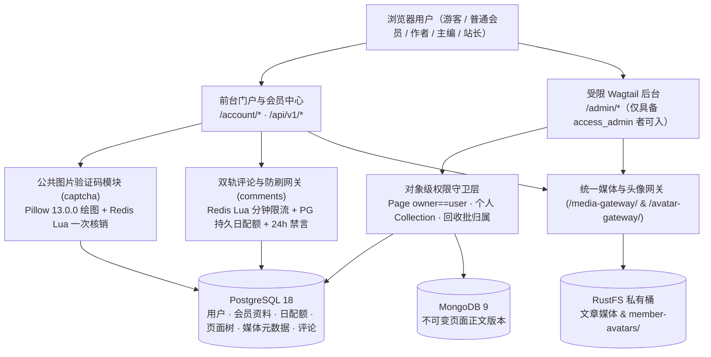

# myblog 会员体系、多角色创作权限与双轨防刷评论架构方案 (RFC)

| 文档属性 | 内容 |
|---|---|
| 标识 | MYBLOG-RFC-MEMBERSHIP-RBAC-01 |
| 日期 | 2026-11-12（Asia/Singapore） |
| 状态 | **Phase 1–3 Implemented & Verified（Phase 1 身份底座、Phase 2 公共图片验证码与 Phase 3 双轨防刷评论配额均已落地并通过 `gpt-6.1-terra` 只读安全审查、187 项全站测试与 Playwright 浏览器冒烟；Phase 4–5 待授权实施）** |
| 独立审查 | `gemini-4-argon`（方案审查）；`gpt-6.1-terra`（分别完成 Phase 1、Phase 2 与 Phase 3 只读反例审查，全部 Blocker/P1 问题均已修复并补齐并发回归测试） |
| 起草基线 | `main@0bc6429b9bb2bd435706a417c96517c96bdd0f73` |
| 已核对依赖 | Django `6.1.2`、Wagtail `8.1`、psycopg `3.3.7`、Pillow `13.0.0`、redis-py `8.1.0`；未安装 `django-simple-captcha` |
| 实施边界 | 测试库（`.env.test`）已应用 `identity 0002`、`comments 0003` 与 `comments 0004`；开发库（`.env.local`）已应用至 `comments 0003`（`comments 0004` 待所有者授权后执行 `migrate`）；全量 187 项测试与 Playwright 浏览器冒烟已在测试环境通过，Phase 3 代码提交/推送待所有者确认 |

---

## 1. 目标、范围与已确认决策

### 1.1 为什么要做这套架构
`myblog` 目前只有后台管理员账户模型 `identity.User` 和公开作者名片模型 `people.Person`，还没有前台会员注册登录入口，也无法让多名作者进入后台“各自创作、互不干扰”。本方案参考 WordPress 的多角色创作分工与知乎的前台互动体验，在兼容现有 Wagtail 8.1 架构的前提下，建立一套**前后台分离、按对象归属隔离、全站共用防刷验证码、且能同时兼顾会员评论与受控访客留言**的完整方案。

### 1.2 核心术语简明说明（给初学者的快速对照）
- **Session（会话）**：浏览器登录成功后，服务端在数据库/缓存里记住“你是谁”的凭证，配合 **CSRF**（防跨站请求伪造令牌）保障请求确实由本人浏览器发出。
- **Revision（页面历史版本）**：Wagtail 每次保存草稿或发布时生成的一份页面快照；页面正文积木已脱水保存在 MongoDB 的不可变字段版本中。
- **Collection（媒体集合）**：Wagtail 原生用来按目录分组管理图片和文档的容器。
- **Outbox（待处理任务表）**：与业务数据在同一数据库事务中一起保存的任务清单，用来在提交成功后异步清理或同步 MongoDB / 搜索索引。
- **Lua 脚本（Redis 原子脚本）**：把“读数据 → 判断 → 修改 → 设过期时间”打包在 Redis 服务端一次执行完，防止高并发请求同时读到旧计数而穿透限流。

### 1.3 已由项目所有者拍板的 9 项核心决策

| 编号 | 已确认决策 | 落地约束 |
|---|---|---|
| **M1** | 前台简洁注册登录 | 一期仅开放**用户名 + 密码**自助注册/登录；暂不做邮箱验证与自助找回，忘记密码时通过人工核密线索联系后台管理员重置 |
| **M2** | 会员头像独立管理 | 新增一对一 `MemberProfile` 保存头像（独立 RustFS 前缀 + Pillow 重编码），不关联 `CustomImage`，不混入文章插图选择器 |
| **M3** | 作者后台审核开通 | 前台注册永远只得普通会员；想成为作者需由管理员在后台审核并加入 `Authors` 组 |
| **M4** | 作者直发与隔离 | 作者在受限 Wagtail `/admin/` 后台编写，**无需审校即可直接发布自己名下的文章**，但严格限制只能增删改查 `owner == 本人` 的内容 |
| **M5** | 基类声明与大厅隔离 | **不在代码里写死具体页面模型**；在统一基类 `CustomBasePage` 用声明式属性 `author_creatable` 与 `author_allow_child_creation` 区分“可创作内容页”与“栏目大厅”。管理员在后台按需把指定大厅（`BlogIndexPage`/`GuideIndexPage`/`PortfolioIndexPage` 等）的 `add + publish` 授给 `Authors` 组后，作者即可直发对应内容页；禁止作者新建/修改栏目大厅或在内容页下套建子页 |
| **M6** | 个人媒体 + 只读公共库 | 作者仅管理本人上传的图片和文档，公共素材库只读选用；音视频（`Audio`/`Video`）暂只限管理员维护 |
| **M7** | 回收站归属隔离与人工清库 | 作者只能回收/恢复自己名下文章（恢复回原树位置且为草稿）；**取消打开列表自动触发 30 天物理清空**，改为超期 30 天标红预警，仅由超级管理员人工二次确认执行永久删除（Purge） |
| **M8** | 评论双轨准入 | 默认全站**仅限登录会员发表评论**；仅在站长指定勾选的文章开启**受控访客留言**（访客强制待审、禁外链、低日配额、每次必过验证码） |
| **M9** | 全站公共图片验证码 | 基于环境已有的 `Pillow 13.0.0 + Redis` 自建公共 `captcha` 模块，供注册、异常登录、访客留言与会员高频风控统一调用 |

### 1.4 本期不做哪些功能（延后二期）
- 邮箱验证码校验与邮件找回密码（待接入 SMTP 服务后在二期平滑扩展）；
- `/u/<username>/` 仿知乎公开个人主页（聚合作者全部文章、关注/私信）；
- 开放作者在线自主申请审核单、作者管理音视频（`Audio`/`Video`）；
- 跨站第三方登录（OAuth/微信/GitHub）。

---

## 2. 现有源码核对与必须先修的隐患

核对当前工作区代码后，发现以下源码事实与潜在风险（这些结论来自静态源码检查，尚未代表运行期验收）：

| 模块与源码位置 | 当前真实情况 | 若直接开放作者与会员会出什么问题 |
|---|---|---|
| `myblog/apps/identity/models.py:4` `myblog/settings/base.py:296` | 已设置 `AUTH_USER_MODEL = "identity.User"`（最小 `AbstractUser`），但没有前台注册/登录路由，也没有 `MemberProfile` | 缺乏普通会员前台入口与资料存放位置；现有邮箱字段没有全站唯一约束 |
| `myblog/apps/people/models.py:20` | `Person` 独立保存公开作者名片（头像外键 `CustomImage`），与 `User` 完全解耦 | 需保留解耦原则，不能凭同名或邮箱相同自动把历史作者名片送给新注册用户 |
| `wagtail/models/pages.py:2429-2582` `wagtail/actions/publish_page_revision.py:20` `wagtail/permission_policies/pages.py:136` `myblog/apps/blog/models.py:140` | Wagtail 原生 `can_publish()`/`can_unpublish()`/`can_set_view_restrictions()`/`can_unschedule()`/`can_reorder_children()` 不检查 `owner`；后台发布走 `PublishPageRevisionAction` 不调 `CustomBasePage.publish()`；后台搜索/报表/日志/批量不走 `construct_explorer_page_queryset`；`BlogPage` 允许文章下建子页 | 只靠钩子与 `CustomBasePage.publish()` 拦不住，作者能偷看他人草稿、取消他人排期、给全站博客大厅设密码，不授 `publish` 又连发布按钮都不显示 |
| `myblog/apps/content_lifecycle/models.py:44` `guides/models.py:467` `blog/models.py:256`、`portfolio/models.py:78` | 各内容页面目前分散覆写脱水与修订逻辑，只有 `GuidePage` 调用了 `MediaReferenceTracker.register_revision_references()`，`BlogPage` 与 `ProjectPage` 尚未接入媒体引用登记 | 若不在 `CustomBasePage` 统一收口，未来新增 `XxPage` 极易漏掉媒体引用保护、权限隔离或发布自动公开配图 |
| `wagtail/permission_policies/collections.py:207` `myblog/apps/media_library/models.py:27, 105` `access.py:46, 109`、`delivery.py:57` | `add` 不隐含 `choose`，而授 `choose` 后共享 Collection 列出全站作者图片；`CustomImage` 默认 `visibility=restricted`；受限媒体凭 `is_staff` 放行；`restrict_asset()` 未查权限；`EditView` 允许直接替换原图；`Audio`/`Video` 无归属隔离 | 作者选图能偷看他人未公开图片；作者直发文章后配图在前台全报 403 裂图；作者可能替换已引用原图或下架他人页面 |
| `myblog/apps/content_lifecycle/models.py:253` `recycle.py:33, 491` `wagtail_hooks.py:48, 102, 266, 380` | `RecycleBatch.actions()` 无条件渲染“彻底销毁”；`RecycleBatchViewSet` 含 `form_fields=["status"]` 暴露增删改路由；`purge_view` 与 `recycle.py:491` 放行 `can_delete & can_publish`；打开列表触发超期清除；`before_serve_page` 仍用 `is_staff` 判断 | 直发作者可直接永久销毁曾发布页面与评论；能借编辑路由篡改批次状态；打开回收站可能清理他人超期页面 |
| `myblog/apps/external_content/models.py:36` `external_content/outbox.py:191` | `OutboxEvent.page_id` 为非空整数；`dispatch_event()` 遇到未知 `event_type` 直接标成 `processed` | 直接塞入无页面头像事件会破坏页面查询，且未知事件会被静默当成成功 |
| `myblog/apps/comments/models.py:236` `rate_limit.py:58`、`services.py:70`、`api/views.py:255` | `author=None` 且 `guest_name=""` 时统一返回 `"匿名/已注销"`；限流分两次 Redis pipeline；`post_comment` 幂等非原子；页面检查在事务外；`PageCommentGovernancePanel` 异步更新缺字段级鉴权 | 硬删会员后历史评论与匿名访客混为一谈；高并发可穿透限流；作者可伪造 POST 打开自己文章的 `allow_guest_comments` 或改他人开关 |

---

## 3. 总体架构与五档角色权限矩阵

### 3.1 总体架构拓扑

### 3.2 全站五档角色与权限边界（游客为未登录状态，不占角色）

| 角色 | 使用入口 | 文章权限 | 媒体权限 | 评论与治理权限 | 回收站与严禁越权边界 |
|---|---|---|---|---|---|
| **游客（未登录）** | 仅前台 | 浏览已发布公开文章 | 仅读取 `public` 媒体与公开会员头像 | 仅在开启受控访客的文章：**必过验证码**、禁外链、低日限额、**强制人工待审**；不可改删/赞踩 | 严禁访问 `/admin/`、草稿及受限媒体 |
| **普通会员 (`Member`)** | 仅前台个人中心（`is_staff=False`，无后台权限） | 仅阅读 | 仅上传/更换**自己的会员头像** | 登录发评/回复（按日配额）、赞踩、5分钟内改及随时删本人评论、看我的评论 | 严禁进 `/admin/`、严禁新建文章、严禁往文章媒体库传文件 |
| **作者 (`Author`)** | 前台 + 受限 Wagtail 后台（授 `wagtailadmin.access_admin`，**不滥设 `is_staff`**） | 在管理员授权的大厅节点下新建声明了 `author_creatable=True` 的内容页（如 `BlogPage`、`GuidePage`、`ProjectPage` 及未来 `XxPage`）；仅对 **`owner == 本人`** 的页面增删改查并**免审直接发布/撤回** | 管理本人上传的图片与文档；公共库只读选用；被他页引用则禁改删 | 享有普通会员全部评论能力（不因是作者自动获得审别人评论权限） | 仅能回收、恢复整批归属自己的页面（恢复为草稿）；**严禁查看/改删他人页面、新建/修改栏目大厅（`BlogIndexPage`/`GuideIndexPage`/`PortfolioIndexPage`）、在内容页下套建子页、调换他人媒体权限、执行 Purge** |
| **主编 / 审校 (`Editor`，可选)** | Wagtail 编辑后台 | 拥有授权子树 `change + publish`，按原生树规则管理全部栏目大厅与内容页（不受作者白名单限制） | 管理授权范围文章媒体（仍受历史引用保护） | 默认会员能力；可单独授予 `comments.moderate_comment` | 可回收/恢复授权范围页面；**无账号权限分配权与永久 Purge 权** |
| **社区风控员 (`Moderator`，可叠加)** | 仅 `/admin/comments/` | 无文章编辑/发布权 | 无文章媒体权 | 全站评论待审审核、作者/IP 溯源、24h 禁言、跨页批量隐藏 | 无文章回收站权；不可修改权限组或绕过评论审计 |
| **超级管理员 (`Admin`)** | 全站后台 | 全站兜底管理（含撤权后接管） | 全站资产管理、受限下架与对账 | 全站治理、解除限制与配置全局开关 | 审核开通作者、帮忘密会员重置密码、**人工二次确认执行永久 Purge** |

---

## 4. 身份三层模型与独立会员头像设计

### 4.1 三层模型的职责隔离
1. **`identity.User`**（登录账号主表，不更换 `AUTH_USER_MODEL`）：仅管 `username`、`password`、`is_active`、权限组（`Groups`）与权限（`Permissions`）。所有前台新注册用户默认为普通会员，**`is_staff=False`**，不具备 `wagtailadmin.access_admin`。
2. **`MemberProfile`**（拟新增于 `identity` App，与 `User` `OneToOneField` 关联）：
   - 核心字段：`nickname`（前台展示昵称，最大 50 字）、`avatar_key` / `avatar_file`（独立会员头像存储键与版本）、`bio`（个人简介，纯文本上限 300 字）、`recovery_hint`（注册时可选填的**人工核密联系方式/安全线索**，仅管理员后台可见，绝不公开输出）、`must_change_password`（管理员重置临时密码后设为 `True`，首次登录强制改密）、`role_updated_at` / `session_epoch`（权限/密码变更时递增，用于使旧会话失效）。
   - **防提权原则**：用户编辑个人资料的接口与表单字段白名单中，绝不允许出现 `groups`、`is_staff`、`is_superuser`、`is_active` 或绑定 `Person` 的字段。
   - **全局会话守卫中间件 `IdentitySessionGuardMiddleware`（P0-7 必须）**：Django 原生会话只校密码哈希，移出 `Authors` 组或修改 `session_epoch` 不会使旧会话自动失效。必须在 `AuthenticationMiddleware` 之后挂载守卫中间件：登录时将 `member_profile.session_epoch` 写入 `request.session["session_epoch"]`，每次请求核对一致且 `user.is_active=True`（否则立即 `logout`）；当 `must_change_password=True` 时，除改密页、退出接口、静态资源与验证码接口外，页面请求一律 302 跳转至强制改密页，`/api/v1/*` 写接口返回 `403 {"code": "must_change_password"}`。
3. **`people.Person`**（公开作者名片，继续保留在 `people` App）：
   - 为解决后续“点击文章作者看简介”需求，可在 `Person` 或独立关联表增加可选 `linked_user = OneToOneField(User, null=True, blank=True, on_delete=SET_NULL)`，**必须由管理员在后台手工确认绑定**；绝不因为“用户名相同”或“留的联系邮箱相同”就自动绑定。
   - **三者互不替代**：`Page.owner` 决定后台谁能操作这篇文章；`Person` 决定文章前台署名显示谁；`Revision.user` 记录历史上哪次版本是谁保存的。账号注销或停用时，不连带擦除历史文章与 `Person` 署名。

### 4.2 独立会员头像存储与安全交付合同
- **为什么不用 `wagtail.users.models.UserProfile.avatar` 也不直接用 `CustomImage`**：
  - `UserProfile.avatar` 是 Wagtail 后台用户表自带的偏好字段，只面向后台用户，不适合给普通前台会员直接写，也不经过项目定制的网关防盗链和元数据清洗；
  - `CustomImage` 是文章配图资产库，一旦会员头像建出 `CustomImage` 记录，就会污染作者写文章时的全站图片选择器（`ImageChooser`），还会受文章引用逻辑干扰。
- **推荐契约**：
  1. 会员头像上传至独立 RustFS 存储前缀 `member-avatars/<随机UUID>/<版本号>.webp`，存储桶保持全私有。
  2. **上传安全清洗**：限制原图文件大小（例如 <= 2MB）、像素总尺寸（例如 <= 2048×2048）；仅允许静态 JPG/PNG/WebP；使用环境已有的 **`Pillow 13.0.0`** 完整解码、按 EXIF 方向旋转归正后，**仅把像素复制进一张全新空白画布再重编码为静态 WebP**（彻底剥离 EXIF 隐私、GPS 与隐藏注释，拒绝 SVG 和动态图）。
  3. **专用头像交付网关**：`/avatar-gateway/<uuid:avatar_token>/` 统一设置响应头 `X-Content-Type-Options: nosniff`、`Content-Type: image/webp`（按头像版本携带长期缓存或版本查询串，换头像生成新版本键）；旧头像按下述生命周期异步回收，SQL 回滚残留交给离线对账，禁止当场物理硬删。
  4. 作者等后台用户在 Wagtail 后台上传个人头像时，也通过同一清洗服务处理，不留旁路。
  5. **统一后台账户头像入口（P1-3）**：Wagtail 原生 `/admin/account/` 默认自带 `AvatarSettingsPanel` 直接写入 `wagtailusers.UserProfile.avatar`。落地时须隐藏或接管该原生面板，将后台用户的头像更新统一委托给 `MemberProfile` 头像清洗与 `/avatar-gateway/` 流程（保持 `UserProfile.avatar` 为空），避免作者后台出现“两套头像”和绕过清洗。

**会员头像与账号删除生命周期回收契约（待实现）**

1. **停用账号是默认推荐动作**：设置 `is_active=False`，保留头像、会员资料及全部历史关系，便于恢复；前台可改显默认占位图。停用不创建头像清理任务，也不删除对象存储文件。
2. **彻底删除账号或更换头像时，先存清单再提交**：受控服务在同一个 `transaction.atomic()` 中锁定账号与资料，读取旧头像的真实 `storage_key`，写入事务性 Outbox（或专用清理表），然后删除用户或更新头像指针。硬删须同时收集 `MemberProfile` 头像，以及若存在的 Wagtail `UserProfile.avatar` 对应 `avatar_images/...` 对象键；更换头像仅回收被替换的旧键。`UserProfile.user` 为 `CASCADE`，必须在资料级联删除前收集，不能指望删行自动回收文件。
3. **提交成功后才异步物理擦除**：独立处理器读取已提交任务，复核该键未被任何 `MemberProfile` 或 `UserProfile.avatar` 引用，再调用对应 RustFS 后端的 `ProtectedRustFSStorage._controlled_physical_delete(storage_key)`。普通 `delete()` 会被拦截，不能用于释放空间；请求处理、删除信号及 `transaction.on_commit()` 回调中均不得同步删文件（回调最多通知处理器，可靠性由已入库任务保证）。SQL 回滚时，删除/换图和任务一并撤销，旧头像保留。
4. **任务独立存活且可重试**：清单保存存储标识、对象键、来源、操作 ID 与状态，不依赖已删除用户的级联外键；同一存储与对象键去重，对象已不存在视为成功，RustFS 失败保留任务重试并告警。头像使用不可变新键，禁止把旧键重新绑定为当前头像；清理器也不得删除仍被引用的键。真实释放空间还须核对桶的版本保留策略，不能把删除标记或接口成功直接当作旧版本字节已回收。
5. **定期对账清理漏网文件**：扩展 `CrossStorageReconciler`，实际列举 `member-avatars/` 及 `avatar_images/` 对象，按 PostgreSQL 中全部 `MemberProfile` 和 `UserProfile.avatar` 的引用排除在用文件；仅清理已无任何引用、且创建超过可配置宽限期（如 24 小时）的孤儿头像，包括上传失败、SQL 回滚或未入队残留。删除前再次核查引用，时间不明则保留告警；先支持 `dry_run`，真实清理仍走上述受控接口。现有对账器只遍历媒体模型记录，尚不具备这一头像前缀扫描能力；头像宽限期不替换文章媒体既有保留规则。
6. **存储回收与前台展示分别处理**：删除/换图提交后，旧网关令牌失效，必要时失效缓存；浏览器已缓存的图片可能保留到缓存到期。持续运行任务、重试与对账，才能最终消除无引用头像的存储占用，不能承诺请求结束时已清空 RustFS。

---

## 5. 公共图片验证码模块设计（`captcha`）

### 5.1 选型结论：自研 `Pillow 13.0.0 + Redis` 公共模块 vs `django-simple-captcha`
`django-simple-captcha` 是常用的 Django 第三方表单验证码包，但它默认把挑战答案存进 PostgreSQL 数据库表并依赖定时清理命令，原生偏向传统刷新页面的 Django Form，不直接支持前后端分离 JSON AJAX 的 Redis 原子一次性核销。而当前环境已经装好 **`Pillow 13.0.0`** 与 **`redis 8.1.0`**，因此推荐在 `myblog/apps/captcha/` 建立轻量公共模块：
- **零新增第三方包风险**，100% 离线可用，完全可控；
- **全站前后端统一复用**：无论是模板表单页（注册、登录）还是异步 JSON 请求（访客评论、异常会员发评），全部调同一套接口；
- **抽象 `CaptchaProvider` 接口**：首期实现 `PillowRedisCaptchaProvider`（4 位避歧义字符 `23456789ABCDEFGHJKLMNPQRSTUVWXYZ` 或简明四则算术题，带随机干扰线与扭曲），后续公网部署如需切 Cloudflare Turnstile 只需替换 Provider 实现。

### 5.2 接口、防重放与故障降级合同

| 项目 | 设计合同 |
|---|---|
| **签发挑战** `POST /api/v1/captcha/challenges/` | 接收合法业务 `scope`（如 `register` / `login` / `guest_comment` / `member_comment`），生成高熵随机 `captcha_id`、Base64 PNG（或图像字节流端点 `/api/v1/captcha/image/<captcha_id>/`）与过期秒数；**响应绝不返回明文答案**，Header 强制 `Cache-Control: no-store` |
| **Redis 存储格式** | Key：`myblog:captcha:<captcha_id>`；Value（JSON/Hash）：`scope`、**浏览器签名 Cookie / Session 绑定指纹**（P1-1：不强绑定原始客户端 IP，避免 4G/5G 或双栈切换误杀正常用户；IP 仅用于限制挑战签发频率）、`HMAC-SHA256(SECRET_KEY, 规范化小写答案)`；TTL 固定 **180 秒**；限制单 IP/单会话同时活跃挑战数（防恶意高频生成图片耗尽 CPU） |
| **统一后端校验** `verify_and_consume(captcha_id, code, expected_scope, binding_key)` | **单次 Redis Lua 脚本原子执行**：取出记录 → 校验 `scope` 与绑定指纹一致 → 校验 HMAC 摘要是否匹配 → **无论对错立即 DEL 删除该 `captcha_id`**（一次尝试后即作废，彻底杜绝并发拿同一张验证码图重放爆破！）；后端调用方必须硬编码传入可信的 `expected_scope`，禁止信任前端传入的 `scope` |
| **刷新机制** | 点击刷新图时带上旧 `captcha_id` 顺带作废，并签发新挑战；前端丢弃迟到的旧响应 |
| **故障与不可用** | Redis 不可用时，所有需要验证码的写入口返回 **503 Service Unavailable**（提示“安全校验服务暂时不可用，请稍后重试”），**严禁跳过验证码或退化为多进程不共享的内存字典** |

---

## 6. 前台会员中心、管理员改密与账号治理边界

### 6.1 前台路由与最小功能清单（`/account/`）
1. **`GET/POST /account/register/`（用户自助注册）**：
   - 必填：`username`（字母/数字/下划线等安全校验）、`password`（遵守 `settings/base.py` 已有密码强度验证器）、确认密码、**公共图片验证码**、蜜罐隐藏字段；
   - 可选：`nickname`（默认同用户名）、`recovery_hint`（人工核密备用联系/口令线索，例如“微信号/常用邮箱尾号”）；
   - 防刷：同 IP 限流（如每小时最多注册 5 个、每日最多 10 个），通过后创建 `User(is_staff=False, is_active=True)` + `MemberProfile`，**不授任何后台权限**。
2. **`GET/POST /account/login/` & `POST /account/logout/`（前台登录/退出）**：
   - 支持跳转到来源页（严格校验站内安全 `next` 路径，防开放重定向）；
   - **防撞库保护**：同 IP 或同用户名连续输错密码达 3 次后，强制弹出**公共图片验证码**；连续失败 10 次触发短期冷却锁定（如 15 分钟）。
3. **`GET/POST /account/profile/`（个人中心与我的评论）**：
   - 允许修改 `nickname`、`bio`、上传新头像（走第 4.2 节 Pillow 重编码流水线）、修改个人密码（必须验证旧密码，改密后更新 `session_auth_hash` 并使其他设备会话失效）；
   - 展示**“我的评论列表”**（含已公开、待审核、已驳回状态与原因），允许对 5 分钟内评论编辑或随时软删本人评论；
   - 在个人中心底部仅展示纯文字引导提示：“如需申请专栏作者发文权限，请联系管理员审核开通”。

### 6.2 管理员管理边界：改密、解封与账号删除
- **重置密码**：仅限超级管理员在 Wagtail 后台“用户管理”或专用会员管理入口执行。调用 Django `set_password()` 校验强度并加密保存，同时将 `MemberProfile.must_change_password = True`、`session_epoch += 1`（由 `IdentitySessionGuardMiddleware` 踢下线原有全部旧会话），操作记入审计日志（绝不记明文密码）。该会员下次登录后必须先进入强制改密页面完成改密才能使用，且未完成改密前禁止访问后台或调用写 API。
- **身份核实提醒（一期无邮箱验证的现实边界）**：注册时提示填写 `recovery_hint` 供管理员人工比对；若未留线索，管理员只能通过站外约定方式人工核实后再发临时密码，不能仅凭“报一个用户名或昵称”就重置。
- **三种处罚互相独立**：**评论禁言**（`CommentGovernanceSubject` 24 小时限制）、**撤销作者资格**（移出 `Authors` 组）和**封停账号**（`is_active=False`）是三个完全正交的操作，互不隐式联动。解除禁言继续复用 `CommentService.lift_restriction()`，增加操作人权限校验与审计日志。
- **停用与彻底删除分开**：默认推荐停用，保留头像及历史关系，恢复启用后可继续使用；彻底删除只允许超级管理员确认后经受控删除服务执行。后台单条/批量删除、管理命令等入口均须接入该服务或拒绝硬删，不能裸调 `User.delete()` / `QuerySet.delete()` 绕过检查。
- **删除前强制完成全量页面与媒体过户（P0-4）**：`Page.owner`、`Revision.user`、`CustomImage.uploaded_by_user`、`CustomDocument.uploaded_by_user` 当前均为 `SET_NULL`。删除账号不删除文章、历史 Revision 或文章媒体。**凡名下仍存在任何未永久销毁的页面（含已发布、纯草稿 `live=False`、以及回收站中 `is_recycled=True` 的页面）或媒体资产的作者，受控删除服务必须要求显式传入接管管理员 `transfer_to_user`（默认当前操作超管），在同一事务内把全部 `Page.owner`、`CustomImage.uploaded_by_user`、`CustomDocument.uploaded_by_user` 及 `RecycleBatch.actor_id` 过户给接管人**，绝不允许硬删后留下 `owner=NULL` 的无主页面或孤儿回收批次；历史 `Revision.user` 允许置空，`Person` 署名保持不变。
- **同一事务完成头像登记与关系清理**：按第 4.2 节，在 `MemberProfile` / `UserProfile` 被级联删除前将对象键写入独立 `AvatarPurgeTask` 清理表；任务随删除一同提交，提交后异步擦除 RustFS。删除失败或事务回滚不得提前删对象。
- **修正赞踩缓存计数（统一升序加锁防死锁）**：`CommentReaction.user` 为 `CASCADE`，裸删会移除互动记录，却不自动修正 `Comment.like_count` / `dislike_count`。受控服务须先锁目标 `User`，查出该用户全部 `CommentReaction.comment_id`，按 **`id ASC` 升序一次性 `select_for_update()` 锁定受影响评论**，在同一 SQL 事务内清除其 `CommentReaction` 并按剩余记录重算两项计数，确保不漏算、不出现负数且不与评论审核发生死锁。
- **保留评论并严格区分“已注销会员”与“匿名访客”（P0-7）**：`Comment.author` 为 `SET_NULL`，`author_subject_key` 保留。必须同步修正 `Comment.author_display`（当前 [comments/models.py:239](F:/openclaw/workspace/wagtail/myblog/myblog/apps/comments/models.py:239) 一律返回 `"匿名/已注销"`）与 `comments/api/views.py`：当 `author_id is None` 且 `author_subject_key.startswith("user:")` 时，明确标记 `kind="deleted_member"`、显示名 **`"已注销用户"`** 与默认占位头像（绝不能混作访客），也不得凭同名新账号重新认领；仅 `author_subject_key` 为 `ip:`/`guest:` 时才展示为 `"访客"`。
- **记录审计与处理进度**：保留操作者、目标账号标识、确认结果及清理任务状态，不记录密码；后台分别显示“账号删除已提交”与“头像物理清理完成/待重试”，两者不得混为完成。

---

## 7. 双轨评论与防黑客刷评架构

### 7.1 开关层级：全局可控 + 单篇只能收紧
1. **新增独立全站设置 `CommunitySettings`**（注册为站点设置或配置模型，不混入导航/页脚设置）：
   - `comment_mode`：`closed`（全站暂停新增评论）/ `members_only`（**默认**：全站仅登录会员可发评）/ `controlled_guests`（允许对勾选文章放开受控访客）；
   - `guest_daily_ip_cap`（默认 5）、`guest_daily_browser_cap`（默认 2）、`member_daily_cap`（默认 30）、`max_pending_queue_budget`（全站待审预警预算，超限自动拦截匿名新投稿）。
2. **扩展现有 `PageCommentSettings`**（[comments/models.py:426](F:/openclaw/workspace/wagtail/myblog/myblog/apps/comments/models.py:426)）：
   - 新增 `allow_guest_comments = models.BooleanField(default=False)`；
   - **权限与后端接口双隔离（P0-6）**：由于【💬 评论与互动】Tab 使用独立异步 POST 接口（`page_settings_view`）保存设置，**服务端接口与服务层必须同时校验**：① 请求人必须是 `page.owner_id == request.user.id`（或 `Editors` / `is_superuser`），禁止作者 A 修改作者 B 页面的配置；② 非 `is_superuser` / `Editors` / `comments.govern_comment_globally` 的普通作者请求时，**不仅在 UI 隐藏 `allow_guest_comments`，后端必须拒绝或强制忽略对 `allow_guest_comments` 的修改**（伪造 POST 载荷传 `allow_guest_comments=true` 直接返回 `403`）；
   - **收紧规则**：只有当“全局处于 `controlled_guests` **且** 单篇 `allow_comments=True` **且** 单篇 `allow_guest_comments=True`”时，游客入口才生效。一旦站长把全局切换回 `members_only`，全站所有文章立刻停收访客评论（已发表评论仍可读）。

### 7.2 分级风控与配额表（起步建议值，后台可调）

| 维度 | 未登录访客（仅在勾选页允许） | 新注册会员（如注册 < 7 天） | 普通可信会员 |
|---|---|---|---|
| **频率限制（Redis Lua）** | 60 秒最多 1 次；同 IP 60 秒最多 3 次 | 60 秒最多 2 次 | 60 秒最多 5 次 |
| **持久日配额（PG）** | 签名浏览器 Cookie **2 条/日**，且同 IP **5 条/日**（P1-2） | **10 条/日** | **30 条/日** |
| **字数上限** | 500 字符 | 1000 字符 | 2000 字符（沿用 `sanitizer.py` 上限） |
| **外链规则** | **严格禁止任何 HTTP/HTTPS 链接** | 最多 1 个（且强制转待审） | 最多 2 个；$\ge 2$ 强制转待审 |
| **图片验证码** | **每次提交必验** | 触发高频/风控信号时弹出 | 触发高频/风控信号时弹出 |
| **默认审核策略** | **100% 强制人工待审**（不得被 `auto_approve` 绕过） | 默认待审（或在后台可配） | 按页面设置 / 风控结果决定 |
| **事后操作权** | 不可凭昵称/IP 编辑、删除或赞踩 | 可 5 分钟内编辑、随时自删、赞踩 | 同左 |

### 7.3 同步修复已有评论防刷缺口
1. **限流原子化**：把 [rate_limit.py:58](F:/openclaw/workspace/wagtail/myblog/myblog/apps/comments/rate_limit.py:58) 的“两次 pipeline（先 `ZCARD` 再 `ZADD`）”合并为**单次 Redis Lua 脚本**，并发下绝不超额；赞踩与编辑接口同步接入该限流。
2. **PostgreSQL 持久日配额表 `CommentDailyQuota`**：唯一键 `(site_id, subject_kind, subject_key, quota_date, action)`，按站点时区计算自然日，在同一评论写入事务内以条件更新/UPSERT 原子加 1（待审成功也扣额，删评不退额），彻底消除 Redis 重启清零配额的漏洞。
3. **补齐服务层事务与幂等**：把页面资格锁（`FOR SHARE`）、单篇设置重读、禁言检查、日配额扣减全部收拢进 `CommentService.post_comment()` 同一个 `transaction.atomic()` 内；幂等凭证 `CommentMutationReceipt` 校验完整参数摘要，同 `request_key` 不同内容直接报 409 冲突；`moderate_comment()` 的 `approve/reject` 强制校验版本 ID。
4. **验证码与 SQL 回滚解耦**：验证码在进入事务之前先原子核销；如果后续发评校验失败回滚，用户只需刷新一下验证码重试即可，绝不能让验证码因为数据库回滚被反复重放。
5. **访客 Cookie 的真实安全边界（P1-2）**：签名 `HttpOnly` 浏览器 Cookie（每日 2 条）仅防普通浏览器用户连续提交，不能防脚本丢弃 Cookie 绕过。真正阻止恶意脚本刷评的硬边界是 **`ip:<client_ip>` 持久日配额（每日 5 条） + 每次必过验证码 + 全站待审预算 `max_pending_queue_budget` 自动熔断**；同时拒绝不带有效签名浏览器 Cookie 的裸 POST 访客请求（该 Cookie 在请求验证码挑战时由服务端签发）。

---

## 8. 基于 `CustomBasePage` 与 Wagtail 通用生命周期的隔离架构

本机 Wagtail 8.1 源码已证实两点底层机制：**① 原生 `PagePermissionTester` 对 `can_publish()` / `can_unpublish()` / `can_set_view_restrictions()` / `can_unschedule()` / `can_reorder_children()` / `can_view_revisions()` 完全不检查 `owner`；② 后台发布动作走 `PublishPageRevisionAction.execute(skip_permission_checks=True)`，根本不经由 `CustomBasePage.publish()`，且后台搜索、报表、日志与批量动作也不走 `construct_explorer_page_queryset` 钩子。**

为保证 `BlogPage`、`GuidePage`、`ProjectPage`、`BlogIndexPage`、`GuideIndexPage`、`PortfolioIndexPage` 以及未来任何新增的 `XxPage` / `XxIndexPage` **天然具备完全一致的行为（零单页面硬编码）**，所有页面权限隔离、媒体引用登记、发布前校验、作者自动署名与发布公开媒体全部沉淀到 **`CustomBasePage` 抽象基类与 Wagtail 通用生命周期钩子/策略** 中（P0-1）：

### 8.1 基类声明式能力与 Wagtail 通用生命周期守卫

1. **声明式能力属性（沿用现有 `supports_comments` 与 `listing_policy` 的设计风格）**：
   - 在 [content_lifecycle/models.py](F:/openclaw/workspace/wagtail/myblog/myblog/apps/content_lifecycle/models.py) 的 `CustomBasePage` 定义两个全站通用类属性（默认全部安全收紧）：
     - **`author_creatable: bool = False`**：声明该页面类型是否允许受限作者（即仅获授 `add + publish`、无 `change` 权限的用户）创建、编辑、复制、发布/下架及回收本人页面。内容页子类（`BlogPage`、`GuidePage`、`ProjectPage` 及未来 `XxPage`）设为 `True`；栏目大厅/全站单页（`BlogIndexPage`、`GuideIndexPage`、`PortfolioIndexPage`、`TagIndexPage`）与 `HomePage` 保持 `False`。
     - **`author_allow_child_creation: bool = False`**：声明该页面作为父节点时，是否允许受限作者在其下创建允许的子内容页。`HierarchicalListingMixin`（所有聚合大厅的公共混入）默认设为 `True`；所有内容详情页保持默认 `False`——这样既不破坏主编/超管对 `BlogPage.subpage_types` 等原生树规则的完整能力，又在底层统一禁止普通作者在任何文章/指南/项目页下套建子页。
   - **动态计算而非硬编码**：在运行时动态收集 `CustomBasePage` 所有已注册子类的 `ContentType`（按 `author_creatable=True` 过滤），任何未来新增页面无需修改一行权限策略代码即可自动接入。
2. **全局注册 `OwnershipPagePermissionPolicy` + `CustomBasePage.permissions_for_user`（P0-1 核心底座）**：
   - 在 `content_lifecycle/apps.py` 的 `ready()` 中调用 `register_permission_policy(AbstractPage, OwnershipPagePermissionPolicy())` 替换全站 `Page` 默认权限策略（`PageLogEntryManager`、`SearchView`、`IndexView`、`ContentTypeUseView`、`aging_pages`、`locked_pages` 等全部 Wagtail 视图经 `policy_registry` 统一路由至此）；
   - 重写 `CustomBasePage.permissions_for_user(self, user)` 返回 `OwnershipPagePermissionTester(user, self)`（Wagtail `Page.permissions_for_user` 源码已证实会自动对未转特化实例的 `Page` 调用 `self.specific_deferred.permissions_for_user(user)`）；同时确保 `HomePage` 与根节点保持 `author_allow_child_creation=False`。
   - **判定模式（按树节点授权而非按组名写死）**：对目标子树节点，若 `user.is_superuser` 或用户拥有的继承权限包含 `"change"`（如 `Editors` 主编组），视为**全量编辑模式**，完全保留 Wagtail 原生行为（编辑 `BlogIndexPage`/`GuideIndexPage`/`PortfolioIndexPage` 与全部内容页均不受作者限制）；若用户仅有 `"add"` / `"publish"` 而无 `"change"`（即 `Authors` 创作组模式），自动进入**归属隔离模式**。
3. **全站通用查询与动作逐项收口**：
   - **Explorer / 搜索 (`/admin/pages/search/`) / 报表 (`aging-pages` / `locked-pages`) / 日志 (`PageLogEntry`) / 类型使用列表 (`ContentTypeUseView`)**：在 `OwnershipPagePermissionPolicy.instances_user_has_any_permission_for()` 中，不再因 `actions` 含有 `"add"` 或 `"publish"` 就把整个子树放入 `all_pages`，而是对无 `"change"` 的子树强制收紧为 `Q(owner=user) & Q(content_type_id__in=author_creatable_ct_ids)`；在 `explorable_instances()` 中，除导航必需的公共祖先链及具备 `author_allow_child_creation=True` 的授权大厅自身外，下级页面一律附加上述归属过滤。
   - **新建入口与子页类型过滤**：
     - 注册 Wagtail 官方 `before_create_page(request, parent_page, page_class)` 钩子作为硬安全门禁：若操作人在 `parent_page` 上处于受限作者模式，且 `not getattr(parent_page, "author_allow_child_creation", False)` 或 `not getattr(page_class, "author_creatable", False)` 或 `getattr(parent_page, "is_recycled", False)`，直接抛出 `PermissionDenied`（阻止绕过界面直接提交创建 `BlogIndexPage`、`GuideIndexPage` 等栏目页）；
     - 同步收口 `AddSubpageView`、`PreviewOnCreateView` 与 `choose_parent`：按操作人权限过滤掉受限作者无权创建的非 `author_creatable` 模型（例如只剩 `BlogPage` 或 `GuidePage` 时自动直达创建表单，且禁止直接访问 `IndexPage` 的新建预览端点）；服务端创建固定赋值 `owner = request.user` 并剥离伪造 `owner` 提交。
   - **编辑 / 预览 / 历史 / 对比 / 版本列表 (`can_edit`, `can_view_revisions`)**：对受限作者，仅当 `author_creatable=True` 且 `self.page.owner_id == self.user.pk` 时返回 `True`；对大厅页与他人页面返回 `False`（同时修补原生 `can_view_revisions()` 只检查 `not page_is_root` 的漏洞）。
   - **发布 / 下架 / 取消排期 (`can_publish`, `can_unpublish`, `can_unschedule`)**：对受限作者，仅当拥有 `"publish"` 权限、页面自身与祖先均未回收（`is_recycled=False`）、`author_creatable=True` **且** **`self.page.owner_id == self.user.pk`** 时返回 `True`；对大厅页或他人页面一律 `False`。
   - **统一发布门禁与 `before_publish_page` 钩子**：在 `CustomBasePage` 提供可覆写钩子方法 `validate_for_publish(self, user=None)`（默认校验自身及祖先 `is_recycled=False`，并校核作者不得发布引用了他人仍为 `RESTRICTED` 媒体的页面；`GuidePage` 等特化模型可继续叠加各自业务门禁，如要求绑定 `Topic` 与 `step` 块），并同时在 Wagtail 官方 `before_publish_page` 钩子与 `CustomBasePage.publish()` 中触发，确保无论是点击编辑页发布按钮还是代码/定时发布均 100% 受检，且发布前重查操作人仍在有效权限组内。
   - **关闭高危权限与禁止 Alias（别名）**：对受限作者恒令 `can_set_view_restrictions()`、`can_reorder_children()`、`can_move()`、`can_lock()` 返回 `False`；`can_copy_to(destination)` 要求源页 `author_creatable=True` 且目标允许 `can_add_subpage()`；在 `before_copy_page` 钩子拦截受限作者勾选 `alias=True`，强制新副本 `owner = request.user`、全新 `document_uuid`、未发布草稿态。
   - **BulkAction（批量发布/下架/删除）**：逐条通过 `OwnershipPagePermissionTester` 校验全部选中页面，混入任一他人页面或不允许类型则整批拒绝。
4. **通用媒体引用提取与作者 `Person` 自动关联（跨全站内容页）**：
   - **统一媒体引用登记**：将原仅在 `GuidePage.save_revision()` 手工触发的 `MediaReferenceTracker.register_revision_references()` 上收至 **`CustomBasePage` 通用修订保存流程**（或公共 Mixin/后置钩子），自动扫描任意内容页的 `featured_image`、`gallery_images`（若模型存在）以及全部 `StreamField` 中实现 `extract_media_refs()` 的积木，保证 `BlogPage`、`GuidePage`、`ProjectPage` 及未来 `XxPage` 全部零遗漏接入 `MEDIA-REF-01`。
   - **通用 `Person` 作者自动绑定（P1-4）**：监听 Wagtail 官方 `init_new_page` 信号及通用表单校验，凡继承 `CustomBasePage` 且定义了指向 `people.Person` 的 `authors` 关联子表（`BlogPagePerson`、`GuidePageAuthor`、`ProjectPagePerson` 及未来同类子表统一沿用 `related_name="authors"`）：当已绑定 `linked_user` 的作者打开新建页时自动预填本人 `Person` 作为第一作者；受限作者保存或发布时，校验不得擅自将他人 `Person` 设为自己页面的主署名作者（管理员/主编不在此限）。

### 8.2 媒体库隔离与防止“连带下架全站页面”
1. **去掉 `is_staff` 全站受限媒体通行证**：修复 [media_library/access.py:46](F:/openclaw/workspace/wagtail/myblog/myblog/apps/media_library/access.py:46)，作者进入 Wagtail 后台仅授 `wagtailadmin.access_admin`（不滥授 `is_staff`）。受限媒体（`visibility=restricted`）只允许**上传者本人（`uploaded_by_user == user`）**、拥有对应范围授权的主编或超级管理员读取。
2. **注册自定义 `AuthorIsolatedMediaPermissionPolicy`（P0-2 修复 Chooser 泄密）**：
   - 媒体库划为：**“作者个人工作区 Collection”** 与 **“全站公共素材库 Collection（作者只读选用，资产必须为 `visibility=PUBLIC`）”**；
   - 因为 Wagtail 原生 `CollectionOwnershipPermissionPolicy` 中 `add` 不隐含 `choose`、而授 `choose` 后会向同组所有人列出该 Collection 的全部图片，必须为 `CustomImage` 与 `CustomDocument` 注册自定义权限策略：在“作者个人工作区 Collection”中，对非 `Editors`/`is_superuser` 用户**无论 `choose`、`change` 还是 `delete` 均强制过滤 `uploaded_by_user == user`**；服务端上传时强制绑定 `uploaded_by_user = request.user` 与个人工作区 Collection。
3. **打通全站内容页直发配图与 `visibility` 自动公开（P0-2 修复前台 403 裂图）**：
   - 作者刚上传至个人工作区的图片/文档默认为 `visibility = RESTRICTED`（草稿阶段仅本人与主编/超管可见，外人不可遍历读取）；
   - 接入 Wagtail 官方 **`page_published`** 通用生命周期信号：无论作者发布的是 `BlogPage`、`GuidePage`、`ProjectPage` 还是未来任意 `CustomBasePage` 子类，只要页面正式发布且具备 `live_revision_id`，自动查询该版本登记在 `MediaReferenceRecord` 中的全部引用，将其中**属于当前页面 `owner` 本人上传（`uploaded_by_user_id == instance.owner_id`）且仍为 `RESTRICTED`** 的 `CustomImage` / `CustomDocument` 同步提升为 `visibility = PUBLIC`；若误引用了他人名下仍处于 `RESTRICTED` 的资产，则在发布前门禁拦截报错，绝不越权公开他人受限文件。
4. **封堵 `EditView` 替换原图与 `restrict_asset()` 越权下架漏洞（P0-2）**：
   - 自定义图片/文档后台 `EditForm`，在 `clean_file()` 中校验：只要该资产在 `MediaReferenceRecord` 中仍有引用，作者本人也**禁止上传新文件直接覆盖替换原图内容**（只允许修改 `title` 等非破坏性信息，想换图须上传新资产）；物理删除继续由 `MEDIA-REF-01` 一票否决；
   - 在 [media_library/access.py:109](F:/openclaw/workspace/wagtail/myblog/myblog/apps/media_library/access.py:109) 补充操作人权限校验：**影响已发布页面的“公开转受限（连带下架页面）”动作仅限管理员执行**，作者绝对无法调用 `restrict_asset()`。
5. **音视频边界**：`Audio` 和 `Video` 模型目前缺少 Collection 与上传者字段，首期保持仅管理员维护，待二期补齐同等归属隔离后再按需开放。

### 8.3 回收站归属隔离、人工清库与撤权处理
1. **移除自动物理清理与多余路由（P0-3）**：
   - 取消 [RecycleBatchViewSet.index_view](F:/openclaw/workspace/wagtail/myblog/myblog/apps/content_lifecycle/wagtail_hooks.py:102) 中打开列表即自动销毁超期 30 天批次的逻辑，列表保留“已滞留 X 天 / 超 30 天标红预警”展示；
   - 剪除 `RecycleBatchViewSet` 的原生 `add/edit/delete` 路由（移除 `form_fields = ["status"]`），杜绝通过编辑表单篡改回收状态；重写 `get_queryset(request)`，普通作者仅能查看 `actor_id == request.user.id` 且根页面 `owner_id == request.user.id` 的自己批次；将原模型方法 `RecycleBatch.actions()` 改为感知 `request.user` 的视图 `Column`，非超管绝不渲染“彻底销毁”按钮；
   - 更新 [before_serve_page](F:/openclaw/workspace/wagtail/myblog/myblog/apps/content_lifecycle/wagtail_hooks.py:380) 判断：从 `is_staff` 改为 `user.has_perm("wagtailadmin.access_admin")`（兼容 `is_staff=False` 的作者）。
2. **服务层严格校验操作人归属**：在 [RecycleService](F:/openclaw/workspace/wagtail/myblog/myblog/apps/content_lifecycle/recycle.py:33) 的回收、恢复与永久销毁三个方法内部分别验证 `actor` 权限与归属（禁止用户请求传 `actor=None` 跳过校验；系统内部清理需显式传入内部授权凭证），且对所有 `CustomBasePage` 子类通用生效：
   - **回收**：作者只能回收整棵子树所有节点均 `owner == 本人` 且均为 `author_creatable=True` 的自己页面；
   - **列表与恢复**：`RecycleBatchViewSet` 列表与恢复动作按作者归属过滤，作者只看到并只能一键恢复自己的回收批次（恢复回原树位置且为草稿 `live=False`）；
   - **永久销毁（Purge，P0-3 收口）**：移除 `recycle.py:491` 与 `purge_view` 中 `(perms.can_delete() and perms.can_publish())` 放行分支，彻底物理删除（含级联销毁该页关联的评论 SQL 记录与异步清空 Mongo 正文）**仅限 `actor.is_superuser` 执行**，普通作者与主编一律不可见、不可调。
3. **撤销作者资格后的默认处置**：当管理员把某用户移出 `Authors` 组后，该用户下一次后台访问与任何发布/编辑事务都会实时失效（同时递增 `session_epoch`）；**其名下此前已经公开发布的页面默认继续保留上线**，如需连带下架，由管理员使用独立的“封禁账户并批量下架名下页面”确认动作处理。

---

## 9. 跨存储边界、锁顺序与迁移规划

- **数据权威划分不变**：PostgreSQL 18 决定账号、角色、`MemberProfile`、日配额、页面发布/回收状态与评论状态；MongoDB 9 仅保存页面正文不可变版本；RustFS 私有存储保存媒体与独立 `member-avatars/` 头像；Redis 8 仅承担分钟限流、图片验证码挑战与发现层失效版本号（均非持久化权威）。
- **跨存储失败处理**：SQL 回滚绝不回滚 RustFS 上传或 Mongo 写入；新建或更换头像/媒体时，先写对象存储再提交数据库指针，失败对象保留待离线对账清理。
- **专用头像清理表 `AvatarPurgeTask` 与修复 `OutboxProcessor`（P0-5 定案）**：当前 `OutboxEvent.page_id` 为非空整数且 `OutboxProcessor.dispatch_event()` 对未知事件类型会静默标记 `processed`。因此确定**新建独立清理表 `AvatarPurgeTask`**（保存存储标识、对象键、来源、操作 ID、状态与重试次数，完全不改动现有 `OutboxEvent` 页面约束与既有逻辑），并同步修补 `OutboxProcessor.dispatch_event()` 对未知 `event_type` 抛出异常拒绝假成功。
- **任务与依赖规划**：`AvatarPurgeTask` 表及消费者须先于头像更换/硬删入口就绪；任务记录不依赖已删除用户的级联外键；`CrossStorageReconciler` 的对象前缀扫描、宽限期与失败补偿是 Phase 1 交付内容，现有媒体事件与对账器不能直接算作已支持头像清理。
- **统一加锁顺序（防并发死锁，P0-4 优化）**：
  1. **日常高频路径不加 `User` 排他行锁**：普通评论、点赞与资料读取**不在常规写入中 `SELECT ... FOR UPDATE` 锁 `identity_user`**（避免全站用户表锁竞争），由事务内重查 `is_active=True` / `FOR SHARE`（仅需要时）及中间件校验保障有效性；
  2. **账户换图与受控硬删**：`identity.User (FOR UPDATE)` → `MemberProfile` → `UserProfile`（若存在），硬删前先置 `is_active=False` 拦截新请求；若涉及页面接管与评论赞踩清理，严格按单向全局锁顺序执行：**`User (FOR UPDATE)` → `ContentMutationGuard` → `Page (id ASC)` → `Comment (id ASC)`**；
  3. **评论写入与赞踩**：`CommentDailyQuota`（或主体锁 `CommentGovernanceSubject`） → 目标 `wagtailcore_page`（`FOR SHARE`） → 根 `Comment` 与目标 `Comment`（统一按 **`id ASC` 升序** 一次性加锁）；
  4. **异步清理处理器**：RustFS 删除交独立处理器在业务事务提交后执行，清理器不得持有 `AvatarPurgeTask` 锁再反向等待账号锁；真实并发仍须单独验收。
- **迁移独立性**：新增 `MemberProfile`、`CommentDailyQuota`、`CommunitySettings`、扩展 `PageCommentSettings.allow_guest_comments` 以及 `captcha` 模块均通过**增量迁移**实现，绝不修改 `identity/migrations/0001_initial.py` 或破坏现有表名与 `ContentType`。

---

## 10. 分阶段实施路线与验证要求

按“**先修安全地基 → 再开前台会员与验证码 → 再放开受控作者创作**”的依赖顺序分 5 步落地（在最终实施前，每步先写失败测试再写实现）：

| 阶段 | 交付内容 | 核心验收标准（全部需真实环境验证） |
|---|---|---|
| **Phase 1：身份与前台会员中心（已实现并验证）** | `MemberProfile`、`AccountAuditLog`、`IdentitySessionGuardMiddleware`（`session_epoch` + `must_change_password`）、独立头像 Pillow 重编码与 `/avatar-gateway/`（并隐藏/统一后台原生 `AvatarSettingsPanel`）、`/account/register\|login\|logout\|profile\|password-change/`、超管工作台改密/停用/过户硬删、`AvatarPurgeTask` 独立清理表与 `CrossStorageReconciler.reconcile_orphan_avatars`、区分“已注销用户”与“访客”展示、`OutboxProcessor` 拒收未知事件并处理 `page.restored` | **已在测试库 + 真实 RustFS/Redis 验证通过**：注册返回 `is_staff=False`（未接 Phase 2 验证码前按 Fail-Closed 返回 503）；EXIF/SVG/动图校验与重编码通过；组增删清与改密旧会话立即失效；停用保留头像，硬删过户全部页面与媒体并真实擦除 RustFS，双线程并发点赞/回复与硬删无死锁 |
| **Phase 2：公共图片验证码模块（已实现并验证）** | `captcha` 应用（`Pillow 13.0.0` 无外部字体渲染 + `Redis Lua` 先限流再绘图及原子一次性核销，绑定 `HttpOnly` 签名 Cookie）、`/api/v1/captcha/challenges/` 与 `/api/v1/captcha/image/<id>/`、防高频生成限流、前后端组件及登录并发预占窗口加固 | **已在测试库 + 真实 Redis 验证通过**：5 线程并发校验仅 1 次成功，输错或空答案立即作废（不销毁他人挑战），跨 IP 漫游不误杀正常 Cookie 会话，限流先于 Pillow 渲染生效，Redis 断开返回 503 拒绝绕过，注册与登录失败触发验证码端到端打通 |
| **Phase 3：双轨防刷评论与配额（已实现并验证）** | `CommunitySettings` 单例、扩展 `PageCommentSettings.allow_guest_comments`（含 P0-6 UI 隐藏 + 后端防篡改与归属鉴权）、单次 Redis Lua 原子分级限流与高频突发验证码识别、PG `CommentDailyQuota` 原子 UPSERT 日配额、`CommentGovernanceAuditLog`、事务内 `FOR SHARE` 锁页面/别名源页访问限制合并校验/序列化待审预算与开关线性化、原子 `CommentMutationReceipt` 幂等（409 冲突）与禁止软删/隐藏评论复活 | **已在测试库 + 真实 Redis/PG 并发与 Playwright 浏览器验证通过**：全局仅会员时访客被拒；作者尝试伪造 POST 开启 `allow_guest_comments` 或改他人/审核员改他人页开关返回 403；勾选文章访客必过验证码、禁外链、进待审、超日配额 429；别名页继承源页与自身分支限制；真实 PostgreSQL/Redis 并发测试无超发、无死锁、无重复评论 |
| **Phase 4：基类通用作者隔离与对象级收口** | `Authors` 组、`CustomBasePage` 声明式能力属性（`author_creatable` / `author_allow_child_creation`）、自定义 `OwnershipPagePermissionTester` + `OwnershipPagePermissionPolicy`（注册于 `AbstractPage`）、`before_create_page` / `before_publish_page` / `before_copy_page` 通用钩子（含禁 Alias/Move/Privacy/Reorder）、在基类收口全站内容页 `MediaReferenceTracker` 登记与 `init_new_page` 通用 `Person` 自动关联、自定义 `AuthorIsolatedMediaPermissionPolicy` + `page_published` 通用自动公开作者本人配图 + `EditForm` 禁止替换已引用原图、修补 `media_library/access.py` 与 `restrict_asset()`、改造 `RecycleService` 与 `RecycleBatchViewSet`（`is_superuser` 专属 Purge） | 跨 `BlogPage`、`GuidePage`、`ProjectPage` 及大厅页（`BlogIndexPage`/`GuideIndexPage`/`PortfolioIndexPage`）全部统一验证：作者 A 无法通过列表、搜索、报表、日志、预览、历史、复制/别名、排序、设密码、直连 URL、选择器、批量或回收站读取/修改/下架作者 B 的页面与受限媒体，也无法新建/编辑栏目大厅或文章套子页；作者直发任意授权内容页前台配图正常 200 显示且进搜索；主编（`Editor`）仍可正常管理授权栏目与全部页面；作者绝对无法调用 Purge |
| **Phase 5：独立安全复核与全量回归** | 交由独立审查代理做越权与并发反例审查；全站测试、Wagtail 8.1 后台实测与 Playwright 浏览器冒烟 | 全部越权用例与并发测试 0 失败；现有全站测试集 100% 通过 |

**Phase 1 账号与头像回收专项验收（已随 Phase 1 实现完成实库验证）**

1. **专表与处理器验证**：真实 PostgreSQL 可提交独立 `AvatarPurgeTask` 清理任务，用户删除后任务记录不随 `User` 级联消失；同时验证 `OutboxProcessor` 遇到未知 `event_type` 会抛出异常而不是静默标为 `processed`。
2. **停用与恢复**：停用后账号不能继续写入，头像对象、资料、评论及赞踩关系保持；不产生清理任务，恢复后头像可用；隐藏前台头像时显示占位图。
3. **彻底删除与换图**：在真实 RustFS 放入会员头像及后台 `avatar_images/...` 头像，删除提交后验证任务包含准确对象键，异步处理完成后对象确实不存在、存储占用得到回收；换图仅清理旧键，新图与其他用户头像保留。若启用桶版本保留，还须核查历史对象版本，不能仅凭网关 404、任务成功或删除标记判定物理擦除。
4. **回滚、重试与幂等**：强制 SQL 回滚，确认用户/旧头像指针与对象仍在、清理任务未提交；上传后回滚留下的新对象待宽限期对账。模拟 RustFS 删除失败、处理器中途退出及重复消费，确认任务保留可重试，对象已不存在可安全结束，仍有引用的对象不被删除。
5. **孤儿对账**：分别准备两个前缀下“在用”“无引用但不足 24 小时”“无引用且超过 24 小时”的对象；`dry_run` 仅列候选，真实执行只擦除超期孤儿。覆盖没有任何 SQL 记录的上传残留、其他 `UserProfile.avatar` 仍在引用及创建时间不明的情况；清理失败保留记录并告警。
6. **关联与真实并发**：硬删名下仍有页面/媒体（含纯草稿与回收页）的作者未过户时被拒，指定 `transfer_to_user` 后全量过户并可删除，文章、Revision、文章媒体与 `Person` 署名保留；删除用户后赞踩计数与剩余互动精确一致，“已注销用户”与“访客”显示严格区分；真实 PostgreSQL 并发执行硬删/换图/赞踩/发布，确认无死锁、无漏记头像任务、无误删在用文件、无残留计数。以候选代码、服务版本与实际命令记录证据，设计审阅不代替这些验收。

---

### 附：目前明确延后与未解决事项
1. **已统一的历史口径差异**：本文明确将“回收站不自动清空、仅管理员二次确认人工 Purge”作为新规范定稿；进入实施前将同步修正 `第一阶段技术方案` 中关于自动惰性清理的旧表述。
2. **人工找回密码的运营成本**：在一期暂不接入邮箱验证的前提下，若用户注册时未填 `recovery_hint` 备用核密线索，后续忘记密码将无法自动验证身份，只能靠管理员线下人工确认。
3. **待完成范围**：Phase 4（`CustomBasePage` 通用作者隔离与免审直发）及 Phase 5 最终回归尚未代码实施；开发库（`.env.local`）尚待执行 `comments 0004` 迁移；带版本策略 S3 桶的历史版本清理核查尚未执行。
