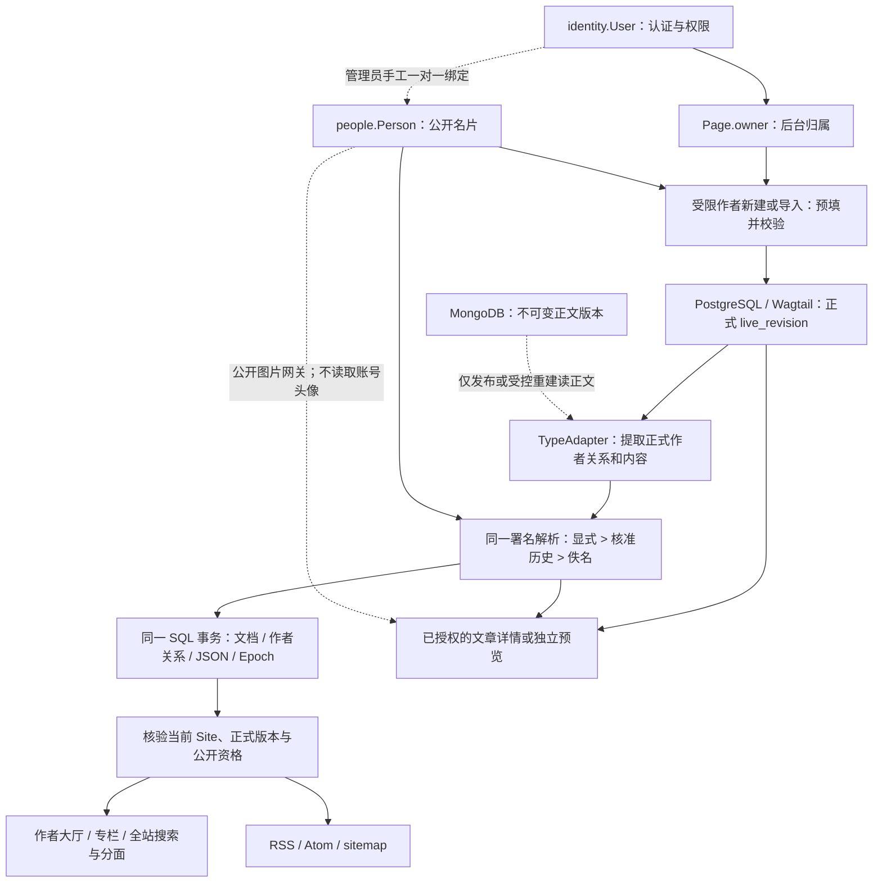

# myblog 全站作者专栏与按作者搜索方案

**RFC：** `MYBLOG-RFC-AUTHOR-DISCOVERY-01` · **日期：** 2026-11-23

**状态：** 产品方向已确认；本文定义实施和验收契约，不代表代码、迁移或性能已验收。

**核对基线：** `main`，起草前 `HEAD` 为 `01cc6f8d5fab63696233bca3a5ab56bc0e959165`；部分源码来自并行工作区候选改动。依赖声明为 Django 6.1 系列、Wagtail 8.1 系列；数据库目标为 PostgreSQL 18。未核对真实服务版本或远程最新提交。

## 1. 目标与边界

读者可以从任意公开文章点击署名进入作者专栏，也可以先在作者大厅找人，再按内容类型、角色、关键词和日期查文章。同一份正式署名同时用于文章徽章、作者主页、全站搜索分面和订阅，不再通过姓名、登录账号或不同页面的临时规则猜测作者。

| 已确认的产品方向 | 本 RFC 的落实方式 |
|---|---|
| A1：全站作者入口与稳定个人地址 | `/authors/` 和 `/authors/<slug>/`；旧 UUID 或数字 ID 只作规范地址迁移，不作为作者索引键 |
| A2：跨类型、角色和关键词组合查找 | 个人专栏使用统一内容查询、跨类型 Tab、角色芯片、默认全文、日期与双模分页；全站搜索支持多选作者 |
| A3：作者大厅热门、搜索与 A–Z | 搜姓名和简介，按公开篇数推荐，按拼音分组；展示跨类型篇数 |
| A4：只为有公开内容的人提供公开入口，全站联动 | 同一站点按正式公开文章判定活跃；无效入口友好导流；详情、搜索、导航、订阅和 sitemap 联动 |

另有内置「佚名」规则：已发布文章没有有效署名时仍可按作者发现，不往原页面的 `authors` 表单或 Revision 塞入系统人物。“全站”指 **当前 Wagtail Site 的所有接入类型**，不跨站点合并，也不因请求者已经登录而显示私有文章。本期不做账号认领、按账号搜索、历史 Revision 重写、订阅筛选器组合或新搜索服务。

## 2. 现状与架构

Revision 是 Wagtail 保存的页面版本。发布副本是从当前正式 Revision 提取的可重建查询数据；它不是批准发布的依据。

| 当前代码 | 能复用什么，必须补什么 |
|---|---|
| `myblog/apps/people/models.py:21`、`people/migrations/0002_person_linked_user.py` | 已有 `Person.public_id/name/avatar/bio/email/linked_user` 与 Wagtail Snippet；没有稳定 slug、分组字段或系统名片保护 |
| `myblog/apps/content_lifecycle/models.py:44`、`forms.py:16`、`wagtail_hooks.py:421`；`myblog/apps/markdown_import/services.py:684` | 已有新建/导入预填和作者防冒用；现有表单在署名清空时提前返回，现有预填并未按受限作者区分，且 helper 有直接写子表的路径，须按第 3 节收紧 |
| `myblog/apps/blog/adapters.py`、`guides/adapters.py`、`portfolio/adapters.py` | 已注册发布适配器；三处重复提取作者，并将数字 ID、姓名派生值和 UUID 混入 `extra_data["author_slugs"]`；项目角色仍是自由文本 |
| `myblog/apps/discovery/projection.py`、`signals.py`、`eligibility.py`、`myblog/apps/external_content/outbox.py` | 已有正式 Revision 重读、公开资格、信号和待办消费入口；尚无作者关联表，投影读快照到写入之间需复核，不能只记录异常就视为已同步 |
| `myblog/apps/discovery/query.py`、`facets.py`、`pagination.py`、`ranking.py` | 已有公共查询、全文 A/B/C 模式、只读快照与签名游标；关键词分支仍会把大量命中和分块搬到 Python 后排序。新作者索引不能独自解决这个问题 |
| `myblog/apps/discovery/feeds.py:208`、`seo.py`；`myblog/apps/content_blocks/rendering/detail.py:427`、`myblog/templates/detail/_detail_meta.html` | 作者 Feed 仍按 JSONField 过滤；现有 sitemap 只注册页面，详情作者目前是从页面关联读出的非链接徽章 |



保持 `people` 管名片、`discovery` 管发布副本和查询，页面应用只实现适配器。继续使用 `CustomBasePage`、现有外置正文实现及共享列表组件。不另建作者 Page 树，不复制一个作者版的 `ContentQuery`。沿用 `说明书/myblog_会员体系与多角色创作权限架构方案_RFC_2026-11-11.md` 的权限边界，以及全站层级列表、标签大厅和订阅的既有公开资格与分页约定；源码差距按本 RFC 验收，不引用历史通过记录作为本次证据。

## 3. 三层身份与三级署名

### 3.1 各对象的责任

- `identity.User` 管登录、权限组、后台操作和评论。其用户名、登录邮箱、会员头像、是否激活、是否在某权限组都不作为公开署名或人物展示字段。
- `Page.owner` 通常是后台创建者，也是受限编辑的所有权线索，可以过户。它不等于写作者。`Revision.user` 只是保存该版本的操作者；审批者、导入操作者和发布者同样不是自动署名对象。
- `people.Person` 是公共作者名片；无账号也能署名。`linked_user` 为可空唯一一对一，只能由授权管理员人工核验后绑定，不允许按姓名、邮箱或昵称自动匹配。解绑、停用账号、转移页面、注销账号均不改已发布的署名关系。

### 3.2 逐级解析

| 优先级 | 使用条件 | 处理 |
|---|---|---|
| 1. 显式署名 | 正式 Revision 的 `authors` 中至少有一个有效 `Person` | 用 `BlogPagePerson`、`GuidePageAuthor`、`ProjectPagePerson` 或已注册类型的同契约关系；保留顺序与贡献角色。审校者或译者即使是唯一有效人物，也算有效，不再补「佚名」 |
| 2. 已确认的绑定 | 受限作者新建或导入时，`Page.owner` 已绑定普通 `Person`；或者管理员已核准一笔指定历史正式 Revision 的署名修复 | 新建和导入在保存草稿版本前预填，正式发布后即属于第 1 级。历史修复只用于被核准的那条正式 Revision，不在读请求或普通重建时按当前 owner 临时推导 |
| 3. 内置名片 | 已接入的文章无有效显式署名，也没有该正式版本的历史核准记录 | 得到一个 `(person_id=<内置名片主键>, author_slug="anonymous", role="anonymous", sort_order=0)`，初始显示 `👤 佚名`，链接 `/authors/anonymous/`；不补原始子表，不保存新 Revision |

**如何区分历史空值与主动清空：** 两者可能序列化为完全一样的作者空列表，不能仅凭 `owner_id`、是否管理员、时间或空列表推断意图。历史回填默认走「佚名」，先用只读命令生成历史候选清单；只有管理员确认对应作者及其公开署名后，才记录该 `page_id + revision_id + person_id`。管理员现在发布或推送时，无论 owner 是否已绑定，表单保留为空就走「佚名」；不从既往核准继承、也不从出版操作人补名。历史版本修复不属于本轮运行授权。

实施时新增 `people.LegacyAuthorAttribution`（若不启用历史人工核准，表保持为空）：`page_id`、唯一 `revision_id`、`person`（`PROTECT`）、`approved_by_id`（内部可空审计字段，不用于展示）、`approved_at`。命令按 `revision_id` 幂等写入，锁内核验仍是单次历史回填清单中的当前正式版本、未有有效显式作者、候选人与当前 owner 的人工绑定一致、且不是系统人物。清单来自新写端语义生效前记录的正式版本集合，应用时逐条核验，新的空署名不加入旧清单；旧版本核准行不得通过普通后台新增或替换。重建从此表读取，不依赖旧发布副本是否存在。撤回错误核准与页面永久销毁走受控命令，先更新公开读模型或使该投影失效，保留操作审计；仅写数据库内受控记录，不碰正文和媒体。

### 3.3 写端校验与角色归一

1. `bind_linked_person_for_page_owner(page)` 仅作为受限作者在新建和 Markdown 导入的预填助手：由调用处用现有子树权限策略判定，不从 `is_staff` 推断。先设置服务端 owner 再查绑定；已有行不覆盖，重复调用不追加。只在页面对象的 modelcluster 关系中加行，由页面和 Revision 保存路径统一写入；取消 helper 独立插入子表的路径。导入继续只产草稿，不接受 Markdown front matter 或客户端传入的 owner、作者 ID 作为绑定来源。
2. `CustomBasePageAdminForm` 对有 `authors` 的受限作者：已绑定时，提交后第一条有效行必须是本人、且为本类型认可的主要角色；禁止给其他人填写 `primary_author`（项目中同样禁止冒用主要贡献角色 `core_dev`）。清空不通过；未绑定者可保存无署名草稿但不能填别人、提交审核或直接发布可署名文章。主编/管理员可按原有权限自由安排或留空。Markdown 导入须调用同一纯校验逻辑，程序式发布、工作流审批、排期及批量发布在受控入口按实际获批 Revision 检查，不用当前草稿或盲信浏览器。审批者可以依法作为编辑发布已核验版本；不能把审批者绑定误用为原作者。无作者关系的栏目不应用该校验。
3. 规范角色枚举：`primary_author`、`co_author`、`reviewer`、`translator`、`editor`、`core_dev`、`other`、系统专用 `anonymous`。博客、指南已有代码直接映射；项目现有默认文本「架构设计与主研发」映射为 `core_dev`，规范代码按原义，其余不认识的非空自由文本映射为 `other`（可保留经过转义的原角色标签，不猜分工）；新项目表单采用规范角色或“自定义其他”，不批量改历史 Revision。项目预填的主要角色使用 `core_dev`。
4. 有效行必须指向存在的普通 `Person`，不允许手动把系统名片选为显式作者。校验拒绝新增重复人物；历史重复记录按 `sort_order`（空值排最后）、原快照顺序、人物 ID 确定第一条有效记录，保留该行角色，每个人每篇只有一票。`sort_order` 存从 0 起的连续序号；新表单上限 50 个贡献者，遇到异常大的历史列表不得静默截断，先报告和人工修复。找不到历史人物才按无效行处理；数据库访问错误、Revision 读取错误不可当成空署名。

## 4. PostgreSQL 模型与迁移

### 4.1 `people.Person`

| 字段 | 实施规则 |
|---|---|
| `slug` | `SlugField(max_length=96, unique=True, editable=False)`；ASCII 小写字母、数字和单连字符，不允许首尾连字符、纯数字、UUID 外形或保留值。数据库唯一约束最终裁决。已有 slug 在 `save()` 中保持原值；改显示名、解绑、换头像不改 URL 或订阅地址 |
| `initial` / `initial_group_rank` | `CharField(1)` / `SmallIntegerField`；A–Z 对应 0，未知或符号 `#` 对应 1 |
| `sort_key` | `CharField(255)`；归一化的拼音/英文键，由同一函数生成和更新；索引 `(initial_group_rank, initial, sort_key, id)`，同名用 `id` 固定次序 |
| `is_system_anonymous` | `BooleanField(default=False, editable=False)`；数据库检查保证 `is_system_anonymous=True` 当且仅当 `slug="anonymous"`，且系统行 `linked_user_id IS NULL`、邮箱为空；唯一 slug 保证最多一条 |

统一 `people/author_identity.py` 处理 Unicode NFKC、去首尾空白、固定的普通话拼音转写、拉丁重音折叠与小写转换；实现时在 `requirements.txt` 锁定一个离线拼音依赖版本，采用无声调、只保留一个读音的模式。不把 `taxonomy.models.get_pinyin_initial()` 当作完整拼音转写 API：它可用于对照 A–Z/# 行为，但不能生成全名 slug。拼音规则固定，并把多音字、罕用字和只有符号的输入放进单测；不在线纠音。常规例子：`张三 → zhang-san`、`Ada Lovelace → ada-lovelace`。先试基本键；冲突时在预留后缀空间内用稳定 `public_id.hex` 后缀，取不到英文或拼音也用 `person-<uuidhex>`。避免“先查没重复再写”的竞争：在内层 savepoint 中插入，仅对指定 slug 唯一约束冲突重试；其他异常原样报错。缩短基础串后再拼后缀，普通人物不得占用 `anonymous`、`lookup` 或 UUID/数字路由空间。

`get_or_create_anonymous_person(*, using="default")` 以唯一 slug 做幂等创建，默认名「佚名」，不覆盖管理员已编辑的显示名、头像、简介。部署时数据迁移先生成系统行；GET 只读，不调用工厂；在线投影缺系统行报故障，不新建普通人物遮掩异常。匿名徽章用当前显示名，保留匿名图标及含义，不必强制一直叫「佚名」。管理员可编辑上述三项，不可删除、改系统标志/slug 或绑定账户；选择器、直接表单 POST、单删/批删和 ORM 删除分别检查。采用自定义 Snippet 权限入口加 `pre_delete` 阻挡 ORM 批删；对任何绕过模型层写身份字段的应用调用禁用 `update/bulk_update`，数据库以检查约束拒绝无效系统身份。若部署要求防应用角色直接 SQL 删系统行，由单独审查的数据库触发器拒绝目标行删除，不影响测试库销毁或维护角色的受控操作。普通 `Person` 不允许通过 Snippet 级联擦掉已使用的作者或历史署名；本期关闭普通硬删入口，清理须单独检查现行子表及历史 Revision 引用。

头像沿用 `Person.avatar → media_library.CustomImage` 和公开图片网关；仅暴露被当前媒体策略允许公开的资产，否则用本地占位。不要改用账号头像、签发私有对象 URL 或在模板中临时生成 S3 rendition。公用邮箱只取作者主动录入的 `Person.email`，为空不展示；搜索响应、Feed、sitemap 不附邮箱。

### 4.2 `discovery.PublishedSearchAuthor`

| 字段 | Django 声明与意义 |
|---|---|
| `document` | `ForeignKey(PublishedSearchDocument, on_delete=CASCADE, related_name="search_authors")` |
| `person_id` | `BigIntegerField(db_index=True)`，Python 为 `int`，匹配 `Person` 的 `BigAutoField`；不是用户 ID，不设跨 App FK。读取时以当前有效人物记录核验，不留悬空名片 |
| `author_name` | `CharField(max_length=120)`，发布时的公开名快照，不参与身份分组 |
| `author_slug` | `CharField(max_length=96, db_index=True)`，唯一规范作者 URL 键的副本 |
| `role` | `CharField(max_length=32, db_index=True)`，使用第 3 节枚举 |
| `sort_order` | `SmallIntegerField()`，非负、与 JSON 展示次序一致 |

约束：`UniqueConstraint(fields=["document", "author_slug"], name="uniq_disc_doc_author_slug")`。增加 `CheckConstraint` 限定角色枚举、非负序号及 `role="anonymous"` 与 `author_slug="anonymous"` 成对出现。不混用不同索引代次。联合索引：

```python
models.Index(fields=["author_slug", "document"], name="disc_author_slug_doc_idx")
models.Index(fields=["author_slug", "role", "document"], name="disc_author_role_doc_idx")
```

第一个供单作者、订阅和多作者候选；第二个供同一作者角色过滤。普通 `person_id` 索引用于核验、按人对账。联合索引与单列索引的写放大、磁盘成本须实测；不要自行省掉本契约要求的索引，也不要把 JSON GIN 当作作者主查询方案。

### 4.3 迁移顺序

1. `myblog/apps/people/migrations/` 继承当前 `0002_person_linked_user`：`0003` 增加允许空的 slug、分组和系统标志（slug 一开始就有唯一约束，旧行用 `NULL` 而非空串）。`0004` 用 `RunPython` 的历史模型按主键递增分批回填；固定转写规则、优先预留 `anonymous`，先生成可重复定位的系统行；同名按主键固定加工顺序，既有 slug 不写。大表允许分批提交并记录进度；部署窗口暂停旧版本写入 `Person` 或先发布兼容写代码，不能让旧进程持续插入空 slug。`0005` 校验无空值、锁定 NOT NULL 和检查约束，再建历史核准表。编号若被并行工作占用，重排而不修改已应用迁移。
2. `myblog/apps/discovery/migrations/` 在当前 `0002_archivecontribution_archivecountstate_and_more` 后创建新表，跨 App 依赖 `people` 最终字段迁移；没有业务页面迁移的循环依赖。新空表随迁移建索引；若对既有千万行热表加索引，评估用非原子迁移并发建索引，失败验证索引是否有效再重试。
3. 不把全库发布投影塞进 `RunPython`。新增 `myblog/apps/discovery/management/commands/reconcile_author_projection.py`：默认只读报告，`--apply` 显式写入，支持主键续跑、批大小与站点范围；一次锁一个页面，处理事务短。对能核验当前正式版本且可从 Revision 内容解出作者关系的现有文档，只补作者行、兼容 JSON 与作者投影版本，不重切正文；无法核验的由现有全量发布投影入口按需重建。导出缺失、冲突、错误版本，以及 JSON 与行集合差异数；切换要求这些未解释差异为零。

## 5. 发布投影、并发和失败恢复

### 5.1 数据合同

在 `myblog/apps/discovery/contracts.py` 增加 `PublishedAuthorRef(person_id: int, role: str, sort_order: int)` 和 `PublishedPayload.author_refs`（默认空序列）。`TypeAdapterContract.extract(published_snapshot) -> PublishedPayload` 只从正式快照提取引用和角色；`myblog/apps/discovery/registry.py` 按 `PublicListingCapabilities.supported_dimensions` 中是否显式声明 `author` 判定该类型是否计入本功能，不将新适配器的隐式默认值当作接入。现有 `blog_page`、`guide`、`project` 显式接入；`*_index`、别名、导航页及未注册类型不生成「佚名」。未来 `XxPage` 只需注册能力、实现同一数据合同和补一条端到端用例。

共享解析器 `myblog/apps/people/attribution.py` 批量读取引用的 `Person` 与本版本历史核准（如有），产生规范有序署名。`myblog/apps/discovery/projection.py::project_page_to_discovery()` 从该结果一次生成关系行和 JSON，不再由三个适配器各写一套：

```json
{
  "authors": [{"id": 42, "public_id": "…", "name": "佚名", "slug": "anonymous", "role": "anonymous", "sort_order": 0}],
  "author_slugs": ["anonymous"],
  "author_projection_version": 1
}
```

上例的 ID 和 UUID 只作示意。保持原 `authors[].id/name/public_id/role` 键兼容，新增 slug 与序号；`author_slugs` 只保留有序规范 slug，不再夹带历史别名。**同一文档、同一提交中，行与 JSON 的人数、身份、角色、顺序、快照名字和 slug 必须一一对应。** 人物更名后，副本名字允许保持发布时快照；公开徽章、分面、名片和 Feed 统一批量读取最新 `Person.name`，不为显示名改动重切历史正文或修改已有发布快照。读 JSON 的旧消费者不能将快照名字用作身份键。前台不读 `linked_user`、审计 ID 或账号字段。

### 5.2 同步写入和重试

1. 受控发布操作仍由 PostgreSQL/Wagtail 决定 `live_revision_id`。发布、审批、排期、回收、恢复、权限调整和对账沿用正式版本规则；发布副本不能让任何未发布页面上线。信号在正式状态可见时同步走同一投影方法。用事务性 Outbox（与业务状态一起保存的待处理任务）保证失败可重放：复用 `external_content/outbox.py` 的页面事件派发，确认每条相关生命周期写入口可持久登记任务，不假设当前 `page_published` 捕获异常的日志就是保证。事务内登记，事务后方可运行消费者；若同步投影失败而发布仍提交，待办必须存活，并记录失败原因、版本和回放状态。
2. 需要 Mongo 提取正文时先读不可变候选、核验文档 UUID、Revision 归属、外置字段指针与哈希；不在持写锁期间等待网络。若信号已位于外层生命周期写事务，复用该写入口已验证的正文/提取结果；没有可用结果则由提交后消费者提取，再在短事务提交投影。无论何路径，锁内重读 `Page` 基表的 live、alias、`live_revision_id`、树位置、回收状态，以及适配器 schema/提取器版本；变化则丢弃提取结果，按当前状态重试，不以 Revision ID 的大小猜哪个版本获批。外置读取失败不以空正文或「佚名」冒充成功。
3. 写锁沿用 `content_lifecycle/guard.py::content_mutation_guard`。持有顺序：现有生命周期全局协调锁 → 按主键的 `Page`（必要时具体页、回收记录沿现有次序）→ 按主键的 `Person`（需要修改/核准时，普通读取不额外持行锁）→ `PublishedSearchDocument` → 作者及其它从属行 → 发现 Epoch / 归档状态与归档桶。邮件、Redis、Mongo 和 RustFS I/O 不拿住这些新写锁。多页按主键顺序或者拆为单页事务。编辑名片走同一协调约定、先人物后 Epoch，不锁它的所有文章。实施前逐条核对 `archive_counts.py` 的现有锁路径：目前日历全量对账有先拿 `ArchiveCountState` 后递增 Epoch 的路径；若与投影同时持有这两把锁，统一为 Epoch → Archive 状态/日桶，或把互相独立的归档更新拆成已有的提交后待办；不接受一条路径反向持锁。消费队列若需认领，在短事务提交认领或租约后再取得页面锁；不可持待办行锁反过来等内容协调锁。
4. 同一 `atomic()` 更新文档和标签/分块（如该次也重建正文）、全量替换该文档作者行、写兼容 JSON，并对可见变化递增 `ContentDiscoveryEpoch`。有意义的输入身份至少包含 `page_id/index_generation/live_revision_id`、发布状态、站点/路径、提取器版本、署名解析版本与有效署名；相同输入及已落库行无差异时跳过替换和 Epoch 增量。空转重试不能制造重复行；旧事件只核对当前状态，不能把已重新发布页面再次下架。待办成功标记只在实际提交或确认无变化后记录；消费者崩溃后重复消费安全。
5. 下架、回收按当前状态令文档退出公开集合；作者行与 JSON 可随不可见文档保留用于排查，不得被前台直接当成可见关系。恢复是草稿，只有再次发布才可重新进入作者集合。彻底删除按既有受控流程清理 SQL 副本（作者行随文档级联）。新增作者流程不删除 Mongo 版本或 RustFS 对象；SQL 回滚不能回滚外部存储，已写对象保留给现有对账流程，不能因投影失败立即物理删除。

安全兜底：公开查询还要核对 `Page.live_revision_id = effective_revision_id`、非别名、当前树位置、当前 Site、非回收，以及自身与祖先无访问限制。不能匹配时暂不显示，不能用旧版或绕开限制补结果。对于当前有效 Revision 但作者投影未完成的作者功能请求，排障期间允许明确的短暂不完整或 `503`；不误报「佚名」或把作者条件删掉。媒体与账号变更遵循原服务边界，公开 GET 不写索引或创建任何人物行。

## 6. 公共查询、分面与千万级约束

### 6.1 作者条件如何与其他筛选组合

`QuerySpec.author_slugs: list[str] = field(default_factory=list)`，`QuerySpec.author_role: str | None = None`。多作者是 OR，同标签 ANY/ALL、类型、日期、站点、关键词之间是 AND。作者与角色必须由**同一条**关系满足。公开角色参数允许规范代码和组合键 `major={primary_author,core_dev}`、`other_contrib={reviewer,translator,editor,other}`；`co_author` 单独，`None` 表示全部（含匿名）；`anonymous` 可用于精确 API 过滤。个人页用 URL slug 强制作者范围，不能用 GET 中的其它 slug 或角色放大结果。

在 `myblog/apps/discovery/query.py` 中，于文本匹配与计数之前，把作者条件施加到公开候选；`myblog/apps/discovery/feeds.py` 作者维度复用同一关系筛选帮助函数：

```python
rows = PublishedSearchAuthor.objects.filter(document_id=OuterRef("pk"))
if spec.author_slugs:
    rows = rows.filter(author_slug__in=spec.author_slugs)
if spec.author_role:
    rows = rows.filter(role__in=roles_for_key(spec.author_role))
if spec.author_slugs or spec.author_role:
    candidates = candidates.filter(Exists(rows))
```

`Exists` 只判断是否有匹配行，不会把合著文章扩成多行；`IN (SELECT document_id …)` 在测试证明更合适时也可用。不把结果 ID 先转为 Python 大列表；作者条件不走 `extra_filters` 或 JSON。标签现有去重必须保留，作者查询与标签同时出现时也要验证文档计数不重。`Site` 无法解析时公共作者请求应收紧至空/404，不能退为所有站。作者专栏、目录、分面、查找和订阅统一使用正式公开候选，并在作者应用范围保持 `authored_on <= 站点当天`，与现有 Feed 日期遮罩一致；排期未真正上线仍必须由 Wagtail live 状态拒绝。`authored_on` 是成文日期，并非发布时间。日期边界、缓存键和游标使用同一请求确定的本地日期。

### 6.2 分面与计数

分面是把命中结果按某个条件分桶并计数。`myblog/apps/discovery/facets.py` 新增 `authors`：用**完整命中集合**（包含实际选中的类型、作者、同一行角色、标签、日期和 A/B/C 文本范围，不含分页）限制关系；若已选作者，文档必须由选定作者匹配，但可显示同篇的合著者分桶。若有角色过滤，参与分桶的行也应用角色限制。按规范 slug/person_id 分组计 `COUNT(DISTINCT document_id)`，不按快照名拆桶；再取当前 `Person.name` 排序和展示。顺序为篇数降序、规范化当前名称升序、slug 升序，结果 `{key: slug, label: name, count: n}`；含有匹配文章的「佚名」才列出。默认返回前 20 项；已选作者的胶囊独立保留，不因不在前 20 或结果为 0 消失。需要找其他可选作者时用独立的活跃作者搜索，不在分面中偷偷取消筛选。

同一次只读、可重复读 SQL 快照交付个人页名片总量、Tab 分桶与结果：名片总量不受 q、Tab、角色和日期范围筛选；Tab 计数与「全部 (N)」保留 q、角色与日期，但移除当前类型切换（其它字段不变）。Tab 数量基于“切到该标签会实际得到的匹配集合”，A/B/C 门槛有赖候选范围时分别按相应范围计算，不能用当前页长度代替，也不能假定「全部」一定等于各类型命中之和；无关键词时按同一关系一次分组即可。全站原有类型分面的跨类型语义不赋给新作者分面。共享 `ContentQuery` 快照入口供作者服务复用，不在普通写事务执行，所有展示字段在事务内装入 ViewModel。

`count_mode="bounded"` 超过现有探测阈值 5,000 时，作者约束必须禁用 `try_summary_count_from_archive_daily()`：现有日历汇总不按作者或角色分组。列表的下限只能标为「超过 5,000 篇」，不能当精确数或伪造末页；目录、名片、Tab 和返回的分面桶要求精确。宽查询超预算时给可重试错误和缩小范围提示，不伪造零项，也不以缓存中的私有或过期条目兜底。

### 6.3 SQL 热路径与容量门槛

- 复用当前 `PublishedSearchDocument` 的条件索引 `disc_doc_live_site_date_idx`、`disc_doc_live_type_date_idx`。日期序用 `(authored_on, page_id)`，相关度用实际排序的完整确定性元组（匹配层级、整型分数、日期及页 ID）；反向查询比较方向和 SQL 排序反转，取得结果后再还原。单靠 `(author_slug, document_id)` 不能保证稀疏作者在日期排序时不会全站遍历：要测试单个冷门作者、热门作者与「佚名」极端倾斜。若不达标，下一步是在相同事务中维护可排序关系副本字段并加 `(site_id, author_slug, authored_on, page_id)` 条件适用索引，再次测量；它仍需通过当前 Wagtail 公开资格检查。不要先上分区、双写搜索集群或用无限制 OFFSET。
- 保留当前全文规则：A 原句匹配、B 分词组 AND、C 受控同义词，按已批准门槛和展开策略；跨 chunk 的 B 以文档为单位交集；标题模式在各轮、评分和高亮都限定标题。现有 GIN 词向量服务 B/C；A 的任意子串不靠该 GIN，加带计划验证的 `pg_trgm` 索引前需单独确认扩展授权和短词语义。千万级上线前，作者相关的关键词查询须把命中集合、去重、评分、边界与 `LIMIT` 下推 SQL，只读当前页所需标签和高亮片段，不能把现有 Python 全量匹配路径带入新入口。优化不能改变已有 A/B/C 搜索含义。
- 大厅和 sitemap 在 SQL 中聚合/分页，不在请求中加载全站文档 ID。目录服务批量聚合 `person_id/type_key`，再和当前 `Person` 关联；若冷热压测证明全站精确热门与分组成本不可接受，沿用 `archive_counts.py` 的贡献记录、代次和对账思想，另加按 `(site_id, person_id, type_key)` 的可重建汇总。发布、撤回、移动、权限变动以及当地日期换日都必须维护或同步标脏，并用同代次与公开资格复核后再读；脏时回数据库精确查询或显式降级 `503`，不展示未核验名片。初版不引入未证明必要的计数系统。

## 7. 作者大厅与个人专栏

### 7.1 路由与状态

在 `myblog/urls.py` 的 Wagtail 兜底前 `include("people.urls")`。新增 `myblog/apps/people/urls.py`、`views.py`、`services.py`；使用 Django 固定路由（作者不是一棵 Wagtail 页面树），复用标签大厅的 URL、ViewModel 与片段交付思路，不强制依赖标签大厅实例。不直接调用 `IndexListingService.build(index_page, request)`：现实现绑定 `root_page_id=index_page.pk`，会误限于页面后代；只复用公共参数、展示组件和 `ContentQuery`，作者查询 `root_page_id=None`。发布前检查各站根路径 `/authors/` 没有既有 Wagtail 页面冲突。

| 地址 | 合同 |
|---|---|
| `/authors/` | `people:author_directory`。`q` 搜当前 `Person.name/bio`（大小写无关的子串，支持中文）；`initial` 是 A–Z 或编码的 `#`，可为空。无 JS 用 GET 正常访问 |
| `/authors/lookup/` | `people:author_lookup`。同 Site 的公开作者联想，只返回 `{value: slug, label: name}` 和 `more`，最多 20 条；输入上限 100 字符，空输入给热门，支持一个中文字，防抖并受公共端点限流。不会返回 ID、未活跃姓名、简介或邮箱 |
| `/authors/<slug>/` | `people:author_detail`。规范小写 slug；已知且有活跃内容返回 `200`。已知但零篇与不存在统一返回同样的友好 `404`（功能开关启用后），不按不存在 vs 零篇泄露名片；推荐当前站 Top 5 活跃作者并链接大厅，不拼入用户输入的 URL |
| `/authors/<public_id>/` 或纯数字旧地址 | 先按 UUID/正整数查唯一人物，当前站活跃才 `301` 到 `reverse("people:author_detail", ...)`。不存在、超范围数字、无公开内容不重定向；验证后只保留允许的查询参，丢弃旧游标。大写变体可按同一规则跳到真实规范 slug；不动态按当前姓名猜测 |

### 7.2 大厅

首屏是「作者专栏」标题和带显式标签的搜索框。默认显示最多 12 位高产作者（计数降序、`sort_key` 和 ID 破同分）；下方 A–Z 导航，`#` 在最后，空组不生成可点击锚点。目录查询按 `(initial_group_rank, initial, sort_key, id)` 稳定排序，每页 48 人；字母切换、搜索都回到目录第一页，更多项用同一排序键继续，不能把全站人物都塞给浏览器。输入搜索时热门区隐藏，避免混淆结果。卡片有头像、名字、简介的纯文本节选、总篇数及 `博客 · 指南 · 项目` 计数徽章；将来的类型可扩展徽章，当前合计不遗漏接入类型。同一公开文档给每位参与者各贡献一篇。`published_count > 0` 才显示；「佚名」一视同仁，最后一篇未署名文章补署名重发、撤回或转私有后，自动从目录、用户查找和推荐消失。没有活跃作者时大厅仍 `200` 并显示空状态。

### 7.3 个人专栏

顶部展示公开头像、H1 作者名、简介、可选公开邮箱、全站点公开总篇数，以及 RSS `/feeds/author/<slug>/` 和 Atom `/feeds/atom/author/<slug>/`。下方控件和结果复用列表 UI：

| 项 | 参数和行为 |
|---|---|
| 类型 Tab | `type=all/blog/guide/project`，通过注册表转成 `blog_page/guide/project`。`全部 (N)`、`博客文章`、`专题指南`、`开源项目`；AJAX 不重载页面，普通链接可独立访问 |
| 角色芯片 | `role=all/major/co_author/other_contrib` 映射「全部参与」「主笔/主要作者」「共同作者」「技术审校/其他」。`anonymous` 仅进入「全部参与」，空角色桶正常返回零结果 |
| 关键词 | `q` 最长 200 字符，默认「标题 + 简介 + 万字正文」；`title_only=1` 仅标题。沿用既有搜索扩展参数与规则，不开启客户端全文搜索 |
| 成文日期 | `date_from`、`date_to` 格式 `YYYY-MM-DD`，闭区间，可只给一端；反向区间或非法日期明确报错，不能改为无日期限制。复用共享 Flatpickr，保留原生输入与服务器校验 |
| 排序 | `sort=authored_desc/authored_asc/relevance`，分别为时间新→旧、旧→新、相关度优先；有关键词默认相关度，无词默认新→旧；无词传 `relevance` 规范为新→旧 |
| 双模分页 | 默认每页 20 项，浅页 `1..100`；公共服务继续应用 `min(100, 1 + floor(2000/page_size))` 的通用上限。过深请求返回 `422` 和游标/按日定位选项，不模糊改为同条件第一页。用 `v2:` 签名双向 Keyset 首页、上一页、下一页。`seek_date` 与现有 `seek_direction=oldest` 用于时间定位；从相关度界面选择日期时明确切换成新→旧或用户已选的日期排序，不伪装成相关度中的绝对页码 |

浅页号、游标、日期定位三类互斥；选类型、作者、角色、标签、排序或其它有效条件时清空分页位置，保留其它过滤。`ranking.py::compute_query_fingerprint` 纳入排序前归一并去重的作者 slug、角色、Site、作者入口策略、日期（含有效截止日）、类型、标签、q、标题范围、展开、页面大小等决定结果的值；不含游标自身。旧 API 的 offset 游标不新增到作者专栏；签名错误 `400`，过期/条件或 Epoch 变化回到第一页并显示刷新提示；无匹配返回 `200`，不能误变为无效作者 `404`。

### 7.4 页面交互与片段

新增 `myblog/apps/people/templates/people/author_directory.html`、`author_detail.html`、`author_missing.html` 与 `partials/_author_directory.html`、`partials/_author_results.html`，沿用 `myblog/templates/discovery/listing/_listing_results.html`、`_listing_pagination.html`。`GET` 默认 SSR（服务端生成完整 HTML）；带 `X-Listing-Response: fragment-v1` 返回 JSON 包装的 HTML：`{html, canonical_url, facets, pagination, count_meta, cursor_reset}`，目录可额外附分组与后续页链接。错误响应对 HTML 与片段保持 `400/404/422/503` 含义，设置 `Vary: X-Listing-Response`，片段不会被当成整页缓存。上线初期不缓存作者页和联想数据，禁止用旧片段替代权限更新后的数据。

在 `myblog/static/people/js/author_controller.js` 调用共享 `myblog/static/js/ui-components.js` 的本地锁定资产。片段更换前卸载旧控件，换后仅挂载一次；请求用 `AbortController` 和请求序号拒绝迟到响应，中文输入合成结束再发请求。成功更新 URL 并处理 `popstate`；失败不覆盖上一次成功的地址/控件与结果。键盘可用，Tab 当前状态、角色选中态与结果更新对屏幕阅读器有提示。移动端控件可换行，日期与排行控件不遮挡内容。无 JavaScript 时，基本筛选、分页、订阅、字母导航仍可用；全站搜索找不到原生下拉中的冷门作者时，可从作者专栏的「在全站搜索此作者」链接带入筛选。

## 8. 全站联动

1. **详情署名。** `myblog/apps/content_blocks/rendering/detail.py::build_detail_presentation()` 输出统一徽章 DTO（`name/slug/url/avatar_url/role/role_label/is_anonymous`）；`myblog/templates/detail/_detail_meta.html` 使用 `reverse()` 结果、模板自动转义、`itemprop="author"` 和名片 URL。公共详情优先用**和正在渲染的正式版本对应**的作者关系，一次批量补当前名片资料，拒绝拿另一个 Revision 的关系拼当前文章。若搜索副本暂缺，读取该正式 Revision 的作者关系和历史核准，用同一解析器计算，不在 GET 触发写投影或额外水合正文；可复用当前受权详情的正式对象。无有效署名时展示可点击 `👤 佚名`。后台预览仅从该预览对象读取草稿作者，既不写索引也不让预览中的未发布名片进入公开联想；无有效公开目标时预览徽章可用纯文本。正文页本来需要的 Mongo 读取，不应由新增署名功能重复触发。
2. **全站 `/search/`。** 修改 `myblog/apps/search/views.py` 的解析、链接生成器和 `QuerySpec`，模板修改 `myblog/apps/search/templates/search/search.html` 与 `partials/_search_content.html`，控制器改 `myblog/static/search/js/search_controller.js`。用 `?author=zhang-san&author=anonymous` 表示多选，最多 10 项，输入归一化、去重、拒绝非法语法；合法但未知 slug 只匹配零或其它有效 OR 项，不可静默退回无条件，胶囊用安全的通用名称表示。`?author_role=reviewer` 可表达精确角色；角色无作者时表示任意具有该角色的公开参与者。Tom Select 通过 `people:author_lookup` 取作者选项，不接任意 HTML；侧边或移动端芯片用 `facets["authors"]`，显示 `作者: 张三 ×`，移除仅删该值。高阶筛选同时保留类型、标签、q、标题范围、日期、排序、分页或定位；条件变化重置分页但翻页保持过滤。沿用现有 `query`/`q` 与标签 URI 兼容，不使 `/api/v1/search/` 原有请求或游标无声变义；独立 API 若将来开放作者参数，用相同验证并明确版本。
3. **作者 Feed。** `myblog/apps/discovery/feeds.py::public_feed_view()` 路由继续服务 RSS 与 Atom；作者维度去除 `extra_data__author_slugs__contains`。复用第 6 节公开资格与关系行筛选，且与现有 `feed_enabled` 和 `supported_dimensions` 交集，再按日期取前 50；不先把站点候选全拉到 Python。两种格式使用同一文档集、同批署名，保持 `urn:uuid:{document_uuid}` 和安全 XML；不输出任何邮箱。**关系行与 JSON 一致是指作者键、顺序与角色一致**，不是指所有文章无条件出现在 Feed：能力、公开资格、日期和条数上限仍有效。对能够唯一映射且当前站活跃的历史数字 ID、UUID 按原格式 `301` 到规范 Feed，保留 RSS/Atom；旧姓名可能同名或变化，不猜测、不改投他人。普通零篇 author Feed 统一 `404`、不泄漏姓名；规范 `anonymous` 是固定公开地址，始终可返回合法空 XML。若专栏有公开文章但其类型均不支持 Feed，返回合法空 XML，不扩大订阅能力。
4. **Feed 缓存与权限撤销。** 规范路由、Site 与可见性判断先于条件 `304`；保留弱 ETag（HTTP 内容版本标签），键包含 Site、规范 slug、格式、日期、策略版本和发现 Epoch。Epoch 写入与可见性变更同事务，人物公开字段更新也使现有标签失效；未覆盖同步失效或旧部署兼容期，作者 Feed 先用 `no-store` 关闭 `304`，不能只借 Redis 旧键返回 `304`。上线后亦要求共享缓存每次重验证，不以可服务陈旧副本为默认。旧 RSS 路径、过期 ETag、跨 Site 和改成私有都要回归。
5. **导航与 SEO。** `myblog/templates/base.html` 顶栏在动态 `NavigationSettings` 与默认导航两条分支中均有「作者专栏」入口，若已有规范链接只显示一次；页脚「发现与归档」增加同入口。`myblog/apps/discovery/seo.py` 在现有 Wagtail sitemap 旁注册当前 Site 的 `AuthorSitemap`；仅公开活跃名片，包含活跃的 `anonymous`，输出 slug 规范 URL，不收录 UUID/数字兼容地址、筛选页或错误页。活跃站点 URL 要用当前 Site 的规范主机与协议，而不是随意请求头；作者主页提供规范链接与 Feed `rel="alternate"`。超出单个 sitemap 容量时，`/sitemap.xml` 输出索引并挂分页分段，不截断原有 Wagtail 页面；对未知/零篇导流页、条件组合页和片段禁止索引或输出相应抓取控制。人物或文章失去公开资格后，不在 sitemap 暴露身份或旧链接。

## 9. 实施顺序与上线门槛

以下是依赖顺序，不授权执行迁移、连接服务、提交、推送或部署。先补失败用例，再写最少实现；每阶段完成后分别跑定向测试。

| 阶段 | 文件归属与要完成的工作 | 放行条件 |
|---|---|---|
| 1. 人物模型与写端 | `people/{models,author_identity,wagtail_hooks}.py`、`people/migrations/`；`content_lifecycle/{models,forms,wagtail_hooks}.py`；`markdown_import/services.py`；各业务 Page 的角色表单 | 可重复迁移、碰撞竞争只生成唯一 slug、系统名片不可误删；受限写入与管理员空署名测试通过 |
| 2. 发布与对账 | `people/attribution.py`、三个 `adapters.py`；`discovery/{contracts,registry,models,projection,signals,eligibility}.py`、`discovery/migrations/`、`discovery/management/commands/reconcile_author_projection.py`；`external_content/outbox.py` 及已确认需补的写入口 | 正式 Revision 阻断走错版本，SQL 原子性、旧事件幂等、故障可重试、授权下的真实 PostgreSQL 并发通过 |
| 3. 查询、容量与 Feed | `discovery/{query,facets,ranking,pagination,feeds}.py`；必要的只读快照复用代码，`discovery/listing/` 参数与模板 | 作者过滤、角色同一行、Tab/分面精确、Feed 与关系一致、分页往返无丢重；证明无深 OFFSET 和全文 Python 全量物化 |
| 4. 公开 UI 与 SEO | `people/{urls,views,services}.py`；作者模板与 JS、`myblog/urls.py`、搜索前端与视图、`detail.py`、`_detail_meta.html`、`base.html`、`discovery/seo.py` | 当前 Site 与权限测试、模板转义、SSR/片段/no-JS、HTTP/SEO、移动端键盘和渲染验收通过 |
| 5. 授权后回填与切换 | 新列、表、索引先部署，再开启所有实例写新投影；只读审计、分批补历史、校验、水位追赶后再开公共读开关 | 按当前正式版本核验，零未解释差异和零积压异常，版本/服务/测试证据具备；有原路径回退措施 |

切换期间由单一发布开关控制作者入口、徽章链接、搜索筛选、作者订阅新读路径和 sitemap 暴露（规范路由不可误落给 Wagtail）。先部署兼容 schema，再部署所有实例写关系行与 JSON，然后按当前正式版本回填并重新对账。任一缺口未收敛不启用；该顺序规避旧进程继续写旧 JSON 覆盖兼容字段。回退先关闭作者功能露出，保留新列、关系行、历史核准和待办；旧读者只在能证明旧格式兼容、公开隔离无回退时恢复原读，否则暂停作者 Feed 并返回可重试状态，不能回到不核验生效 Revision 的 JSON 查询。不直接降级迁移或删除外部对象。

运行指标最少包含投影延迟/失败/待办重试、最新 Revision 缺失与 JSON 差异数、`anonymous` 比例、按入口的 SQL P95、超时率、游标重置率和作者 sitemap 页数。日志记 Site/页面/Revision/事件及错误码，不记全文、邮箱、账号或凭据。基准目标建议为代表性选择性查询服务端 P95 ≤ 500ms（10 并发），在线单 SQL 预算复用约 2 秒，并给请求总预算；宽范围精确计数和热门投影单独验收，不用简单查询平均值替代。记录数据分布和软硬件规格，未实测不得称为已支持一千万篇。

## 10. 自动化测试验收矩阵

| 编号 | 测试位置 | 准备与通过条件 |
|---|---|---|
| A01 | 新 `tests/test_author_discovery.py` | MigrationExecutor 从上一代迁移同名、中文、空格、符号人物；清单可重跑，追加新人物并发无重复，改名保持 URL 和 RSS。新安装/存量迁移最终都只有一条系统名片 |
| A02 | `tests/test_author_isolation.py`、`tests/test_markdown_import_integration.py` | 受限作者预填本人，`ProjectPage` 为 `core_dev`；篡改角色、清空已绑定署名、选佚名、用未绑号冒用拒绝；合法空草稿可存，导入不发文；管理员清空（含已绑 owner）不改原表且发布为匿名 |
| A03 | 新 `tests/test_author_discovery.py` | 三种内容、未来注册类型、栏目、一个多角色情况及重复历史作者；验证显式优先、历史指定版本、无真名匿名、后补重发脱离匿名，历史核准不跨 Revision；账号过户或解绑不改结果 |
| A04 | `tests/test_detail_shell_and_toc.py` | SSR 上真实作者与匿名都可点；草稿编辑、预览和公开文章互不串读；未开启作者功能与缺投影时按契约处理；正文/TOC 不回归 |
| A05 | `tests/test_s9_search.py` | 同文两位作者、多选 OR，标签 ANY/ALL、日期、类型等组合只返回一行；作者甲是审校、乙是主笔时，甲 + 主笔不命中；正反例均校验分面及 URL 胶囊 |
| A06 | `tests/test_s9_search.py`、`tests/test_listing_framework.py` | 正文超过一万字，仅末段关键词命中；标题模式、同义词、跨 chunk 命中与标题高亮保持旧契约；Tab 计数不使用当前页或其他 Tab 的搜索分支 |
| A07 | `tests/test_pagination_and_calendar_archive.py` | 同日文章分页往返无丢重；第 100 页合法、第 101 页 `422`；深游标、日期正倒序、筛选签名切换、伪造/过期、作者超过 5,000 条及归档总数误用反例 |
| A08 | `tests/test_feed_and_archive.py` | RSS/Atom 对同一作者选中相同的规范文章集合，JSON/关系行一致；旧 ID/UUID 唯一映射；更名/撤回/私有化与弱 ETag；空匿名 Feed，安全 XML、稳定条目 ID |
| A09 | 新 `tests/test_author_discovery.py` | 同作者跨两个 Site，父栏目受限、回收、排期、移动、Alias、过期副本；作者卡片、计数、分面、推荐、Feed、联想、sitemap 都不外泄。零篇/未知统一 404；备选作者限当前站 |
| A10 | 新 `tests/test_author_discovery_concurrency.py` (`TransactionTestCase` / PostgreSQL 独立连接) | 有屏障地交错同页发布两个 Revision、回收后恢复/重发、过期事件、人物改名、历史命令与后台改稿、权限变更与订阅请求；无死锁、旧快照不能覆盖新生效版本；写入第 N 项故障不留下半套行，并可幂等重试 |
| A11 | 新 `tests/test_author_discovery.py` 与真实浏览器场景 | 系统名片不可从管理后台 URL、批删或 chooser 绕过；头像限制、公开邮箱、恶意名字转义；SSR/片段前进后退、无 JS、中文输入、弱网竞态、窄屏与键盘 |
| A12 | 授权的 PostgreSQL 性能与故障专项 | 分阶段到 10⁷ 文档、冷热门分布与合著；记录 `EXPLAIN (ANALYZE, BUFFERS)`、索引体积/写入、P95、内存、快照与锁等待；搜全文冷/热、宽精确计数、日期跳转及 sitemap。模拟 Mongo/RustFS 故障的失败恢复需用隔离服务；验收作者读取链只查 SQL，不做 Mongo 对象水合或 S3 请求 |

后续实施者在 WSL2 先确认工作目录 `/mnt/f/openclaw/workspace/wagtail/myblog`，用 `/root/anaconda3/envs/wagtailblog-test/bin/python`，核对测试连接实际使用的 SQL 自动测试库（默认 `test_myblog`，不是手工探针 `myblog_test`）、Mongo 数据库、Redis 库与 RustFS 桶/前缀是否独立。`.env.test` 文件名本身不证明隔离。由明确授权后执行 `manage.py check`、`makemigrations --check --dry-run`、`migrate --plan`，以及 `manage.py test tests.test_author_discovery tests.test_author_discovery_concurrency tests.test_author_isolation tests.test_markdown_import_integration tests.test_s9_search tests.test_feed_and_archive tests.test_listing_framework tests.test_pagination_and_calendar_archive tests.test_detail_shell_and_toc`。先建失败用例再验证通过；测试库建表、真实服务连接与压测须分别获准。真实浏览器需截图核对桌面/移动端，实测普通点击、双向游标、中文输入中间态、禁用 JS 与返回按钮；不能单以页面返回 `200` 代替。

**本次仅交付 RFC。** 发布入口的实际覆盖、真实 PostgreSQL 锁序与故障重放、数据库体量、浏览器与 SEO 行为都由后续实施阶段验证；本文不授予业务写入或部署权限。
