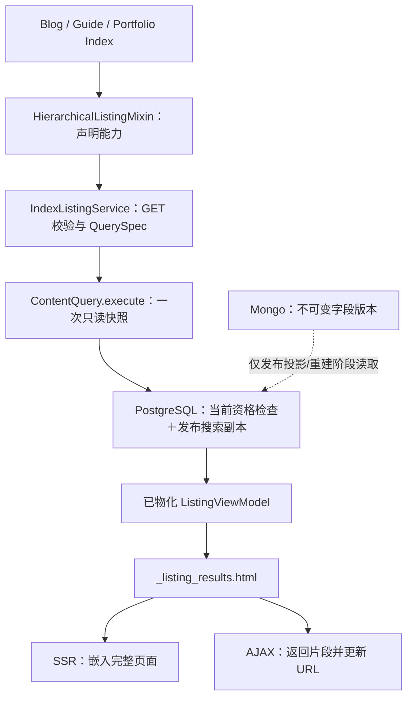

# Wagtail 全站层级列表与多维检索通用框架 RFC

Universal Hierarchical Index Listing & Discovery Framework

| RFC 属性 | 内容 |
|---|---|
| 标识 | MYBLOG-RFC-HIERARCHICAL-LISTING-01 |
| 形式 | Google Engineering Design Doc / RFC 风格：摘要、背景、目标、合同、详细设计、替代方案、风险、实施与验收；不声称 Google 存在统一强制 RFC 模板 |
| 状态 | Reviewed & Approved（经 gemini-4-argon 独立审查，B-01/B-02/B-03 与 A-01~A-04 闭环合并，待用户确认新增决策后实施） |
| 日期 | 2026-11-09 |
| 起草职责 | 架构、查询与展示合同、发布版本隔离、性能边界和验收设计 |
| 当前代码基线 | `main`，`d35eacb56146a88f566d2e2a8ca6c5949e23c19c`；开始起草时工作区干净 |
| 远程 | `origin` 指向 `anc1996/myblog`；本次没有 fetch，不断言远程实时状态 |
| 已核对环境 | WSL2 指定环境包元数据：Wagtail `8.1`、Django `6.1.2`；项目要求 PostgreSQL 18、psycopg `3.3.7` |
| 本次授权 | 只读核对新旧源码、撰写本 RFC；没有应用实现、服务连接、迁移、提交、推送或部署授权 |
| 审查责任 | 下一步由主代理安排 gemini-4-argon；本文不表示该审查已经执行 |

本文的“必须”表示拟实施和验收条件，不表示当前代码已经满足。文中新增接口、文件、字段和示例均为设计，不能直接当作已有 API 调用。

## 1. Executive Summary：提案摘要

在现有 `discovery` 应用内补齐通用列表能力，让各类 Index 页面只声明“列出什么类型、覆盖哪一层、支持哪些专属筛选”，共用参数解析、正式版本查询、权限检查、分页、模板和浏览器交互。

用户已确认的四项产品选择保持不变：

| 已确认项 | 本 RFC 的执行语义 |
|---|---|
| ① A：标题＋正文混合检索，提供仅搜标题开关 | 默认检索已发布标题、简介/摘要和正文文本；`title_only=1` 后，所有搜索阶段均只能命中标题 |
| ② A：默认递归后代，提供包含子栏目开关 | `include_descendants=1` 默认搜索当前栏目全部层级的内容；`0` 只搜直接子内容 |
| ③ A：SARGable 成文日期区间，日期逆序/相关度排序 | 日期来自正式版本 `authored_on`；直接比较日期列；排序规则由统一服务解释 |
| ④ A：首屏 SSR＋AJAX 无刷局部更新双模同构 | 普通 GET 返回完整页面；AJAX 复用相同服务和 `_listing_results.html`；URL 可以分享、刷新和前进后退 |

“包含子栏目”指是否检索子栏目中的文章，不表示把子栏目卡片混入文章结果。子栏目入口如何展示是第 12 节新增决策 D4。

SSR 是服务器先生成完整 HTML；AJAX 是浏览器请求新结果后只替换页面中的一部分。“双模同构”在这里指两种入口共用同一份查询和模板，不指在浏览器重写一个搜索引擎。

核心调用链：



该提案复用已有 `ContentQuery`，不另建与它并行的列表查询引擎。业务 App 不再自行调用 `get_children().specific()` 获取文章卡片，也不自行解释日期、分页和搜索模式。

## 2. Context：现状、证据和痛点

### 2.1 参考项目实际采用了什么

本次只读查看 `../wagtailblog2/wagtailblog3/apps/blog/services/listing.py:923–971`：

- `get_children().live().public()`，或 `BlogPage.objects...child_of(index_page)`，获取直接子节点。
- `title__icontains=filters.search`，只做标题连续子串检索。
- 用业务表日期、栏目日期和 `first_published_at` 的 `Coalesce` 注解生成 `sort_date`，再筛选排序。
- 已有服务抽取、缓存、分页和异步响应设计；不能把旧项目描述成“完全没有服务层或 AJAX”。

直接子节点适合目录浏览，但用户在父栏目搜索时会漏掉更深层文章。标题子串查询不能找出只在正文提到的技术概念，不能直接提供中文分词、受控同义词和统一相关度。业务表与注解表达式的搜索方法，也不适合原样复制到新项目的正式版本搜索副本上。

`icontains` 本身不等于 SQL 注入；Django ORM 会绑定参数。真正的问题是搜索范围与能力有限，以及没有匹配索引时可能扫描大量文本。`Coalesce` 也不是一律禁止，而是不能假定业务表普通日期索引可以支持该注解上的范围过滤。

### 2.2 myblog 已有的基础和仍然存在的缺口

“脱水”是把正文完整内容及其不可变版本保存在 MongoDB，PostgreSQL 页面与 Revision 中保留身份和版本指针。搜索副本保存从正式版本提取的文本和展示信息，可以重建，不决定哪个版本正式发布。

| 当前源码证据 | 已有能力 | 本框架必须补齐的部分 |
|---|---|---|
| `myblog/apps/discovery/contracts.py` 的 `QuerySpec` / `QueryResult` | 类型、Site、栏目范围、日期、标签、游标、统计合同 | 没有标题范围字段；需要明确扩展而非使用不存在的参数 |
| `discovery/models.py` 的 `PublishedSearchDocument` / Chunk / Tag | 正式版本 ID、标题、URL、摘要、日期、专属元数据、正文分块和 GIN 词向量索引 | 没有原句子串的 trigram 索引；多索引代次选择需要明确 |
| `discovery/query.py:80–155` | 统一入口、范围筛选、日期比较 | root 副本缺失时跳过范围过滤；`AccessContext` 未真正用于资格检查；`extra_filters` 没有执行 |
| `discovery/query.py:92–100` | 尝试开启只读可重复读事务 | 嵌套事务直接跳过设置；设置失败只记日志，不能据此声称始终单快照 |
| `discovery/query.py:296–350` | 搜索等级、分页、统计 | 全量命中 ID 和文档在 Python 中排序；评分未落实权重；有关键词时日期方向计算与注释不一致，须用行为测试核实并修正 |
| `discovery/query.py:175–193` | 无关键词列表 | 标签逐条读取有 N+1 风险；不得只优化搜索分支 |
| `blog/models.py:110–127` | 面包屑和直接子项 | 子类型对象列表，尚未接入通用搜索与分页 |
| `guides/models.py:159–177` | Topic、Difficulty 的 Python 列表筛选 | 只查直接子项；模板没有使用筛选后的 `guides` |
| `guides/templates/guides/guide_index_page.html:16` | 卡片 HTML | 又调用 `page.get_children.live.specific`，绕过 context 中筛选 |
| `portfolio/models.py:200–214` | `PortfolioIndexPage` 模型 | 当前没有对应的 Index 模板，需要新增，不能报告为只改一个声明 |
| `discovery/feeds.py`、`content_lifecycle/public_access.py` | 订阅/归档已有公开资格检查经验 | 可以抽取规则，不能直接断言现有批量 Python 辅助函数已满足大规模列表、缺失路径及所有祖先边界 |

既有 adapter 的真实 `type_key` 分别为 `blog_page`、`guide`、`project`；公开类型别名 `blog` 不等于内部 `blog_page`。示例和白名单必须使用正确身份。

### 2.3 优势与成本都要讲清

已有发布投影可以一次提取正文，随后大量列表请求只访问 PostgreSQL。这样能够避免每页几十篇文章分别读取 MongoDB，也能阻止草稿日期、标签或标题进入正式结果。

搜索副本仍占 PostgreSQL 空间，全文分块与 GIN 也有写入和存储成本。列表零 MongoDB 访问不等于“PostgreSQL 完全不存正文文本”，也不等于一千万篇文章下精确计数天然很快。

## 3. Goals / Non-goals：目标、边界与成功标准

### 3.1 目标

1. Blog、Guide、Portfolio 使用一套查询与展示合同；以后注册新类型，不修改公共服务中的业务类型分支。
2. 列表内容、总数、筛选统计、栏目入口和分页标记由同一次数据库快照生成。
3. 列表请求路径对 MongoDB 和 RustFS 的网络访问均为零。正文详情和发布投影仍按既有合同处理。
4. 正式版本、Site、树范围、私有权限、回收状态和类型白名单共同限制所有结果，包括统计和高亮。
5. 浏览器禁用 JavaScript 时能筛选和翻页；启用时局部更新，并正确处理历史记录与请求乱序。
6. 把已存在的底层缺陷列为接入前置条件，不用页面端筛选掩盖错误。

### 3.2 不在本次设计范围

- 不升级 Django/Wagtail/PostgreSQL，不重构目录与 app label。
- 不改变 Page ID、`document_uuid`、迁移身份、Revision JSON 或 MongoDB 字段版本格式。
- 不新建 Elasticsearch，不把 Redis 变成结果正确性的依据。
- 不设计后台私有内容检索、不允许公共列表通过 staff 登录自动显示受限页面。
- 不增加跨栏目语义推荐、任意 ORM 表达式查询或通用低代码筛选平台。
- 本文给出实施步骤，不表示已获得代码实施、建索引或服务访问授权。

### 3.3 验收出口

只有第 10 节必测项通过、独立审查阻断项关闭、四个新增决策确定后，才可称框架具备接入条件。只通过普通单元测试，不能宣称真实 PostgreSQL 并发和性能已经通过。

## 4. Architecture：分层和代码归属

保留当前 `myblog/apps/*` 物理目录与 `from discovery...` 顶层导入方式。新增普通 Python Mixin，不新增多表继承模型或数据库表来表示 Index。

```text
myblog/apps/discovery/
  contracts.py                 现有 QuerySpec / QueryResult 的兼容扩展
  query.py                     统一搜索入口，组织同快照执行
  eligibility.py               新增：SQL 合法候选集与当前状态核验
  query_filters.py             新增：已注册筛选执行器
  ranking.py                   新增：统一等级与评分排序
  listing/
    __init__.py
    contracts.py               ListingPolicy / ListingViewModel 等
    params.py                  GET → 规范化筛选条件
    service.py                 IndexListingService
    mixins.py                  HierarchicalListingMixin
    rendering.py               SSR / 片段响应与错误
  templates/discovery/listing/
    index_base.html
    _listing_filters.html
    _listing_results.html
    _listing_card.html
    _listing_pagination.html
  static/discovery/js/
    listing_controller.js

myblog/apps/guides/listing.py   Guide 专属筛选定义与注册
myblog/apps/blog/models.py     页面接入声明
myblog/apps/guides/models.py   页面接入声明
myblog/apps/portfolio/models.py
tests/test_listing_*.py        新增定向测试
```

以上为建议文件边界。可以按实际复杂度合并小文件，但职责与单一查询入口不能改变。公共层只认识 type key、字段名和注册协议，严禁导入 `blog.models`、`guides.models` 或 `portfolio.models`。

### 4.1 模型层：HierarchicalListingMixin

Mixin 是可复用的 Python 行为组合。它位于现有 `CustomBasePage` 前面，使用协作式 `super()`，保留原有发布、回收和交付守卫。

`ListingPolicy` 为冻结数据类，最少声明：

| 配置 | 合同 |
|---|---|
| `type_keys` | 必填且非空；只允许已注册内容类型；未配置属于部署错误，不能解释为全站所有类型 |
| `descendants_default` | 默认 `True`；GET 开关转换为 `tree_scope` |
| `descendants_toggle` | 默认 `True`；未来业务可固定范围，但不能扩大父级 policy |
| `filter_keys` | 专属筛选器注册键；空元组表示没有专属筛选 |
| `facet_keys` | 允许显示的统计项；不直接采用用户传入的 facets 字段 |
| `navigation_type_keys` | 可作为直接子栏目入口的 Index 类型，非文章内容白名单 |
| `page_size` / `max_page_size` | 默认 20 / 50；底层也执行硬上限 |

Mixin 提供 `get_listing_policy(request)` 和 `get_listing_extra_context(view_model)` 扩展钩子。后者只能基于已物化数据补充展示信息，不能再次查询正文或缩小已分页结果。

业务若需要新的查询条件，必须注册筛选定义。不能重写 `get_context()` 后在 Python 中再删结果，否则总数、统计和分页会不一致。确需扩展时必须调用 `super()`，且不得重建列表。

`parent_page_types` / `subpage_types` 继续决定编辑器中可以怎样建树；`type_keys` 决定本列表展示什么。二者职责不同，接入 Portfolio 不自动允许它嵌套栏目。

### 4.2 服务层：IndexListingService

服务对外提供 `build(index_page, request) -> ListingViewModel`，按以下顺序执行：

1. 读取并校验 policy；确定请求入口对应的 Index ID。
2. 从请求路由解析 Site；不存在合法 Site 时拒绝，不能用 `site_id=None` 回退到全站。
3. 解析 GET 为冻结的 `ListingFilters`，计算规范化 URL 与筛选指纹。
4. 组装一个 `QuerySpec` 和 `AccessContext(mode=PUBLIC)`；Site、root、类型上限全部由服务端生成。
5. 只调用一次 `ContentQuery.execute(spec, context)`。
6. 以返回的 DTO 生成 `ListingViewModel`，构造分页链接和已选筛选状态。

DTO 是只携带数据的返回对象。这里的 DTO 必须是字符串、日期、数字和列表等已取出的数据，不携带延迟执行的 QuerySet、Page 实例或可触发网络访问的属性。

示意映射：

```python
spec = QuerySpec(
    q=filters.q or None,
    type_keys=list(policy.type_keys),
    site_id=site_id,
    root_page_id=index_page.pk,
    tree_scope="descendants" if filters.include_descendants else "children",
    include_root=False,
    search_fields="title" if filters.title_only else "all",
    date_from=filters.date_from,
    date_to=filters.date_to,
    sort=filters.effective_sort,
    extra_filters=filters.extra_filters,
    facets=list(policy.facet_keys),
    include_listing_scope=True,
    page_size=filters.page_size,
    cursor=filters.cursor,
    navigation_cursor=filters.navigation_cursor,
)
result = ContentQuery.execute(spec, AccessContext(mode=AccessMode.PUBLIC))
```

此代码省略导入、标签和已有模式控制参数，仅解释合同；其中 `search_fields`、`include_listing_scope`、`navigation_cursor` 是本 RFC 待新增字段，当前代码直接执行会报错。

一次 `execute()` 不等于一条 SQL；可以执行多条查询，但候选集、模式判断、排序、总数、统计和输出必须处于同一快照，不能每个用途调用一次服务。

### 4.3 展现层：ListingViewModel

建议字段：

| 字段 | 用途 |
|---|---|
| `filters`、`errors` | 规范化选项和字段错误 |
| `items`、`total_count`、`facets` | 同一个 `QueryResult` 中的文章结果与统计 |
| `scope` | 正式栏目标题、摘要、公开 URL、面包屑和直接子栏目入口 |
| `next_url`、`previous_url` | 服务端生成、保留全部有效筛选的完整导航 URL |
| `canonical_url` | 当前规范化的可分享 URL；这里指地址规范化，不强行规定所有筛选页的 SEO canonical 标签 |
| `cursor_reset`、`messages` | 内容改变导致重置、搜索展开等可见提示 |
| `corpus_epoch`、`query_fingerprint` | 数据版本和规范化筛选身份 |
| `search_policy` | 是否可手动展开分词结果；由全体命中数判定，不能从本页 A 模式条数猜测 |

`SearchResultItem` 已有 `column_metadata`，本期应从发布副本 `extra_data` 中按允许字段填充。Guide 的 Topic 名称与难度从这里显示，不回查 GuidePage。

`QueryResult` 增加有默认值的 `listing_scope`、`previous_cursor`、`search_policy` 等字段；`QuerySpec` 增加 `search_fields="all"`、`include_listing_scope=False`、`navigation_cursor=None`。其他调用方保持默认行为。只有 Index 服务打开栏目展示数据的返回开关。`listing_scope` 同时返回导航总数及下一批导航的游标，不把它们混入文章计数或文章游标。

## 5. API Contracts：参数和扩展协议

### 5.1 统一 HTTP GET 参数

示例：

```text
/guides/?q=PostgreSQL&title_only=0&include_descendants=1
  &date_from=2026-01-01&date_to=2026-11-09
  &sort=relevance&topic=database&difficulty=intermediate&page_size=20
```

实际 URL 为一行。前端不能把内部 type key、数据库字段、`site_id` 或 root 路径作为可自由编辑条件。

| 参数 | 规则与默认值 |
|---|---|
| `q` | 去首尾空白并做统一归一化；原始值与归一化值均最多 200 字符；无内容为 FILTER |
| `title_only` | 只接受 `0` / `1`；默认 `0` |
| `include_descendants` | 只接受 `0` / `1`；默认 `1` |
| `date_from`、`date_to` | 严格 ISO `YYYY-MM-DD`，可单侧；闭区间，起日不得晚于止日 |
| `sort` | 公共列表只开放 `authored_desc` / `relevance`；有关键词默认 relevance，否则 authored_desc |
| `tag` | 可重复正整数，去重且最多 20 个；未提供为不限制 |
| `tag_mode` | `ANY` / `ALL`，默认 ANY；维度间 AND，单维度的逻辑须明确 |
| `topic` | Guide 提供的 slug，最多 100 字符；映射到注册执行器 `topic_slug` |
| `difficulty` | Guide 定义的 `beginner` / `intermediate` / `advanced` |
| `page_size` | 默认 20，正整数；超过 50 截到 50，响应和表单显示有效值；非整数或小于 1 返回字段错误 |
| `cursor` | 有签名且有长度上限的 opaque token，最多 2048 字符；用户不应解析它 |
| `navigation_cursor` | D4-A 下可选的子栏目导航游标，单值、最多 2048 字符；与文章 cursor 独立校验 |
| `secondary`、`expand` | 延续 `none/words`、`auto/off/on`；不得借搜索展开绕开树或标题范围 |

单值参数重复提交返回 400；`tag` 是显式例外。未知参数返回 400，避免用户误以为条件已生效。兼容别名必须登记后处理，不能悄悄忽略拼错参数。

原有 `/api/v1/search/` 使用 `query`、`type`、`year/month` 等协议，本期不擅自改掉。Index 新入口使用上表；如复用旧参数解析器，应在适配边界显式转换。旧 API 的缓存、限流和游标辅助行为也不能直接假定适合新入口。

不合法但语法正确的 Topic slug 返回空结果，不忽略这个条件。难度不在 choices 内返回 400。不能用全局 `GuideTopic.objects.all()` 向公众暴露没有任何合法发布内容的主题。

HTML checkbox 未勾选时不会提交值，但本框架的递归默认值为真，因此不能把“参数缺失”当作取消勾选。通用模板使用唯一的 `0/1` select，或在未选中时启用值为 `0` 的隐藏项、选中时禁用隐藏项；每个参数最终只提交一次。

### 5.2 专属筛选器注册合同

`TypeAdapter.allowed_filters` 当前只是声明，不意味着底层已经会执行。新增 `ListingFilterDefinition`，由各业务 App 在 `AppConfig.ready()` 内注册，注册过程禁止数据库和网络 IO。

每个定义至少具备：

- `key` 与 `query_param`：稳定注册键和外部参数名。
- `type_keys`：只允许应用到哪些内容类型。
- `parse(raw)`：纯函数校验并输出有界值。
- `apply(qs, value)`：只作用于发布副本 QuerySet，不能提高访问资格。
- `facet(qs)`：只对传入的合法命中集分组，不能改用全局业务表。
- `metadata_keys`：可以输出的发布展示字段。

Guide 示例：`guides.topic` 允许 `guide` 类型，使用固定 ORM 路径 `extra_data__topic_slug`；`guides.difficulty` 使用 `extra_data__difficulty`。两者同时选中时为 AND。

`extra_filters` 只能容纳注册后校验的规范字段和值。不能把用户传来的字典直接交给 `filter(**request.GET)`，不能让用户决定 `__lookup`、SQL 列名、ORDER BY 表达式、JSON 路径或正则表达式。

混合类型 Index 只有在所有适用类型都明确声明语义后才能开放专属筛选；没有 Topic 字段的类型不能在选择 Topic 时“自动放行”。

### 5.3 三种业务页的接入声明

以下分别为 6、8、6 行声明。只展示接入部分，原模型字段、panels、Meta 和编辑器建树约束均需保留；所需类和注册项完成后才可运行。新类型仍需实现既有发布 TypeAdapter，不能靠这几行自动提取正文。

```python
class BlogIndexPage(HierarchicalListingMixin, CustomBasePage):
    template = "blog/blog_index_page.html"
    listing_policy = ListingPolicy(
        type_keys=("blog_page",),
        navigation_type_keys=("blog_index",),
    )
```

```python
class GuideIndexPage(HierarchicalListingMixin, CustomBasePage):
    template = "guides/guide_index_page.html"
    listing_policy = ListingPolicy(
        type_keys=("guide",),
        navigation_type_keys=("guide_index",),
        filter_keys=("guides.topic", "guides.difficulty"),
        facet_keys=("topics", "difficulties", "tags"),
    )
```

```python
class PortfolioIndexPage(HierarchicalListingMixin, CustomBasePage):
    template = "portfolio/portfolio_index_page.html"
    listing_policy = ListingPolicy(
        type_keys=("project",),
        navigation_type_keys=(),
    )
```

通用默认值负责递归、标题开关、日期和排序；Guide 插件负责专属字段。Portfolio 仍只允许当前建树规则中的直接 ProjectPage，递归默认开启不会凭空增加后代。

业务模板继承 `discovery/listing/index_base.html`，只改卡片展示 block 或服务端配置的卡片模板。模板选择来自代码白名单，不来自 GET。新增页面不能靠复制整份结果模板接入。

## 6. Query Design：单快照、资格、搜索与排序

### 6.1 一次可重复读快照

使用主 PostgreSQL 连接开启最外层 `REPEATABLE READ READ ONLY` 事务。必须在事务内第一条业务 SELECT 前设置隔离级别，再读取 root、Epoch 和候选数据。

当前代码的“已在 atomic 就跳过设置”和“设置失败后继续查询”都不能作为验收实现。建议查询内部使用明确的最外层事务入口；如遇调用方已经开启事务，仅允许经同一快照管理器认证的嵌套调用，否则拒绝并报告配置错误。不能把普通 savepoint 当作新快照；若未来启用 `ATOMIC_REQUESTS`，须先调整入口。

在事务内完成 root / Site 复核、资格检查、匹配、计数、统计、已分页结果和栏目数据的物化。提交后模板只能消费 DTO，不允许延迟查询标签、Page 或 facet QuerySet。

快照保证同一响应内部一致，不代表查询进行到一半时撤销权限能够追溯修改已经读取的数据。本期采用快照开始时的当前状态；不得声称提供跨响应的严格实时撤回或可撤销已下载内容。

### 6.2 合法候选集 E：先限制，再搜索

`eligibility.py` 必须在同一快照中给出唯一的候选集 E：

1. `site_id` 必须匹配路由 Site，root 必须属于该 Site 的根节点范围。
2. root ID 对应实际存在、可公开访问的当前栏目；树路径、depth 从当前 PostgreSQL Page 读取，不信任 URL 或旧副本路径。
3. 内容类型位于 policy 白名单，副本 `is_live=True`、`is_recycled=False`。
4. 关联当前 Page 必须存在、`live=True`、`live_revision_id` 非空、`alias_of_id IS NULL`。
5. 副本 `effective_revision_id` 必须等于当前 `live_revision_id`，`document_uuid` 与业务页一致；副本路径、depth 必须与当前树状态一致。
6. 自身及祖先不得处于回收或 restoring 状态，不得存在密码、登录或组权限限制；PUBLIC 不因登录管理员而放宽。
7. 当前发布代次只能选一个。第一版固定查询现有生产者使用的 `index_generation=1`；多代重建切换另设批准合同，不查询所有代次后临时去重。
8. 再交集类型、树范围、标签、成文日期和专属字段，得到搜索候选集。

通过 PostgreSQL 标量查询、`Exists` / 子查询和已注册业务模型的轻量字段完成当前状态检查，不实例化每篇业务页，不反向导入业务模型。`document_uuid` 所在的业务子表由 adapter 的 `model_label` 解析，注册信息不足则拒绝该类型。

路径缺失、祖先元数据不完整或资格检查报错时必须拒绝相应结果，不能忽略异常后放行。Wagtail 技术树根不是实际对外内容页；祖先 `live` 判定必须区分技术树根与实际栏目，避免把通常不发布的技术根误判为全站不可见。此边界须有专门测试。

现有 `get_public_blocked_page_ids()` 有可复用的规则，但会遍历候选记录、具体子类型，且有吞异常分支。本期先抽取和完善共同规则，再形成可在分页前执行的 SQL 资格过滤；不能先分页、渲染或计算 count 后调用它补删。

**root 失效必须收紧范围：** 当前栏目不存在或不公开返回 404；栏目本身合法但发布副本尚未就绪，返回可重试 503，不能退回跨栏目搜索。有效栏目内没有匹配内容返回 200 空结果。

当前 Page.path 用于树结构，发布副本用于文章标题、摘要、日期、标签和专属字段。Page 行可能含草稿中的标题，不能用它覆盖正式卡片标题。栏目头部和面包屑也应取核验过的发布副本，不直接把当前 Index 实例的草稿 intro 输出到公网。

### 6.3 树范围规则

Treebeard 用固定宽度分段的 `path` 表示树位置，不新增自维护 `parent_id`：

- 后代：`path` 以前缀 root.path 开头且 `depth > root.depth`。
- 直接子项：相同前缀且 `depth = root.depth + 1`。
- 两种情况均 `include_root=False`，内容白名单默认不含 Index。
- 子栏目导航另外使用 `navigation_type_keys` 和直接子层级，不参与文章命中数。
- 节点移动后，受影响子树的 path、URL、Site 必须更新投影并递增 Epoch；只重投影被移动的父节点不够。

实际资格范围基于当前 Page.path，即使副本过期也不会返回其他栏目内容；过期副本按 6.2 拒绝，等待投影修复。

### 6.4 标题开关必须贯穿所有搜索阶段

扩展 `QuerySpec.search_fields`，只接受 `"all"` / `"title"`。`all` 对应 adapter 输出的 title、intro、summary、body；`title` 对应 `PublishedSearchChunk.field_name="title"`。

同一个字段范围同时用于：

1. 模式 A：归一化连续原句包含。
2. 模式 B：中文分词后的词组 AND 命中。
3. 模式 C：受控同义词扩展。
4. 相关度计算和命中高亮。

保留 `SEARCH-MODE-02`：A≥5 仅显示 A；A 为 1–4 条时默认只显示 A，可手动展开 B；A=0 自动 B；B<10 且未关闭扩展时才按受控词库补 C。不能把本文四项产品选项的“A”与搜索模式 A 混淆。

多个关键词可以分布在同一篇文章不同分块中，因此 B 模式按 document 维度求 AND，不能强迫所有词出现在同一个 chunk。每一轮的标题范围仍必须保持。

高亮只能来自实际命中的字段，不能固定取第一块。仅搜标题时绝不显示正文命中高亮；普通卡片的正式摘要仍可以展示。高亮输出转义文本和命中区间，由模板插入固定 `<mark>`，不接受存储或用户输入的 HTML。

### 6.5 SARGable 成文日期

SARGable 指把条件写成数据库容易利用索引定位范围的形式。用户区间是 DateField 上的闭区间：

```sql
WHERE authored_on >= %s AND authored_on <= %s
```

两个参数分别为起日和止日。单侧条件只生成相应一边；不对日期列套 `EXTRACT`、`DATE_TRUNC`、字符串格式化或类型转换。

如果兼容 year/month，在参数层先计算月份或年度起点与下一周期起点：

```sql
WHERE authored_on >= %s AND authored_on < %s
```

不把 `authored_on__year/month` 直接透传到本列表查询。不允许“只有 month 没有 year”的隐式全历史扫描；必须明确年份。聚合 SELECT/GROUP BY 中按月截断可以保留，禁止的是用列函数代替范围 WHERE。

不能把未来 `authored_on` 当作未发布状态。是否可见由当前发布状态与 Revision 决定；本列表不新增 `authored_on <= today` 规则。现有 Feed/Archive 的该额外规则不在本 RFC 内修改，也不能不加说明复制进列表。

PostgreSQL 优化器可以在小表或宽范围时选顺序扫描。因此验收是 SQL 形态正确、索引匹配且代表性大数据的选择性查询有合理执行计划，不要求所有查询永远出现 Index Scan。

### 6.6 排序与分页前聚合

保留搜索等级的明确优先级，等级不能被一个很高的浮点分数替代：

| 场景 | 稳定 ORDER BY |
|---|---|
| 无关键词 | `authored_on DESC, page_id DESC` |
| 有关键词且 relevance | `match_tier ASC, score_key DESC, authored_on DESC, page_id DESC` |
| 有关键词且 authored_desc | `match_tier ASC, authored_on DESC, page_id DESC` |

日期排序界面文案为“按匹配等级，再按成文日期从新到旧”，避免误以为会把模式 C 的新文排在模式 A 前。该规则延续既有原句优先合同。若以后要求跨等级纯日期排序，必须另行批准。

同等级评分使用现有 adapter 的 `weight_profile`，结合词覆盖、词距、技术词保护和长度归一化。以不重叠词向量评分，保留词位；按文档先聚合，再排序和分页，不能因一个页面有多个 chunk/tag 而重复输出。`score_key` 为确定性的整数，避免游标依赖不稳定的浮点序列化。

不能保持当前“取全量命中 ID → 拉所有全文块 → Python 排序 → 最后切页”的路径。应把匹配等级、文档去重、评分、排序和 LIMIT 放在 SQL 内；仅为已分页项目批量取 tags 和必要高亮片段。facet 对全体合法命中集计算，不只统计当前页。

## 7. Presentation：SSR 与 AJAX 双模同构

### 7.1 同一个地址、同一份结果模板

完整页结构为栏目头部、GET 筛选表单和结果容器。初始响应在容器中 include `discovery/listing/_listing_results.html`；片段包含列表、总数、分页、动态筛选选项和必要提示。

初次带查询参数打开、刷新、分享地址、无 JavaScript 提交表单都走完整 SSR。AJAX 请求同一个地址，通过请求头选择响应形态；不得发起第二个独立搜索 API 再拼出另一套卡片。

按新增决策 D3-A 推荐：

```text
普通请求：Accept: text/html
增强请求：Accept: application/json
          X-Listing-Response: fragment-v1
```

增强响应为 `application/json`：

```json
{
  "version": 1,
  "html": "<section data-listing-results>...</section>",
  "canonical_url": "/guides/?q=PostgreSQL&sort=relevance",
  "total_count": 24,
  "corpus_epoch": 18,
  "cursor_reset": false,
  "messages": []
}
```

该 HTML 由同一服务端片段模板生成；`total_count` 等重复字段必须来自同一个 ViewModel。响应不包含正文 blocks、Mongo 指针或独立的第二份卡片 JSON 数据源。

Wagtail 8.1 的 `Page.get_template()` 已认识 `X-Requested-With: XMLHttpRequest` 并可选择 `ajax_template`；但这个机制本身不提供 JSON 包装、Vary、参数校验和历史记录，不能直接当作完整方案。

Mixin 的 `serve()` 必须先走 `super().serve()` 保留 `CustomBasePage` 守卫，取得合法 `TemplateResponse` 的 context。普通请求按原响应交付；增强请求使用该 context 渲染结果片段并生成 JSON，不再调用一次 `get_context()`。如上游返回重定向或错误，不能强行替换成成功 JSON。统一渲染辅助函数负责预期参数错误与响应头。

`get_context()` 在请求内缓存单个 ViewModel，避免框架重复访问触发第二次查询。所有公开响应的 `Vary` 至少包含 `Accept, X-Listing-Response, X-Requested-With`；新增 Vary 合并已有值，不覆盖它。

第一版返回 `Cache-Control: no-store`，完整页与片段均不存公共结果缓存。避免直接套用现有仅按原始参数和 Epoch 的 API 缓存。后续若引入缓存，必须另验 Site、root、规范化条件、模板/策略版本、权限资格和 Epoch 的完整身份及失效机制。

### 7.2 listing_controller.js 的状态机

浏览器只管理交互和地址，不执行过滤、排序或权限判断：

1. 初始化时保留可用的原生 form 和 `<a href>`；以当前 URL 写入一次 `replaceState`。
2. 拦截有效的同源表单提交和本列表分页链接；Ctrl/Meta、新窗口、外链、下载链接保持原行为。
3. 关键词输入防抖建议 300ms，监听中文输入法 composition 状态；组合输入未结束不发请求。
4. 条件变化先清除 cursor；翻页保留全部条件。`secondary` 手动展开也必须清除 cursor。
5. 每次请求递增序号，使用 `AbortController` 取消旧请求；回包仅在序号仍为最新时生效。
6. 校验状态码、Content-Type 和响应版本后替换结果容器；只执行服务端受控 HTML，不插入脚本。
7. 成功后同步规范化表单值、结果数、提示和 URL，再 `history.pushState`；连续输入搜索使用 `replaceState`，避免每个字生成一条历史。
8. `popstate` 从当前地址恢复完整筛选条件并请求，不调用 pushState；恢复该历史项已保存的滚动位置。
9. 内容变化重置游标时使用服务器首页 URL，显示提示，并用 replaceState 替换失效 URL。
10. 请求中保留旧结果并标识 `aria-busy`；完成后通过 `aria-live` 宣布结果数，分页后将焦点移到结果标题，输入时不抢焦点。

`pushState` 的目标必须为服务端给出的同源、合法栏目地址；不接受外部跳转 URL。前端需要 AbortController 和序号双重检查，因为取消请求不能证明服务器没有执行旧请求。

### 7.3 错误与降级合同

| 情况 | SSR | AJAX / 浏览器行为 |
|---|---|---|
| 合法但无命中 | 200，空结果和调整条件提示 | 替换为空结果；URL 正常更新 |
| 参数格式错误 | 400，保留表单与字段错误，不调用 execute | 400 JSON `errors`，保留旧结果，标记它对应旧条件，不写成功历史 |
| root 不存在/不公开 | 404，不展示栏目标题或子项 | 404，清除旧结果和旧栏目摘要，展示通用不可用提示 |
| 合法 root 缺少可用副本 | 503＋Retry-After | 显示暂不可用；不回查 Mongo 或跨栏目搜索 |
| 资格/数据库检查失败 | 503，通用错误 | 清除可能失效的旧结果；允许用户显式重试 |
| 超过请求速率 | 429＋Retry-After | 保留界面并按提示等待，不自动形成重试风暴 |
| 网络断开或响应协议错误 | 原生浏览器错误处理 | 保留旧内容并明确“更新失败”；用户可点击普通 GET 链接完整打开 |
| 过期/条件不匹配游标 | 200 首页结果，轻提示 | 更新为首页结果与规范化 URL |
| 恶意格式/签名错误游标 | 400 | 不解释用户伪造的分页偏移 |

任何降级都必须走相同公开访问规则。页面关闭 JavaScript 或 AJAX 出错，不得切换成直接读取业务表和正文的兼容路径。

## 8. Performance and Security：性能与安全红线

### 8.1 列表零 MongoDB 访问

**LIST-01：** 列表 title / summary / authored_on / tags / url / Topic / Difficulty 来自 PostgreSQL 发布副本及其关联 Tag/Chunk；PostgreSQL Page、Site、回收和权限元数据只用于资格与树核验。

列表请求不得调用 `hydrate_from_mongo()`、`Revision.as_object()`、TypeAdapter.extract 或 StreamField 正文渲染。摘要缺失使用空串或固定占位，不临时读正文补齐。不调用 RustFS 下载对象或动态生成依赖远程对象读取的封面。

“列表零 MongoDB 延迟”严格表示这个请求调用链的 MongoDB 网络调用数为零；不包括此前发布时的内容提取，也不保证 PostgreSQL 查询耗时为零。Index 模板、面包屑、全局导航、卡片和中间件均应纳入测量，不能只测 `execute()`。

### 8.2 索引与查询计划

**LIST-02：** 日期区间遵循 6.5。候选索引按真实查询选择性评估，例如：

```sql
CREATE INDEX disc_listing_site_date_idx
ON discovery_publishedsearchdocument
    (site_id, type_key, authored_on DESC, page_id DESC)
WHERE is_live AND NOT is_recycled AND index_generation = 1;
```

这是候选迁移设计，不是本次执行命令，也不是所有筛选的万能索引。树 path 的前缀条件要核查数据库 collation、Django 生成 SQL 与 `varchar_pattern_ops` 是否匹配；不能只凭模型上的 `db_index=True` 声称前缀扫描一定用索引。

**LIST-03：** 保留 `PublishedSearchChunk.search_vector` 的 GIN 倒排索引。它按词元定位全文命中，不会自动加速任意 `%原句%`：

- 模式 A 原句包含另需经批准启用 `pg_trgm`，为实际查询表达式创建匹配的 GIN trigram 索引。
- `normalized_text` 已归一化时优先使用与索引表达式一致的包含操作；若 ORM 实际生成 `UPPER(column) LIKE UPPER(%s)`，普通列 trigram 索引不能被假定适用，须改表达式或对应建立表达式索引。
- 不把 `search_vector @@ query OR normalized_text ILIKE '%term%'` 当作必然走 GIN 的保证。需要保留短词/技术词的补充语义时，拆成有界、去重的候选分支并验计划。
- 中文分词在投影端与查询端采用一致归一化、技术词保护和 simple 配置；不能仅写“用了 PostgreSQL 全文检索”就假定原生配置会自动正确切中文。
- 短于三字符的查询可能没有可用 trigram。保留已批准搜索语义，用候选范围、并发限制和 statement timeout 控制成本，不能为了性能暗中禁止所有短中文搜索。

Guide 的 `extra_data__topic_slug` / `difficulty` 可按实际 ORM 表达式建立 B-tree 表达式索引，必要时与 Site/类型组合。普通 JSONField 或给整个 JSON 随便加 GIN 不等于等值筛选已经得到合适计划。

新增扩展、索引迁移、索引重建属于后续单独授权。大表并发建索引需要非原子迁移与失败索引清理方案；不能混进普通请求启动逻辑。

### 8.3 查询成本与容量

**LIST-04：** 不得按文章数发查询。已分页结果批量取标签；正文分块只读取高亮所需片段。关闭前不再执行懒查询。

**LIST-05：** 精确总数和 facet 必须保留，但不代表成本恒定。推荐首轮测试数据为 10 万条文档、每文多块、多个栏目深度、真实中文分布，并逐步扩大。报告冷/热缓存、并发数、数据库硬件和索引大小。

拟定初始 SLO：在约定测试环境、10 并发下，已索引的常见筛选服务端 P95 ≤500ms；交互请求数据库超时上限 2s。该数值为待验证目标，未实测，不是保证。若宽范围精确统计无法达标，先优化 SQL 与索引，再由用户批准同步/异步统计的合同变化，不能悄悄改成估算或只计当前页。

### 8.4 防刷、输入和输出安全

**LIST-06：** 服务入口和底层双重限制 page_size≤50。QuerySpec 非 HTTP 调用也必须受枚举、类型白名单、日期和分页校验约束。

推荐初值：每 IP 60 次/分钟、每 Site 同时执行最多 10 个列表查询；生产按容量调整。只有受信代理链可提供真实 IP，不能信任任意 `X-Forwarded-For`。限制 GET 查询串最多 8KiB、解析词元最多 16 个、同义词每组最多 4 个且总数最多 64。超出返回明确错误，不能截断后假装完整搜索。

Redis 可用于令牌计数，但失效时降为进程内保守限额和有限执行槽，不能因缓存故障绕过 SQL 资格检查。多进程本地限额只是降级措施，不等于全站精确计数。

**LIST-07：** ORM 参数绑定、固定排序映射、固定查询路径和注册器白名单共同防注入。不允许原样拼接 q、sort、Topic、JSON key 或 cursor 到 SQL。`raw SQL` 如确有必要，所有值必须绑定，结构只能来自代码常量。

**LIST-08：** title、summary、标签和 Topic label 默认 HTML 转义；URL 只允许合法公开路径/允许站点 URL，拒绝 `javascript:` 和协议相对外链伪装。不对用户输入或摘要调用 `mark_safe`。AJAX 请求头只选响应格式，不是身份认证或权限凭据。

**LIST-09：** 私有、草稿、回收和 restoring 页面不能出现在结果、精确数量、facet 标签、导航或高亮中。不能以“链接点不开”作为列表已经安全的证明。

## 9. Consistency：发布、幂等、锁顺序与补偿

### 9.1 哪个系统负责什么

| 系统 | 责任 |
|---|---|
| PostgreSQL / Wagtail | 当前发布 Revision、公开权限、页面树和回收状态的判断依据 |
| MongoDB | 正文等字段的不可变版本；列表不直接访问 |
| PublishedSearchDocument / Chunk / Tag | 正式版本的可重建搜索与展示副本，不能反向决定页面正式发布 |
| Redis | 限流或未来缓存辅助；缺失不能改变资格结论 |
| RustFS / S3 | 对象存储和受控媒体交付；列表不做远程对象读写 |

### 9.2 投影一致性

投影只能从核验过的正式 `live_revision` 提取数据，审批发布必须使用批准的那个 Revision，不能取“最新草稿”。列表用 `effective_revision_id` 与当前指针核验，投影落后时宁可暂时少一项，不能展示过时或未批准内容。

提取 MongoDB 版本可以在锁外准备，但写入投影时必须重新核验 Page、Revision、UUID 和代次；指针变化则放弃旧任务并重试。幂等身份至少包含 `(page_id, effective_revision_id, index_generation, extractor_version)`；旧任务不能覆盖新发布或下架状态。

文章副本、chunks、tags 的替换和 Epoch 递增必须在同一个 SQL 事务提交。下架、回收、恢复、权限、Site、树移动和实际参与过滤的专属字段变动，都要使相应游标失效。仅递增 Epoch 不会自动修复旧 URL、旧 path 或旧 Topic 名称。

Guide 当前副本有 Topic slug/name，没有稳定 Topic ID。第一版将它们定义为随文章发布的展示快照；草稿修改关联、难度和标签不影响旧正式版本。Topic 目录改名后，不得只把筛选下拉更新成新 slug，却留下旧副本。需要以原发布 Revision 重投影受影响内容；未来如要求 Topic 重命名即时联动，应另增稳定标识和明确的公共分类同步合同。

### 9.3 保留统一写锁顺序

沿用项目已批准的写入顺序，不为列表另建一套锁：

```text
transaction.atomic
→ SET LOCAL lock_timeout = '3s'
→ ContentMutationGuard(global) FOR UPDATE
→ 所有参与的 Page 按主键升序 FOR UPDATE
→ 工作流/Revision、业务子表、媒体及引用（按原合同稳定顺序）
→ 搜索投影 / Outbox / 操作回执
→ ContentDiscoveryEpoch(global) FOR UPDATE
→ COMMIT
```

Outbox 是与业务数据一起保存的待处理任务表。新投影任务必须复用已有任务和补偿机制，或在实施合同中明确扩展，不能只在日志里写“稍后重试”却没有可发现的待办。

列表读取本身不取得全局排他锁、不执行 `select_for_update()`，不在 GET 中创建 Epoch 或补投影。读事务的 statement timeout 与写事务的 lock_timeout 是不同限制。

现有写入口是否全覆盖该顺序、是否完整覆盖子树移动和发布信号失败，本次只根据源码识别风险，未证明已经满足。它们是接入前检查项；若需修改高风险生命周期代码，由主代理单独限定文件归属和批准合同，实施者不得再作为同一高风险改动的独立审查者。

### 9.4 失败与对账

- 投影失败：不从列表请求读取 Mongo 临时补齐；保留可重试任务和错误，查询拒绝不一致副本。
- SQL 回滚：不能认为 Mongo 或 RustFS 写入也回滚。跨存储对象保留待对账，不能立即物理删除。
- 重复投影：幂等替换当前版本，不重复创建可公开文档或重复计数；旧版本任务必须被拒绝。
- 恢复为草稿：仍不得进入列表；重新正式发布后再投影。
- 回收恢复必须保留已批准的原位置恢复要求；列表框架不改树、不自行恢复页面。

## 10. Validation：验收矩阵与真实验证要求

以下是实施后必须运行的测试计划，不是本次已通过的测试报告。

| 编号 | 场景 | 必须观察到的结果 |
|---|---|---|
| V01 | 三层 Blog / Guide 树，递归开关两态 | 默认包含深层文章；关闭仅直接内容；无其他栏目串入 |
| V02 | root 缺失、副本缺失、错误 Site | 404 或 503 按合同区分；绝不扩大到全站 |
| V03 | type key 错误、白名单为空、跨类型查询 | 配置错误可诊断；不能返回所有类型 |
| V04 | 正文独有关键词、标题独有关键词 | 默认两者可命中；标题开关后正文独有项消失 |
| V05 | 标题范围＋A/B/C＋手动展开 | 所有阶段保持标题限制；模式门槛按全体合法命中数计算 |
| V06 | 跨正文 chunk 的多个词、跨块原句 | 保留 document 级 AND 和重叠块原句语义，不重复行 |
| V07 | 同日多篇、不同等级、已知权重和日期 | 稳定排序；关键词日期倒序真实从新到旧；评分不是仅固定等级分 |
| V08 | 日期边界、闰日、单侧日期、非法日期 | 闭区间正确；SQL WHERE 不包含列函数；无关键词相关度规范化为日期排序 |
| V09 | Topic＋Difficulty＋标签 ANY/ALL | 全部条件 AND；错误 slug 空结果；未知难度 400；每页、总数和统计一致 |
| V10 | 草稿修改 title/date/tags/topic/difficulty | 结果和栏目头部继续显示旧正式版本，不出现新草稿值 |
| V11 | 自身/祖先受限、回收、restoring、技术树根 | 应拦截的内容连统计都不可见；技术根不误封正常站点 |
| V12 | Alias、未来排期、下架、恢复为草稿 | 仅当前正式源页有资格，未来 authored_on 不被误认为排期 |
| V13 | 发布副本 Revision 落后、文档 UUID 不符、多代副本 | 拒绝不一致记录，仅固定活动代次且无重复 |
| V14 | 子树跨栏目/跨 Site 移动，祖先权限改变 | 当前范围正确；旧 path/url 不泄漏，Epoch 正确失效 |
| V15 | SSR / AJAX 同参数 | ID 顺序、count、facets、提示、分页链接与片段 HTML 一致 |
| V16 | 禁用 JS、分享 URL、前进后退、取消勾选 | 筛选、分页可用；历史和表单恢复；不会因缺参重新打开递归 |
| V17 | 慢请求 A 后于快请求 B、中文输入法、多次点击 | A 不覆盖 B；不在组合输入中刷请求；不产生重复绑定 |
| V18 | 400/404/429/503/断网、非 JSON 响应 | 遵守错误表；不错误 pushState，不保留已知失效的敏感旧结果 |
| V19 | 伪造/过期/换条件/跨 Site cursor | 400 或带提示重置；不能注入偏移、跨范围取数据 |
| V20 | 1 项与 50 项的 SQL 查询数、模板渲染后 SQL | 查询次数不随项目数线性增加；快照退出后零列表延迟查询 |
| V21 | 整个列表请求拦截 MongoClient、S3 客户端和正文水合 | 无调用；网络调用计数为零；缺摘要也不回源 |
| V22 | HTML/XSS/SQL 字符串、超大参数、代理 IP 伪造 | 正常转义/绑定/拒绝，速率限制生效 |
| V23 | PostgreSQL 两个独立连接并发发布/下架/回收 | 同一响应快照一致；下一请求看到新状态；错误不吞掉 |
| V24 | 原生发布/审批与旧投影任务竞争、SQL 回滚 | 旧任务不覆盖批准 Revision；跨存储对象待对账 |
| V25 | 代表性数据上的 EXPLAIN、10 并发、冷热缓存 | 记录真实 SQL/计划/耗时/内存/索引；短词与宽范围统计也要测 |

权限与树变动的并发测试必须针对 PostgreSQL，使用两个独立连接；SQLite、Mock、普通 `TestCase` 外层事务都不能替代隔离级别与并发证据。需要测试事务模式与被测外层只读事务兼容，不能为了让测试通过删除隔离级别断言。

列表“禁止 Mongo 调用”的拦截测试是检查违约，不是用 Mock 模拟成功水合。真实发布投影和 Mongo 不可变版本另在授权隔离服务中验证，二者都要有证据。

后续验收命令示例，**获得对应授权并准备隔离服务后执行**：

```bash
cd /mnt/f/openclaw/workspace/wagtail/myblog
test "$PWD" = /mnt/f/openclaw/workspace/wagtail/myblog
MYBLOG_PY=/root/anaconda3/envs/wagtailblog-test/bin/python
"$MYBLOG_PY" -m compileall -q myblog/apps/discovery
MYBLOG_ENV_FILE=.env.test "$MYBLOG_PY" manage.py check
MYBLOG_ENV_FILE=.env.test "$MYBLOG_PY" manage.py test tests.test_listing_params tests.test_listing_queries tests.test_listing_rendering
git diff --check
```

上述 `test_listing_*` 为计划新增测试，不是当前存在的测试模块。并发/投影/网络证据另记录实际命令、服务与结果。新数据库测试使用 `POSTGRES_TEST_DB` 指定的 Django 自动测试库，不能误用开发库或手工探针库 `myblog_test`。

现有 S9 测试会直接在配置数据库创建、发布和物理清理页面；未经服务授权不能为这份文档直接运行它，更不能把旧测试历史通过当成新框架验收。

## 11. Rollout：实施顺序、归属与回退

| 阶段 | 工作内容和文件归属 | 完成条件 |
|---|---|---|
| P0 合同批准 | 主代理收集 D1–D4；Argon 审查本文与当前源码 | 产品项不重问；未通过项有处理结论 |
| P1 查询基础修正 | 指派一人负责 `discovery/contracts.py/query.py/eligibility.py/ranking.py`、相关测试 | root 拒绝策略、PUBLIC、单快照、标题字段、日期/排序、去重全部通过 |
| P2 发布投影一致性 | 单独指派高风险责任人，限定 `projection.py/signals.py` 及必要生命周期入口 | 原生发布/审批、子树移动、幂等、Epoch、失败任务与回滚通过独立审查 |
| P3 通用列表核心 | `discovery/listing/*`、筛选注册协议；Guide 专属注册文件归另一人 | GET、QuerySpec、DTO、同快照 facets、游标稳定；不互改公共文件 |
| P4 三页与双模展示 | 页面声明、业务模板、通用模板和 JS | Blog/Guide/Portfolio 都可用；不再从模板查业务页 |
| P5 数据库与集成验收 | 经单独授权生成/审查索引迁移，在隔离服务串行集成 | V01–V25、有代表性的计划及并发证据、文档与候选代码匹配 |
| P6 上线准备 | 用户另行批准发布窗口和回退条件 | 没有未关闭阻断项；再执行授权的提交/推送/部署 |

实施工作者只写任务包分配的文件；同任务通过原生代理通信，不为派发任务创建 handoff 或日常 wiki 页面。高风险实现者不得独立审查自己写的高风险代码。

上线可用代码配置按 Index 类型逐个启用。关闭增强 JS 时保留同一 SSR 查询服务；发生查询正确性或权限问题时，停用新入口并返回明确不可用，不能自动回退到没有统一资格检查的旧列表。

回退不删除 Page、Revision、Mongo 字段版本或 RustFS 对象。附加搜索索引可先保留；确认旧代码兼容后，另行授权删除。固定代次 1 的数据结构不因前端回退而改写。

## 12. Decisions：四个新增落地权衡，待用户选择

以下 D1–D4 是新增工程决策，与第 1 节已确认的四项 A 无关。本文详细方案按各项 A 推荐值描述，尚不代表用户已选定；若选择 B/C，只调整相应协议，不放宽正式版本、权限、零 Mongo 和单快照要求。

### D1：分页要优先适合持续增长的数据，还是直接跳页

| 选项 | 做法 | 收益与代价 |
|---|---|---|
| **A【推荐】** | 签名 keyset 游标，提供上一页/下一页 | 用排序末项定位，避免深 OFFSET；不提供任意第 N 页跳转，需要升级现有 offset cursor |
| B | 签名 offset 游标，最大 offset 10000 | 最接近现有实现，改动较小；深页仍有扫描成本，超过窗口要求缩小条件 |
| C | 传统页码，可跳转前 500 页 | 使用习惯直观，但精确总数和深页成本较高；必须明确最大浏览窗口 |

A 的具体合同：cursor 包含 version、Site、root、规范化条件指纹、策略版本、Epoch、有效期、方向及完整排序边界；用 Django signing 签名，不能把 Base64 当作签名。relevance 边界包含 tier、整数 score、date、page ID，日期边界包含 tier（有关键词时）、date、page ID。

keyset 是按上一页末项的排序值继续查找。上一页反转比较方向和 SQL 排序，再反转取出的结果。`QueryResult.previous_cursor` 随之新增；指纹不包含 cursor 本身，包含 page_size、标题范围和搜索展开状态。

有效期建议 30 分钟；签名正确但过期、Epoch 变化或筛选身份不符时重置首页并提示；格式/签名错误返回 400。多个 HTTP 请求之间不维持数据库事务，Epoch 只是失效标识，不提供旧历史快照。全局 Epoch 更新频繁时可能频繁重置，此代价先接受并测量，不在本期擅自改为分区 Epoch。

keyset 不会消除精确统计或全文评分成本。旧 `/api/v1/search/` 仍有 `_encode_cursor` 与 page 辅助转换依赖，不能直接改函数格式破坏旧调用；应提供版本化新格式并保留旧 API 适配测试。

### D2：动态筛选数量采用哪种解释

| 选项 | 做法 | 收益与代价 |
|---|---|---|
| **A【推荐】** | 所有 facet 统计当前完整命中集，包含已选维度条件 | 列表、总数和统计最容易对齐；选中主题后其他主题可能不再出现 |
| B | 每个维度统计时排除它自己的选中条件 | 适合连续探索，如选了数据库主题还能看到其他主题数量；要在同一快照内维护多个候选分支，成本更高 |
| C | 只显示固定筛选词，不显示实时数量 | 查询较轻；无法体现当前条件下可选内容，主题仍只能来自合法发布范围 |

A 的 Topic 选项来自当前合法命中集中的 `topic_slug/topic_name`，Difficulty 选项由已声明 choices 标注并关联命中数量。无结果时保留用户已选值供清除，不另外读取全局私有主题清单。统计始终是精确文档数，不能因标签连接重复累加。

### D3：AJAX 响应返回什么

| 选项 | 做法 | 收益与代价 |
|---|---|---|
| **A【推荐】** | JSON 包装服务端 HTML 片段与少量状态 | 模板只写一份，规范化 URL/提示/错误容易表达；响应需要一个小型包装协议 |
| B | 仅返回 HTML 片段，状态放 data 属性或响应头 | 传输简单；复杂错误、URL 和游标重置状态解析较繁琐 |
| C | JSON 数据，由浏览器独立渲染卡片 | 方便其他客户端；浏览器和 SSR 容易重复维护模板，第一期成本最高 |

任何选项都必须从同一 ViewModel 生成，并满足 SSR/AJAX 结果一致。C 只有提供共享的渲染规范与一致性测试后才可接受，不能以选 C 为由取消已确认的 SSR 首屏。

### D4：子栏目入口与文章结果如何组织

| 选项 | 做法 | 收益与代价 |
|---|---|---|
| **A【推荐】** | 上方显示直接子栏目导航，下方递归文章列表 | 层级入口清楚，文章 count/facet 不受栏目卡片干扰；导航需作为同快照附加数据 |
| B | 子栏目和文章混合在一个分页列表 | 接近当前 Blog 展示；需要给 Index 的日期、排名、专属筛选和计数定义额外语义 |
| C | 只显示文章，靠面包屑或全站导航进入子栏目 | 最简洁、查询较少；用户浏览目录的能力较弱 |

A 的导航不随 q、日期和文章专属条件消失，只受当前 Site/root、直属层级和公开资格限制；“包含子栏目”开关只改变文章查询范围。导航按正式标题及 page ID 稳定排序，每次最多 50 项，多余项通过同一服务的 `navigation_cursor` 继续获取，不能无限渲染。该游标签名绑定 Site/root、导航类型、策略版本、Epoch 和排序边界，不绑定文章 q/date/Topic；过期与伪造的处理沿用 D1。文章条件变化保留导航位置，root 变化则清除两个游标。导航操作仍通过一次 execute 取得同快照数据，不增加独立公开资格查询入口。所有导航链接和标题均来自核验过的发布副本，导航总数与文章总数分开。

如果用户选 D4-B，需先补充栏目在 Topic/Difficulty 下的行为，不能将缺少专属字段的 Index 卡片直接放行。当前推荐 A 避免这个额外业务歧义。

## 13. Risks / Alternatives：风险与替代方案

| 风险或替代方案 | 结论 |
|---|---|
| 各 App 复制一份查询代码 | 初期快，但标题范围、权限和分页很快分叉；不采用 |
| 把所有逻辑塞入抽象 Page 基类 | 容易扩大数据库继承与所有页面职责；采用轻量 Mixin＋独立服务 |
| 列表按需回 Mongo 取摘要 | 增加网络调用并可能读取错误版本；禁止 |
| 直接把现有搜索 API 接到前端 | 当前协议和缓存/资格/排序存在差距；先修核心，不能绕过前置修正 |
| 公共资格检查枚举全站 Page 到 Python | 小站可运行，不满足可扩展目标；用 SQL 候选集，结合真实计划验证 |
| 搜索副本暂时滞后 | 通过当前 Revision 核验暂时排除，保留任务重试；不假装始终完整 |
| pg_trgm 短词与精确统计耗时 | 明确容量、限流与超时；需要真实数据验收，不能用“有 GIN”替代 |
| 单快照与延迟模板渲染冲突 | 快照内物化 DTO；模板访问数据库视为违约 |
| GET 参数组合无限增长 | 严格白名单、有界值、无默认缓存；后续缓存要单独设计 |
| 全局 Epoch 频繁失效 | 先保留既有语义；记录重置率，必要时另提缩小失效范围的合同 |

## 14. Review Package：独立审查入口与证据

### 14.1 请 gemini-4-argon 优先检查

1. Mixin 的 MRO、`super().serve()`、TemplateResponse 与 preview 是否保留 Wagtail 8.1 / CustomBasePage 守卫，是否有重复执行查询。
2. Site、root、当前 Page.path 与发布副本一致性、技术树根和祖先限制，是否存在范围扩大或错误全站封锁。
3. 单快照入口、事务嵌套拒绝策略和 DTO 物化是否可实现；现有调用方是否存在未识别的 atomic 包装。
4. 仅搜标题是否贯穿 A/B/C、评分和高亮；分词 AND、日期次序和 tier 优先是否与批准合同一致。
5. SQL 去重、精确计数、facet 与 keyset 是否共享同一合法集合；GIN/trigram/JSON 表达式索引是否匹配真实生成 SQL。
6. 原生审批/排期/下架/移动/回收/恢复是否会留下旧副本；旧任务是否可能覆盖批准 Revision；跨存储失败是否保留待对账对象。
7. JSON 片段协商、Vary、错误、中文输入、请求乱序、popstate、checkbox 和无 JS 降级是否完整。
8. D1–D4 是否存在应先让用户选择的额外产品歧义；三页“不到 10 行”是否仅表示声明而没有掩盖实现工作量。

输出应标明阻断项/非阻断建议、文件行号、反例、修改合同与建议测试。审查本文不等于已审查未来实现；高风险实现仍需独立复核。

### 14.2 本次依据

本地需求与已批准合同：

- `说明书/需求附件/SEARCH-V2-FILTER.md`：统一候选集、正式日期、原句优先、统一相关度与统计。
- `说明书/myblog_统一搜索与组合筛选方案_SEARCH-V2-FILTER_2026-11-04.md`：SEARCH-MODE-02、单快照、搜索副本与分块。
- `说明书/myblog_全站订阅与时间线归档通用接口框架方案_2026-11-07.md`：能力声明、公开资格、日期范围和投影修正经验。
- `说明书/myblog_portfolio与site_settings架构与实现方案_RFC_2026-11-07.md:331–349,536–573`：正式投影、旧任务拒绝和统一锁顺序。
- 当前 `AGENTS.md`：PostgreSQL/Mongo/RustFS 边界、WSL2 环境、授权和报告要求。

源码依据见第 2 节；额外核对当前安装的 Wagtail 8.1 源码：

```text
/root/anaconda3/envs/wagtailblog-test/lib/python3.13/site-packages/
  wagtail/models/pages.py:1331–1393
    get_context / get_template / serve / TemplateResponse
  wagtail/query.py:25–55,408–413
    descendant_of / child_of / public
```

Context7 检索了 Wagtail 官方仓库关于 `get_context`、`get_template` 和 `defer_streamfields` 的文档；检索结果指向 main 分支，不能用它替代本机 8.1 版本证据。PostgreSQL 官方网页本次直接读取失败，因此索引和事务设计须在实施阶段以授权环境中的实际 SQL、数据库版本和 EXPLAIN 再核验；本文没有据此宣称真实服务或性能通过。

### 14.3 本次交付与验证状态

本次仅新增本 RFC，没有实现任何上述新增接口或修复。执行静态文档结构、代码示例语法、声明行数、本地引用及 `git diff --check` 检查；具体结果以同次交付汇报为准。

没有执行 `manage.py check`、现有数据库测试、迁移、真实并发、性能压测、Mongo/RustFS 连接或浏览器回归。这些属于未来实施与独立验收，不把历史测试结果列为本框架通过证据。

本次没有 commit SHA；起草基线 SHA 见文首。没有提交、推送或部署。下一步是由主代理交给 gemini-4-argon 独立审查，再收集 D1–D4 和具体实施授权。

## 15. Independent Architecture Review & Blocker Resolution (gemini-4-argon)

### 15.1 独立审查结论与处置概述

本 RFC 经 Wagtail 8.1 专家代理 `gemini-4-argon` 对照本机 Wagtail 8.1 源码（`/root/anaconda3/envs/wagtailblog-test/lib/python3.13/site-packages/wagtail/`）及 PostgreSQL 18 事务内核执行独立审查。审查结论确认为：**架构主方向、用户四项已批方案及 D1–D4 推荐项 A 全部成立；原识别的三项阻断项（B-01、B-02、B-03）与四项优化建议（A-01~A-04）已在本节完成契约闭环并纳入工程规范**。

### 15.2 阻断项（Blockers）闭环解决方案

#### 【B-01 闭环】Wagtail 8.1 原生后台预览（`serve_preview`）与公网服务（`serve`）分流
1. **公网交付与后台预览分流**：
   - `HierarchicalListingMixin` 同时重写 `serve(request)` 与 `serve_preview(request, mode_name)`。
   - `serve_preview()` 首行检查 `if self.is_recycled: raise Http404(...)`，并给 request 打上标记 `request._is_listing_preview = True`。
   - 处于预览模式时：
     - 栏目头部信息（标题、`intro`、`featured_topic`）优先取自内存中当前的 `self` 实例，确保编辑者能在 Wagtail 后台实时预览尚未保存或尚未发布的草稿改动。
     - 若 `self.pk is None`（新建栏目未落库，`PreviewOnCreateView`），不调用 `ContentQuery.execute()`，直接返回空结果 `ListingViewModel(items=[], total_count=0)` 供渲染，彻底避免 404 崩溃。
     - 若 `self.pk is not None`（草稿保存后预览），允许 root 处于未发布状态，下属文章仍通过 `AccessMode.PUBLIC` 的发布副本进行渲染（0 Mongo 访问）。
2. **`serve()` 方法执行顺序优化**：
   - 检查 `CustomBasePage` 的 `live`/`is_recycled` 权限守卫。
   - 调用 `IndexListingService.build(self, request)`，直接在服务层完成参数校验；若参数非法返回 400，或触发限流返回 429，或 AJAX 请求返回 JSON/片段，**直接短路返回，不调用 `super().serve()` 构造无用的全页 `TemplateResponse`**。
   - 普通 SSR 请求调用 `super().serve()`，其内部 `get_context()` 直接读取服务层缓存在 `request._listing_view_model` 中的数据，零二次查询。
   - 重写 `get_vary_headers(self, request)` 返回 `["Accept", "X-Listing-Response", "X-Requested-With"]`。
3. **子类遗留代码清理**：
   - 明确在 `BlogIndexPage` 与 `GuideIndexPage` 接入该 Mixin 时，同步删除旧有的 `get_context()` 方法，避免 MRO 重复查询数据库。

#### 【B-02 闭环】子树移动与 `page_slug_changed` 的轻量元数据同步
1. **PostgreSQL 轻量级子树拓扑元数据同步**：
   - 在 `discovery/projection.py` 中新增 `sync_subtree_tree_metadata(root_page)`。
   - 在 `discovery/signals.py` 中监听 `wagtail.signals.page_slug_changed` 与 `post_page_move`。
   - 当栏目页面发生移动或改名时，仅在 PostgreSQL 端将下属所有已存在发布副本的页面批量更新其 `root_path = Page.path`、`depth = Page.depth`、`url_path = Page.get_url()`，并自增 `ContentDiscoveryEpoch`。**严禁重新读取 MongoDB 或重新切分 `PublishedSearchChunk`**。
2. **Index 适配器与面包屑完整性**：
   - `BlogIndexPageAdapter`、`GuideIndexPageAdapter`、`PortfolioIndexPageAdapter` 在 `extra_data` 中保存完整 `"intro": intro_text`，`GuideIndexPageAdapter` 额外保存 `"featured_topic"` 字典。
   - 面包屑首项固定为站点根 `Site.root_page`（`HomePage`），中间栏目祖先从已核验的 `PublishedSearchDocument` 提取标题与 URL。

#### 【B-03 闭环】单快照事务状态机（兼容 `django.test.TestCase`）与搜索兼容模式
1. **快照事务状态机**：
   - 生产环境及 `TransactionTestCase`（`not connection.in_atomic_block`）：正常执行 `SET LOCAL TRANSACTION ISOLATION LEVEL REPEATABLE READ READ ONLY; SET LOCAL statement_timeout = "2000ms";`。失败时严禁吞异常，直接抛出。
   - 内部嵌套快照：复用当前只读可重复读事务。
   - `django.test.TestCase` 自动化测试中（`connection.in_atomic_block` 且为 `_from_testcase`）：跳过被锁定无法重复设置的 SQL 语句，并在当前测试事务内安全执行查询；真实并发测试使用 `TransactionTestCase` 验证。
   - 误在普通写事务中调用：抛出 `RuntimeError` 拒绝。
2. **全站搜索兼容模式**：
   - 当 `include_listing_scope=True` 时执行严格栏目核验（缺失或不合法返回 404/503）；
   - 当 `include_listing_scope=False` 且 `root_page_id is None`（旧全站搜索 API）时，允许 `type_keys=[]`（默认排查非 Index 的所有内容模型），并通过版本前缀双轨兼容旧 offset 游标与新 keyset 游标。

### 15.3 优化建议（Advisories）实施细则
1. **A-01：同向 Keyset 排序与 SQL 整数权重公式**：
   - 将 `match_tier`（A=0, B=1, C=2）映射为降序的 `tier_rank`（A=3, B=2, C=1, FILTER=3），使得排序统一为全降序：`(tier_rank DESC, score_key DESC, authored_on DESC, page_id DESC)`，消除混合排序比较漏洞。
   - 利用 `ts_rank_cd(search_vector, tsquery, 32)` 在 SQL 端直接算出整数 `score_key`，避免拉取分块到 Python。
2. **A-02：PostgreSQL 18 索引算子匹配**：
   - `PublishedSearchDocument.root_path` 显式采用 `OpClass(F("root_path"), name="varchar_pattern_ops")` 索引，确保在非 C 排序规则下稳定命中 B-Tree 索引。
   - 模式 A 原句匹配采用 `normalized_text__contains`，直接匹配 `gin_trgm_ops` 索引。模式 B/C 中文分词移除容易退化为全表扫描的短词 `normalized_text__icontains` OR 分支，纯走 GIN 倒排。
3. **A-03：动态 Facet 协议与卡片字段补全**：
   - `ListingFilterDefinition` 增加 `facet_key` 属性，与 `compute_facets` 动态解耦回调。
   - 适配器 `extra_data` 补齐 `difficulty_label`、`last_reviewed_at`、`estimated_minutes`、`project_status_label`，并在构造 `SearchResultItem` 时传入 `column_metadata`。
4. **A-04：单次 SQL Exists 资格核验**：
   - `eligibility.py` 采用单次 SQL `Exists(OuterRef("page_id"))` 联合核验，避免在 Python 中循环遍历。

