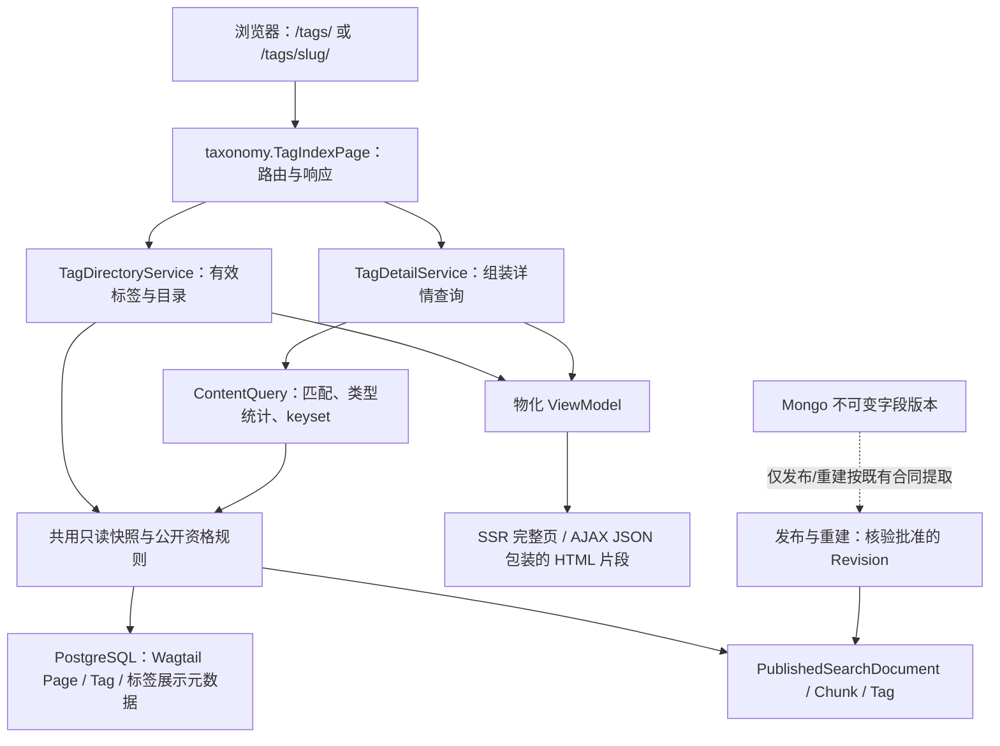

# myblog 全站标签大厅与跨类型检索系统 RFC

Global Tag Directory & Cross-Type Discovery

| RFC 属性 | 内容 |
|---|---|
| 标识 | MYBLOG-RFC-TAG-DISCOVERY-01 |
| 文档形式 | Google 企业工程设计文档 / RFC 风格：背景、目标、详细设计、契约、权衡、实施、验收与审查；不假设 Google 存在统一强制模板 |
| 状态 | Reviewed & Conditionally Approved（经 gemini-4-argon 独立审查，架构主方向通过，6项阻断项 BLK-01~06 闭环入约，待用户确认后实施） |
| 日期 | 2026-11-09 |
| 提案职责 | 总体架构、数据与接口契约、发布一致性、性能边界、实施路线 |
| 决策与审查责任 | 总体协作主代理组织；计划交由 `gemini-4-argon` 独立审查，本文不表示已调用或已通过 |
| 核对代码基线 | `main`，`7dc415240da91f20b6ef8365819312564eb317ad`；起草前工作区干净 |
| 远程 | `origin` 指向 `anc1996/myblog`；未执行 fetch，不据此断言远程最新状态 |
| 环境依据 | `requirements.txt` 声明 Django 6.1 系列、Wagtail 8.1 系列、psycopg 3.3.7；已读取 WSL2 指定环境的 Wagtail 8.1 包元数据与路由源码 |
| 本次授权 | 核对现有源码、撰写指定文档；没有业务实现、真实服务连接、迁移、提交、推送或部署 |

阅读约定：“现有”指已核对源码中存在的能力；“新增”“必须”指本 RFC 的实施要求。设计存在不等于测试通过。Revision 是页面的历史版本；发布副本是从正式版本提取、供检索使用且可以重建的数据。

## 1. Executive Summary：要做什么

在全站统一词库之上增加一个标签入口。用户进入 `/tags/`，可以查看热门前 20 个标签、按 A–Z 首字母找标签，或者输入标签名即时搜索。进入 `/tags/<slug>/` 后，可以同时检索博客、指南和项目，通过“全部 / 博客 / 指南 / 项目”分栏切换结果。

本方案直接复用 PostgreSQL 中的 `PublishedSearchDocument`、`PublishedSearchChunk` 和 `PublishedSearchTag`。前台请求不恢复文章正文，不逐篇实例化业务 Page，不向 MongoDB 补摘要。所谓“0 MongoDB 延迟”，严格表示整个标签页面请求链的 MongoDB 网络调用次数为零，查询和渲染本身仍有 PostgreSQL 与 CPU 成本。

已经批准的四项产品选择作为固定输入：

| 决策 | 本 RFC 的落实方式 |
|---|---|
| ① RoutablePage RESTful 风格地址 | 一个 `TagIndexPage` 服务 `/tags/` 与 `/tags/<slug>/`，GET 读取，同地址兼容完整页和片段 |
| ② 顶部类型 Tab 无刷新切换 | 数量从同次查询的 `facets["types"]` 生成；点击更新结果、当前状态与地址 |
| ③ 热门云、A–Z、实时搜索 | Top 20 按有效发布文档引用数排序；拼音/英文排序；标签名搜索采用 AJAX |
| ④ 仅展示有效标签、缺失友好导流 | 所有标签入口均以公开发布文档引用为前提；合法但无有效内容的 slug 返回 200 友好页 |

这里的“全站”是**当前请求 Site 内全部已接入的内容类型**，不是跨域汇总所有 Site。当前内部类型为 `blog_page`、`guide`、`project`；将来接入新类型不需要再增加一套标签查询。

## 2. Context：现状、痛点与事实边界

### 2.1 参考项目 wagtailblog2

本次只读核对 `../wagtailblog2/wagtailblog3/`，不连接或修改旧站数据。

| 问题 | 源码证据 | 对新方案的影响 |
|---|---|---|
| 与 BlogPage 强绑定 | `apps/blog/services/tag_listing.py:67` 直接查询 `BlogPage`；`:94`–`:97` 通过 `blog_blogpagetag_items` 找标签 | 项目和指南不能自然进入同一结果集；新增类型需要重复查询 |
| 仅搜标题子串 | 同文件 `:73` 使用 `title__icontains` | 无法匹配只在正文出现的技术问题，也没有统一的分词与扩展策略 |
| 没有跨类型分栏 | `apps/blog/models.py:441` 的 `BlogTagIndexPage` 交给博客专用服务，输出博客结果 | 无法表达某标签在不同内容类型中的分布 |
| 依赖查询参数分流 | 服务读取 `?tag=...`，目录和详情共用分支 | 路由资源含义不直观，需要为可分享地址重新明确契约 |
| N+1 统计的历史风险 | `apps/blog/templatetags/blog_tags.py:87` 的注释记录从遍历博客改为单条聚合；当前目录服务也已采用 `annotate(Count(...))` | 应继承集合聚合思路，并把“查询数不随标签数线性增加”纳入验收 |

N+1 指先查一批记录，再为每条记录单独查询一次。**当前所见旧站标签统计已做过聚合优化，不能将历史 N+1 问题写成当前仍然存在。** 本 RFC 重点消除博客耦合，并防止新模板重新引入逐标签、逐卡片查询。

### 2.2 myblog 的基础更适合全站聚合

| 现有部件 | 可以复用的能力 | 仍须补齐或核验 |
|---|---|---|
| `taxonomy/models.py` | 复用 `taggit.Tag` 作为统一词库，已有 `TagMergeRedirect` | 没有标签大厅模型、标签介绍或拼音排序元数据 |
| `discovery/models.py:55` | 发布文档含类型、Site、日期、摘要、正式 Revision ID、树位置 | 查询必须核验其仍对应当前正式版本，不能只看 `is_live` |
| `discovery/models.py:122` | `PublishedSearchTag` 以稳定 `tag_id` 连接发布文档 | 名称和 slug 是副本字段，改名时不能按旧文本拆成多个标签 |
| `discovery/contracts.py` | `QuerySpec` 已支持 `tag_ids`、`type_keys`、`search_fields`；`QueryResult` 有统计与游标 | 缺少跨类型 Tab 的统计范围声明，以及标签头所需的未搜索总数 |
| `discovery/query.py:90` | 已有只读可重复读事务入口、全文检索与组合过滤 | 类型过滤早于统计；首次标签请求默认仍可进入旧 offset 分页 |
| `discovery/ranking.py:37` | 已有签名 keyset 游标与查询指纹 | 当前指纹未包含 Site、标签、标签匹配方式及搜索展开策略 |
| `discovery/query.py:351`、`:535` | 结果结构有 `previous_cursor` | 实际返回 `"prev:available"` 占位值，尚不能作为上一页游标 |
| `discovery/eligibility.py:19` | 核对 Page 存在、live、非 alias、路径与深度，排除访问限制 | 没有完整核对正式 Revision、索引代次、回收祖先；导入回收模型不等于已过滤 |
| `discovery/listing/` 和共享模板 | 参数解析、ViewModel、卡片、分页、AJAX 骨架 | 不能直接套用“当前栏目后代”的查询范围；高亮、分页链接与交互还需针对性加固 |

因此，优势来自**现有统一发布数据结构**，不是说现有代码已经完整满足新契约。P0 必须先处理本节差距，再接入公开页面。

### 2.3 已有合同的优先关系

沿用《全站层级列表与多维检索通用框架 RFC》最终审查补充部分、第一阶段发布/回收合同和项目 `AGENTS.md`。本文不修改已批准的页面身份、原树位置恢复、审批发布、Mongo 字段版本格式和媒体保留规则。

历史说明与当前源码矛盾时，以本次任务约束和当前代码核对结果记录差距，不把历史“已完成”当作当前验收结论。

## 3. Goals / Non-goals：目标与边界

### 3.1 必须达到的目标

1. 当前 Site 的公开博客、指南、项目共享同一标签索引和内容查询。
2. 标签数、引用数、类型数量和卡片均遵守同一公开资格与正式 Revision 规则。
3. 单次详情请求内，元数据、标签总数、搜索命中、类型统计和当前页来自同一个只读可重复读快照。
4. 标签大厅、详情、缺失导流、SSR 与 AJAX 整个调用链均零 MongoDB 访问；也不向 RustFS/S3 读写对象。
5. 类型切换、标题范围切换、中文输入、前进后退与可分享地址行为明确，关闭 JavaScript 仍可完成基本操作。
6. 第一页起使用签名 keyset 上一页/下一页，不用深 OFFSET，也不拿浏览器历史模拟上一页。
7. 新类型由注册能力声明接入，公共查询代码不导入 BlogPage、GuidePage 或 ProjectPage。

### 3.2 本期不做

- 不迁移旧站数据，不增加第二套标签词库，不把标签建成树状 Category。
- 不在标签 GET 内建投影、重建索引、生成正文摘要、保存标签或修改 Epoch。
- 不将标签大厅自身计入内容总数，不把 `*_index` 栏目页当作文章。
- 不引入 Elasticsearch、外部拼音服务或 Mongo 聚合；Redis 仅可辅助限流与可选缓存。
- 不重做 RSS/Atom，不把标签内关键词订阅扩展成新产品。
- 不借此修改身份、审批、回收恢复或永久删除实现；发现高风险缺陷由主代理另行限定实施文件与授权。

## 4. Architecture：组件与依赖

选择将 `TagIndexPage` 放在 `taxonomy` 应用：标签是全站能力，放到 `blog` 会再次造成入口归属与业务类型耦合。应用 Python 导入仍为 `taxonomy`、`discovery`，不改变既有 App label 或迁移身份。



“物化”指在事务内把需要的数据读成普通列表、字典和字符串。模板拿到这些值后不再悄悄执行查询。

| 层 | 拟归属 | 责任 |
|---|---|---|
| 页面与词库展示模型 | `myblog/apps/taxonomy/models.py` | 页面树约束、路由、后台字段 |
| 目录与详情服务 | `myblog/apps/taxonomy/services/` | 参数、标签解析、目录聚合、结果组装；服务包为新增设计 |
| 展示数据结构 | `myblog/apps/taxonomy/contracts.py` | 明确目录、详情、缺失模式和统计含义 |
| 公共查询 | `myblog/apps/discovery/{contracts,query,eligibility,ranking,facets}.py` | 一致的公开资格、搜索、统计和双向游标 |
| 快照入口 | `myblog/apps/discovery/snapshot.py`，拟新增 | 让目录、标签解析与 ContentQuery 安全共用一个事务 |
| 模板 | `myblog/templates/taxonomy/` | 大厅、详情、缺失提示及两个结果片段 |
| 共享展示 | `myblog/templates/discovery/listing/` | 复用卡片和分页；修改应兼容既有栏目页 |
| 浏览器控制 | `myblog/static/taxonomy/js/tag_index_controller.js`，拟新增 | 目录/详情交互；公共控制器的通用修复由明确负责人维护 |

不直接调用 `IndexListingService.build(tag_page, request)`：该服务把页面 ID 作为栏目根，并默认限制其后代。标签详情的 `root_page_id` 必须为 `None`，否则会把全站标签误变成“标签页下面的文章”。

## 5. Data Model：模型与数据契约

### 5.1 新增 TagIndexPage

模型声明为 `TagIndexPage(RoutablePageMixin, CustomBasePage)`，Mixin 放在前面以接管子路由；`CustomBasePage` 来自 `content_lifecycle.models`。

| 项目 | 规范 |
|---|---|
| 继承字段 | Page 的标题、slug 等；CustomBasePage 的 `document_uuid`、`is_recycled` |
| 新增页面字段 | `intro`：简短纯文本导语，`TextField(blank=True)`；保存在 PostgreSQL 与 Revision，不使用外置正文 |
| 父页面 | `parent_page_types = ["home.HomePage"]` |
| 子页面 | `subpage_types = []`，标签详情是动态路由，不为每个 Tag 建 Page |
| 数量 | `max_count_per_parent = 1`；支持每个独立 Site 首页各有一个入口 |
| URL | 在该 Site 的首页下创建 slug 为 `tags` 的页面；`clean` 校验固定入口和父级，移动/复制也须遵守约束 |
| 评论 | `allow_comments = False`，避免大厅变成互动内容页 |
| 类型注册 | 不注册为可检索内容类型，不生成正文搜索投影，不进入 Feed 或归档 |
| 后台接入 | `home.HomePage.subpage_types` 必须加入 `"taxonomy.TagIndexPage"`；仅写 `parent_page_types` 不够 |

`max_count_per_parent` 是 Wagtail 创建约束，不可宣称它自动成为数据库并发唯一约束。并行创建、复制、移动的实际行为在 P0 核对；若现有受控写入口不能保证唯一，须补同一写锁下的校验。

示意路由如下，仅表达接口，不是已经实现的代码：

```python
class TagIndexPage(RoutablePageMixin, CustomBasePage):
    @path("", name="directory")
    def directory(self, request):
        # 统一检查后调用 TagDirectoryService，再交付完整页或片段。
        ...

    @path("<str:tag_slug>/", name="detail")
    def detail(self, request, tag_slug):
        # 解析标签与公开结果，不限制为该页面的子树。
        ...
```

### 5.2 标签说明与拼音排序元数据

`taggit.Tag` 现有词库提供 `id/name/slug`，没有标签描述和拼音排序字段。本方案增加轻量的 `TagDirectoryMetadata`，不修改 taggit 的第三方模型，也不新建可替代 Tag 的词库。

| 字段 | 类型/约束 | 目的 |
|---|---|---|
| `tag` | 指向 `taggit.Tag` 的 OneToOneField，CASCADE | 一个标签一份展示元数据 |
| `description` | TextField，blank，表单限 1000 字符 | 标签详情介绍；空值显示“浏览全站与「名称」相关的公开内容” |
| `sort_key` | CharField(255)，有索引 | 已归一化的拼音/英文排序键 |
| `initial` | CharField(1)，有索引，A–Z 或 `#` | SQL 分组与筛选，不在每次请求翻译全词库 |
| `updated_at` | DateTimeField | 维护与问题定位 |

词库展示信息属于独立公共配置：编辑保存后生效，不承诺 Wagtail Revision 审批。它不能修改某篇文章的标签关联，也不能决定该文章是否公开；若未来要审批标签介绍，应另设可发布的词库编辑合同。

拼音策略采用本地 `pypinyin` 的常用读音，英文按 `casefold` 处理；去除排序用的首尾空白和无意义前导符号，生成不带声调的键。数字、纯符号、无法归类的文字进入 `#`；多音字默认读音可能不合语义，允许管理员覆盖 `sort_key/initial`。排序仅用于展示，不改变原标签名与 URL。

`pypinyin` 当前未列入依赖，P0 必须核对许可证、运行环境和固定版本后再加锁；不能声称已安装。配置写入时生成排序字段；新建/改名标签时同步，已有标签通过授权后的独立数据准备步骤补齐。GET 不保存元数据。遗漏元数据的有效标签保留在目录，按 `#` 与原名稳定排序并报警，不因排序缺失隐藏公开内容。

### 5.3 复用的发布数据

```text
Wagtail Page.live_revision_id
    └─ 对应 PublishedSearchDocument.effective_revision_id
PublishedSearchDocument
    ├─ PublishedSearchChunk：title / intro / body 的已发布检索文本
    └─ PublishedSearchTag：document_id + tag_id 唯一
taggit.Tag
    └─ TagDirectoryMetadata：description / sort_key / initial
```

- `PublishedSearchTag` 是发布标签关联的副本，不能改查 `BlogPage.tags` 等当前编辑态关系。
- 所有统计按稳定 `tag_id` 分组；名称、slug 通过同快照连接当前规范 Tag，不按 `tag_name/tag_slug` 文本分组。
- 引用数定义为 `COUNT(DISTINCT page_id)`：同一内容有多个 chunk、重复关联候选或索引代次时仍只计一次。
- 第一版沿用当前生效索引代次 `index_generation=1`，统一候选集显式限定。若项目已启用其他代次，P0 改为读取明确的生效代次配置，目录与详情必须一致，不能跨代次求和。
- `PublishedSearchDocument` 当前唯一键是 `(page_id, index_generation)`；仅有这个约束不能证明只有一个代次会进入查询。
- 卡片标签可批量连接规范 Tag 生成展示值；不读取业务 Page 的标签管理器，不按卡片查词库。

### 5.4 标签改名、删除与合并

标签详情用 slug 解析 Tag，然后以 ID 查询已发布关联。文章草稿增删标签不影响当前正式标签集合；正式发布后才替换 `PublishedSearchTag`。

标签改名属于词库公共配置：目录、标题与链接使用当前规范 Tag，数量保持按 ID 统计；需同步派生展示字段并递增 Epoch，整个过程只访问 PostgreSQL。不能要求修改每篇文章的草稿才能修正名称。

现有 `TagMergeRedirect` 有原 ID/名称和目标 Tag，**没有原 slug**。本期不凭名称猜测旧 slug 并做 301，也不自动追写文章历史 Revision。找不到规范 Tag 的旧 slug按友好缺失页处理。若必须保留合并前 URL，另行增加唯一的旧 slug 映射、循环检测和发布关联迁移合同，再审查；本方案不悄悄扩大到标签合并工程。

删除或合并后的孤立投影不能继续独立展示标签。目录以内连接现存规范 Tag 为前提；同时保留可对账信息，不能在 GET 中修数据。

## 6. Routes & UX：路由与页面行为

所有地址由 `TagIndexPage.get_url(request)` 与 `reverse_subpage()` 生成；文中的 `/tags/` 是标准 Site 根路径示例，不在模板中硬编码域名。

### 6.1 模式一：标签大厅 `/tags/`

从上到下显示标题、导语、热门标签云、标签名搜索框、A–Z / `#` 导航、分组结果。

- **热门云**：当前 Site 的有效标签按引用数降序取前 20；同数量按 `sort_key`、`tag_id` 升序稳定排列。不足 20 个全部展示，徽章始终显示精确文档数，视觉字号不改变可点击区域或阅读顺序。
- **A–Z**：返回 `{"A": [...], ..., "#": [...]}` 的分组字典；空组不展示内容，字母导航可显示禁用状态。当前批次最多 100 个标签，默认 50；超出以目录自己的签名 keyset 继续加载，不能把全部词库塞入 HTML。
- **即时搜索**：`q` 在大厅只搜索标签名，按规范化后的名称包含匹配，不搜索正文，不自动做拼音全串搜索。输入 300ms 防抖，中文组合输入结束后再发送请求；也支持普通 GET 表单。
- **统计范围**：`valid_tag_count` 是该 Site 全部有效标签数；`matched_tag_count` 是 q/letter 过滤后的标签数；单个徽章是该标签的内容数，不能混淆。
- **热门区域不随 q 改写排名**：同快照计算整个有效标签集的 Top 20，方便无匹配时继续发现内容。A–Z 结果受 q/letter 过滤，热门区标明“全站热门”。
- **目录翻页**：先按初始组 A–Z、最后 `#`，再按 `sort_key/tag_id` 稳定排序；如果某组跨批次，允许下一批继续显示同一个组标题。字母导航给出 `?letter=P` 真链接，不跳转到尚未加载的 DOM。

目录搜索无结果仍为目录模式，展示清除搜索与热门入口，不错误地提示某个标签不存在。

### 6.2 模式二：标签详情 `/tags/<str:tag_slug>/`

1. **标签头**：规范名称、纯文本说明、该 Site 公开内容总数、RSS/Atom 链接。
2. **类型 Tab**：固定展示“全部 / 博客 / 指南 / 项目”，零数量也显示；按同次返回的类型统计填数。新注册类型在固定三类后按配置顺序追加，不能使“全部”漏算其他类型。
3. **混合深度检索框**：默认搜索标题、导语和正文，`title_only=1` 时只搜索标题；沿用既有原句匹配、分词与受控同义词扩展规则。
4. **卡片流**：复用 `discovery/listing/_listing_card.html`，增加可读的内容类型标识；卡片只使用 `SearchResultItem` 数据。
5. **分页**：复用共享分页组件，使用真实的上一页/下一页签名游标及 GET 链接；关闭 JS 后能正常翻页。

Tab 对外参数使用公开别名：`type=blog` 映射到 `blog_page`，`type=guide` 到 `guide`，`type=project` 到 `project`；省略或 `all` 表示全部。映射来自注册表，不能直接把任意用户输入传入 `type_keys`。

点击 Tab 保留 q、标题范围及排序，清空 cursor；结果、数字、当前 Tab 和 URL 一起更新。未知类型或非法参数返回 400，不悄悄放宽成全部内容。

**三个数量的例子**：某标签共有 30 篇公开内容；输入关键词后命中 8 篇，其中博客 5、指南 2、项目 1。标签头仍显示 30；Tab 显示“全部 8 / 博客 5 / 指南 2 / 项目 1”；点击指南后卡片区显示共 2 篇，不把其他 Tab 变为 0。

### 6.3 模式三：不存在或没有有效公开内容

以下情况对匿名访客保持同一种 200 友好页：Tag 不存在；只关联草稿；只关联受限、回收或当前 Site 以外的内容；已无有效发布关联。统一提示“暂未找到这个标签的公开内容”，不区分后台真实存在性。

推荐最多 5 个**当前有效标签**：先取名称包含或前缀相近项，再以有界候选做本地字符串相似度排序；无相似项时展示热门标签。不得扫描全部文章、发起外部 NLP 请求或查询私有标签推荐。相似度只影响导航建议，不自动把用户导向另一个标签。

提供返回大厅、修改搜索与热门标签入口；未知 slug 的回显必须转义。响应带 `noindex, follow`，不列入 sitemap，避免大量 200 空页成为搜索引擎的无效结果。200 不适用于语法非法的路径或后端故障。

已存在且有效的标签在 q/type 过滤后没有命中，仍是正常详情页，保留标签头和 Tab，提示清除条件。

### 6.4 路由守卫与预览

本机 Wagtail 8.1 的 `RoutablePageMixin.serve(request, view=...)` 会直接调用路由方法，绕过 `CustomBasePage.serve()`；其 `serve_preview()` 也直接解析根路由。因此只写继承声明不够。

`TagIndexPage` 必须显式实现统一入口检查，并由 `serve`、`serve_preview` 及可被直接调用的路由方法共用：

- 公网入口核验当前页与祖先公开可访问、未回收；缺失 Site 时拒绝，不以 `site_id=None` 扩大到所有站点。
- 未发布页面不能因用户添加查询参数获得预览。后台预览必须来自 Wagtail 已认证的预览流程，设置仅在服务端使用的上下文标记。
- 新建未保存页可预览大厅壳与提示；不得为 `pk=None` 建索引或报内部错误。已保存草稿可预览标题/导语，内容仍限正式公开副本。
- 已回收页禁止预览；预览响应不进入共享缓存。详情页如无专门预览入口，预览默认展示大厅，不伪造动态 Tag 的草稿版本。
- 复用 Wagtail 路由权限检查，同时覆盖直接单元调用与 AJAX；公开检查不能只放在 SSR 模板分支。

## 7. Service Contracts：服务与单快照数据流

### 7.1 统一有效文档集合 E

目录和详情共用 `discovery` 中的公开资格入口，不分别维护近似过滤器。集合 E 必须满足：

1. 当前请求 Site 和明确生效的索引代次；仅允许注册为标签内容的类型。
2. 投影 `is_live=True`、`is_recycled=False`，实际 Page 存在且为 live、非 alias。
3. `effective_revision_id == Page.live_revision_id`，并用 SQL 核验 Revision 的对象身份及投影的 `document_uuid` 对应当前页面；批准的正式 Revision 尚未投影时排除旧副本，不回查最新草稿。身份核验不调用 `Revision.as_object()`。
4. 树路径、深度、站点归属与当前 Page 一致；移动未同步的旧副本暂不进入结果。
5. 页面自身及相关祖先没有访问限制、回收中或恢复中状态；辅助回收标记与回收记录的覆盖范围须实测。
6. 对于未来排期，Wagtail 尚未正式发布的版本绝不进入结果；`authored_on` 是成文日期，不能独自替代 live Revision 判断。本标签查询不额外加入“成文日期不得晚于今天”的新产品条件。

拟在 adapter 能力声明中追加默认关闭的 `tag_listing_enabled`，与 Feed/Archive 能力分开。博客、指南、项目明确打开；栏目页和 TagIndexPage 关闭。公开类型别名复用现有 `public_type_slug`，展示名/顺序由注册描述提供默认值。不得使用“type_key 不以 `_index` 结尾”作为唯一能力判断。

新增默认值应兼容旧 adapter。将来新类型完成发布提取、能力声明与测试后，即可自动加入目录、“全部”和类型统计；仅注册模型名称不会自动产生可检索内容。

### 7.2 TagDirectoryService

拟定调用 `build(index_page, request) -> TagDirectoryViewModel`：

1. 解析并校验 q、letter、目录游标与容量。
2. 开启共用的只读快照，在里面复核 Site 与入口公开状态，读取 Epoch 和有效集合 E。
3. 从 `PublishedSearchTag.document_id ∈ E` 出发，连接 Tag 与展示元数据，按 Tag ID 聚合有效文档引用数，排除 0 引用。
4. 以同一候选关系分别得到热门 Top 20、A–Z 组数量、目录筛选总数和当前批次。
5. 物化 DTO 后退出事务；SSR 和 AJAX 使用同一份结果。

核心查询形态为集合聚合，不为每个 Tag 调用 `.count()`。DTO 至少包含：

```text
mode = "directory"
popular_tags: [{id, name, slug, count, url, initial}]
groups: {initial: [{id, name, slug, count, url}]}
group_counts: [{initial, count}]
valid_tag_count / matched_tag_count
next_directory_cursor / previous_directory_cursor
active_filters / canonical_url / corpus_epoch / cursor_reset
```

`group_counts` 随 q 变化、在选择 letter 前计算，方便切换其他字母；当前 `groups` 与 `matched_tag_count` 再应用 letter。目录与热门所用 E 一致，只是名称筛选范围不同。

### 7.3 TagDetailService 与 ContentQuery

拟定调用 `build(index_page, request, tag_slug) -> TagDetailViewModel`。详情服务先进入公共快照，完成 Tag 解析、元数据与入口复核，再在同一快照中调用一次 `ContentQuery.execute()`；不为每个 Tab 另发查询请求。

找不到 Tag 或 `scope_total_count=0` 时，相似标签与热门导流也在当前快照内生成，复用目录服务的内部聚合函数；不能退出事务后再开启另一笔事务拼推荐。这样缺失状态与推荐所依据的公开资格仍然一致。

传给公共查询的基本结构：

```python
QuerySpec(
    q=filters.q or None,
    tag_ids=[tag.id],
    tag_mode="ANY",
    type_keys=selected_type_keys,  # 全部为 []，由标签内容能力集合限定
    site_id=site.id,
    root_page_id=None,            # 全站标签不是 TagIndexPage 的后代
    include_listing_scope=False,
    search_fields="title" if filters.title_only else "all",
    facets=["types"],
    sort=filters.sort,
    page_size=filters.page_size,
    cursor=filters.cursor,
    pagination_mode="keyset",     # 拟新增字段，首次请求也必须用 keyset
    facet_scope="without_type",   # 拟新增字段，保留其他条件，仅去掉当前类型条件
    content_scope="tag_listing",  # 拟新增字段，应用标签内容能力白名单
)
```

扩展必须在 `QuerySpec` 有默认值，既有调用方沿用原语义：`pagination_mode="auto"`、`facet_scope="filtered"`、`content_scope="default"`。标签请求固定策略，由服务端构造，HTTP 不允许直接控制这些内部参数。

`QueryResult` 拟增加可选整数 `scope_total_count`、`matched_total_count`，旧调用默认 `None`。标签详情映射为：

| 返回值 | 计算集合 | 使用位置 |
|---|---|---|
| `scope_total_count` | E 中带该 Tag 的全部内容，未应用 q 或选中类型 | 标签头的 `tag_total_count`；0 时转友好缺失模式 |
| `matched_total_count` | 上述集合按当前搜索策略命中，但未应用选中类型 | “全部”Tab 数量 |
| `facets["types"]` | 同一搜索命中集合，按 type_key 分桶 | 博客/指南/项目及扩展类型 Tab |
| `total_count` | 搜索命中集合再应用选中类型 | 当前卡片区总数 |
| `items` | 当前类型结果排序后按游标取页 | 当前页卡片 |

必须保证 `matched_total_count == sum(facets["types"].count)`，每个文档恰属一种内容类型。零数量类型由能力注册表补齐，不能靠当前分桶是否出现来决定某个 Tab 是否存在。

**搜索模式判定范围也要统一**：先在带 Tag 的跨类型集合上决定原句 A / 分词 B / 同义词 C 和手动展开结果，再按类型切出卡片。切换类型不重新单独决定 A/B/C，否则某类型可能突然扩展出另一批结果，Tab 数量无法对应。用户开启“仅搜标题”时，A、B、C、摘要高亮与所有统计都使用相同标题范围。

标签详情需要补齐 SEARCH-MODE-02 的手动分词展开提示与入口，不能只显示默认结果而丢掉公共搜索能力。展开状态进入 URL 与游标指纹。

### 7.4 只读可重复读事务

`REPEATABLE READ READ ONLY` 让单次请求内的多个 SELECT 看见同一批已提交数据，且数据库拒绝写入。它是一笔事务，**不是承诺只有一条 SQL**。

目录和详情共用拟新增快照上下文管理器，`ContentQuery.execute` 也使用它：

```text
进入最外层 atomic
→ 在第一条业务 SELECT 之前设置 REPEATABLE READ、READ ONLY、statement_timeout
→ 注册受控的当前连接快照上下文
→ Site/入口复核、Epoch、Tag 元数据、有效文档集合
→ 总数、分桶、匹配、排序、当前页与批量标签
→ 物化全部 ViewModel
→ 退出快照
→ 模板交付
```

- 内部嵌套只允许复用同一个已认证的快照；不能仅凭随意设置一个布尔属性就跳过校验。
- 遇到普通写事务或 `ATOMIC_REQUESTS` 外层包装，拒绝并报告配置错误；不能在已发生 SELECT 后临时改隔离级别。
- 设置隔离失败必须失败退出，不记录日志后继续在普通隔离级别运行。
- 测试沿用现有 `TestCase` 包装兼容约定，但这种分支不是隔离级别证据；真实事务与并发用 `TransactionTestCase` 和两个 PostgreSQL 连接验证。
- 事务内不调用投影、不 `get_or_create` Epoch、不取排他锁；缺失投影不能自动回源修补。
- Wagtail 为路由预先读取 Page 不代表业务集合已在快照内核验；服务必须在快照内重核入口、Site 和实际过滤依据。
- 模板只消费已物化业务数据；若 Wagtail 固定外壳仍有 SQL，应单独计入整页预算，不能让它重算卡片、数量或公开资格。

### 7.5 发布、锁、幂等与补偿

读取页不取得写锁。影响公开标签的写操作沿用已有统一顺序，不新增“先锁标签再锁全局”的相反路径：

```text
SQL atomic
→ lock_timeout
→ ContentMutationGuard(global)
→ 涉及的 Page 按主键升序
→ Revision / 业务关系 / 词库与元数据（各自稳定顺序）
→ 发布文档、chunks、tags / Outbox / 操作回执
→ ContentDiscoveryEpoch(global)
→ COMMIT
```

只有词库元数据变动时跳过无关 Page 锁，仍先取全局协调锁，最后更新 Epoch。Outbox 是与业务数据一起保存的待处理任务表；若需要补偿任务，必须使用项目已有机制或明确新增的持久任务，不能只打日志声称会重试。

- 从批准并实际生效的 `live_revision` 提取投影；Mongo 字段版本保持不可变。
- 写入投影前再次核验 Page、UUID、正式 Revision 与发布代次；幂等身份至少包含 `(page_id, effective_revision_id, index_generation, extractor_version)`。
- 文档、chunks、tags 替换与 Epoch 递增在同一 SQL 事务提交；旧任务不得覆盖新发布、下架或回收状态。
- 下架、回收、恢复、权限变化、树移动、Site 变化和词库显示变更均须使有关缓存及游标失效；恢复为草稿不自动重新进入标签。
- SQL 回滚不会回滚 Mongo 或 RustFS 写入。失败外部对象保留待对账，不能立即物理删除；GET 不做跨存储补偿。

当前 `projection.py` 中“提取在前、atomic 写入在后”、固定发布代次等代码不能据此认定并发已安全。P0 审查其锁与回验；如需改动生命周期写路径，单独由主代理安排负责人和独立审查，不由标签前端实施者顺手修改。

## 8. HTTP & Presentation：双模同构协议

双模同构表示首屏 HTML 与 AJAX 片段使用同一服务、同一 ViewModel 和同一结果模板，不维护两套查询逻辑。

### 8.1 GET 参数

| 参数 | 大厅 | 详情 | 限制 |
|---|---|---|---|
| `q` | 标签名查询 | 内容查询 | 单值，去首尾空白，最多 200 字符；超长返回 400，不静默截断 |
| `letter` | A–Z、`#` | 不接受 | 单值；URL 中 `#` 必须编码为 `%23` |
| `type` | 不接受 | all / 注册的公开类型别名 | 单值；内部 type_key 不直接暴露为自由输入 |
| `title_only` | 不接受 | 0/1 | 默认 0，明确控制所有搜索阶段 |
| `sort` | 目录固定顺序 | relevance / authored_desc / authored_asc | 有 q 默认 relevance，无 q 默认 authored_desc |
| `expand` / `secondary` | 不接受 | 沿用公共搜索的受控枚举 | 不接受任意值；所有模式变化清除游标 |
| `page_size` | 默认 50，最大 100 | 默认 15，最大 50 | 正整数；非法值返回 400；更大值按明确上限规范化 |
| `directory_cursor` | 目录分页 | 不接受 | 与内容 cursor 分开，最多 2048 字符 |
| `cursor` | 不接受 | 当前内容页 | 最多 2048 字符，只接受新签名 keyset 格式 |
| `format=partial` | 可选 | 可选 | 保留共享兼容入口；响应模式必须进入 Vary/缓存键 |

相关的单值参数重复传入返回 400，避免服务端、签名和前端各取不同值。未知参数不参与查询，规范 URL 删除无效噪声；不能用未知参数构造 ORM 字段名。

共享 `parse_listing_filters()` 当前有静默截断与宽松解析；只能复用其中经过核验的规范化函数，不直接宣称它满足本表的严格协议。日期等高级筛选沿用公共数据能力，但本期不额外加到标签 UI。

### 8.2 SSR 与片段模板

拟新增：

```text
taxonomy/tag_index_page.html
taxonomy/tag_detail_page.html
taxonomy/_tag_directory_results.html
taxonomy/_tag_detail_results.html
taxonomy/_tag_missing_results.html
```

详情片段包含标签头计数、Tab 数字/选中状态、结果提示、卡片与分页。输入框置于替换区域外，避免中文输入被打断；服务返回的 active_filters 用于同步表单和浏览器历史。

卡片和分页复用共享组件，但不直接嵌套整个 `_listing_results.html`：它含栏目导航和“包含子栏目”空态提示，不适合全站标签。共享分页改为实际 `<a href>`，JS 只增强点击；共享组件不得出现重复容器 ID。

AJAX 发送 `X-Listing-Response: fragment-v1`，响应为 JSON 包装的服务端 HTML：

```json
{
  "mode": "detail",
  "html": "<section>服务端渲染的同一个结果片段</section>",
  "canonical_url": "/tags/python/?q=事务&type=guide",
  "active_filters": {"q": "事务", "type": "guide", "title_only": false},
  "tag_total_count": 30,
  "matched_total_count": 8,
  "total_count": 2,
  "facets": {"types": [{"key": "blog_page", "count": 5}, {"key": "guide", "count": 2}, {"key": "project", "count": 1}]},
  "next_cursor": null,
  "previous_cursor": null,
  "corpus_epoch": 42,
  "cursor_reset": false
}
```

示例数值仅说明协议，不是实测数据。目录响应对应返回目录统计和 `next_directory_cursor`；缺失页返回 `mode="missing"` 与友好导流片段。

`canonical_url` 在此指服务器规范化的可分享地址，含有效筛选和当前有效游标；不是强制要求所有筛选页的 SEO canonical 标签都相同。重置游标时返回无旧 cursor 的首页地址。

响应协商维度使用 `Vary: Accept, X-Listing-Response, X-Requested-With`，通过 Django 的响应头合并工具保留原有 Vary；查询参数本身也必须进入缓存键。不能让完整页缓存污染 JSON，或让私有预览命中公开结果。

### 8.3 浏览器交互

- Tab、字母导航、搜索、标题开关和分页均有真实 GET 地址或表单；JS 失败时提供重新加载当前 URL 的入口。
- 300ms 防抖只在 `compositionend` 后触发中文输入查询；新请求取消旧请求，并用递增请求序号阻止已完成的旧响应覆盖最新结果。
- 普通输入更新用 `replaceState`，主动提交、Tab 和翻页用 `pushState`，避免每次按键都堆一条历史。
- `popstate` 从 URL 恢复搜索框、类型和开关，再获取相同片段，不只替换卡片。
- cursor_reset 时按服务端首页地址 `replaceState` 并提示“内容已更新，已返回第一页”，不能把失效游标留在地址栏。
- 容器设置 `aria-busy`，结果数用合适的 `aria-live` 区域；Tab 采用链接导航并标记 `aria-current`，避免只做视觉切换。
- 错误保留现有可读结果，显示重试提示；AbortError 不展示为失败。返回空结果与服务错误必须有不同文案。

### 8.4 keyset 双向翻页

Keyset 是用上一页边界记录的排序值定位下一批结果，不使用“跳过前 N 条”的深 OFFSET。

无关键词默认按 `(authored_on DESC, page_id DESC)`；有关键词 relevance 按公共查询的 `(tier_rank DESC, score_key DESC, authored_on DESC, page_id DESC)`。显式成文日期升序/降序使用对应稳定序列，不能一边展示按相关度，一边按日期裁剪游标。

- 下一页用当前末项生成 `direction=next` 游标。
- 上一页用当前首项生成 `direction=prev` 游标，查询反向边界、反向排序取一批，再反转回正常展示顺序。
- 同日、同分值必须以 page_id 作最终比较键；先按文档聚合，再排序分页。
- 游标签名绑定版本、Site、内容能力策略版本、索引代次、标签 ID/匹配方式、公开类型、q 的统一归一化值、搜索字段、expand/secondary、sort、page_size、Epoch、方向与边界；目录游标使用独立 salt 与自己的过滤/排序字段。
- 首次请求即选择 keyset，不通过 `include_listing_scope=True` 偷开开关，否则会错误开启栏目根逻辑。
- 签名有效但过期、Epoch 或条件变化：200，重置当前条件首页；签名错误、字段类型/方向/日期非法：400。
- 沿用 30 分钟有效期。多个 HTTP 请求间不持有数据库事务；Epoch 变化触发重置，不提供跨请求历史快照。
- `previous_cursor` 只能为真实签名 token 或 `None`，不得返回 `"prev:available"`，也不得用前端记录 cursor 栈替代服务端能力。

### 8.5 RSS、Atom 与错误状态

标签头通过 `reverse("discovery:feed_tag", kwargs={"slug": tag.slug})` 复用 `/feed/tag/<slug>/`，Atom 使用既有对应路由。RSS 默认订阅该标签的全部支持 Feed 的公开内容，不带 q/title_only/type 条件；标签页要清楚注明“订阅此标签的新内容”。

现有 Feed 和标签查询可能有能力、日期与上限差异，不保证 XML 条目数等于标签头总数。RSS 是另一请求，不与 HTML 共享事务；共同遵守发布和访问权限红线。

现有 Feed 路由使用 `<slug:slug>`，标签页按需求使用 `<str:tag_slug>`。Unicode 标签 slug 的反向生成与订阅必须在 P0 核验；若现有词库允许 Unicode，则需在既有 Feed 所属文件中增加经过相同验证的兼容路径。不能生成点击即 404 的链接或静默隐藏已批准的订阅能力。

| 情况 | HTTP | 页面行为 |
|---|---|---|
| 合法 slug 无公开内容或不存在 | 200 | 通用友好导流、noindex |
| 有效标签搜索无命中 | 200 | 详情空结果，可清除条件 |
| 条件或 Epoch 变化导致游标重置 | 200 | 当前条件第一页及轻提示 |
| 参数、编码、签名非法 | 400 | 清晰错误与安全返回链接 |
| 入口未发布、回收、受限或路由结构不匹配 | 404 或 Wagtail 原有访问响应 | 不强行变成 200 标签缺失页 |
| 非 GET/HEAD 的公开目录请求 | 405 | 不产生写操作 |
| 超过频率限制 | 429 | Retry-After，保留现有页面 |
| 数据库超时、必要投影设施不可用 | 503 | Retry-After，不伪装成标签不存在 |
| 未预期程序错误 | 500 | 通用错误页并记录请求标识，不暴露内部异常 |

HEAD 与 GET 保持状态和必要响应头一致，响应体按框架约定为空。

## 9. Performance, Cache & Security：性能与安全红线

### 9.1 零 Mongo、零对象存储请求

禁止在标签调用链使用业务页 `.specific()`、`Revision.as_object()`、`hydrate_from_mongo()`、`get_field_version()` 或遍历正文 blocks；不能因缺摘要、缺高亮或缺投影就回源。

检验范围包括路由、权限、服务、模板、全局导航、context processor、中间件和 AJAX 片段，不只拦截 `ContentQuery.execute()`。RustFS/S3 不做 HEAD、GET、签名探测或 rendition 生成；可输出已有本地 URL 字符串，但浏览器后续访问对象不计为服务器标签请求的直接调用。

缺失摘要显示既有纯文本摘要兜底；缩略图可留空。不能为了完善卡片造成逐篇外部存储调用。

### 9.2 聚合与查询成本

- `PublishedSearchTag(tag_id, document)` 现有索引与 `(document, tag_id)` 唯一约束可复用。
- `tag_slug` 是快照文本且当前没有匹配的专用索引；详情先利用规范 Tag 的 slug 找 ID，再用 tag_id 过滤，避免扫描投影 slug。
- 公共候选集先限定 Site/生效代次/内容能力并核验资格，再用于聚合。统计与卡片必须使用同一有效集合，不能先统计后在 Python 删除私有结果。
- 卡片标签一次批量读取；当前 `doc.search_tags.all()` 出现在逐文档组装中，必须通过批量预取或 DTO 聚合消除线性 SQL。
- 拼音字段写入时生成，目录按索引字段稳定分页。标签名包含匹配在小规模词库先测量；确有瓶颈再评估 PostgreSQL trigram 索引，不先承诺安装扩展或执行建索引。
- 有关键词的公共查询目前存在把大量候选 ID 拉到 Python 的路径，不能把“有 keyset token”宣传成已实现数据库级有界搜索。P0 要检查匹配、文档聚合、排序与边界是否真的在数据库内完成；不达标则为性能阻断项。
- 只在授权测试库上执行 `EXPLAIN (ANALYZE, BUFFERS)`；列出数据库版本、数据量、索引、命令与计划，不把设计索引视为已经使用。

建议初始工程门槛：目录核心数据 SQL 不超过 12 条、详情不超过 18 条；整页外壳另记录固定成本。对 20/200/2000 个标签和每页 15/50 张卡片比较 SQL 数，不能随条目数线性增长。真实数据规模或权限模型需要调整预算时，先给出计划与证据，由主代理审定。

参考性能目标为固定测试环境中 100 万有效文档、1 万标签、平均每文档 3 个标签、20 并发读：无关键词目录/详情 p95 ≤ 300ms，关键词详情 p95 ≤ 800ms；冷缓存单列。该数值是拟验收目标，尚无压测证据，不保证精确 COUNT 在任意规模天然便宜。超过预算时优化 SQL、索引和有界算法，不改成不准确数量或回 Mongo。

### 9.3 缓存策略

第一版不缓存跨请求业务结果，也不复用现有搜索 API 的结果缓存：先证明公开资格和计数正确。标签响应采用 `Cache-Control: no-store`，预览同样不缓存；Redis 仅用于辅助限流。

理由是标签元数据、页面权限、祖先回收或站点变化若没有可靠更新 Epoch，旧热门云和标签名本身就可能泄漏信息。为读性能添加缓存前必须通过所有相关写入口的失效测试。

后续若启用缓存，必须单独通过以下条件：

1. 同快照读取的 Epoch 与结果绑定；键含 Site、入口、规范 Tag ID、内容/索引策略版本、全部规范筛选、游标、语言、SSR/片段模式。
2. Page、Revision、权限、回收、路径、Site、词库介绍和拼音排序变化均更新 Epoch；旧键有 TTL 且容量有界。
3. Redis 失效回到 PostgreSQL 同快照查询，不回旧结果；不得缓存错误、未知 slug 的无限随机键或私有预览。
4. 若增加 ETag/304，也需当前主库重新核验公开状态与版本；弱 ETag 不能绕过权限检查。浏览器、代理和 CDN 缓存一起审查。

### 9.4 防刷与输入输出安全

- 建议初值：目录与详情共用每 IP 每分钟 60 次昂贵查询预算；SSR 与 AJAX 共享计数，不能换请求头绕过。入口可按部署环境调整并记录。
- 当前 `api.limiter` 直接信任 `X-Forwarded-For`，不得原样复制。只在可信代理链中解析转发地址，其他场景用实际远端地址；Redis 限流须验证原子性，不能仅凭 pipeline 注释认定并发安全。
- Redis 限流不可用沿用辅助服务故障策略并报警；同时保留数据库 2 秒 statement timeout 与入口并发上限。部署限额配置属于实施步骤，不在本次文档任务执行。
- slug 最多 100 字符，与现有 Tag/投影约束协调；支持经核验的 Unicode。URL 只做一次受控解码，拒绝控制字符、斜杠/反斜杠、点路径及异常编码，不把 slug 拼进文件路径或 SQL。
- ORM 参数化查询；SQL 的排序与字段名仅来自白名单；生成 URL 使用反向路由和编码工具，不自行拼接原始用户文本。
- 标签名称、slug、description、搜索词与摘要均默认转义。高亮应先转义原文和命中词，仅由服务端插入受控 `<mark>`；现有卡片的 `snippet|safe` 必须有安全数据来源保证或改为安全结构渲染。
- 相似推荐、目录数量、RSS 链接和 Tab 不能暴露没有公开内容的标签。未知 slug 不能区别提示“你无权查看”。
- 日志不记录密码、Token、完整游标签名或原始敏感搜索词；保留请求标识、耗时、结果规模和不可逆的查询摘要即可。

## 10. Alternatives & Trade-offs：选择与代价

| 备选 | 结论 | 理由与代价 |
|---|---|---|
| 在 blog 内扩展旧标签页 | 不采用 | 文件更少，但难以保持全站职责，容易继续查询 BlogPage |
| 每类 Page 各查一次后合并 | 不采用 | 计数、排序和分页难统一，后续类型越多查询越多 |
| 直接在 Mongo 聚合正文与标签 | 不采用 | 增加网络成本，绕开已批准的正式发布与权限规则 |
| 独立非 Page Django view | 不采用 | 可实现，但不符合已批准的 RoutablePage 和 Wagtail 页面管理方向 |
| 独立标签页 Page，每个 Tag 一个 | 不采用 | 词库变动带来大量页面与树管理成本，当前动态路由足够 |
| 名称排序每次现场转拼音 | 不采用 | 大词库请求成本不可控，难在 SQL 中稳定分页；选择小型展示元数据表 |
| 立即加 Redis 结果缓存 | 延后 | 读取可能更快，但先要证明权限和发布变化能准确失效 |
| 全量返回全部标签 | 不采用 | 首屏与实时搜索成本随词库增长，选择分组统计和有界目录分页 |

200 缺失页是已批准的用户体验选择，代价是需要 noindex 和防刷，避免大量无效 URL 占用抓取与计算资源。全局 Epoch 能保证跨请求发现变化，但频繁发布时翻页可能频繁回到首页；第一版接受并测量，不另造分区版本机制。

## 11. Rollout：实施顺序、文件归属与回退

### 11.1 P0 → P4

| 阶段 | 工作与拟归属 | 交付与退出条件 |
|---|---|---|
| P0 审查 | 架构负责人只读核对上述源码、前置批准合同；独立审查者检查第 13 节 | 关闭发布资格、事务、Tab 统计、游标、高亮、类型注册、Unicode Feed 的阻断项；冻结新增 DTO/QuerySpec 字段；列出迁移与服务测试的授权清单 |
| P1 标签目录服务 | 常规实现者负责 `taxonomy/contracts.py`、`taxonomy/services/*`、展示元数据模型/后台；公共 discovery 改动由指定核心负责人独占 | 集合聚合、Top 20、A–Z、实时搜索、目录 keyset、无公开标签隐藏；目录服务不引用 BlogPage，不连接 Mongo |
| P2 TagIndexPage 与路由 | 指定页面负责人独占 `taxonomy/models.py`、HomePage 允许类型、相关迁移草案；RSS 路由归原 Feed 负责人 | 根目录、详情、缺失、serve/preview 守卫、站点约束完成；模型迁移另行授权生成与执行 |
| P3 模板与前端交互 | 模板/前端负责人负责 `templates/taxonomy/*`、`static/taxonomy/*`；共享 card/pagination/controller 另明确单一负责人 | 首屏 SSR、AJAX 同构、类型 Tab、输入法、URL、真实双向链接、无 JS 降级与错误处理 |
| P4 自动化测试 | 测试负责人负责新增标签测试；公共查询测试与高风险写入测试由对应负责人维护，独立审查者只读复核 | 第 12 节用例及授权的真实并发/性能验证完成；报告与代码候选版本匹配，无以 Mock 代替数据库证据 |

自动化测试从 P1 随实现增加，P4 负责集成、真实服务与验收收口，不推迟到全部代码写完才测。公共查询和投影前置加固属于本 RFC 的依赖；主代理必须给出具体文件归属后才能实施，不能多人争写 `query.py`。

本次没有原生子代理派发，也没有独立审查调用。计划中的角色名表示责任安排，不表示当前会话已经拥有或调用相应模型。

### 11.2 授权与上线步骤

1. 主代理组织 RFC 独立审查，确认工程细节与阻断项处置。
2. 获得代码实施授权，按文件归属完成 P1–P3。
3. 获得独立的 schema/数据准备授权后，生成并核对迁移依赖；新模型使用 `taxonomy` 现有迁移链和 taggit 的实际迁移叶节点，不改 App label，不重写历史迁移。
4. 在指定隔离测试环境执行建表与词库排序元数据准备，按正式 Revision 补齐必要发布副本。不得操作旧站数据库。
5. 在 Wagtail 后台按正常保存 Revision、审核/发布流程创建 `tags` 页面；这是内容写入，不包含在“只写 RFC”授权内。
6. 完成 P4，核对所有公开入口和功能开关，再由用户授权部署。提交与推送也需要单独明确授权。

### 11.3 回退

将新入口从导航移除或通过正常 Wagtail 流程下架，回到原有搜索入口；保留新表和索引供兼容回退。公共查询的新参数均有兼容默认值，旧列表与 Feed 必须有回归证据。

回退不得删除 Page、Revision、Mongo 字段版本、RustFS 对象，也不反向修改文章的正式标签。清理附加表、索引与缓存是后续单独授权的操作。

## 12. Validation：验收矩阵

| 编号 | 场景 | 必须观察到的结果 |
|---|---|---|
| T01 | 同一 Tag 关联博客、指南、项目 | 全部与三个分栏数量精确；内部 blog_page 正确映射到公开 blog |
| T02 | 新增注册内容类型 | 不改标签查询核心即可进入目录和全部，并生成额外类型 Tab；栏目页仍排除 |
| T03 | 仅草稿、受限、回收/恢复中、外 Site、alias 标签 | 不进入目录、云、统计、推荐；详情统一友好页，不泄露真实存在性 |
| T04 | 正式 R1 后保存带新标签的草稿 R2 | 仍使用 R1；审批指定 R2 发布前不出现新标签，批准并发布后原子切换 |
| T05 | 投影 Revision 落后或混入两个索引代次 | 旧副本拒绝；重复页面不多计，不通过去重掩盖代次选择缺失 |
| T06 | 同标签 30 篇，关键词命中 8 篇，选指南 2 篇 | 头部 30、全部 8、分类型 5/2/1、结果 2；切 Tab 不改变搜索模式集合 |
| T07 | 原句、分词、受控扩展、手动展开 | A/B/C 策略一致，展开状态可分享且绑定游标；标题开关贯穿全部路径 |
| T08 | 正文有词、标题无词 | 默认可命中，title_only 后不命中；标题范围高亮不引用正文 |
| T09 | 多个相同日期/分值，至少三页 | 下一页/上一页往返精确，无重复漏项；上一页不出现占位值 |
| T10 | 相同条件跨 Tag/Site 复用游标，切类型/关键词/展开/页大小 | 校验绑定身份；有效签名但条件变化重置，伪造签名 400 |
| T11 | 空、超长、畸形、过期或非法方向边界游标 | 按错误契约处理，无 500；目录和内容游标不可互用 |
| T12 | 25 个有效标签，数量并列 | 热门恰取 20，按稳定次序，无效标签不补位；数量来自 distinct 页面 |
| T13 | 英文、中文多音字、数字、纯符号、无排序元数据 | 正确进入 A–Z/#；可覆盖多音字；目录分页无遗漏且不会 GET 写数据 |
| T14 | 标签改名或相同 ID 的副本文本不一致 | 仍只统计一个 Tag，规范链接一致；介绍/排序变动使 Epoch 失效 |
| T15 | 不存在标签、无有效内容标签、详情关键词零命中 | 前两者相同 200/noindex 导流；后者保留正常详情，推荐仅来自有效集合 |
| T16 | SSR 与 AJAX 同条件 | 同一 Epoch 下内容 ID 顺序、数量、facets、提示、分页和结果片段一致 |
| T17 | 完整公网 GET/HEAD 与 AJAX，缺摘要、缺投影 | Mongo/S3 网络调用为 0，无正文水合，无投影写入；故障不会回源 |
| T18 | 20/200/2000 标签与 15/50 卡片 | SQL 次数受固定预算约束，无逐标签 count/逐卡片标签查询 |
| T19 | 发布/下架/改权限与目录/详情读取交错 | 两个独立 PostgreSQL 连接证实单请求内数量与结果同快照，后续请求看到新状态 |
| T20 | 嵌套内部快照、普通写 atomic、TestCase 与真实事务 | 合法嵌套复用；外来事务拒绝；TestCase 兼容不能代替真实隔离证据 |
| T21 | TagIndexPage 回收、祖先回收、未发布、新建预览 | 路由不会绕过守卫；合法后台预览不误公开草稿内容，回收页不可预览 |
| T22 | 快速切换 Tab、连续输入、中文 IME、浏览器前进后退 | 最后请求获胜、焦点与表单恢复正确；地址可直接重开 |
| T23 | JS 禁用、键盘访问、慢网/429/503 | GET 搜索与双向链接可用，Tab 可访问，错误可重试且不清空已有内容 |
| T24 | 名称/描述/q/slug/高亮包含脚本与引号 | 输出安全转义，仅受控 mark 标签保留，URL 和签名无注入 |
| T25 | 伪造 X-Forwarded-For、切换 SSR/AJAX、Redis 故障 | 不能绕过已配置的可信代理限流；辅助故障不改变公开资格 |
| T26 | Unicode slug、RSS/Atom、多个 Site | 地址反向生成与订阅有效；Feed 仍只出正式公开数据，差异语义有说明 |
| T27 | 重复投影任务、旧任务晚完成、SQL 失败 | 新正式状态不被覆盖；外部失败对象保留对账，无同步物理删除 |
| T28 | 既有博客/指南/项目栏目页、搜索 API、Feed/Archive | 默认协议保持兼容，新增统计与分页模式没有改变旧调用含义 |

真实服务测试必须串行调度，记录候选 commit 或未提交 diff 标识、数据库版本、settings、库名、服务、命令、用例和输出。不能把 SQLite、Mock、镜像标签或其他 commit 的通过记录当作 PostgreSQL 并发证据。

### 12.1 后续验证命令合同

所有 Python 与 Django 命令在 WSL2 的 `/mnt/f/openclaw/workspace/wagtail/myblog` 中，先用 `pwd -P` 和绝对路径比较确认，再使用：

```text
/root/anaconda3/envs/wagtailblog-test/bin/python
```

实施后应实际执行并报告：

- 变更 Python 文件的语法检查；不在 Windows Python 或 Conda base 下替代执行。
- `manage.py check`。
- 新增目录、详情、路由、游标测试，以及受影响的 `tests/test_listing_framework.py` 和公共发现测试。
- 授权后使用 `.env.test` 的真实 PostgreSQL 事务/并发测试、查询预算与性能测试。
- 浏览器验证 SSR、AJAX、IME、键盘与无 JS 流程。
- `git diff --check`，以及只针对本次新增文档的空白检查。

数据库测试命令须在实施时确认实际测试模块和 runner 后填写，不能为尚不存在的模块编造已执行命令。Django 自动测试库默认 `POSTGRES_TEST_DB=test_myblog`，不得误用手工服务探针库 `myblog_test`，更不得连接旧站数据。

## 13. Review Package：交给 gemini-4-argon 的核心风险

请独立审查者按以下顺序给出“通过 / 阻断 / 建议”，每项提供源码或具体反例。审查本 RFC 不等于已经审查未来实现。

| 风险 | 需要回答的问题 | 不通过条件 |
|---|---|---|
| R01 路由守卫被绕过 | RoutablePageMixin 的 serve/preview 是否跳过基类？直接路由调用是否安全？ | 已回收、未发布或受限入口可交付公开结果 |
| R02 正式版本一致性 | eligibility 是否关联当前 live Revision、有效代次和站点？ | 草稿标签、旧正式标签或旧任务结果进入当前统计 |
| R03 祖先权限与回收 | 目录、详情、推荐和计数是否使用同一个 E？ | 任意统计或推荐暴露私有/回收内容 |
| R04 Tab 集合语义 | 是否在类型过滤前统一判定 A/B/C 并计算 types facet？ | 切换类型后全部数、其他类型数或命中集合无故变化 |
| R05 快照入口 | Tag 解析、标签头和 ContentQuery 是否真的同一只读可重复读事务？ | 多次事务拼结果、普通 savepoint 冒充快照或 GET 写投影 |
| R06 双向 keyset | 首次即 keyset？上一页真签名？指纹含 Tag/Site/扩展策略？ | 占位 prev、深 OFFSET、跨标签游标可用、同分值漏项 |
| R07 标签身份与目录排序 | 改名是否按 ID 聚合？拼音元数据缺失/改动如何处理？ | 一个 Tag 拆成多个桶，排序变化不重置游标，GET 写元数据 |
| R08 无外部存储调用 | 整个完整页/片段是否零 Mongo、零 S3，含模板外壳？ | 为摘要、权限或导航发生正文水合/对象探测 |
| R09 发布写入并发 | 是否沿用统一锁、回验 Revision、幂等和事务内 Epoch？ | 旧任务覆盖新状态；失败后立即物理删 Mongo/RustFS 对象 |
| R10 安全与负载 | 高亮 safe 来源、未知 slug 导流、代理信任和限流原子性是否可靠？ | XSS、存在性泄漏、限流易绕过、全量 Python ID 排序无界 |
| R11 SSR/AJAX 与预览 | 同构数据、Vary、历史恢复、无 JS、中文输入是否完整？ | JSON/HTML 混缓存、旧响应覆盖新结果、公开缓存预览 |
| R12 RSS 与类型扩展 | Unicode slug、Feed 能力差异和未来类型是否真正支持？ | 订阅链接不可用，新增类型遗漏在全部或误收栏目页 |

P0 阻断项必须在接入公开入口前解决；生命周期、迁移或跨存储写入的修复由主代理另行指派限定文件。参与实现同一高风险变更的人不能再作为该变更的独立审查者。

## 14. Evidence & Delivery：本次交付证据

### 14.1 实际核对

- 项目 `AGENTS.md`、`.ai-memory.toml`、依赖声明；当前分支、工作区、远程配置和 HEAD。
- 当前 `taxonomy`、`discovery` 的模型、契约、query、facets、eligibility、ranking、registry、projection、Feed 与 listing 服务/模板/脚本。
- `content_lifecycle.CustomBasePage`、公共资格辅助函数、HomePage 的子页面白名单。
- 旧站 `BlogTagIndexPage`、`tag_listing.py` 与 `top_tags_sidebar`，确认博客耦合、标题子串和聚合优化事实。
- 本机 WSL2 环境 `wagtail-8.1.dist-info/METADATA` 与 `wagtail/contrib/routable_page/models.py`，确认 path、反向路由、serve 和 serve_preview 行为。
- Context7 返回的 Wagtail 官方仓库 RoutablePageMixin 文档，用于辅助理解；结果来自 main，版本行为以本机 8.1 源码为准。PostgreSQL 官方事务文档本次外部读取失败，不据此声称真实隔离验证通过。
- 历史记忆仅用于定位全站统一模型和生命周期边界；本文关键现状已对照当前源码，未沿用历史测试通过数作为本功能证据。

### 14.2 本次完成与没有验证的事项

本次只新增本 RFC。没有修改业务代码、模型、依赖、迁移、配置或旧站文件；没有调用其他模型代理，没有执行真实服务连接、Django 检查、Python 测试、浏览器测试、并发测试或性能测试。

文档实际执行了 `git diff --check`、覆盖未跟踪文件的 `git diff --no-index --check -- /dev/null <文档路径>`，并检查章节、代码围栏、验收编号和审查风险编号；结果由本次交付回报列出。当前 HEAD 仅作为核对基线，不是本 RFC 的新 commit；未提交、未推送。下一步由总体协作主代理安排独立审查，依据阻断项冻结实施合同，再进入 P1。

## 15. Independent Architecture Review & Blocker Resolution (gemini-4-argon)

### 15.1 独立审查结论与处置概述

本 RFC 经 Wagtail 8.1 专家代理 `gemini-4-argon` 对照本机 Wagtail 8.1 源码（`/root/anaconda3/envs/wagtailblog-test/lib/python3.13/site-packages/wagtail/`）及 PostgreSQL 18 事务内核执行独立审查。审查结论确认为：**架构主方向、用户四项已批方案（RoutablePage RESTful、多类型分栏 Tab、热门云+A-Z首字母分组、有效标签展示+缺失友好导流）全部成立；原识别的 6 项阻断项（BLK-01 至 BLK-06）与 5 项优化建议（ADV-01 至 ADV-05）已在本节完成契约闭环并纳入工程规范**。

### 15.2 六大阻断项（Blockers）闭环解决方案

#### 【BLK-01 闭环】Wagtail 8.1 RoutablePageMixin 路由守卫与预览防崩溃
1. **统一入口权限守卫 `_enforce_entry_guard(request)`**：
   - 在 `TagIndexPage` 模型内部封装 `_enforce_entry_guard(request)`，并在 `serve()`、`serve_preview()`、`directory()`、`detail()` 所有入口第一行强制调用；
   - 校验内容包括：`self.is_recycled`、祖先回收状态、`self.live`（受权预览时放行）、`self.get_view_restrictions()` 访问权限组以及当前 `Site` 有效性；
   - 在 `serve_preview()` 中显式置 `request.is_preview = True`，防止未发布草稿在后台预览时因未满足 `live=True` 报 404 崩溃；
   - 覆写残留的 `index_route`，统一重定向至 `directory`。

#### 【BLK-02 闭环】公开资格核验 `eligibility.py` 完整性加固
1. **补齐修订版本与代次核验**：
   - 增加 `Page.live_revision_id == OuterRef("effective_revision_id")` 与 `index_generation=1` 关联校验；
   - 排除处于 `RecycleEntry(status__in=["recycled", "restoring"])` 的回收祖先路径；
   - 通过具体 Page 子表（`blog_blogpage`、`guides_guidepage`、`portfolio_projectpage`）联合校验 `is_recycled=False`，防止已移入回收站的草稿标签泄漏。

#### 【BLK-03 闭环】跨类型 Tab 统计流向与真双向 Keyset 游标
1. **全集判定模式与分栏统计**：
   - 在包含全部已注册类型的全集上判定模式 A/B/C，并计算 `facets["types"]`（未命中的类型自动补 0），然后再应用当前选中的 `type_keys` 过滤分页，保证切换 Tab 时各类型数字保持绝对稳定；
2. **真双向签名 Keyset 游标**：
   - 废除 `prev:available` 字符串伪游标，生成带签名的真实上一页游标（`dir="prev"`）；
   - 修复 `authored_asc` 排序时的 Keyset 比较方向；
   - 在签名指纹 `compute_query_fingerprint()` 中补齐 `site_id`、`tag_ids`、`tag_mode`、`expand`、`secondary`。

#### 【BLK-04 闭环】A-Z 分组桶序修复与纯符号标签 Slug 容错
1. **显式桶序 `initial_group_rank`**：
   - 针对 PostgreSQL 与 Python 中 `'#'` (ASCII 35) `<` `'A'` (ASCII 65) 的天然大小关系，引入 `initial_group_rank`（`A–Z` 为 `0`，`#` 为 `1`）；
   - 排序与目录 Keyset 游标统一按照 4 元组比较：`(initial_group_rank ASC, initial ASC, sort_key ASC, tag_id ASC)`，杜绝翻页时丢弃 `#` 组标签；
2. **纯符号标签 Slug 兜底**：
   - 当标签为纯符号（如 `+++`）导致 `slugify()` 生成空串时，自动生成 `sym-<hash>` 兜底 slug，并在目录生成 URL 时容错过滤空 slug，防止 `NoReverseMatch` 500 崩溃。

#### 【BLK-05 闭环】私有标签侧信道防泄漏与 XSS 免疫
1. **零公开内容标签敏感信息阻断**：
   - 访问不存在或公开文档数为 0 的标签时，响应中坚决不暴露数据库中的标签真实全名与描述（防止攻击者探测草稿中的私有标签），统一以用户传入的 `tag_slug` 为输入，并在当前有效标签全集中计算相似推荐；
2. **XSS 免疫**：
   - 移除 `_listing_card.html` 中高亮文本的 `|safe` 过滤器，改为结构化字典 `{prefix, match, suffix}` 由 Django 自动转义渲染 `<mark>` 标签。

#### 【BLK-06 闭环】RSS 中文标签路由与 Unicode ETag 修复
1. **Unicode Slug 支持**：
   - 标签订阅路由从 `<slug:slug>` 调整为 `<str:slug>/`，支持中文标签订阅而不报 `NoReverseMatch`；
   - `feeds.py` 的 ETag 响应头对非 ASCII slug 进行 SHA-256 摘要哈希，杜绝 Latin-1 编码崩溃。

### 15.3 优化建议（Advisories）采纳说明
- **ADV-01**：在迁移中为 `PublishedSearchDocument` 增加 `(site_id, index_generation, type_key, page_id, effective_revision_id)` 条件复合索引，为 `TagDirectoryMetadata` 建立 `(initial_group_rank, initial, sort_key, tag_id)` 索引。
- **ADV-02**：`projection.py` 写入时在事务内对 Page 加行锁重验版本，防止并发覆盖。
- **ADV-03**：限流器 `limiter.py` 仅在配置信任代理时读取转发头，并在超限时停止追加时间戳。
- **ADV-04**：后续引入 `pypinyin` 库使用词组模式提取中文拼音首字母，确保多音字技术词准确分组。
- **ADV-05**：`TagIndexPage` 重写 `can_copy() -> False`，防止在同一首页下产生重复路由冲突。
