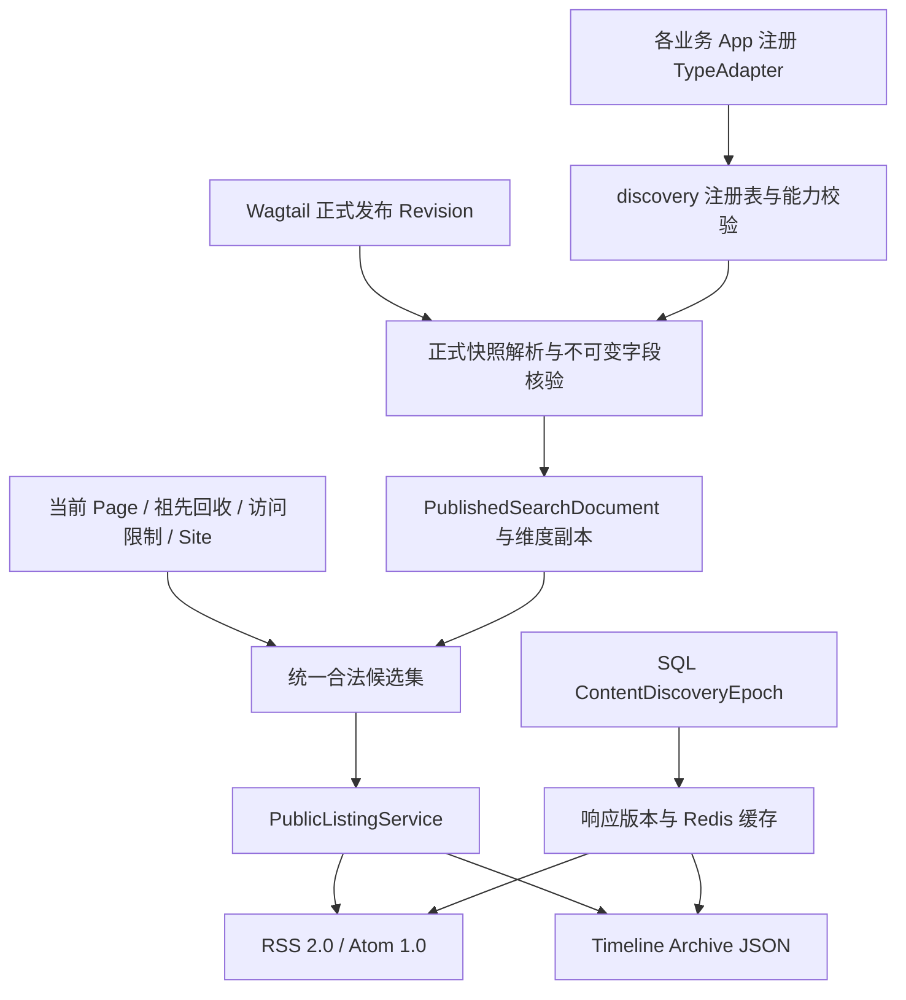

# 全站多页面通用订阅与时间线归档接口框架方案

日期：2026-11-07

状态：架构草案，供生命周期与并发独立审核；不表示已经实现或获准迁移。

源码基线：`6860571a025eb4c50a4dacd0384da3cbd8d6ecdf`。

## 1. 目标与关键结论

建立一套公共框架，让 BlogPage、GuidePage 和未来任意业务 xxPage，通过各自应用中的适配器接入 RSS 2.0、Atom 1.0 和年月归档。公共框架不导入业务 Page，不按类名判断“文章”，也不逐个拼接不同应用的查询。

推荐继续扩展 discovery：共用注册表、正式版本提取和合法候选查询，订阅与归档只负责参数、排序和输出格式。PostgreSQL/Wagtail 继续决定是否发布、发布哪个 Revision；Revision 就是页面的历史版本。Mongo 只提供该 Revision 精确绑定的不可变字段版本，Redis 只保存可重建缓存。

有三项必须在审核前说清：

1. `authored_on` 是成文日期，不是定时发布时间。成文日期不晚于今天，只是附加过滤；不能代替 `live/live_revision_id` 和 Wagtail 定时发布检查。
2. `getattr(ancestor, "is_recycled", False)` 不足以检查祖先：Wagtail 基础 Page 没有项目子类的该字段。必须通过统一服务检查具体类型及有效回收记录。
3. 现有已确认搜索合同要求主库核验，不能直接改为“信任 Redis epoch”。在普通 PostgreSQL + Redis + 提交后通知架构中，**无条件零 SQL 的 304 与立即阻断撤权无法同时保证**。首期推荐主库短查询核验后返回 304，做到零 Mongo、零正文提取、零 XML 拼接；真正零 SQL 快路径作为独立的一致性协议评审项。

这第三项是要求之间的冲突，不应在实现时隐藏。若零 SQL 被认定为首期硬性验收条件，应先批准第 8.5 节的额外前提，再实施。

## 2. 已核对的项目基础

| 位置 | 当前事实 | 本方案处理 |
| --- | --- | --- |
| `discovery/registry.py:19` | 按 type_key 注册，重复注册直接覆盖 | 增加唯一性、能力、公开 slug 校验 |
| `discovery/contracts.py:101` | 有 TypeAdapterContract，尚无订阅能力合同 | 增加 PublicListingCapabilities 与专用输出 DTO |
| `discovery/models.py:19` | get_current_epoch 使用 SQL get_or_create | 读接口改为只读取得已初始化记录；不声称已支持零 SQL |
| `discovery/models.py:49` | 有正式内容副本及标签；允许不同 index_generation 并存 | 只读取已激活代次，补足订阅所需时间及维度 |
| `discovery/projection.py:58` | 直接 adapter.extract(page)，没有在此统一恢复 live_revision | 投影必须经过正式版本解析入口 |
| `discovery/projection.py:80` | document_uuid 缺失时可能随机生成，发布代次固定为 1 | 身份缺失拒绝投影，使用真实发布代次 |
| `discovery/query.py:111` | 基础候选只检查副本 is_live/is_recycled | 加入主库 Page、祖先回收、访问限制及版本一致性检查 |
| `blog/adapters.py:104`、`guides/adapters.py:96` | 栏目页也已注册供搜索使用 | 保留搜索用途，订阅及归档能力显式关闭 |
| `guides/adapters.py:27` | GuideTopic 尚未进入统一发布载荷 | 从正式快照提取专题关联 |
| `people/models.py:19` | Person 有 public_id，没有 slug | 首期作者 URL 使用 public_id 的 UUID 字符串 |
| `content_lifecycle/models.py:19` | CustomBasePage 为抽象模型，is_recycled 位于各具体表 | 回收检查不可只查 wagtailcore_page |
| `blog/models.py:217`、`guides/models.py:369` | with_content_json 按 Revision 指针读取 Mongo | 发布投影可能发生 Mongo IO；缓存命中不应重复水合 |

当前适配器还存在日期缺失回退 `date.today()` 的行为。正式列表不得这样补值；缺少必填日期应作为坏数据报告，不能每天自动改变归档月份。

本机只读核对依赖结果：Python 3.13.2、Django 6.1.2、Wagtail 8.1、psycopg 3.3.7。没有连接数据库或外部存储验证本方案。

## 3. 方案选择与职责边界

三种可行方向：

| 方向 | 特点 | 结论 |
| --- | --- | --- |
| 各应用分别提供 Feed，再在全站合并 | 容易起步，权限、时间、分页和统计重复实现 | 不推荐 |
| 每次遍历所有具体 Page，实时恢复 Revision/Mongo | 版本来源直观，但归档聚合与大量页面读取成本高 | 只适合诊断，不作为正式请求路径 |
| 扩展 discovery 正式副本与统一访问检查 | 复用当前基础，读路径可批量查询，类型扩展由应用完成 | 推荐 |



拟新增职责，名称为本方案提议，当前尚不存在：

| 模块 | 职责 |
| --- | --- |
| `discovery/contracts.py` | 能力协议、维度引用、列表条目及查询规格 |
| `discovery/registry.py` | 适配器注册、公开类型 slug 映射、启动检查 |
| `content_lifecycle/public_access.py` | 批量判定当前页面与祖先是否允许进入匿名公开列表 |
| `discovery/public_listing.py` | 构建共同候选集，统一过滤、排序、统计及分页 |
| `discovery/feeds.py` | XML 生成器和 Feed 元数据 |
| `discovery/archives.py` | 时间范围及月份聚合 |
| `discovery/http_cache.py` | 响应键、条件请求、缓存读写 |
| `discovery/urls.py`、API 路由 | 参数解析和调用服务 |
| 各 App 的 `adapters.py` / `apps.py` | 业务字段映射和注册 |

ContentQuery 与 PublicListingService 共用“合法候选集构造器”。不为订阅复制一套发布和权限规则，也不让 Feed 调用包含分词、搜索分块和高亮的完整搜索流程。

## 4. 页面类型接入合同

### 4.1 能力声明

下面是接口草案，不是现有可导入 API：

```python
from dataclasses import dataclass
from typing import Any, Protocol

@dataclass(frozen=True)
class ListingOptions:
    feed_enabled: bool = False
    archive_enabled: bool = False
    public_type_slug: str | None = None
    supported_dimensions: frozenset[str] = frozenset()

class PublicListingCapabilities(Protocol):
    listing: ListingOptions

    def extract_listing(
        self, published_snapshot: Any
    ) -> "ListingPayload":
        """只映射统一解析器已经确认的正式快照。"""
        ...
```

TypeAdapterContract 保留现有搜索协议，增加可选的 `listing` 能力。缺少该能力的旧适配器视为两个开关均关闭，避免新增框架后把所有注册类型自动公开。

`extract_listing()` 仅负责业务元数据映射；框架在适配器外侧填写、核验 Page ID、稳定 UUID、生效 Revision、实际发布时间和发布代次。适配器不能通过伪造状态绕过统一守卫。

注册时执行 Django system checks：

- type_key、model_label 唯一；同一已注册实例重复注册可无操作，不允许其他实例静默覆盖。
- 开启任一能力时 public_type_slug 必须合法且唯一。
- model_label 对应可用的 Page 子类；正式身份和版本解析符合公共合同。
- 声明的维度必须有字段映射及已注册解析器；未知维度报错。
- 对未提供 authored_on 的模型，可使用应用声明的正式日期映射；不强迫所有未来模型字段同名，但必须返回有效 date。
- 不捕获异常后静默跳过注册。当前 GuidesConfig.ready() 的宽泛吞异常需在实施时调整。
- AppConfig.ready() 只注册对象，不查询数据库、Mongo 或 Redis。

“零硬编码”的边界是：核心引擎不认识 BlogPage、GuidePage、ProjectPage；各应用必须显式说明自己的字段含义。新维度需要新增维度提供者，不可能靠四个布尔/字符串参数自动理解任意业务关系。

### 4.2 当前类型能力

| type_key | public_type_slug | feed | archive | 维度 |
| --- | --- | --- | --- | --- |
| `blog_page` | `blog` | true | true | type、tag、author |
| `guide` | `guide` | true | true | type、tag、author、topic |
| `blog_index` | 不公开 | false | false | 无 |
| `guide_index` | 不公开 | false | false | 无 |

不开启的类型在候选构造阶段就被排除，不能先计数、分页后再删除。栏目页仍可参与原有搜索，其展示页可以提供子内容订阅链接。

公开 URL 使用 public_type_slug，内部查询使用 type_key，两者通过注册表转换，不能假定 `blog == blog_page`。

### 4.3 统一条目与维度

ListingPayload 至少提供：

- `title`、纯文本 `summary`、`authored_on`。
- 已发布关系中的标签、作者、专题引用。
- 业务附加字段仅在明确允许时输出，不直接序列化 extra_data。

框架生成的 PublicListingItem 增加：

- `page_id`、`document_uuid`、`effective_revision_id`、`publication_generation`。
- `public_type_slug`、当前规范绝对 URL。
- `published_at`：首次实际公开发布时间；`updated_at`：最近实际发布事件时间。
- `dimensions`：统一维度引用集合。

不把 Revision.created_at 当成“最近发布”：某版本可能先保存，几天后才批准发布。

维度引用采用 `dimension + namespace + object_key` 稳定识别，另有 public_slug、label、role、sort_order。例如：

| 维度 | namespace | object_key | 对外 slug |
| --- | --- | --- | --- |
| tag | `taxonomy` | Tag ID | Tag.slug |
| author | `people` | Person.public_id | 同一 UUID 字符串 |
| topic | `guides` | GuideTopic ID | `guides--django` |
| topic | `projects` | 项目主题 ID | `projects--django` |

专题使用命名空间避免不同应用的 `django` 撞名；现有专题 API 尚未对外冻结时，推荐从一开始使用限定 slug。旧简写如要兼容，只能在唯一可解析时重定向，歧义返回 400，不能擅自合并两个分类。

作者订阅默认只包含 `primary_author`、`co_author` 角色；其他角色是否属于作者由公共角色配置决定，不能把审校人员自动算作作者。Feed 不输出后台 User 信息或 Person.email。

页面与人员/专题的关联来自正式 Revision；共享 Person/Tag/GuideTopic 的当前公开名称等资料按现有共享资料合同读取。修改共享名称或 slug 也必须触发失效，不能长期沿用投影中的旧显示值。

## 5. 统一发布副本与数据模型

不新增第二套 FeedPublication 或 Mongo 发布状态表。扩展 PublishedSearchDocument，保存必要的列表元数据：

- 核验过的稳定 document_uuid；禁止缺失时随机生成。
- 真实 effective_revision_id / publication_generation。
- 实际 first_published_at / last_published_at，或等义的 published_at / updated_at 副本。
- 提取器/列表格式版本、投影完整性状态。
- 继续保存 title、summary、authored_on；大正文不增加 PostgreSQL 副本。

订阅与归档读取一个明确的 active_index_generation。现有唯一约束只保证 `(page_id, index_generation)` 唯一，不能阻止跨代重复；重建完成后以 SQL 激活指针切换代次并增加 epoch，未完成代次不可读。

标签继续复用 PublishedSearchTag。作者和专题新增通用 `PublishedListingTerm` 关系表，至少包含 document、dimension、namespace、object_key、role、sort_order；使用明确的非空 role（无角色为空字符串），避免 NULL 破坏唯一性语义。稳定身份建立联合唯一约束，反向筛选建立 `(dimension, namespace, object_key, document_id)` 索引。

对外 slug 由维度提供者解析为稳定 object_key，再过滤关系表。由此避免对 extra_data JSON 扫描，也避免同名专题或改名造成错误订阅。

Site 边界以当前请求解析得到的 Wagtail Site 为准。首期保留现有“一页归属一个当前 Site”的规则，并覆盖嵌套 Site 测试；属于嵌套子站的页面不自动出现在父站 Feed。Site 根页面变化、页面移动或域名协议变化应更新归属、URL 与 epoch。将来若要求一页同时出现在多个站点，应单独增加站点成员关系，不能靠一个 site_id 列假装支持。

所有新增表、字段及初始化均需之后单独授权迁移；本轮不生成迁移文件。

## 6. Wagtail 生命周期安全合同

### 6.1 共同合法集合

Feed 条目、Archive items、total_count 和月份计数，必须从同一个合法集合计算：

1. 适配器已注册，且该入口能力开启。
2. 当前 Page 存在，属于当前 Site，`alias_of_id is None`。
3. 当前 Page `live=True` 且存在 live_revision_id。
4. 投影的 effective_revision_id 与当前 live_revision_id 一致，发布代次匹配，属于激活索引代次且投影完整。
5. 当前页及任一祖先都未处于回收/恢复中状态。
6. 当前页及祖先没有有效私有访问限制；祖先若为别名，还要核对源页面限制。
7. 正式快照 authored_on 不晚于固定站点时区的今天。
8. 日期、身份、URL 和字段指针有效；异常时不降级读取草稿或 Mongo 最新版本。

内容副本只能提供候选，不能凭 `doc.is_live=True` 决定公开资格。新发布投影延迟可以暂时少条目；已下架、受限或旧版本条目不得继续出现。

### 6.2 别名与祖先回收

Feed/Archive 直接排除别名，不像评论那样解引用后输出另一个条目。源页面每个站点范围只输出一次；普通复制产生新 UUID，可作为新文章订阅。

Wagtail `Page.get_ancestors()` 返回基础 Page 查询集。项目的 CustomBasePage 是抽象类，所以不能写 `Page.objects.filter(is_recycled=False)`，也不能对基础祖先实例使用默认 False 来判断安全。

统一 public_access 服务必须：

- 检查当前树祖先 ID 与 RecycleEntry 中 `recycled/restoring` 条目的交集。
- 对祖先和目标节点按 content_type 批量读取具体模型的 is_recycled；可由统一模型发现/生命周期注册提供，不按 blog、guides 硬编码。
- 两种来源不一致时拒绝纳入，并产生待对账记录；不能因为一张表“看起来正常”就放行。
- 根据当前 Page 树计算祖先范围；不把 RecycleEntry.original_path 当作永远有效的当前树路径。
- 缺失具体类型或查询失败时拒绝该请求/候选，不用 False 兜底。

框架不额外假设“所有祖先必须 live=True”是 Wagtail 原生规则；应检查真实路由可达性及项目已有约束，避免误排允许存在的未发布祖先下内容。

### 6.3 私有页面

公共 Feed/Archive 永远按匿名公开语义执行。即使请求来自超级管理员、已登录用户或已通过密码的浏览器，也排除私有页面，不调用 `accept_request()` 来扩大结果。

本机 Wagtail 8.1 的 `Page.get_view_restrictions()` 会检查自身、祖先以及别名祖先的源限制；这是语义基准。`.public()` 可作为保守预筛选，但其实现不能直接代替完整的别名祖先核验。

首期采用保守策略：若路径上存在 PageViewRestriction 记录即排除；即使遇到异常残留的 NONE 记录也不放行，先修复或对账。这样可能少显示内容，但不会因误解记录类型公开私有内容。需要精确保留 NONE 时，须增加单独的等价性测试后调整。

批量实现可以使用 SQL EXISTS/NOT EXISTS 和按类型批量读取，但要与原生方法逐例对照。不得按单页 Python 检查后仍使用未过滤集合计算统计，也不得把私有专题名称、作者关联数量留在分桶中。

### 6.4 正式快照与 Mongo

投影统一入口顺序：

```text
读取当前 Page 与发布身份
→ 检查当前 Site、回收及匿名访问资格
→ 固定 live_revision_id
→ live_revision.as_object()
→ 核对 Revision 所属对象及 document_uuid
→ 按该 Revision 指针核验 Mongo 文档/字段/版本/schema/hash
→ adapter.extract_listing(snapshot)
→ 在写锁内重新检查发布身份
→ 保存投影、关联与 epoch
```

`as_object()` 通过项目的 with_content_json 自动水合 Mongo，因此不能把它放到所有缓存命中请求里。正式请求读取已核验的简短副本；投影构建、修复和验收才执行完整快照提取。

快照是正文、标题、日期、作者关系、标签关系和专题关联的共同来源。当前树、Site、权限和回收状态来自当前 SQL 状态，不能恢复成旧 Revision 中的状态。

Mongo 超时、内容缺失或 hash 不匹配时，本轮投影失败且不激活；旧投影若对应旧 live_revision，不能继续输出。不得回退 latest_revision、Mongo 最新字段或空正文。失败产生 Outbox 重试/对账，SQL 回滚不触发 Mongo/RustFS 立即删除。

### 6.5 定时与过期

- `live=False` 或无 live_revision 的未来排期页面永远不入流。
- V1 已发布、V2 未来排期时，继续使用 V1；不能用 V2 的 go_live_at 或日期把 V1 错误隐藏。
- 未来成文日期以正式快照为准，在站点日期到达时才进入列表；这不是触发 Wagtail 发布。
- 对 Wagtail 到期撤销发布，首期以已执行的原生下架结果为准，不私自定义“到点必定生效”的额外逻辑。
- 若将来要不依赖调度器、到 expire_at 即自动隐藏，必须从当前正式版本解释 expire_at，并把下一次时间边界纳入缓存键/有效期；仅靠全局 epoch 不够。
- 回收恢复始终为草稿；重新发布之前不入流。

## 7. 路由、订阅和归档接口

### 7.1 Feed

| URL | 含义 |
| --- | --- |
| `/feed/` | 当前站点全部开启订阅的内容类型，默认 RSS 2.0 |
| `/feed/type/<slug>/` | 注册表中的公开类型 |
| `/feed/tag/<slug>/` | 标签 |
| `/feed/author/<slug>/` | Person.public_id 字符串 |
| `/feed/topic/<slug>/` | 带命名空间的专题 |
| 上述 URL 加 `?format=atom` | 同一筛选条件的 Atom 1.0 |
| `/feed/atom/` | 308 重定向到 `/feed/?format=atom` |

首期每个 Feed 返回最近 50 条，固定 `-authored_on, -page_id`；保留现有成文日期排序合同，不把它称作按实际发布事件排序。RSS 是最近内容窗口，完整历史通过 Archive 获取；若以后需要可靠的“每次新发布事件”订阅或 Feed 翻页，应另定义协议。

维度 URL 可以与其他已支持筛选参数组合，例如：

```text
/feed/tag/django/?type=guide&format=atom
/feed/type/guide/?topic=guides--django
```

维度之间 AND。路径和查询中同一维度冲突返回 400，不静默覆盖。首期同维度只接受一个值；重复参数返回 400。未支持的 format/参数返回 400，未注册类型或不存在的维度对象返回 404，存在对象但没有公开匹配内容返回 200 空 Feed。

页面型维度对象自身私有时按不存在处理。解析错误、404 和路由重定向在条件请求判断之前完成，不能因为 If-None-Match 为 `*` 就把无效资源变成 304。

路由放在 Wagtail catch-all 之前。中文标签和专题采用明确的 Unicode slug 校验或自定义 converter，不能直接使用只接收 ASCII 的默认 `<slug:...>` 然后声称支持中文。

### 7.2 RSS / Atom 输出

使用 Django `Rss201rev2Feed` 和 `Atom1Feed`，必要时仅扩展少量生成逻辑；不手写 XML 字符串。

| 内容 | RSS 2.0 | Atom 1.0 |
| --- | --- | --- |
| 内容类型 | `application/rss+xml; charset=utf-8` | `application/atom+xml; charset=utf-8` |
| 条目标识 | guid=`urn:uuid:{document_uuid}` | id=`urn:uuid:{document_uuid}` |
| 标识性质 | `unique_id_is_permalink=False` | 与 URL 解耦，URL 改变不变 ID |
| 发布时间 | pubDate，RFC 822 日期语义，使用 RFC 2822 兼容序列化 | published，RFC 3339 |
| 最近实际发布 | channel lastBuildDate 反映响应版本变化 | entry updated |
| Feed 最近变化 | SQL 内容版本的稳定时间 | feed updated |

所有 datetime 必须带时区，并统一转换 UTC。DateField `authored_on` 不直接伪装成 UTC 午夜发布时间。

Atom feed 和每个 entry 都有 id、title、updated；feed 有可靠的作者 name 兜底以及正确的 self/alternate 链接。作者以公开姓名输出，可扩展支持多个作者；RSS 不用姓名冒充要求邮箱语义的 author 字段，也不自动公开 Person.email。

Feed 自身 ID 从配置的规范站点及规范筛选身份生成，例如稳定的 tag URI 或 UUID URN；不从任意 Host 头拼接。条目链接使用当前 Site 的规范 HTTPS 根 URL 与已确认路由。路径移动和域名变更不改变条目 UUID。

摘要首期使用经过长度限制的纯文本。Atom 输出 `summary type="text"`；RSS description 使用适合其 HTML 消费语义的文本转义，再交给 XML 生成器。测试 `<script>`、`&`、中文、控制字符及双重解码，不能仅检查 XML 能解析。

不在 Feed 输出正文、后台字段、私有媒体直链或临时 S3 签名 URL；不为构建 Feed 临时上传对象或生成缩略图。

需要专门覆盖 Django 生成器的两个行为：

1. Atom1Feed 只有收到 updateddate 才生成 entry updated，因此必须逐条传值。
2. latest_post_date 在空 Feed 时回退当前时刻，不利于稳定缓存；应使用稳定 feed_updated_at 覆盖，不用请求时间。该时间取 SQL epoch 变更时间、当前日期边界和部署配置激活时间的最大值；同一表示身份下固定不变，且不得早于条目 updated。删除最新文章或跨日纳入内容时也更新 Feed 级时间，不能只取剩余条目的最大日期。

规范审核基准：RSS 2.0 specification、RFC 4287 的 feed/entry 必需元素及 ID/日期规则、RFC 9110 的条件请求语义。

### 7.3 Timeline Archive

```text
GET /api/v1/archives/
GET /api/v1/archives/?type=guide&topic=guides--django&year=2026
GET /api/v1/archives/?tag=django&year=2026&month=11
```

支持 type、tag、topic、year；同时沿用通用框架的 author 过滤，month 用于展开单月。默认 page_size=20，上限 50，使用签名 keyset cursor。

示意返回：

```json
{
  "status": "success",
  "epoch": 142,
  "as_of_date": "2026-11-07",
  "timezone": "Asia/Singapore",
  "filters": {"type": "guide", "year": 2026},
  "total_count": 2,
  "groups": [
    {
      "year": 2026,
      "count": 2,
      "months": [
        {
          "month": 11,
          "count": 2,
          "items_url": "/api/v1/archives/?type=guide&year=2026&month=11"
        }
      ]
    }
  ],
  "items": [
    {
      "id": "a5866f67-0715-4ca8-b947-e3635c1b1a6b",
      "type": "guide",
      "title": "示例指南",
      "url": "https://example.test/guides/example/",
      "authored_on": "2026-11-06",
      "published_at": "2026-11-06T02:00:00Z",
      "updated_at": "2026-11-07T01:00:00Z",
      "summary": "公开摘要"
    }
  ],
  "page_size": 1,
  "next_cursor": "signed-opaque-cursor",
  "cursor_reset": false
}
```

示例为说明分页取 page_size=1，total_count 和 groups 表示全部匹配公开内容；items 只包含本页。不在每个月嵌套全部文章，避免无界 JSON。

统计保留全部当前筛选条件；指定 year 后只统计该年，指定 month 后只统计该月。无匹配结果返回 200，total_count=0、groups/items 为空；数据库错误返回 503，不能伪装空结果。

游标绑定 Site、规范筛选、排序、page_size、epoch、日期及配置版本，记录最后一条 `(authored_on, page_id)`；不能复用现有未签名 offset 游标冒充 keyset。仅 epoch/日期变化时按既有合同回到首页并标记 cursor_reset；签名篡改或筛选条件不匹配返回 400。

月份分组默认只返回有内容的月份。超过配置的分组数量上限时明确返回 groups_truncated 与后续年份查询入口；不得悄悄截断，也不得把整站所有文章作为归档统计输入加载到 Python。推荐上限 1200 个非空月份，作为待压测的初始值。

### 7.4 日期查询与索引

SARGable 指把可比较的原始日期列直接放在查询条件里，方便数据库使用 B-tree 索引。查询采用：

```python
# 2026 年 11 月。日期边界由参数校验器生成。
eligible.filter(
    authored_on__gte=date(2026, 11, 1),
    authored_on__lt=date(2026, 12, 1),
    authored_on__lte=site_today,
)
```

年份范围同样是 `[当年一月一日, 次年一月一日)`。拒绝无法构造下一年边界的 year，不能让 9999 溢出。不要在 WHERE 中使用 EXTRACT(month FROM authored_on) 或 TruncMonth(authored_on) 代替范围条件。

聚合可以使用：

```python
eligible.order_by().annotate(
    bucket=TruncMonth("authored_on")
).values("bucket").annotate(
    count=Count("pk")
).order_by("-bucket")
```

这里的 eligible 已经排除所有非法及重复条目。tag/topic/author 通过 EXISTS 筛选，避免多关系 JOIN 放大计数。若实际使用 JOIN，必须先恢复文档唯一集合，再计算 total/groups/items。

候选索引是 `(site_id, index_generation, authored_on DESC, page_id DESC)` 及增加 type_key 的变体；可按激活状态设计固定条件的部分索引。不要把 `CURRENT_DATE` 写入部分索引谓词。具体索引数量以真实 PostgreSQL EXPLAIN 和数据规模决定，不承诺所有筛选必然走索引，也不为每个维度盲建一份。

## 8. epoch、缓存与 HTTP 304

### 8.1 必须改变版本的事件

全局 ContentDiscoveryEpoch 继续是首期版本源。下列可观察变化必须在对应 SQL 事务中递增：

- 实际发布、撤销发布、回收、恢复、永久删除和别名转普通页。
- 页面或祖先访问限制增删改、组关系变化；即使不改变匿名资格，保守失效也可接受。
- 页面移动、slug/站点归属/域名协议变化、祖先别名绑定变化。
- Tag 合并/改名、Person 公开资料变更、专题公开资料及 slug 变更。
- 发布副本和关系激活、重建代次切换。

仅保存草稿且不改变公开资格时不递增公开内容版本。新增类型能力、格式模板等部署配置使用单独的 registry/render fingerprint 进入缓存身份，不能假定数据库内容变化会替代码部署失效。

### 8.2 ETag 身份

需求中的模板保留为可读前缀：

```text
W/"feed:v1:s{site_id}:e{epoch}:{dim}:{slug}:{fmt}"
```

但它不足以覆盖组合筛选、跨日日期资格和部署配置。实际建议：

```text
W/"feed:v1:s{site_id}:e{epoch}:{dim}:{slug}:{fmt}:q{digest}"
W/"archive:v1:s{site_id}:e{epoch}:q{digest}"
```

digest 使用 SHA-256 的固定长度安全编码，输入为规范化完整筛选、Site 规范来源、站点时区、site_today、active_index_generation、registry/render 版本，以及 Archive 的 cursor/page_size。slug 使用受限编码，不能把原始请求直接拼入响应头。

日期必须进入身份：未来成文日期的页面可能在零点变为可见，此时没有任何 SQL 写操作。只靠 epoch 会把昨天的空 Feed 错误判为今天仍可 304。缓存 TTL 也不能越过该日期边界；时间在一次请求中固定，响应前若越界重新计算。

默认不发 Last-Modified，避免把 epoch.last_mutated_at 误当成所有表示的完整修改时间。以后若启用，需要同时考虑跨日、配置、维度资料和删除事件，并验证 If-None-Match 优先级。

### 8.3 首期推荐的安全请求流程

按现有 SEARCH-RANK-02 合同，在独立、短小的 `REPEATABLE READ READ ONLY` 事务内：

```text
解析并校验参数与 Site
→ 建立主库只读快照，读取 SQL epoch 与 active generation
→ 解析维度、构造该快照下的合法集合/响应身份
→ 验证缓存条目确实对应当前身份
→ get_conditional_response(request, etag=etag)
→ 若为 304/412，补齐缓存头并直接返回
→ 否则读取同版本 XML/JSON 缓存，或从合法集合生成
→ 缓存与输出携带同一个 epoch、日期、配置身份
```

若一个版本尚未生成任何有效表示，先构建或证明该表示可用，再认可其 ETag；不能在投影损坏时凭拼接的字符串返回 304。缓存构建失败返回不可用，不把故障表示与有效空表示共用 ETag。

缓存命中的主库核验可以依赖经过完整覆盖的全局 SQL epoch：缓存生成时已执行全部访问检查，此后任何影响结果的 SQL 变化都在同事务增加 epoch。若写入口覆盖尚未证明，仍需当前访问资格批量核验，不能仅靠 epoch。

首期采用已确认的只读快照时点语义：在该快照建立后提交的并发撤权，影响下一请求；不声称已经撤回在途响应。不能同时声称“省去末尾复核”和“发送前一定看到所有已提交撤权”。更严格的最终复核需另行统一合同。

隔离级别必须在事务的第一条业务查询之前设置；若存在 ATOMIC_REQUESTS 或调用者事务，应调整入口边界。设置失败直接失败，不能像现有代码那样捕获后继续并声称保证同一快照。

304 热路径的验收定义：

- 允许主库 epoch、Site/维度及必要资格核验 SQL。
- 不访问 Mongo/RustFS、不恢复 Revision、不提取正文、不计算统计、不拼 XML。
- 统计完整请求中间件产生的查询，不能只测视图函数。

### 8.4 条件请求与缓存头

使用 Django `get_conditional_response` 处理弱 ETag、多个 If-None-Match 值、通配符及 If-Match 的 412，不手写字符串相等判断。该函数在无需特殊响应时可能返回 None，调用方必须正确继续生成响应。

GET 与 HEAD 均支持；HEAD 可复用元数据/已缓存表示，不为了响应头恢复 Mongo。200 和 304 都写入：

```text
ETag: W/"..."
Cache-Control: public, max-age=0, must-revalidate
```

不启用 stale-while-revalidate、stale-if-error 或 CDN 自行延长过期响应；撤权后旧内容不能作为可接受的陈旧响应。已被订阅客户端下载的内容无法追回，“不泄漏”指服务当前响应的资格保证。

显式 format 不需要 Vary: Accept。若以后加入基于 Accept 的协商，必须把协商结果纳入身份，并返回对应 Vary。Feed/Archive 不依据 Cookie、登录身份扩大结果，也不写 session。

### 8.5 真正零 SQL 的 304：额外前提与不通过项

单纯在 SQL 提交后 `cache.set(epoch)` 有明确反例：

```text
SQL 已提交“祖先变私有”
→ 回调尚未执行、失败或进程退出
→ Redis 仍是旧 epoch
→ Feed 返回旧版本 304
→ 客户端继续使用含该页面的旧内容
```

因此不能以 Redis 命中、短 TTL、on_commit 或双读 Redis 解决这个提交窗口。

若坚持零 SQL，需作为独立变更审核一个写前阻断协议：

1. 所有影响公开结果的写入口先取得现有 ContentMutationGuard，再在 Redis 将公开读取标为 dirty；确认成功后才允许 SQL 改变可见性。
2. dirty 不因超时自动恢复 clean；写进程崩溃后由对账者持同一协调锁核对主库才能恢复。
3. SQL 提交后，按提交版本单调发布新的 epoch/配置/维度及 Site 元数据，再原子转 clean；晚到任务不得倒退版本。
4. 请求仅在同一健康 incarnation 下得到 clean 且有完整表示身份时，可免 SQL 判断 304；dirty/缺失/故障转主库路径或 503。
5. Redis 重启、故障切换、备份恢复可能复活旧 clean。必须有独立可证明的新 incarnation/全站就绪屏障，在完成 SQL 对账前关闭快路径；普通 Redis 键本身不能证明其未回退。
6. 覆盖管理后台、批量操作、定时任务、导入、模型/API、权限 M2M、Site 和共享资料修改，禁止绕过。Site 与维度解析、限流、认证及中间件也不得偷偷查 SQL。
7. 与主库路径统一定义读检查时点；并发写发生在检查后属于在途响应，不能承诺网络发送原子性。

这些是必要条件，不是本草案已经给出的完成证明。该方向让 Redis 的可用性与发布写入发生耦合，超出“Redis 仅可重建辅助”的现有首期合同；必须单独批准、审查并进行崩溃和 failover 实验。

**本草案对“现有合同下首期无条件零 SQL 304”的结论是不通过。** 推荐先交付安全的主库核验 304；不得为满足性能口号牺牲公开权限。

## 9. 锁顺序、幂等、失败与补偿

沿用已批准 MUTATION-LOCK-02，不另建 Feed 专用锁：

```text
ContentMutationGuard
→ Page（同类按 ID 排序，含涉及树节点）
→ WorkflowState
→ TaskState
→ 媒体记录
→ 发布副本/维度关联
→ ContentDiscoveryEpoch
→ OperationResult / Outbox 写入
```

这是公共写入的顺序约束；具体受原生 Wagtail 动作内部锁影响，实施前仍需源码对照和真实并发检验。协调记录必须预先初始化，缺失拒绝变更；不能在请求中临时 get_or_create 后宣称锁可靠。Feed/Archive 正常读请求不取得全局排他锁。

同一 operation_id 的既有结果，应在取得协调锁后、改变任何业务状态前读取并核对操作者、动作、目标和输入摘要；上表末尾是最终结果写入时机，不表示幂等检查可以推迟到操作之后。

耗时 Mongo 读取和摘要提取在锁外完成，记录预期 Revision、发布代次、提取器版本；取得锁后重新核对并短事务写入。版本变更则丢弃结果、有限重试。不得持全局写锁等待 Mongo、传输对象或生成全部 XML。

Outbox 是与业务数据一起保存的待处理任务表。发布/下架/权限变化和 epoch 更新同事务提交，Outbox 补做可重建投影和缓存；on_commit 仅唤醒，不作为唯一可靠通知。

- 事件使用唯一 event_id；投影幂等键至少包括 Page、发布代次、Revision、目标索引代次和提取器版本。
- 重复事件无重复关联；乱序旧事件在锁内被拒绝，不能覆写新发布。
- 新发布导致旧投影版本不匹配时先不可见，补齐后增加 epoch。
- 下架/撤权立即由主库资格及 epoch 阻断，不等待后台删缓存。
- Redis 故障走主库；主库无法核验返回 503，不返回旧缓存或 304。
- Mongo 预写后 SQL 失败保留对象待对账；该功能不增加任何立即物理删除逻辑。
- 对账定位身份错配、孤立投影、落后事件及外置指针缺失；不在 GET 请求中修复数据。

## 10. 五分钟接入 ProjectPage 的示例

前提是公共框架已经按本方案实现，ProjectPage 已具备合法的 Wagtail 保存/发布/Revision 生命周期。五分钟指增加列表能力的代码接线，不包含新模型迁移、Mongo 脱水适配及完整安全验收。

以下接口都是本方案拟新增的 API，当前不能直接复制运行。

```python
# projects/adapters.py
from discovery.contracts import ListingOptions
from discovery.adapter_helpers import RevisionListingAdapter

class ProjectPageAdapter(RevisionListingAdapter):
    type_key = "project_page"
    model_label = "projects.ProjectPage"
    schema_version = 1
    extractor_version = 1
    allowed_filters = ["year", "month", "tag_ids", "author", "topic"]
    weight_profile = {"title": 1.0, "summary": 0.4, "body": 0.1}

    listing = ListingOptions(
        feed_enabled=True,
        archive_enabled=True,
        public_type_slug="project",
        supported_dimensions=frozenset(
            {"type", "tag", "author", "topic"}
        ),
    )

    # helper 只读取统一解析器交付的正式 Revision 快照。
    # 字段映射属于业务 App，公共引擎无需认识 ProjectPage。
    listing_fields = {
        "title": "title",
        "summary": "summary",
        "authored_on": "authored_on",
    }
    tag_relation = "tags"
    author_relation = "authors"
    author_person_field = "person"
    author_role_field = "role"
    author_roles = frozenset({"primary_author", "co_author"})
    topic_relation = "topic"
    topic_namespace = "projects"
    search_text_fields = ("title", "summary", "body")
```

RevisionListingAdapter 是拟提供的声明式 helper：实现 TypeAdapterContract.extract 与 extract_listing，将上述映射转换为 PublishedPayload / ListingPayload，复用公共 Block 文本提取；不是继承 BlogPageAdapter。没有 topic 的页面不声明 topic 能力和映射，没有作者同理；核心不会猜关系名。

```python
# projects/apps.py
from django.apps import AppConfig

class ProjectsConfig(AppConfig):
    name = "projects"

    def ready(self):
        from discovery.registry import register_type_adapter
        from discovery.dimensions import register_topic_model
        from .adapters import ProjectPageAdapter

        register_topic_model(
            namespace="projects",
            model_label="projects.ProjectTopic",
            key_field="pk",
            slug_field="slug",
            label_field="name",
        )
        register_type_adapter(ProjectPageAdapter())
```

如该应用已经注册专题提供者，仅需注册适配器。若有 ProjectIndexPage，其适配器明确配置：

```python
listing = ListingOptions(
    feed_enabled=False,
    archive_enabled=False,
)
```

启用 App 并发布 ProjectPage 后自动获得：

```text
/feed/
/feed/type/project/
/feed/type/project/?format=atom
/feed/tag/python/?type=project
/feed/author/<Person.public_id>/?type=project
/feed/topic/projects--tooling/
/api/v1/archives/?type=project
```

不修改 discovery 引擎、中心 URL 表或模板中的类型列表。为已有发布内容补建投影是受控后台操作，不能在 AppConfig.ready() 或首个 GET 中偷偷回填。

## 11. 定向验收与独立审核清单

以下均是待执行的验收项目，本轮没有执行：

| 组别 | 必须通过的反例 |
| --- | --- |
| 类型扩展 | Blog、Guide、第三个 Project；未声明能力默认关闭；栏目页不计数；重复 type/slug 注册失败 |
| 正式版本 | V1 发布后 V2 改标题/日期/作者/标签/专题保存草稿，各 Feed/Archive 仍完整显示 V1 |
| 定时发布 | 首次未来排期不出现；V1 已发布且 V2 排期时仍显示 V1；实际发布后原 UUID 更新 |
| 回收 | 自身回收、仅父级回收、祖先具体表标志与回收记录不一致、恢复草稿；条目及统计均排除 |
| 访问限制 | 自身/祖先密码、登录、组限制；祖先别名指向受限源；即使超级管理员访问也排除 |
| Site/身份 | 跨 Site、嵌套 Site、移动、域名变化、Alias 排除、普通复制新 UUID |
| 分类 | 同名不同 namespace 专题、中文 slug、Tag 合并、作者角色、资料改名和已删除对象 |
| 304 | 两种格式隔离、多个 ETag、通配符、HEAD、412；非法参数/不存在对象不能变 304 |
| 时间 | 站点零点、跨年、闰年、未来成文日期；SQL 无写入时仍更新表示身份 |
| 标准 | XML namespace、Atom 必需 updated/author、稳定空 Feed 时间、UTC、guid 非链接、特殊字符 |
| 归档 | 同一合法集合的 items/total/groups；多标签/多作者不重复；签名游标、epoch 重置、月范围 |
| 投影 | 多索引代次、重复/乱序任务、Revision/UUID 错配、Mongo 缺失/超时/hash 错误 |
| 并发/故障 | 限权/下架与缓存命中并发；SQL 提交后缓存更新失败；主库或 Redis 故障 |

对 304 的性能测试要断言没有调用 XML 生成、Revision 恢复和 Mongo 读取；推荐基线不能断言零 SQL。若零 SQL 协议单独获准，再对完整 HTTP 请求断言零查询并执行 Redis 回退/崩溃恢复测试。

真实 PostgreSQL 使用两个独立连接测试发布、下架、限权、回收及投影竞争。SQLite、单连接顺序测试或 Mock 不能证明锁安全。

实施后的建议命令，执行前须再次核对 WSL 项目绝对路径及获得相应服务授权：

```bash
cd /mnt/f/openclaw/workspace/wagtail/myblog
pwd
/root/anaconda3/envs/wagtailblog-test/bin/python -m compileall -q discovery content_lifecycle
/root/anaconda3/envs/wagtailblog-test/bin/python manage.py check
MYBLOG_ENV_FILE=.env.test /root/anaconda3/envs/wagtailblog-test/bin/python manage.py test tests.test_public_listing tests.test_feeds tests.test_archives
git diff --check
```

上述测试模块名为计划名称，尚未创建。真实并发测试另用获准的 PostgreSQL 自动测试库，不能使用手工探针库 myblog_test，也不接触旧项目数据。

供 gemini-4-argon 独立审核的重点：

1. 原生 Page/Revision 发布、排期及 alias 更新入口是否全部受控，信号是否可能早于事务提交。
2. 本机 get_view_restrictions 与 `.public()` 在别名祖先上的差异；批量守卫能否等价或保守覆盖。
3. 自定义回收字段的具体模型解析及 RecycleEntry 双来源检查是否漏祖先。
4. as_object 的状态保留、项目水合 IO 和外置指针归属核验。
5. 统一锁是否覆盖权限/Site/共享资料写入，原生动作是否存在反向加锁。
6. 全局 epoch 是否与所有可见性变更及投影激活同事务；失败时能否错误返回旧 304。
7. 确认快照时点安全语义，并对无条件零 SQL 要求给出独立通过或不通过意见。

当前会话没有原生子代理派发工具；本稿没有声称已调用 Argon 或完成独立审核。

## 12. 本轮交付与后续顺序

本轮只新增本方案文档，未修改应用代码、数据、配置或 AGENTS.md；没有迁移、提交、推送、部署。

建议批准后按依赖实施：

1. 正式版本解析、祖先回收与访问限制统一查询；先通过安全反例。
2. 能力注册与维度合同、投影关系和有效索引代次。
3. RSS/Atom 与 Archive，先实现 SQL 核验后的缓存协商。
4. 用第三个页面类型证明无需修改核心。
5. 真实 PostgreSQL 并发、故障、XML 标准与性能验收。
6. 如仍要求零 SQL，另行审批第 8.5 节的协议，不能与首期安全基线混为一项已完成能力。

## 附：本机源码证据

库源码均位于 `/root/anaconda3/envs/wagtailblog-test/lib/python3.13/site-packages/`，仅作本轮只读核对：

- `wagtail/models/revisions.py:170`：as_object 调用 content_object.with_content_json。
- `wagtail/models/revisions.py:204`：Revision.publish 调用内容对象 publish。
- `wagtail/models/pages.py:2019`：祖先来自 base_page_model 查询集。
- `wagtail/models/pages.py:2048`：访问限制包含当前页、祖先及别名源。
- `wagtail/models/pages.py:2104`：with_content_json 保留当前树和部分实例状态。
- `wagtail/query.py:398`：public 的 private_q 实现。
- `wagtail/actions/publish_revision.py:119`：未来 go_live_at 与已有 live_revision 的分支。
- `wagtail/actions/publish_revision.py:145`：实际发布更新 last_published_at/live_revision。
- `wagtail/actions/publish_page_revision.py:45`：page_published 信号及后续 alias 更新。
- `wagtail/management/commands/publish_scheduled.py:93`：按 approved_go_live_at 取得待发布 Revision。
- `django/utils/cache.py:167`：get_conditional_response 的 304/412 分支及返回值。
- `django/utils/feedgenerator.py:268`：空 Feed 时间回退当前时间。
- `django/utils/feedgenerator.py:359`：RSS 2.0 生成与 isPermaLink。
- `django/utils/feedgenerator.py:470`：Atom entry published/updated/author/id/summary 输出。

外部官方文档检索和 Context7 正文读取本轮未取得可用结果；API 行为以上述本机已安装源码为依据。RSS/Atom/RFC 标准的完整符合性，仍需后续规范复核与生成结果验证，不能把设计说明当作已通过标准验证。
