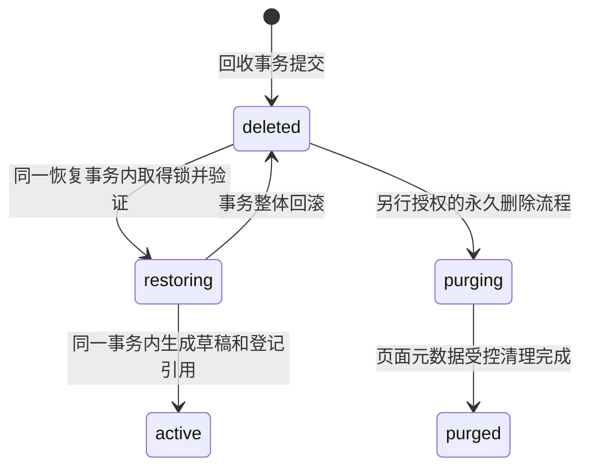
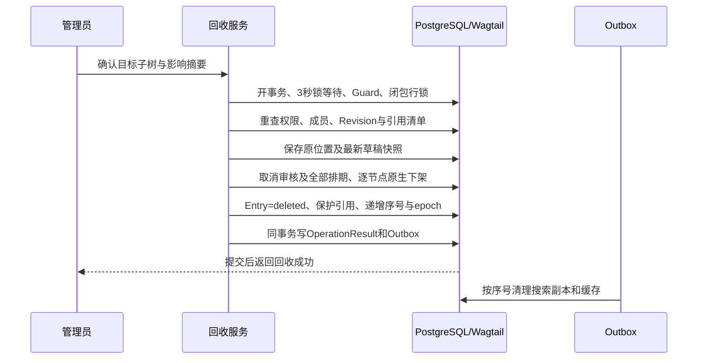
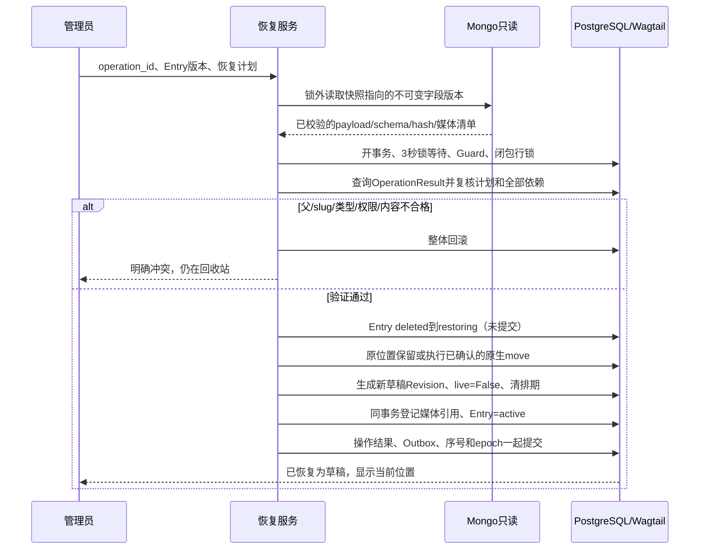

# myblog 十项决策与页面恢复契约完善报告

日期：2026-11-04。用途：更新现行说明书前的架构与契约审查稿。

**结论：采用用户已确认的全部 10 项 A 选项。页面回收保留现存 Page 和整棵子树，正常恢复解除回收状态并生成未发布草稿，保留页面身份及原树位置。不能把恢复实现为硬删除后重建，也不能直接回写历史树路径。**

本文新增接口、数据结构和验收条件均是设计草案，不是已经实现或测试通过的功能。已确认的产品选择无需再次征求选择；候选模型、生命周期适配和具体数据库约束仍需工程审查。本文不授权迁移、连接真实服务、提交、推送或部署。

## 1. 核查基线与必须先修正的前提

本轮核查 Git：分支 `main`，远程 `anc1996/myblog`，候选基线 HEAD 为 `7ce96fe818f1fb7d38d0261465e2ad28b87e2e99`；开始核查时工作区干净。

已读取项目 AGENTS.md、依赖、实际 settings、URL、首页、迁移、搜索入口，以及现行主方案、搜索方案和六项技术审查。历史记忆仅用于定位以往关注点，以下判断以本轮文件和已安装源码为准。

WSL2 中先确认绝对路径 `/mnt/f/openclaw/workspace/wagtail/myblog`，使用指定环境离线核查：

| 项目 | 本轮实际结果 |
|---|---|
| Python / Django / Wagtail / treebeard | 3.13.2 / 6.1.2 / 8.1 / 5.3.1 |
| `myblog` / `home` / `search` 导入位置 | 均位于当前新项目目录；只是当前启动目录下的结果，尚无永久断言守卫 |
| 当前模型 | `home/models.py:6` 仅有空的 `HomePage(Page)`；尚无 identity、media_library、回收模型 |
| 当前搜索 | `search/views.py:20` 仍为基础 `.live().search()`，未实现本文合同 |
| 当前交付 | `myblog/urls.py:14` 仍注册原生文档路由，`:25` 的 DEBUG 媒体静态路由仍存在 |
| 当前容器 | `Dockerfile:4`、`:28` 仍用 Python 3.14 / bookworm；尚未对齐本次决策 |

### 1.1 树模型：是 MP_Node，不是 AL_Page

本机 Wagtail 8.1 的 `AbstractPage` 继承 `treebeard.mp_tree.MP_Node`。Page 的结构字段是 `path`、`depth`、`numchild`；`url_path` 是路由路径，不是树节点身份。它没有普通邻接表的持久 `parent_id`，也没有表示兄弟顺序的原生 Page `sort_order`。

因此，任务中的 `parent_id` 和 `sort_order` 应作为 **RecycleEntry 自己记录的快照字段**：父节点 ID 从 `get_parent()` 取得，同级序号由未过滤的 `get_children().order_by("path")` 计算。不能为此擅自给框架 Page 添加另一套父子外键或排序系统。

Wagtail `Page.move(target, pos=..., user=...)` 会处理树路径、后代 URL 和移动信号；这里的 `pos` 是 `"left"`、`"right"`、`"first-child"`、`"last-child"` 等位置名称，不是任意整数序号。恢复一般不需要调用 move，只有获准的冲突处置才需要。

源码依据见第 10 节的 S1、S2。

### 1.2 “精确回原位置”的可检验含义

正常恢复保证：同一个 Page ID、同一个父节点 ID、同一个保留的兄弟位置、同样的子树父子关系；不自动改 slug，不复制页面，不自动追加到末尾。

`path` 的字符串编码可能因 treebeard 重排而改变；父级改 slug 也可能合法改变 `url_path`。不能承诺把历史 path/url 字节写回后还能保证当前树正确。

如果原父节点仍在但已移动到其他位置，恢复不能悄悄宣称“原位置完全还原”。默认返回位置变化冲突，显示旧路径和现路径；管理员可明确接受“恢复到原父节点当前所在位置”，并记录 `placement_result=accepted_parent_change`。父级只改名称或 slug、父子关系不变时，显示 URL 变化提示，使用当前合法 URL，不倒退父级修改。

原兄弟已永久移除时，“历史第 N 名”不一定还有相同含义。正常操作通过保留占位节点维护位置；发现占位位置已被绕过修改，严格恢复应暂停，不能静默降级为近似恢复。第 4.4 节规定具体判定。

### 1.3 框架机制不能替代项目合同

1. 原生 `unpublish()` 是下架流程，但对原本 `live=False` 的对象不执行完整分支。因此回收必须额外处理所有相关 Revision 的排期元数据。
2. 原生 `Page.route()` 在最终目标判断 `live`；不能认为只下架父页就一定阻断后代直达 URL。必须回收、下架整个目标子树，并在统一读取服务检查回收祖先。
3. `with_content_json()` 刻意保留当前树位置和部分生命周期字段。不能把历史 JSON 解包当成恢复生命周期的全部步骤。
4. 原生批量 Rendition 生成路径包含直接 `file.delete()`。接管 `post_delete` 信号还不足以保证跨存储失败对象保留。
5. `construct_explorer_page_queryset` 只负责特定后台列表；不是预览、选择器、模型层调用或公网访问的安全边界。

## 2. 10 项决策的落地修订案

### 2.1 决策 1：媒体权限修改默认阻断，确认后才连带下架

契约编号：`MEDIA-ACL-02`。

提供两个明确分开的内部动作：

```text
plan_restrict(asset_id, actor) -> RestrictionPlan
restrict(asset_id, actor, operation_id, confirmed_plan_token=None) -> OperationReceipt
```

`RestrictionPlan` 至少包括资源版本、当前权限版本、受影响 Page ID、有效发布 Revision、发布序号、别名依赖、影响摘要、生成时间和短期确认凭证。列表必须来自正式发布版本的完整媒体引用，不从搜索索引或最新草稿推测。

行为约定：

- 没有受影响公开页面：锁内核验后允许修改，记录审计与 epoch。
- 存在受影响公开页面且未确认：返回 `409 affected_publications`；权限与发布状态均不变，展示有权查看的影响清单。
- 管理员确认：必须具有资源权限修改权及本次连带下架授权；确认不是普通编辑按钮自动附送的布尔值。
- 执行时重新计算影响集合。确认凭证绑定操作者、动作、资源版本及影响摘要；页面、新发布 Revision 或权限发生变化就返回 `409 impact_changed`，重新确认。不能只信浏览器传回的 Page ID 列表。
- 在同一 PostgreSQL 事务内，通过原生动作下架全部受影响页面及必要别名，修改资源权限、更新发布序号、引用视图、Outbox、操作结果与 epoch；任一步失败全部回退。
- 历史/草稿引用继续保护资源，但不会仅因这些引用而下架另一篇无关的公开文章。
- 已安排的发布或审批不能绕过新的权限：执行入口重新核验资源，失效任务不发布；对本次明确取消的排期另外记录取消结果。
- 改回 public 不自动重新发布任何页面。

列表应区分“直接引用该资源的公开页”和“别名等依赖导致一起下架的页面”。不能用 `Page.objects.live()` 加草稿关系，漏掉旧正式版本仍在引用资源的情况。影响集合不完整时拒绝执行。

文件交付继续每次鉴权；已经发送或在途的字节无法召回，不承诺传输中途撤回。

### 2.2 决策 2：A 有结果仍只显示 A，1–4 条时手动展开 B

契约编号：`SEARCH-MODE-02`。

模式判定在应用全部筛选和权限后的候选 E 上完成，按 Page 去重计数。门槛是整个 A 集合的 `COUNT(DISTINCT page_id)`，不是当前页剩余数量。

| 当前 A 数量 | 默认结果 | 可选动作 |
|---|---|---|
| ≥5 | 仅 A | 不显示“分词匹配”补充按钮 |
| 1–4 | 仅 A | 列表底部显示“展开分词匹配” |
| 0 | 沿用 B，再按已有 C 规则回退 | 保留同义词开关 |
| 无关键词 | FILTER | 不进入 A/B/C |

新增 `secondary=none|words`，与已有只控制 C 的 `expand=auto|off|on` 分开。用户点击后仍完整保留 A，在其下方单独显示 B 补充区域；B 排除该次快照中已属于 A 的 Page。不得把 B 塞进 A 的分页列表，也不得把标题改为一个混合的“共 N 条”而不解释组成。

推荐结果结构：

```text
primary:    {mode, items, total_count, facets, next_cursor}
supplement: null | {mode: "B", items, total_count, facets, next_cursor}
can_expand_words: bool
corpus_epoch, query_version, normalized_filters, notices
```

手动补充分词默认只展示 B，不隐式再加 C；用户另行请求同义扩展时，补充区域才按 B/C 等级展示，并排除 A。A 为零时既有 B/C 自动回退规则继续有效，C 的默认门槛和质量参数不因这次“全部选 A”自动变成已压测定值。

补充区用自己的游标和统计，界面标明“分词匹配中的数量”；两区同时返回时必须来自同一个数据库快照。A 不足 5 条自然能在第一页完整展示。若点击时数据变化使 A 已达到 5 条，返回当前 A 及结果变化提示，关闭不再适用的补充区，避免使用旧按钮强行改变策略。

### 2.3 决策 3：只有原句字符串重叠，词向量不重叠

契约编号：`SEARCH-CHUNK-02`。

将原方案“一个分块同时保存原文和两类词向量”改为两个逻辑数据集，允许分表：

```text
PhraseChunk(document, field, segment, chunk_no,
            core_start, core_end, text_start, text_end,
            normalized_text, display_offset_map)

TokenChunk(document, field, segment, chunk_no,
           token_start, token_end, char_start, char_end,
           vector, token_offset_map, main_token_count)
```

- PhraseChunk 的核心区间不重叠，实际字符串可包含前一核心区末尾 256 个归一化字符；只在同一逻辑段内重叠，不跨字段、段落或代码边界。
- 256 以 Unicode 字符计，不以 UTF8 字节计。首块不需要前缀；q 原始和归一化后均不得超过 256 字符。
- TokenChunk 在完整逻辑段统一分词后，按主词元边界切分，主词元区间不重叠，不重复给 GIN 存储同一个边界区的词元。
- 首版采用一个受 GIN 索引的 `vector`，来自主词元流；专业词用同版本保护词处理。旧文中“可增加搜索模式子词”暂不作为默认索引输入，避免把人工排列的子词当成真实词距。
- 如后续确需扩展子词召回，应独立评审其词位与排名方案，不能悄悄再复制一份重叠排名向量。
- 每块继续执行现行 8KiB UTF8 / 2048 主词元候选上限及实际向量大小检查；超限重新切 TokenChunk 不加重叠，切 PhraseChunk 仍保留原句覆盖。
- A 用原文字符串复核技术词边界；B/C 的 AND 可以由不同 TokenChunk 的 EXISTS 满足。
- 同一 A 命中可落在两个字符串块里，按 `(field, segment, absolute_start, absolute_end)` 去重，再按 Page 聚合；摘要与高亮使用绝对位置。
- 词频和长度只使用不重叠主词元，不从 PhraseChunk 求和。

“节省一半 GIN 空间”是优化目标，不是已证实结论。节省比例取决于原块长、词分布、索引压缩、是否保留其他向量；`pg_trgm` 字符串索引仍有自己的重叠成本。验收使用同语料和相同配置的索引字节、构建时间和查询结果对照，不能承诺固定减半。

### 2.4 决策 4：短 REPEATABLE READ；O 允许整项降级

契约编号：`SEARCH-SNAPSHOT-02`、`SEARCH-RANK-02`。

搜索的一致性时点定为本次主 PostgreSQL 事务取得快照的时刻。该事务内统一取得权限范围、epoch、正式发布身份、匹配、精确总数、分桶、排序、分页和摘要数据；不在请求末尾另开一次主库核对。

```text
非嵌套的专用读取事务
  -> 在任何业务 SELECT 前 SET TRANSACTION ISOLATION LEVEL REPEATABLE READ READ ONLY
  -> 从主库读取当前身份范围、会话授权版本、epoch、索引代次
  -> 校验游标，必要时清除其位置并重跑第一页
  -> 计算 E、模式、结果与统计
  -> 完整物化为无懒加载的 DTO
提交读取事务
  -> 用 DTO 渲染响应
```

`atomic()` 默认隔离级别不是 REPEATABLE READ。若启用 `ATOMIC_REQUESTS` 或请求前置逻辑已在同一个事务查询，不能再用一个嵌套 atomic 冒充新快照；应使用非原子视图入口或明确的独立读取连接，并验证连接池归还后的事务设置。不得用全局 `SET` 污染复用连接。

权限涉及的 SQL 数据在同一快照读取，不直接复用 `request.user` 已缓存的组权限。会话可以提供身份线索，但 Redis 不能成为可搜索资格的裁决依据。密码访问凭证需与快照中的访问规则版本核对。

**必须同步改写旧的时间承诺：** 事务取得快照后才发生的下架或撤权，不能使正在运行的 REPEATABLE READ 重新看见新值。因此搜索保证“快照时合法、下一次新快照生效”；不再承诺“响应发出前最新状态再次核验”。这是已选决策 4 的必然边界，不能同时保留旧说法。详情页和媒体交付仍使用各自响应提交前的当前权限检查；搜索结果点击后仍会重新鉴权。

短事务不得包含 Mongo、RustFS、缩略图计算、网络发送或慢模板查询。设置查询与事务预算，超时返回不可用，不伪装为空结果。缓存只能在快照内读取的 epoch、配置和权限范围相符时复用；最终响应所需数据须完整物化，禁止退出事务后再由模板访问 ORM。

O 是基于原文偏移的跨块词距特征。定义两个全局版本化配置：

```text
full: score = 0.55F + 0.20T + 0.15O + 0.10I
base: score = (0.55F + 0.20T + 0.10I) / 0.85
```

F 继续使用 `ts_rank_cd` 的块内内置词距和既定归一化；base 不再计算跨块 O，也不宣称仍有跨块邻近能力。切换需改变 `ranking_version`、epoch 和缓存键，使旧游标失效；不能同一份结果只给部分文档降级、只重排前 100 条，或在分页之间暗换公式。

### 2.5 决策 5：协调锁限时；Rendition 不抢全局锁

契约编号：`MUTATION-LOCK-02`、`RENDITION-02`。

每个取得 ContentMutationGuard 的事务，必须在尝试行锁前执行 `SET LOCAL lock_timeout = '3s'`。配置应在公共事务入口统一执行，而不是依赖个别调用者记住。

3 秒是每次数据库锁等待的上限，不是整项操作的最长时间；另外设置并验证事务/语句预算。锁超时后退出并回滚整个业务事务，返回 `503 content_busy` 和短期重试提示；只允许用原 operation_id 重试，不在已失效的事务里继续 SQL。

协调行不存在时拒绝写入。行锁不负责公平排队，也不能仅因加锁就声称已证明无死锁。

前台常用尺寸清单按模板实际使用列为固定配置并版本化。保存草稿同事务写预生成任务；发布准备阶段确保必要派生图已就绪，再进入短发布事务复核版本。草稿保存不因图片计算失败而丢内容；必要派生图未就绪时发布返回可重试状态，保留草稿。不能在 ContentMutationGuard 持有期间读取原图、计算图片或上传。

派生图工作者只取得图片行锁，使用 `(image, filter_spec, focal_point_key)` 唯一约束。它不获取 Page、工作流或全局协调锁；模板也不能在页面事务内懒生成。

建议流程：图片行锁下检查资源未删除、登记生成租约；锁外计算并上传不可变候选 key；重新锁图片，核对源文件版本、焦点、资源状态和租约后登记 Rendition，重复任务复用赢家。删除服务也锁同一图片，并把未完成生成租约作为删除阻塞条件。

源图替换生成新资源/新文件身份，不覆盖旧 key。SQL 登记失败、唯一冲突输家或超时未知的对象保留待对账；不立即删除候选文件。仅过期租约不足以证明对象上传已经停止，回收候选前须核对工作者与对象清单。

原生 `get_rendition()` / `get_renditions()` 的实际调用路径需要受控适配，尤其批量生成的直接删除路径。唯一约束仅保证 SQL 不重复，不能自动撤回已上传对象。

### 2.6 决策 6：音视频每次鉴权，生产内部转发，本地 ASGI 异步流

契约编号：`MEDIA-DELIVERY-02`。

共同入口为资源稳定 ID，参数含必要的 Page/Revision 使用上下文；不能允许浏览器传任意桶、key、上游地址或内部代理路径。`GET`、`HEAD`、Range 续传、条件请求均先由 Django 检查当前用户、资源、页面有效版本和回收状态。

生产流程：

```text
浏览器 -> Django 鉴权 -> X-Accel-Redirect 内部位置
                         -> Nginx 流式代理 -> 私有 RustFS
```

内部 location 必须声明 `internal`，禁止公网直达；Nginx 上游和桶由配置固定，应用只输出经过编码检查的受控对象标识。RustFS 私有鉴权必须由内部 S3 签名组件或仅供 Nginx 使用的短期上游授权解决。`X-Accel-Redirect` 本身不会生成 S3 SigV4 签名，也不会让私有桶自动可读。

如内部采用短期预签上游 URL，它只在服务端内部流转，不返回浏览器、不写普通访问日志；这不改变“每次浏览器请求必须经 Django 鉴权”的规则。是否采用签名内部代理由部署任务评审，不以公开桶绕过。

先鉴权再处理 304/206/416；禁止缓存绕过授权。默认 `Cache-Control: private, no-store`，不暴露上游凭据或对象地址。验证 Content-Length、Content-Range、Accept-Ranges、ETag/Last-Modified、If-Range、HEAD 空响应体，以及拒绝范围时的 `416` 和 `bytes */size`。首期明确支持单 Range；多 Range 返回受控错误且 UI 使用常规单 Range，不声称已支持 multipart。

本地使用 ASGI 服务加 `StreamingHttpResponse` 的异步迭代器；新增 ASGI 入口及开发启动说明。当前 WSGI gunicorn 启动命令不能证明异步流已成立。boto3 是同步客户端，不能把它的阻塞 read 直接放进 async generator；如沿用 boto3，使用有并发上限的专用线程池分段读取，并在取消/断连时关闭流；也可另行评审原生异步 S3 客户端。

不得整文件读入内存，不得依赖 Django 同步/异步迭代器自动转换。压测应覆盖慢客户端、断连、并发 Range、线程池饱和和内存峰值。

### 2.7 决策 7：Python 3.13 / trixie；导入路径守卫

契约编号：`ENV-IMPORT-02`。

Dockerfile builder/runtime 同时改为 `python:3.13-slim-trixie`，按该发行版核对运行库；不是只改一个 FROM 或只改注释。后续锁定依赖、构建并记录镜像摘要，此报告不宣称镜像构建通过。

项目提供无外部 IO 的启动断言模块：以入口文件解析出的绝对仓库根为基准，用 `find_spec` 核对项目包、settings 和所有本项目 App 的 origin/search locations 均处于根内，发现共享 Conda 旧站同名模块立即失败。

守卫应早于 `django.setup()`，覆盖 manage.py、WSGI、ASGI、测试入口及 Outbox/定时命令；不能只比较当前工作目录，不能只在测试模块导入后再检查。命名空间包、符号链接路径先 resolve，不能用字符串前缀判断目录包含关系。

第三方 Django/Wagtail 位于环境 site-packages 是正常情况，守卫只约束第一方模块并核对所选框架版本。部署目录 `/app` 与 WSL 路径不同，根应从当前安装文件导出，不硬编码 F 盘。反例测试让外部同名包先占导入路径，必须在任何服务连接/写入前失败。

### 2.8 决策 8：身份与媒体模型路线已确认

契约编号：`IDENTITY-01`、`MEDIA-MODEL-01`。

- `identity.User(AbstractUser)` 位于 `identity.0001_initial`，先设 `AUTH_USER_MODEL="identity.User"`，Person 仍独立。
- `media_library.Image(AbstractImage)`、`Document(AbstractDocument)`、`Rendition(AbstractRendition)` 从新库首轮业务迁移即使用；保持原生表单字段、Collection、标签和必要索引。
- 设置 `WAGTAILIMAGES_IMAGE_MODEL`、`WAGTAILDOCS_DOCUMENT_MODEL`；Rendition 通过所选 Image 的反向关系识别，不虚构单独的 rendition setting。
- Rendition 的 `image` FK、`related_name="renditions"` 及三字段唯一约束必须符合本机 8.1 系统检查。
- identity 首迁移不能依赖 Page、Person 或媒体。media_library 的用户、Collection、taggit 等依赖按实际字段和候选迁移生成，不能靠 INSTALLED_APPS 排序代替。
- 先离线检查完整依赖图，再按单独授权核验实际迁移史及隔离空库初始化。当前仓库存在 home 迁移不代表运行过；也不能为接入 User 而删除或重跑现有数据迁移。

原文“推荐采用，等待用户选路线”应改为“用户已确认，等待候选模型和工程验证”；确认模型路线不等于授权迁移。

### 2.9 决策 9：日期、API、HTML 边界已定

契约编号：`PAGE-DATE-01`、`EDITOR-SAFE-01`。

HomePage 不要求 authored_on；所有业务 Page 与栏目 Page 必填 DateField，纳入 Revision。后台新建表单以项目配置时区的当天预填，后续编辑不重写。程序创建必须显式给有效值；不使用 auto_now/auto_now_add。复制和历史恢复保留原日期，不改成恢复当天。

首期不注册 API v3 路由；必须测试匿名、登录及管理员对候选 v3 地址均无可用入口，不能只隐藏菜单。其他已有 API/文档/图片入口仍需分别检查，关闭 v3 不等于媒体安全自动完成。

不提供独立 RawHTMLBlock。RichText、Markdown、Table 中允许的 HTML 统一按版本化白名单净化；Table 的 rowspan/colspan 等已确认功能仍保留。Mermaid 的 SVG 导出和渲染另做净化，不能因为没有 RawHTMLBlock 就信任所有 HTML/SVG。历史内容按原 schema 读取，不借此删掉复杂表格、数学或图表需求。

### 2.10 决策 10：原树回收、整树处理；游标过期自动第一页

契约编号：`RECYCLE-RESTORE-01`、`SEARCH-CURSOR-02`。

有子页面时目标是整棵子树，不能自动提升子节点，不能仅标记根而遗漏其余节点。回收保留树节点、Revision 与 Mongo 内容；恢复细则见第 3–7 节。

搜索游标必须先验证签名、条件、身份范围、Site、配置及有效期。仅 epoch 变化时，在同一个新快照中保留当前筛选，清除游标位置，从第 1 页重新执行，返回：

```text
cursor_reset = true
reset_reason = "corpus_changed"
notice = "内容已更新，已回到第 1 页。"
```

该新第一页重新判断 A/B/C 和补充区资格，不沿用旧模式判定。游标签名伪造、条件不一致、身份改变等错误不能伪装为 epoch 变化后继续使用旧授权；身份改变应丢弃旧游标，以新身份执行新的第一页请求，旧私有结果绝不复用。

若游标在新快照建立后才再次遇到外部 epoch 更新，本次仍返回该快照的合法结果；下次请求再重置。不能在一次响应内无限循环追逐最新 epoch。已展示旧结果应整体替换，不追加到旧列表造成重复。

## 3. Restore 的范围、状态机与数据结构

### 3.1 两种“恢复”必须分开

`restore_recycled_batch` 解决误删：解除原节点的回收状态，使用回收时保存的最新草稿快照。

`restore_revision_as_draft` 解决历史内容回退：给仍活动的页面以指定旧 Revision 生成新草稿。

二者都不自动发布，都不修改历史 Revision 的内容。不能恢复回收页时默认选择上次正式版，丢掉删除前尚未发布的编辑。草稿缺失时使用受控回收前补存的快照；不能现场取 Mongo “最新内容”猜版本。

### 3.2 最小数据草案

以下为伪结构，字段类型与迁移依赖需实施阶段核定。原始快照字段创建后不可变；状态、版本号和完成信息可更新。

```text
RecycleBatch
  id: UUID
  root_page_id_snapshot: bigint
  root_page: nullable FK(Page, SET_NULL)
  operation_id: UUID
  actor_id / created_at / reason
  status: deleted | restoring | active | purging | purged
  state_version: bigint
  snapshot_digest / member_count
  restored_at / restored_by / restore_operation_id
  placement_result / resolution_audit

RecycleEntry
  id: UUID
  batch: FK(RecycleBatch)
  page_id_snapshot: bigint
  page: nullable FK(Page, SET_NULL)
  document_uuid: nullable UUID
  original_parent_id: bigint
  original_parent: nullable FK(Page, SET_NULL)
  original_ancestor_ids: ordered array
  original_path / original_depth / original_url_path
  original_sort_order: int             # 全部兄弟中的 0-based 序号
  original_prev_sibling_id / original_next_sibling_id
  original_sibling_ids: ordered array  # 去重共享快照可存在批次附表
  original_slug / snapshot_draft_slug / original_locale_id / original_site_ids
  page_model_label / content_schema_versions
  snapshot_revision_id / latest_revision_id_before
  live_revision_id_before / was_live
  intro_version_id / body_version_id / content_hashes
  reference_manifest_version / reference_manifest_hash
  status: deleted | restoring | active | purging | purged
  state_version / restored_revision_id

RecycleBatchMember
  batch_id / page_id_snapshot
  entry_id
  membership: newly_recycled | already_recycled
  blocking_batch_id: nullable

OperationResult
  operation_id: UNIQUE
  actor_id / action / target_batch_id / input_hash
  result_code / result_payload / completed_at
```

关键数据库约束：

- `UNIQUE(batch_id, page_id_snapshot)`；同一 Page 最多一条处于 deleted/restoring/purging 的 RecycleEntry，使用 PostgreSQL 条件唯一约束。
- 外键删除不得级联删掉回收审计；除允许清理的当前 FK 外，原始 ID 标量永久保留。Page 已永久移除则不再承诺可恢复。
- 一个节点与批次的成员关系只登记一次，重复请求不会重复累计保护计数。
- snapshot_revision 必须属于同一 Page；intro/body 身份、schema、hash 与该 Revision 一致。
- 这些跨表条件不能全部用 CHECK 实现，需服务核验和针对性约束/测试，不能写个 schema 就声称全部由数据库保证。
- 回收后若再次恢复、再回收，新建新的批次和 Entry；旧 active 记录作为审计保留。

不在 Page 上增加第二个 `is_deleted` 裁决字段。是否回收以当前有效 Entry 为准；若为了查询增加缓存标记，它只是受约束的投影，缺失或不一致时拒绝公开和永久删除。

### 3.3 状态机



正常恢复用一个短 SQL 事务完成 `deleted -> restoring -> active`。`restoring` 不作为分两次提交的长时任务状态；其他事务在提交前仍看见 deleted，提交后看见 active，避免进程崩溃留下半恢复页面。失败分支是回滚，而不是提交一半后再“补偿改回 deleted”。

批次状态与其本次归属的 Entry 状态在同一事务改变。批次 active 表示本批次负责的新回收节点已恢复；不代表其 `already_recycled` 依赖节点也已恢复。

`active` 只表示脱离回收站，可以编辑草稿，**不表示 live=True**。purged 为终态，普通还原不允许从中重建同 ID 页面。

所有非 active 状态均阻断公开交付、普通编辑、发布、复制和新增子页；回收站专用只读预览和受控恢复另行授权。

### 3.4 嵌套批次：避免恢复父页时误恢复更早删除的子页

例如先回收子页 B，再回收父页 A。A 的批次要覆盖当前物理子树，但：

- 活动节点创建归属 A 的新 Entry。
- B 及其原批次节点仍归属原 Entry；A 只登记 `already_recycled` 依赖，不覆盖 B 的删除时间、原草稿或操作人。
- 恢复 A 时，只恢复本批次 `newly_recycled` 的节点；B 继续回收。这是恢复到“删除 A 之前的状态”。
- 恢复 B 前，必须先让其全部祖先活动；不允许单独恢复后代而留下回收祖先。
- A 尚未恢复时，B 的普通一键恢复返回父级回收冲突。管理员迁移到新父节点只允许处理完整批次根，且不能绕过其他未解决批次依赖；复杂依赖先恢复父批次再处置。
- 永久删除 A 涉及 B 时，必须显式把依赖批次及媒体影响纳入删除计划，不能普通级联偷偷删除 B 的回收记录。

批次操作按成员集合核验，不凭现在的 `path startswith` 直接推导全部历史归属。

## 4. 原位置保留与冲突处理

### 4.1 回收前记录什么

在协调锁内重新读取真实子树与未过滤的兄弟集合，再记录父 ID、祖先 ID 序列、path/depth/url_path、原序号、左右相邻 ID、完整兄弟 ID 序列和 slug。

保存每个节点删除前最新草稿的精确 Revision 指针、此前 live_revision 指针及外置字段身份。已经存在的最新 Revision 直接引用；无有效 Revision 的受支持页面必须在回收事务中通过受控保存生成快照，不允许进入不可恢复的“只有标题记录”状态。

记录实际 Site 根匹配集合，不能假设 Page 有唯一 Site 外键。树根及任一 `Site.root_page` 默认禁止回收；先迁移站点根属于另一项管理员操作。HomePage 日期豁免不代表它可以被删除而让 Site 失效。

### 4.2 占位节点就是正常恢复位置的依据

回收不调用 move、不改 slug、不删除 Page、不减少 numchild。已回收页面仍在物理树中占据原位置，后台仅通过查询和动作限制隐藏。

所有新增、移动、排序和 slug 修改的命名空间检查都包含回收节点。普通 explorer 隐藏不等于释放 slug 或空出排序位置。

涉及回收节点或含回收后代的移动，以及会让活动兄弟跨过回收占位节点的重排，必须拒绝或走专门位置变更计划。排序界面不能把过滤后的列表重新从 0 编号回写整组兄弟。管理员也不能凭普通“移动”权限破坏回收时保留的位置。

允许不改变保留位置的活动页面内容编辑和安全追加；新插入/移动必须用包含占位节点的完整兄弟序列验证。不能为了隐藏回收页重写全局 Page manager，使框架 get_children/get_parent 看不见这些结构节点。

### 4.3 父节点与类型冲突

恢复前逐项检查：

1. 原 Page 仍存在且身份、类型正确；否则返回 `410 page_purged_or_missing`，保留审计。
2. 原父节点存在，且没有 deleted/restoring/purging 的祖先；否则返回 `409 parent_missing` 或 `parent_recycled`。
3. 本批次中一起恢复的父节点可作为合法“计划活动”父节点；外部批次的父节点不能假装已恢复。
4. 原父节点的祖先身份序列仍相符。发现父节点已换位置，默认停止并显示冲突。
5. `specific_class.can_exist_under(parent)` 必须通过，核对 `parent_page_types` 与 `subpage_types` 双方；所有内部父子边都检查，不能只检查根。
6. 管理员指定新父节点时，还核对 `can_move_to()`、语言、树深上限、数量限制、站点/权限变化和不能移入自身后代。
7. 原地恢复不是新建，不能机械调用 `can_create_at()`：它含 is_creatable 和新建数量语义，可能把本来已计入数量的页面重复计算。max_count/max_count_per_parent 应按包含回收节点的实际物理数量核验；迁移时排除自身一次。
8. 权限以当前配置为准，不恢复旧权限快照，不把原 owner 或旧后台许可当成当前恢复授权。恢复操作需要独立 restore 权限，并核验整批及目标父级权限。

如果类型配置已经改变，返回 `409 tree_rule_changed`。先改合法配置或由管理员指定合法新父节点；不能 `save(clean=False)` 掩盖结构不合法。

### 4.4 slug、顺序及 URL 冲突

**slug。** 原地保留节点会自然保留原 slug；Wagtail 原生可用性检查也查询全部兄弟。本项目的所有创建/复制/移动/改名入口都必须在协调锁内执行同样检查。普通受控路径不应产生“新页抢了回收页 slug”的情况。

若导入、历史缺陷或外部 SQL 已造成冲突，严格恢复返回 `409 slug_conflict`，列出有权查看的冲突节点，不覆盖、不自动加 `-2`。管理员可在冲突解决表单中明确输入新 slug；改名属于有记录的恢复方案，并重新校验整棵恢复树的 URL。

另存 `snapshot_draft_slug`：已发布页的最新草稿可能已经提出改地址，而当前树节点仍保留旧 slug。二者不同时，返回 `409 draft_slug_differs`，要求明确选择保留原树地址还是采用删除前草稿地址，逐节点记录选择。不能为了原位置恢复静默丢弃尚未发布的 slug 编辑，也不能把草稿里的地址默认为已经正式占用。

Wagtail 的父关系来自 path，不能虚构 `UniqueConstraint(parent_id, slug)` 已经建在框架 Page 上。首期依靠统一协调锁、原生校验及禁止绕过入口；若以后引入独立 slug 预留表，须单独设计并证明双向一致。

**顺序。** 默认不移动节点，原位置直接保留。对已保存的兄弟 ID 序列做核验：剔除已经合法移出或永久删除的旧兄弟后，存活旧兄弟与回收节点的相对先后必须不变；新兄弟不得通过重排挤走受保护的占位关系。原序号用于审计和异常定位，不当作可直接写入 Page 的字段。

如果仍在原父下但确有位置漂移，默认返回 `409 placement_changed`。管理员可查看“恢复到原左/右邻居之间”的明确计划，通过 `Page.move(target, pos="right"|"left")` 修正，再重新读取整棵受影响树。两侧锚点都不存在、锚点已不在原父下或顺序矛盾时，不能声称能精确还原，必须要求显式选择目标位置。

**URL。** 从当前合法父链和确定的 slug 重算；旧 url_path 仅用于差异提示与审计。不得覆盖其他页面的路由或自动创建指向未发布草稿的公开重定向。父级 slug 合法变化时恢复沿用当前 URL，并明确显示变化。

### 4.5 管理员冲突处置是独立的命令输入

```text
RestoreResolution
  placement: original | accept_parent_current_position | relocate_batch_root
  target_parent_id: optional
  position: optional named position + anchor_page_id
  slug_overrides: optional map[entry_id, explicit_slug]
  expected_entry_version
  expected_plan_digest
  confirmation_token
```

默认一键还原只允许 `placement=original`、不改 slug，且草稿地址与原节点地址没有歧义。非默认处置需要管理员实际提交对应参数并确认差异；不能由后端“尽力恢复”自动决定。迁移还需核验本批次根的移动权和目标父级的添加权，不能把 restore 权限扩大成任意移动权。

迁移批次根必须整体移动其物理后代，包括仍属于更早回收批次的节点；后者维持回收状态。移动影响所有关联批次的当前依赖，需要在计划中列明并验证。若无法证明依赖一致，拒绝该快捷处置，先恢复父级或单独修复，不做局部拆树。

## 5. 事务、锁顺序、幂等与生命周期

### 5.1 锁合同

所有可能改变树、页面生命周期、引用或媒体权限的项目写入口，统一顺序：

```text
事务 + SET LOCAL lock_timeout='3s'
  -> ContentMutationGuard 固定行
  -> RecycleBatch / RecycleEntry：各表 ID 递增
  -> Page：受影响闭包 ID 递增
  -> WorkflowState：ID 递增
  -> TaskState：ID 递增
  -> 媒体资源：固定类型顺序后 ID 递增
  -> 引用/生命周期附属行
  -> discovery epoch 行
  -> 写入 Outbox 与 OperationResult
```

取得 Guard 后再重新计算闭包：批次成员、祖先、父节点、位置锚点、树操作可能改动的兄弟及其后代、别名依赖。不能只锁根，随后由 treebeard 隐式修改未规划的相关节点。多表的具体依赖若需要调整，所有入口一并调整，不能回收和发布各有一套相反顺序。

永久删除、恢复、保存 Revision、批准、排期执行、别名同步、媒体限制变更均先拿 Guard。缩略图工作者是明确例外：仅锁 Image 及其生成记录，不反向获取 Guard 或 Page；因此不能形成 Image -> Guard 与 Guard -> Image 的环。

原生动作会隐式操作相关对象，需在调用前闭包预锁并确认不会反向取锁。Guard 只串行受控写者，不能阻止绕过服务的原生调用或直接 SQL；后者属于必须关闭的旁路。

### 5.2 回收时序



排期清理覆盖所有相关 Revision 的 `approved_go_live_at`，包括页面原本未发布时；该字段是可变排期元数据，不是不可变 Revision.content。进行中或需修改的工作流调用原生 cancel，保留任务历史，不删除 WorkflowState/TaskState。

Page 当前字段中的 go_live_at/expire_at 和供恢复使用的快照要有明确策略：历史内容原样保留，恢复时以新草稿清空排期字段。发布执行器对回收状态再检查，因此旧任务即使已领取也不能重新发布。

信号、通知、外部索引不能在事务未提交时做不可逆外部写入。on_commit 只唤醒持久 Outbox；唤醒失败不抹掉已提交业务状态。

### 5.3 恢复时序



Mongo 只读校验可在锁外完成；进锁后必须核对 Entry、Revision 指针、schema/hash、提取器版本与预检一致。只接受按已批准合同写入的不可变版本，不接受“预检是 V1、锁内改用 V2”。资源状态和权限在 SQL 锁内重新核验。

### 5.4 恢复伪代码

```python
def restore_recycled_batch(command, actor):
    # 下面是契约伪代码，不是可直接执行的框架 API。
    receipt_hint = find_authorized_committed_receipt_hint(command, actor)
    prepared = None
    if receipt_hint is None:
        prepared = preflight_exact_snapshot_content(command, actor)  # Mongo只读，无写锁

    with short_mutation_transaction(lock_timeout="3s"):
        acquire_existing_content_mutation_guard()

        authorize_receipt_or_command(actor, command)
        receipt = find_operation_result(command.operation_id)
        if receipt is not None:
            require_same_actor_action_target_and_input_hash(receipt, command, actor)
            return receipt_with_current_state_for_authorized_actor(receipt)

        plan = recompute_and_lock_restore_closure_in_global_order(command)
        require_expected_versions_and_plan_digest(plan, command)
        authorize_entire_plan(actor, plan)
        require_deleted_entries_and_complete_membership(plan)
        validate_exact_content_and_reference_manifests(plan, prepared)
        validate_parent_slug_order_type_locale_site_and_permissions(plan)
        validate_all_assets_exist_and_are_not_deleting(plan, prepared)

        set_batch_and_owned_entries_restoring_without_commit(plan)
        apply_only_explicitly_confirmed_tree_resolution(plan, actor)

        for entry in plan.newly_recycled_entries_parent_first:
            page = reload_specific_page_and_parent(entry)  # move后不能用旧缓存
            draft = page.with_content_json(deepcopy(entry.snapshot_revision.content))
            draft.slug = plan.resolved_slug_for(entry)
            draft.go_live_at = None
            draft.expire_at = None
            draft.live = False
            draft.live_revision = None
            draft.has_unpublished_changes = True
            draft.expired = False

            # 用项目适配器保存完整草稿及cluster关系；不得原位覆盖历史Revision。
            revision = save_new_draft_via_lifecycle_adapter(
                draft, actor=actor, reuse_exact_mongo_versions=True
            )
            register_complete_media_refs_for_revision(
                revision, prepared.manifest_for(entry)
            )
            cancel_all_pending_schedule_metadata(page)
            assert_no_active_workflow_or_approved_publication(page)
            mark_entry_active_with_result_revision(entry, revision)

        mark_batch_active_with_placement_result(plan)
        verify_batch_postconditions(plan)
        bump_lifecycle_sequences_and_discovery_epoch(plan)
        append_idempotent_outbox_events(plan, command.operation_id)
        receipt = insert_operation_result(plan, command, actor)

    return receipt
```

`save_new_draft_via_lifecycle_adapter` 必须同时处理 Page 当前草稿字段、ModelCluster 关系和新 Revision，不能把 `save_revision()` 当成一定会持久化所有当前字段的万能动作。实现须对照 8.1 的编辑/历史回退路径验证。

已存在成功回执的重试不依赖 Mongo 或 RustFS 当前可用性。预检只读取不可变快照，不以“Entry 必须仍 deleted”作为重试前置条件；预检报错而同操作可能已提交时，也必须先按原 operation_id 核对回执再报告失败，不能把已提交成功误报成失败。

伪代码中的生命周期赋值只发生于专门、受验证的恢复服务，不代表允许日常代码批量 `update(live=False)` 代替原生下架。回收时原生下架已完成；恢复末尾仍做不发布的状态断言。

### 5.5 成功后的后置条件

对本次恢复的每个普通节点：

```text
page.id、document_uuid、历史 Revision IDs、旧Mongo字段版本：保留
page.live = False
page.live_revision_id = NULL
page.has_unpublished_changes = True
page.latest_revision_id = 本次恢复生成的新草稿
新草稿 go_live_at / expire_at = NULL
所有待执行 approved_go_live_at = NULL
无进行中/需修改且可沿用旧批准的工作流
Entry.status = active
媒体引用清单完整；历史和回收残留引用保护没有丢失
搜索中仍不可见；仅显式重新审核/发布后才可能重建有效发布副本
```

旧 live_revision 指针保存在回收审计，不重新设置成当前正式指针。旧 Revision.content、Mongo payload 与对象 key 不修改；Person、Tag 的公共资料不回滚。

恢复不是重新批准。后续发布必须按当前权限、新草稿 Revision 和当前有效批准重新检查，不能沿用删除前的 approval。恢复新草稿复用相同 Mongo 字段版本合法，因为 document_uuid 和 Page 身份未变；复制新 Page 则必须使用新的身份合同。

首期 Alias 是否开放仍服从主方案单独决定。已开放时：源页回收导致别名下架及绑定失效，源页恢复不使别名自动 live；别名没有自己的 Revision，不能套用以上普通节点循环。缺少已验证的别名恢复适配时，拒绝相应批次并标明未支持，不能悄悄转成普通页或伪造 Revision。

### 5.6 幂等、失败与补偿

OperationResult 的唯一 operation_id 绑定操作者、动作、目标和规范化输入摘要；与业务变更一起提交。同一个已提交操作重试返回原回执，不生成第二份草稿、不重复累计引用、不重复发任务。同 ID 不同输入返回冲突。

恢复后再次被回收，旧 operation_id 的回放只返回历史回执及当前状态提示，绝不能把新批次又恢复一次。查看回执也必须验证当前读取权限，不能因知道 UUID 就获得页面信息。

| 情况 | 对外结果 | 状态与后续 |
|---|---|---|
| 锁等待超时 | 503 content_busy，可用原操作 ID 重试 | 整体回滚，仍 deleted |
| 父/slug/位置/类型/版本冲突 | 409，附有权查看的解决信息 | 无部分恢复；新计划需新确认 |
| 无操作权限 | 403 或避免信息泄漏的 404 | 不暴露其他人的页面清单 |
| Mongo 缺失、摘要不符、引用清单不完整 | 内容不可用/503；不得假装成功 | 保留全部数据及回收状态，待对账修复 |
| SQL 提交前异常 | 失败 | 整体回滚；Mongo只读，无需删除对象补救 |
| 提交结果因断连未知 | operation_status_unknown | 查主库原操作 ID；不能把“暂时查不到”当确定回滚 |
| 搜索/缓存任务失败 | 恢复已经成功，任务待重试 | 不能回滚已提交的恢复；页面仍未发布 |
| RustFS 对象被外部删除 | 恢复预检拒绝或报告内容不完整 | 不以空图/空正文掩盖；独立备份/对账流程处理 |

普通恢复不写 Mongo/RustFS。若 schema 转换必须新建字段版本，属于另一个明确的内容升级动作：锁外预写、锁内核验并绑定；SQL 失败留下待对账对象，不物理删除。

## 6. MEDIA-REF-01 的恢复合同

引用事实按稳定资源 ID、Page、Revision、外置字段版本、Block 路径和提取器版本登记；保留同一 Revision 的事实，不因页面进入回收站就删除。

“已发布、当前草稿、历史、回收站”是可重叠的观察分类，不是四个互斥生命周期值。一条历史 Revision 在回收期间同时属于历史及回收保护范围。

```text
can_physically_delete(asset) =
    资源状态允许
    AND 完整引用清单已核验
    AND 不存在任何仍保留的Page/Revision/回收保护引用
    AND 不存在未完成生成/交付保护任务
```

保护计数不能把四个分类简单相加。可以用资源-Revision 去重计数及独立引用事实；缓存计数仅作辅助，不得让 Redis 或可能漏项的索引决定真正删除。

回收时把当前草稿/历史的回收分类激活，保护总集合不减少；恢复时为新草稿登记完整引用，并按当前 Entry 状态重新计算分类。历史引用始终保留，不能先把回收保护清零，异步几秒后才加草稿保护。

如保留缓存计数，引用、分类变化、计数与 Entry 必须在同一个 SQL 事务更新；负数、缺少提取版本或事实不符一律阻断媒体物理删除。恢复不得把状态为 deleting/deleted 或正在清理的资源重新置为可引用。

对现存完整清单，资源 restricted 不阻止恢复为后台草稿，但必须有相应草稿读取权限；公开发布时继续拒绝 restricted 引用。恢复不会为了成功而把资源改成 public。

页面永久删除只解除本页被批准清理的 Revision 和引用；公共媒体仍独立存在。Mongo 历史和 RustFS 物理清理由单独的持久任务及对账规则控制，不在恢复或 SQL 异常分支执行。

## 7. 后台集成与所有入口的统一拦截

### 7.1 Explorer 只做列表过滤

```python
@hooks.register("construct_explorer_page_queryset")
def hide_recycled_pages(parent_page, pages, request):
    # 示意：visible_in_explorer由公共服务返回SQL表达式；
    # 排除自身或任一祖先存在有效回收Entry的页面。
    return pages.filter(visible_in_explorer(request.user))
```

实际 SQL 可用 Entry 的 EXISTS/祖先路径关联；不能先分页再用 Python 删除回收节点，否则条数、分页和选择器可能泄漏。专属回收站视图不复用这个隐藏列表，而是按 RecycleBatch/Entry 查询并执行自己的权限检查。

不要覆盖全局 Page.objects 让结构查询也看不见回收节点。直接输入已回收父页的 explorer URL 应转到授权回收详情或拒绝，不能显示一个误以为空目录的可创建界面。

### 7.2 专属回收站视图

注册受保护的后台 URL 和菜单入口，按批次根显示原位置、删除者、删除时间、节点数、回收前发布状态、内容完整性和冲突信息。后代默认作为批次成员展开，不给每个后代一个绕过父级的恢复按钮。

“一键还原”是无冲突情形下的一次 POST 动作：带 CSRF、operation_id、预期 Entry 版本和计划摘要。GET 只能查看/预检，不能修改状态。不要求用户再选原路径；默认计划即原位置。冲突时转管理员处置表单，既不自动改名，也不自动发布。

成功消息必须为“已恢复为草稿”，显示真实父路径及编辑入口；若采用非原位置处置，明确显示位置变化。部分节点属于更早回收批次时显示“这些页面仍在回收站”，不能笼统提示整树全部恢复。

### 7.3 必须覆盖的旁路

| 入口 | 合同 |
|---|---|
| 单页/批量后台删除 | 调回收服务，不调用普通硬删除 |
| Page.delete / DeletePageAction / QuerySet.delete / 级联 | 服务边界及 pre_delete 拦普通永久删除；专门凭证仅在授权 purge 生效 |
| 页面编辑、保存、历史回退、复制、移动、翻译、别名 | 状态改变前查自身及祖先回收状态，统一协调锁 |
| 原生审核批准、拒绝、恢复工作流、完成动作 | 旧任务不能发布；核对精确 Revision 与当前状态 |
| publish_scheduled / 已领取定时任务 | 执行时再查回收和资源权限，不能只在领取时检查 |
| 普通预览、历史预览、比较、编辑深链接 | 受保护回收页只允许专用授权只读查看 |
| Page chooser / AJAX chooser / 后台全局搜索 / recent edits | 查询时排除，不能仅隐藏 Explorer |
| 前台 HTML、搜索、Tag、Archive、站点地图、Feed、URL生成 | 统一有效发布与当前回收判断；不得读取最新草稿 |
| 原生 documents、图片、Rendition、DEBUG media、Range | 全部经媒体网关，不能因页面不可见而放开文件直链 |
| API v3 | 首期不注册，验证 DELETE/读写路径均不存在 |
| 原始 SQL / `_raw_delete` / RustFS 控制台 | 应用保护无法覆盖；禁止项目普通代码使用，运维另行授权 |

没有单个后台 hook 能覆盖上表全部入口。模型动作适配、命令调用点、信号保护和 UI 集成需要分别证明；不能凭“隐藏删除按钮”验收回收站。

## 8. 三份现行文档的逐处修订清单

行号对应本报告核查时的 HEAD，后续插入内容后应按章节定位。原始需求和任务书不在本次润色范围；必要的后续确认以补充决策记录表达，不覆盖原始需求。

| 决策 | 主方案《第一阶段技术方案》 | 《统一搜索与组合筛选方案》 | 《六项技术审查与推荐方案》 |
|---|---|---|---|
| 1 媒体撤权 | C:193–196 换为默认阻断/管理员确认两阶段；D1.1:343 起补影响集合闭包与幂等 | 4.3:170 起明确同事务下架及权限变更，索引异步仅清理 | 5:114–126 补确认流程、影响清单和回滚 |
| 2 少量 A 手动 B | D3:436–440 加 1–4 按钮、独立区域 | 1:21、3:99、5.2:203–222、7:295 起增加 secondary、两区 DTO/游标/统计 | 补充搜索:155–159 说明默认 A、手动 B |
| 3 分块分离 | D3:442–447 说明字符串重叠和向量无重叠 | 4.1:136 改数据模型；6.2:279–286 重写；8 资源预算更新，不声称空间已减半 | 搜索:148–152 补主词元及原句数据分离 |
| 4 事务与 O | D3:454 去掉响应前整份二次核对；普通详情 D1:288–291 保留原合同 | 6.1:234–257 增 ranking profile；7.2:321–330 重写快照时点；7.3:341–343 改缓存核验时间 | 搜索:155 将“当前”说明为查询快照；文件交付:116 维持当前鉴权 |
| 5 超时与缩略图 | C:216 分离派生图图片锁；D1.1:343–349 加3秒与统一顺序；S7加预生成 | 4.3:174–175 索引激活事务也走锁合同；8预算涵盖预生成任务 | 3:70–77 加超时；2、5补派生图锁与对象残留 |
| 6 Range交付 | C:181、188–200 增生产/开发链路；S7增加ASGI和Nginx验收 | 无独立媒体实现；展示只输出网关地址 | 5:114–117 增内部转发及本地ASGI，不把WSGI当异步 |
| 7 环境 | A.1:73–78、A.2、S0/S1更新导入守卫与Docker实际差异 | Q1/Q8入口检查使用新项目导入路径 | 6与验证边界补环境路由证据，不能将配置当已执行 |
| 8 身份媒体 | B:119–150、C:166–176、F:565–566 将推荐改已确认 | 依赖新模型/发布适配，不另建User或媒体 | 结论表:18–19、1:30、2:50–59、下一步:166 删除重复征求路线选择 |
| 9 日期APIHTML | D:257–258、C:192、D4:481、F:572–573 改已定边界 | 2:80、3:97 保留Home不自动注册、日期来自正式版 | 2/5补不注册v3；引用主方案编辑器白名单 |
| 10 回收游标 | D2:399–422 改已选路线、整树、完整Restore；D3:454自动第一页；F:572–575清理过时未定项 | 1:23、7.2:317–331、Q6及验收改为同条件自动第一页 | 文件保护与下一步补恢复；搜索:159改轻提示自动第一页 |

主方案 E 的 S6/S7/S8/S9 及验收 18–24 要补入下面的恢复矩阵。搜索 Q3/Q4/Q5/Q6/Q8 分别增加分块、快照、评分配置、游标重置和真实资源验证。三份文档统一引用本合同编号，避免复制三套略有不同的状态机。

更新 F 章时明确区分：本轮 10 个产品选择已确认；C 的默认自动同义扩展门槛、排名系数、事务预算和大子树容量仍是工程候选值，必须实测。不能把“全部 A”扩大解释成用户确认了所有旧推荐参数。

## 9. 验收矩阵与 gemini-4-argon 审查任务包

### 9.1 必须转成测试的恢复与并发场景

下列均为待实施验收，本文未运行。

| 编号 | 场景 | 必须断言 |
|---|---|---|
| R01 | 未发布单页回收再恢复 | ID/父/位置不变；新草稿；live=False |
| R02 | 已发布V1、有草稿V2时回收 | 恢复V2完整内容；V1历史保留；不自动发布 |
| R03 | 多层混合页面类型子树 | 全部目标回收；恢复父子边、兄弟顺序和媒体关系一致 |
| R04 | 先删B再删A，再恢复A | B仍回收；其余只恢复A新回收的节点 |
| R05 | 原父回收、缺失或迁移 | 默认恢复阻断；提示先恢复父或显式合法处置 |
| R06 | slug被绕过占用 | 不覆盖、不自动加后缀；明确冲突 |
| R07 | 父/子类型配置改变、语言不符、深度溢出 | 事务回滚，无部分活动节点 |
| R08 | 回收占位期间新增/排序/复制 | slug预留成立；不能跨占位重排；探测漂移不静默降级 |
| R09 | 两个连接同时恢复同批次 | 只生成一次有效恢复结果；另一请求幂等或版本冲突 |
| R10 | 恢复与永久删除/再次回收并发 | 单一串行结果，不能恢复已清理内容 |
| R11 | 恢复与媒体删除/新增引用并发 | 资源不能在复引用过程中被删除；无保护空窗 |
| R12 | 回收未发布但有排期的页面 | approved_go_live_at全部清除；领取过的任务也不能发布 |
| R13 | 恢复后旧审批/排期重放 | 新草稿不能沿用旧批准；始终未发布 |
| R14 | Mongo缺失、hash错误、未知Block schema | 拒绝成功；数据保留待修，不写空正文 |
| R15 | SQL提交前故障与提交未知 | 前者全回滚；后者按OperationResult确认，不重复生成 |
| R16 | 权限不足、GET、CSRF缺失、篡改计划/操作ID | 无修改，无越权信息暴露 |
| R17 | Explorer/chooser/预览/直接URL/API旁路 | 回收内容隔离；授权回收只读入口另测 |
| R18 | 历史/草稿/回收引用分类 | 任一仍保留引用均阻止物理删除，恢复无负数及重复计数 |
| R19 | 原地恢复与显式迁移、改slug | path/depth/numchild/url_path一致，旧Revision JSON不变 |
| R20 | 源页/别名及跨Site权限 | 未支持则拒绝；支持时源恢复不让别名自动上线 |
| R21 | 锁持有超过3秒 | 等待者明确content_busy并回滚；原操作ID重试可核对 |
| R22 | 大子树超过事务预算 | 回收/恢复在变更前明确拒绝或整笔回滚，不能分批提交半树 |
| R23 | 最新草稿slug不同于保留节点slug | 明确呈现两种地址；不静默覆盖草稿编辑或抢占其他页面 |

R09–R13、R21 必须使用真实 PostgreSQL 独立连接、同步起跑点和受控锁等待验证；SQLite/Mock 只能测试分支，不能证明锁语义。真实服务及测试数据库操作另行授权，按项目规则串行执行。

R19 应核对 treebeard 的结构不变量、父子和兄弟序列、后代 URL，不能只看后台成功提示。普通原位恢复不能用 fix_tree 当日常步骤；结构损坏需要独立修复计划。

大子树首期采用原子事务。预检体量、锁等待和执行时间，不够承载则在执行前明确返回容量限制；不能暗改为多次提交。若要分批恢复，需要另一个带可见性门禁的长期操作合同。

另外分别验证：媒体确认前后影响集合变化；A=0/1/4/5及展开去重；边界256字符和分词无重叠；base/full切换；RR读写并发及权限时点；epoch重置；Nginx内路由隔离/真实Range；异步慢客户端；导入污染；首次模型迁移和后台兼容。

### 9.2 待交给 Argon 的明确范围

角色配置 `.codex/agents/argon.toml` 当前声明 `gemini-4-argon`；本会话没有原生派发代理工具，**本轮未实际调用 Argon，不能报告其审查通过**。以下为可直接用于后续派发的只读任务包。

```text
目标：
  审查 RECYCLE-RESTORE-01 及其依赖在本机 Wagtail 8.1/treebeard 5.3.1 是否成立。
  输出阻断项、源码路径/行号、反例、最小调整建议和待验证项。

文件归属：
  无写入文件。只读 AGENTS.md、本报告、主方案、搜索方案、六项审查、
  当前相关代码，以及指定环境中的框架源码。

允许IO：
  只读文件及离线导入/源码核查；任何真实服务、测试数据库、迁移、
  编辑、提交、推送或部署均不在本任务授权范围。

不得做：
  不自行实现、不修改旧站、不写记忆任务页、不启动其他代理。
  不以模型配置名称证明实际调用身份。

交付：
  按严重程度给出发现；每条含触发条件、实际调用路径、违反契约、
  建议、是否阻断；未复现/未测试明确标注。
```

### 9.3 Wagtail 生命周期关注点

1. Page.unpublish、UnpublishPageAction、UnpublishAction 对 live=False、别名、排期、信号及日志的实际行为；如何无遗漏取消排期且不改历史 content。
2. publish_scheduled 已领取 Revision 与回收并发；workflow finish 默认 latest.publish 的适配位置；旧批准如何确定不能发布恢复后的新草稿。
3. save_revision 的 overwrite_revision、自动保存、评论关系及最新指针；恢复应新建 Revision，禁止原位改历史。
4. 新草稿的当前 Page 字段、Clusterable 关联及 Mongo 引用是否真正一致；with_content_json 保留字段是否影响恢复状态。
5. 别名无自身 Revision 的特殊流程、源页恢复、别名绑定失效；支持范围未验证前是否封闭入口。
6. 原生删除、QuerySet和级联调用点；pre_delete保护是否与框架删除、历史迁移及获准purge兼容，是否有触发外部文件删除的旁路。
7. 通知及搜索信号是否在事务提交前写外部服务；Outbox如何接管不重复副作用。

### 9.4 树结构关注点

1. MP_Node真实字段、get_parent缓存、Page.move的字符串pos、MP_MoveHandler的实际受影响行闭包。
2. slug检查未受默认manager过滤；同父唯一性的实际保证范围，创建/复制/改名/移动是否全部先锁Guard。
3. 同级排序UI在隐藏节点后是否重新编号或允许跨越占位，批量重排如何验证完整兄弟序列。
4. 原父节点移动、祖先改slug、树重排、Sibling永久删除的冲突分类；是否有“恢复成功但不是原位置”的静默路径。
5. can_exist_under/can_move_to 与 can_create_at 的语义差异；locale、max_count、max_count_per_parent、根/Site/深度/PathOverflow。
6. 嵌套批次成员归属与恢复父不恢复早删子；批次根迁移时更早回收后代的依赖一致性。
7. 只下架父页不保证后代不可访问；公网、chooser、后台深链接及管理命令是否都检查回收祖先。

### 9.5 编辑器与媒体关注点

1. RichText、Markdown、嵌套Table、两类图集、音视频、封面等媒体抽取是否覆盖历史schema，原文位置/Block路径是否稳定。
2. Table合并/拆分、撤销重做、图片、公式、安全HTML与历史回放；不能以换简易Table替代需求。
3. Mermaid独立块/Markdown围栏共用渲染、严格模式、SVG导出净化、版本兼容；失败应显示可理解错误，不销毁历史原文。
4. RawHTMLBlock关闭后Markdown/Table的白名单是否仍满足功能；多阶段净化是否改变资源ID和引用提取。
5. 预览是否使用选定Revision及准确Mongo版本；回收预览不能借普通编辑入口修改内容。
6. 单/批量Rendition生成、唯一冲突和清理路径；图片锁与删除租约是否有反向拿Guard的死锁，候选文件是否意外被直接删除。
7. ASGI异步流与boto3的真实阻塞位置；Nginx私有S3上游签名、Range/HEAD/304鉴权和内部路径是否可绕过。

独立审查员不得把参与实现的同一高风险变更写成“独立审查通过”；后续若 Argon 实施修复，应由另一个未参与实现的审查角色复核。

## 10. 证据、验证结果与后续顺序

### 10.1 本轮已核对的框架源码

下列均位于本轮 WSL 环境的 `/root/anaconda3/envs/wagtailblog-test/lib/python3.13/site-packages/`。行号是该本机安装版本的行号，不能当作上游其他版本的固定行号。

| 标识 | 文件与行号 | 支持的结论 |
|---|---|---|
| S1 | `wagtail/models/pages.py:345–355`；`treebeard/mp_tree.py:460–468` | Page继承MP_Node，结构字段path/depth/numchild |
| S2 | `wagtail/models/pages.py:1834`；`wagtail/actions/move_page.py:41–124`；`treebeard/mp_tree.py:966–994` | move位置与URL/信号处理；get_parent存在缓存 |
| S3 | `wagtail/models/pages.py:653–665`、`:1736–1788` | slug查询所有兄弟；父子类型/新建/移动语义不同 |
| S4 | `wagtail/models/pages.py:1029–1123`、`:2104–2175` | Revision可原位覆盖，with_content_json保留当前树/生命周期 |
| S5 | `wagtail/actions/unpublish.py:51`起；`wagtail/actions/unpublish_page.py:46–75` | live分支、清正式指针/排期和别名下架 |
| S6 | `wagtail/models/pages.py:993–1016` | 路由遍历后在目标检查live，父下架不等于整树隔离 |
| S7 | `wagtail/models/workflows.py:346–382`、`:512–520`；`wagtail/workflows.py:25–27` | cancel及条件唯一约束；默认完成发布最新Revision |
| S8 | `wagtail/management/commands/publish_scheduled.py:93–120` | 排期按Revision元数据领取并直接调用publish |
| S9 | `wagtail/admin/views/pages/listing.py:442–447` | explorer hook签名及实际调用位置 |
| S10 | `wagtail/images/models.py:588–607`、`:731–811`、`:1489–1516` | Rendition唯一键、单个get_or_create和批量直接删文件 |
| S11 | `wagtail/images/signal_handlers.py:10–15`、`:38`起 | 原生post_delete在on_commit安排对象删除 |
| S12 | `django/http/response.py:448–550` | 同步/异步流迭代器类型及不匹配转换风险 |
| S13 | `wagtail/admin/views/pages/edit.py:634–660`；`wagtail/models/pages.py:785–845` | 已发布与未发布草稿保存不同；slug改变影响后代URL |

Context7 返回了官方仓库 main 分支的 hook/树API文档，未提供本任务所需的固定 8.1 快照，因此只作辅助，关键判断均回读本机 8.1 源码。web 查询未返回可用结果，官方网页直接抓取也失败；没有把它们记录成“上游最新版本核查通过”。

后续实施可复查的官方资料入口如下，本轮未成功在线抓取其正文：

```text
https://docs.wagtail.org/en/stable-8.1.x/reference/hooks.html
https://docs.wagtail.org/en/stable-8.1.x/reference/models.html
https://django-treebeard.readthedocs.io/en/latest/mp_tree.html
https://www.postgresql.org/docs/18/transaction-iso.html
https://www.postgresql.org/docs/18/runtime-config-client.html
https://nginx.org/en/docs/http/ngx_http_proxy_module.html
https://docs.djangoproject.com/en/6.1/ref/request-response/
```

### 10.2 本轮实际执行及未执行

实际执行：PowerShell只读文件/行号检索；`git status --short`、`git branch --show-current`、`git remote -v`、`git rev-parse HEAD`；WSL绝对路径断言；指定Python执行版本与find_spec离线核查；安装源码的grep/sed/nl定向读取。WSL未安装rg，首次源码检索失败后改用grep，不因此安装工具。

本轮新增文件只有本报告。没有修改现行三份方案、原始需求、应用代码、settings、Dockerfile或迁移。

已在核对绝对路径后执行文档定向检查：

- `/root/anaconda3/envs/wagtailblog-test/bin/python -X utf8 -`：以内联只读脚本核验10个决策章节、23个恢复场景、19个代码围栏、Python示例语法、标题空行、尾随空白与UTF8内容，全部通过。示例语法通过不等于伪代码已实现或业务通过。
- `git diff --check`：通过。
- `git diff --no-index --check -- /dev/null 说明书/myblog_十项决策与页面恢复契约完善报告_2026-11-04.md`：通过；此命令额外覆盖未追踪的新报告，避免普通diff漏查。
- `git status --short`：仅本报告为未追踪新增；`git rev-parse HEAD`仍为本报告第1节的阅读基线。

没有运行 Django/Wagtail 系统检查、业务测试、迁移、真实服务探针、PostgreSQL并发、Nginx/ASGI压测或浏览器流程；设计报告没有应用代码修改，不把离线核查写成业务验收。

未提交、未推送。HEAD只是阅读基线，不是本报告的提交SHA。

### 10.3 落地前阻断项与下一步

以下是实现开放前的阻断条件，不表示用户还没确认产品需求：

1. Argon核实Wagtail生命周期/树入口覆盖，特别是未发布排期、别名、批量删除、排序占位和Rendition直接删文件。
2. 核准具体候选模型、全局锁顺序及首迁移依赖图；真实迁移历史与空库初始化需要另行授权。
3. 三份方案按第8节同步，删除“待用户选路线”和搜索响应前二次核对等冲突措辞，保留已确认功能。
4. 实现状态机、完整引用和OperationResult后，按R矩阵在获准隔离PostgreSQL执行真实并发与故障测试。
5. 确定生产内部S3签名方案及本地ASGI入口，验证私有交付和性能；没有这项不能仅凭X-Accel头或async关键字宣布完成。

推荐顺序是模型与依赖核查、短事务与操作结果、Revision/审批适配、完整媒体引用、回收与恢复、交付与缩略图、搜索契约更新、综合验收。每步保留失败数据待对账，不以物理删除外部对象弥补SQL回滚。
