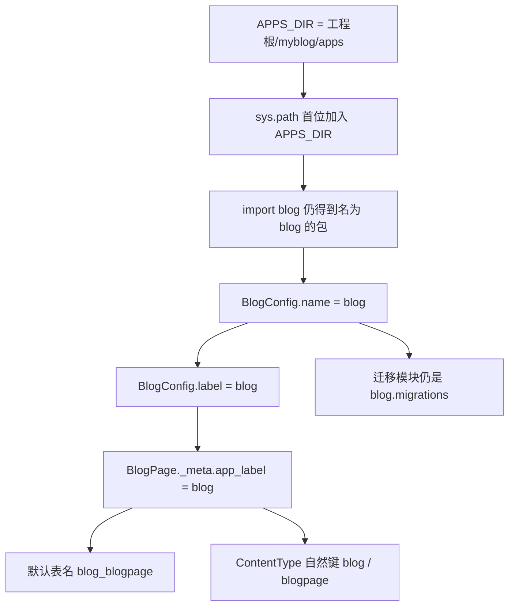

# myblog/myblog/apps/* 子应用目录架构收敛与重构方案

| RFC 属性 | 内容 |
|---|---|
| 标识 | MYBLOG-RFC-APP-LAYOUT-01 |
| 规范形式 | Google Engineering Design Doc / RFC 风格：背景、目标、合同、设计、替代方案、风险、执行、验证与回退；不声称 Google 存在一套统一的强制 RFC 模板 |
| 状态 | Draft：供用户与 Gemini Argon 审查，尚未批准实施 |
| 日期 | 2026-11-09 |
| 起草职责 | 总体架构、应用身份、迁移依赖、执行入口及验收合同；角色名称不作为底层模型身份的证明 |
| 用户提供的历史基线 | `c8d616b8b7658bf226615113634bf1f481925f95`，历史记录为 103 项单测、36 项生命周期演练通过 |
| 本次实际阅读基线 | `main`，`0a238f1b69bced1060933e920e3dddbc376beb7a`；开始起草时工作区干净 |
| 远程 | `origin`，`anc1996/myblog`；本次未 fetch，不据此断言远程实时状态 |
| 本次实测环境 | WSL2，`/root/anaconda3/envs/wagtailblog-test/bin/python`；包元数据为 Django `6.1.2`、Wagtail `8.1`、psycopg `3.3.7` |
| 本次授权 | 读取新旧项目相关源码、起草本 RFC；不实施搬迁、不连接真实服务、不生成或应用迁移、不提交、不推送、不部署 |
| 下一审查 | Gemini Argon 进行 Wagtail 8.1 源码级生命周期与应用注册独立审查；本文不表示该审查已执行 |

文中的“必须”表示拟批准的实施和验收条件，不表示已实现或已验证。Revision 是 Wagtail 保存的页面历史版本；ContentType 是 Django 用来标识模型种类的数据库记录；应用标签 `app_label` 是模型与迁移使用的稳定短名称。

## 1. Executive Summary：提案摘要

把工程根目录的 16 个自有模块完整搬到项目包内的 `apps/`，使它与 `settings/` 同级：

```text
F:\openclaw\workspace\wagtail\myblog\       ← 工程根目录
└── myblog\                              ← 项目 Python 包
    ├── apps\                            ← 自有模块的新物理位置
    │   ├── blog\
    │   ├── portfolio\
    │   └── ...                          ← 共 16 个模块
    └── settings\
```

通过 `sys.path.insert(0, str(APPS_DIR))`，继续使用 `from blog.models import BlogPage` 等现有顶层导入。`blog.apps.BlogConfig`、`name = "blog"`、模型标签 `blog.BlogPage`、迁移名称 `blog.0001_initial` 均保持不变。

这是一次文件位置调整。**不允许为目录调整新增数据库迁移、重命名表、修改 ContentType、重写 Revision 或转换 MongoDB 数据。** 如果工具提示这些变更，应停止调查，不能通过执行迁移把问题“修好”。

目录搬迁和数据库身份之间有清晰的条件关系，但仅凭几行路径配置，不能宣称已经验证真实数据库 100% 无变化。验收需要同时满足：应用身份相同、历史迁移逐字节相同、模型与迁移状态相同、经授权读取的 PostgreSQL 元数据相同。

## 2. Context：为什么要做，以及当前事实

### 2.1 动机

根目录同时承担应用代码、部署材料、基础设施、脚本、测试和说明文档的入口。集中自有应用可以缩短查找路径，使新同学明确区分“业务模块”和“工程运行材料”，也与用户熟悉的旧项目组织方式保持一致。

目录集中本身不提升查询速度，不改变数据库规模，也不修复已有生命周期缺陷。本期不以目录改动夹带业务改造。

### 2.2 已核对的参考实践

只读查看旧项目 `wagtailblog2/wagtailblog3/settings/base.py:16–42`：

```python
PROJECT_DIR = os.path.dirname(os.path.dirname(os.path.abspath(__file__)))
APPS_DIR = os.path.join(PROJECT_DIR, "apps")
if APPS_DIR not in sys.path:
    sys.path.insert(0, APPS_DIR)
```

新项目采用相同的顶层导入思路，但不复制旧站的环境文件加载策略、第三方应用清单、凭据或数据库配置。新项目仍从工程根目录读取 `.env.local`，或通过 `MYBLOG_ENV_FILE` 显式选择环境文件。

### 2.3 当前事实和背景修正

| 项目 | 本次核对结果 | 对方案的影响 |
|---|---|---|
| 历史与当前提交 | `c8d616b` 后已有 `0a238f1` | 实施前锁定最新候选基线，不能覆盖这次新增功能 |
| 两个提交的差异 | `portfolio/blocks.py`、`portfolio/migrations/0002_alter_projectpage_body.py`、`tests/test_portfolio.py` | 搬迁必须带走当前版本，不能从历史提交复制旧文件 |
| 自有模块数 | 用户列出的 16 个均在根目录 | 全部纳入物理搬迁 |
| Django 注册情况 | 15 个自有应用在 `INSTALLED_APPS`；`api` 是被 URL 引用的普通 Python 包 | 16 个模块不等于 16 个注册应用；不新增 `api` 注册 |
| AppConfig | 14 个自有模块已有 `apps.py`；`search`、`api` 没有 | 保留现状，不为了统一外观补造配置 |
| `home` | 以 `"home"` 注册，存在唯一 `HomeConfig` | Django 可以自动选择配置；维持原条目与顺序 |
| ASGI | 当前不存在 `myblog/asgi.py`，也未见 `ASGI_APPLICATION` 配置 | 明确设计新增入口的接入规则，不把 ASGI 写成已有能力 |
| S2 路径检查 | 判断模块是否在工程根目录内 | 搬迁后仍满足原条件，不应称其必然失败 |
| S1 路径检查 | `tests/test_s1_models_offline.py:74` 写死根目录的 `identity/models.py` | 此断言确实需要随搬迁调整 |
| 单测数量 | AST 静态统计 `tests/test_*.py` 为 103 个 `test_*` 方法 | 只证明源码方法数；不证明当前运行全部通过 |
| 生命周期脚本 | 位于 Windows Temp，未纳入本仓库 | 执行前必须固化、审查其路径适配及副作用 |

### 2.4 Goals / Non-goals

**目标：**

1. 16 个模块在一个受管理的位置集中存放。
2. 保持所有现有 Python 导入名称、应用身份、迁移依赖和数据库记录身份。
3. 管理命令、Web 入口、离线测试、集成测试和脚本采用同一套路径初始化。
4. 保留模板、静态资源、后台扩展、历史版本和跨模块调用行为。
5. 提供可重复、可回退、能够被独立审查的实施步骤与证据。

**本期不做：** 重命名应用或模型、升级依赖、修改表结构、迁移业务数据、调整业务锁顺序、修改发布策略、重建搜索、清理历史媒体、合并模块、改造旧站、提交推送或部署。

测试入口适配仅用于安全复现本次搬迁的验收。若需要修复业务或测试框架的既有缺陷，应另列依赖任务，不能悄悄并入目录搬迁。

## 3. Invariants：必须保持的合同

| 编号 | 不变条件与验收方式 |
|---|---|
| INV-01 | 自有模块只以既有顶层名称使用；应用 `name/label`、模型 `label_lower` 保持原值 |
| INV-02 | 所有模型、自动生成的多对多中间表和显式 `db_table` 的映射保持相同；既有 PostgreSQL 表名、OID、列、约束、索引无本次引入的变化 |
| INV-03 | 既有 `django_content_type` 的 `(id, app_label, model)` 全部保持原值；相关 Permission、Page、Revision 外键不重写 |
| INV-04 | 所有历史迁移的内容哈希、`(app_label, migration_name)`、依赖和替换关系不变；本次新增迁移数为零 |
| INV-05 | `AUTH_USER_MODEL`、自定义图片/文档模型、存储后端、工作流完成动作等字符串不变 |
| INV-06 | `BASE_DIR`、`PROJECT_DIR` 的原语义不变；`.env.*`、media、static 输出、服务数据位置不变 |
| INV-07 | PostgreSQL/Wagtail 继续决定正式发布及批准 Revision；MongoDB 字段版本不可变，Redis 和搜索均非权威 |
| INV-08 | 统一锁顺序、operation_id、UUID、版本指针、内容 hash、Outbox 事件类型与幂等键保持原值和原行为 |
| INV-09 | 失败对象保留待对账；SQL 回滚不视为 MongoDB/RustFS 回滚，不因本次搬迁立即删除对象 |
| INV-10 | 不读写旧站数据库或对象；不借用旧项目路径解决新项目导入问题 |
| INV-11 | 自有模块来自当前候选工程的指定目录；禁止根目录残留副本、旧站同名包或两套模块身份混用 |

本 RFC 保证“本次不改变既有合同”，不据此证明当前实现已经完整满足每一条高风险业务合同。发现原有不符合项，必须记录其基线状态及是否阻断本次工作。

## 4. Proposed Design：目标目录与导入架构

### 4.1 路径名称统一

全文使用以下名称，避免测试中的 `PROJECT_DIR` 与 settings 中同名变量含义不同：

```python
# myblog/settings/base.py 中的既有语义保持不变
PROJECT_DIR = Path(__file__).resolve().parent.parent  # 工程根/myblog
BASE_DIR = PROJECT_DIR.parent                        # 工程根
APPS_DIR = PROJECT_DIR / "apps"                       # 工程根/myblog/apps
```

在测试与新脚本中使用 `REPO_ROOT` 表示工程根，`PROJECT_PACKAGE_DIR` 表示项目包，避免把全局 `PROJECT_DIR` 一次性改成另一种含义。

### 4.2 完整迁移清单

下表路径相对于工程根目录。每次搬迁包括该模块的 `__init__.py`、Python 文件、`migrations/`、`management/`、`templates/`、`static/` 及其他已追踪资产。

| 原目录 | 目标目录 | Django 注册身份 |
|---|---|---|
| `api/` | `myblog/apps/api/` | 普通包，继续由 `include("api.urls")` 引用 |
| `blog/` | `myblog/apps/blog/` | `blog.apps.BlogConfig` / `blog` |
| `comments/` | `myblog/apps/comments/` | `comments.apps.CommentsConfig` / `comments` |
| `content_blocks/` | `myblog/apps/content_blocks/` | `content_blocks.apps.ContentBlocksConfig` / `content_blocks` |
| `content_lifecycle/` | `myblog/apps/content_lifecycle/` | `content_lifecycle.apps.ContentLifecycleConfig` / `content_lifecycle` |
| `discovery/` | `myblog/apps/discovery/` | `discovery.apps.DiscoveryConfig` / `discovery` |
| `external_content/` | `myblog/apps/external_content/` | `external_content.apps.ExternalContentConfig` / `external_content` |
| `guides/` | `myblog/apps/guides/` | `guides.apps.GuidesConfig` / `guides` |
| `home/` | `myblog/apps/home/` | `"home"` 自动选择 `HomeConfig` / `home` |
| `identity/` | `myblog/apps/identity/` | `identity.apps.IdentityConfig` / `identity` |
| `media_library/` | `myblog/apps/media_library/` | `media_library.apps.MediaLibraryConfig` / `media_library` |
| `people/` | `myblog/apps/people/` | `people.apps.PeopleConfig` / `people` |
| `portfolio/` | `myblog/apps/portfolio/` | `portfolio.apps.PortfolioConfig` / `portfolio` |
| `search/` | `myblog/apps/search/` | `"search"`，默认 AppConfig / `search` |
| `site_settings/` | `myblog/apps/site_settings/` | `site_settings.apps.SiteSettingsConfig` / `site_settings` |
| `taxonomy/` | `myblog/apps/taxonomy/` | `taxonomy.apps.TaxonomyConfig` / `taxonomy` |

目标拓扑：

```text
myblog/                                 # 工程根
├── manage.py
├── Dockerfile
├── requirements.txt
├── AGENTS.md
├── .ai-memory.toml
├── .env.local                          # 保持本地，禁止提交
├── .env.test                           # 保持本地，禁止提交
├── infra/
├── scripts/
│   ├── ...                             # 既有运维材料
│   └── run_tests.py                     # 拟新增的受控测试入口
├── tests/
│   ├── __init__.py                      # 拟新增：仅初始化路径
│   └── ...
├── 说明书/
└── myblog/
    ├── __init__.py
    ├── bootstrap.py                     # 拟新增：标准库路径初始化
    ├── urls.py
    ├── wsgi.py
    ├── asgi.py                          # 拟新增：标准 Django ASGI 入口
    ├── settings/
    │   ├── base.py
    │   ├── dev.py
    │   ├── production.py
    │   └── test.py                      # 拟新增：隔离验收配置
    ├── templates/                      # 项目级模板保持原位
    ├── static/                         # 项目级静态资源保持原位
    └── apps/
        ├── __init__.py                  # 容器包，不注册为 Django 应用
        └── <上表中的 16 个模块>/
```

根目录的 `.codex/`、Git 配置、输出目录，以及现有未纳入本次范围的本地文件均保持原位。不读取、移动或清理根目录的历史 `db.sqlite3`；它不成为本次 PostgreSQL 验收数据源。

### 4.3 单一的路径初始化实现

推荐用一个仅依赖标准库的函数承载路径注入，settings 与各入口调用同一函数，避免出现五份逐渐不同的复制代码。

拟新增 `myblog/bootstrap.py`：

```python
"""让集中存放的自有应用继续使用既有顶层导入名称。"""
from pathlib import Path
import sys

PROJECT_PACKAGE_DIR = Path(__file__).resolve().parent
APPS_DIR = PROJECT_PACKAGE_DIR / "apps"


def configure_app_imports() -> Path:
    """可重复调用；保持唯一的应用搜索路径位于首位。"""
    apps_path = str(APPS_DIR)
    while apps_path in sys.path:
        sys.path.remove(apps_path)
    sys.path.insert(0, str(APPS_DIR))
    return APPS_DIR
```

`base.py` 在定义 `PROJECT_DIR/BASE_DIR` 后、导入任何自有应用前调用：

```python
from myblog.bootstrap import configure_app_imports

APPS_DIR = configure_app_imports()
```

此函数不导入 Django、不调用 `django.setup()`、不加载 `.env`、不访问服务，也不改变进程工作目录。`sys.path` 中出现绝对路径，不依赖启动者当前目录。

`base.py` 是正常 Django 初始化的统一保障；各入口提前调用，是为了支持在 settings 加载前导入纯 Python 契约，以及覆盖直接运行脚本的情况。不要把业务导入或 `django.setup()` 放进 `myblog/__init__.py`。

**限制：** `sys.path` 只能影响尚未导入的模块，无法替换已经缓存于 `sys.modules` 的旧模块。必须在第一条自有应用导入前执行初始化，并用来源守卫拒绝已提前加载的错误副本；不能通过删除 `sys.modules` 后重载模型来补救。

### 4.4 `sys.path` 注入闭环矩阵

| 入口 | 初始化时机及做法 | 验收条件 |
|---|---|---|
| `myblog/settings/base.py` | 调用共享函数后才声明或使用应用；dev/production 继续继承 base | 分别加载 settings 时只有一个目标路径，且位于首位 |
| `manage.py` | `main()` 中，在执行 Django 管理命令前调用函数；保留 `setdefault` | `check`、shell、管理命令统一使用目标目录 |
| `myblog/wsgi.py` | 获取 WSGI application 前调用；保留现有 settings 默认选择 | 新进程直接导入 `myblog.wsgi` 能完成注册 |
| `myblog/asgi.py` | 新增标准 Django ASGI 入口；初始化后调用 `get_asgi_application()` | 直接导入可完成注册；不等于已经安装 ASGI server 或完成部署 |
| Django `-m` / `django-admin` | 选择继承 base 的项目 settings；在 apps.populate 前由 base 初始化 | 未经过 manage.py 的 Django 启动同样正确 |
| `tests/__init__.py` | 只调用共享函数，不初始化业务数据 | 以包方式加载 S2 等纯契约测试能顶层导入 |
| `scripts/run_tests.py` | 先加入由 `__file__` 推导的工程根，再调用函数；之后才发现测试 | 不依赖测试文件字母排序，不靠先导入 S1 产生副作用 |
| `scripts/generate_qa_test_dataset.py` | 保留由 `__file__` 推导工程根的步骤，在 setup 前调用函数 | 只做语法与入口审查；脚本会清理/写入数据，不作为导入探针执行 |
| `scripts/check_local_postgres.py` | 工程根进入路径后调用函数，再导入 base/home | 不改变既有连接授权；该脚本假定空库，不适合已建表库验收 |
| 其他 `scripts/*.py` | 按是否导入项目逐一归类；纯基础设施脚本无须导入应用 | 每个脚本有明确结论，不能批量执行运维脚本做 smoke test |
| 定时任务、Outbox、WSGI worker 子进程 | 通过管理命令、Web 入口或显式 bootstrap | 每个新进程完成同样来源检查；不用热加载替代进程重启 |
| IDE / 临时 Python 片段 | 先能导入工程包，再显式调用 bootstrap；IDE 可配置同样源码根 | 只加 IDE 路径不能替代运行时初始化 |

`tests/__init__.py` 并不保证 `unittest discover -s tests` 一定会导入该包：未指定顶层目录时，它可把测试作为顶层模块加载。因此验收统一从受控 runner 进入；纯 unittest 包发现应显式指定 `-t .`。不得继续依赖发现顺序偶然完成 Django 初始化。

从工程外执行 `python /绝对路径/scripts/example.py` 时，最初只有脚本目录自动进入 `sys.path`；脚本仍需先加入工程根，才能导入 `myblog.bootstrap`。任意外部进程在未配置路径前直接 `import blog` 不属于可保证的入口。

已存在的脚本逐项归类如下，避免把“覆盖 scripts”留成笼统要求：

| 脚本 | 本次路径适配结论 | 执行边界 |
|---|---|---|
| `generate_qa_test_dataset.py` | 导入项目，增加共享 bootstrap | 会清理并生成页面；不执行 main 做入口检查 |
| `check_local_postgres.py` | 导入 base/home，增加共享 bootstrap | 连接真实服务且要求空库；不作为现有库验收命令 |
| `check_postgres_search.py` | 仅第三方库和脚本内工具，不增加应用路径 | 真实临时表/索引探针，需服务操作授权 |
| `check_local_s3.py` | 不导入自有应用，不增加应用路径 | 会写入和删除探针对象，需对象操作授权 |
| `local_services.py` | 不依赖应用导入，不增加应用路径 | 包含服务管理、凭据和资源准备，不批量运行 |
| `fetch_rustfs.py` | 不依赖应用导入，不增加应用路径 | 下载、导入镜像等行为单独授权 |
| `fetch_postgres.py` | 复用同目录镜像工具，不增加应用路径 | 保持脚本间导入；不执行下载或导入 |
| `scripts/tests/test_local_services.py` | 保持 `scripts.local_services` 导入；纳入正确工程根的测试入口 | 独立于原 103 项业务测试，另列结果，不凑入基线计数 |

后续新增脚本只要导入项目应用，就遵守相同 bootstrap 合同；纯服务工具不因目录搬迁加入 Django 初始化。

### 4.5 AppConfig 和应用注册规范

现有配置保持：

```python
class BlogConfig(AppConfig):
    default_auto_field = "django.db.models.BigAutoField"
    name = "blog"
    # label 未显式声明，Django 默认得到 "blog"。
```

**本次 `name` 不需要变更。** 应用的完整 Python 导入名仍是 `blog`，与磁盘上多了一层目录不矛盾。已有 `label` 若存在必须原样保留；当前未显式声明的无需为本次搬迁全部补写。

不改为 `name = "myblog.apps.blog"`，也不把 `INSTALLED_APPS` 改为嵌套路径。不新增 `myblog.apps`、`api` 的注册项。不调整注册顺序、`default_auto_field` 或 ready 逻辑。

只固定 `label = "blog"` 并不能使一次任意包重命名安全：迁移文件里序列化的函数、存储类、模型基类、旧任务消息的 dotted path 仍可能引用 `blog.*`。本方案连这些导入路径也一起保持。

禁止业务代码使用 `myblog.apps.blog.models` 等第二套名称。Python 技术上仍可能从容器路径导入相同文件；`__init__.py` 不是隔离机制。通过源码扫描、来源检查和进程内别名检查防止重复导入，不引入自定义 import hook 或 `sys.modules` 别名补丁。

## 5. Zero-Drift：数据库与 ContentType 零变化推演

### 5.1 从路径到数据库身份的完整链条



本机 Django `6.1.2` 源码确认：

1. `django/apps/config.py:33–47`：默认 label 来自 app name 的最后一段，path 单独从模块文件位置推导。
2. `django/db/models/options.py:242–246`：未显式指定表名时，使用 `app_label + "_" + model_name`，再按后端长度限制截断。
3. `django/db/migrations/loader.py:62–72`：默认迁移包来自 `AppConfig.name + ".migrations"`。
4. `django/contrib/contenttypes/management/__init__.py:128–140`：已有 ContentType 按 `app_config.label` 和模型名识别，只为缺失项准备创建记录。

因此，**在保持应用名、label、模型名、显式 Meta、迁移文件和依赖配置不变的前提下**，文件路径变化不会进入默认表名或 ContentType 自然键的计算。

| 模型 | 搬迁前后应用/模型标签 | 搬迁前后表名 |
|---|---|---|
| `BlogPage` | `blog.BlogPage` | `blog_blogpage` |
| `GuidePage` | `guides.GuidePage` | `guides_guidepage` |
| `Comment` | `comments.Comment` | `comments_comment` |
| `ProjectPage` | `portfolio.ProjectPage` | `portfolio_projectpage` |

四个例子不能代替全量证明。验收应包含全部注册模型、代理/继承关系和 `include_auto_created=True` 的中间模型。显式表名原样保留；约束名称中的 `%(app_label)s` 和 `%(class)s` 也不能变化。

### 5.2 ContentType、权限和页面历史

ContentType 的稳定标识不是 Python 文件绝对路径。保持 `(app_label, model)` 后，原记录无需变化；但自然键相同不自动证明数值 ID 没被删建，所以数据库快照必须同时核对 `id`。

Wagtail `Page.content_type_id`、`Revision.content_type_id`、`Revision.base_content_type_id` 和权限表关联继续指向原 ContentType。Revision JSON、对象 ID、页面树的 `path/depth/numchild`、发布和批准版本引用均不重写。

本机 `wagtail/models/revisions.py:89–95,170–171` 显示 Revision 持有 ContentType 外键，并通过 `content_object.with_content_json(content)` 还原历史对象。保持模型注册和原模块路径，可以继续进入同一个模型实现；仍须实际验证各页面历史的反序列化和 Mongo 版本读取。

禁止删除或重建 ContentType，不运行 `remove_stale_contenttypes`，不运行数据导入来“对齐 ID”，不转换 Migration app label。

### 5.3 迁移不变的判定

迁移清单以 `(app_label, migration_name)` 为主键，对文件内容计算 SHA-256；只归一化清单中的外层目录前缀，不能修改迁移内容来使 hash 相同。

以迁移前候选基线 B 为比较对象，要求搬迁后：

- 清单条目、内容 hash、依赖边、替换关系及已应用记录相同。
- `MigrationLoader(None)` 可从磁盘加载相同的迁移图，不建立数据库连接。
- 内存中的模型状态与迁移状态比较没有本次新增差异；实施工具应使用 Django 6.1.2 的真实内部接口并经源码复核。
- 若基线已存在漂移，先记录并处理为单独阻断项，不能归因于搬迁，也不能为了通过检查补一份迁移。

本次不执行 `makemigrations`。未来即便是 `makemigrations --check --dry-run`，也须符合项目单独授权要求；它不代替上述文件和数据库快照比较。

### 5.4 物理数据库证明与适用边界

“不执行任何数据库操作的文件搬迁不会主动重命名 PostgreSQL 表”是设计结论；“目标服务所有表和 ContentType 已验证原样保留”是需要授权后才能得出的事实。

P3 应在无业务写入的同一目标库上，搬迁前后分别记录：

1. 服务版本、数据库名、schema、候选源码 SHA 和实际依赖版本。
2. 全部应用表及中间表的 schema、表名、OID、列定义、约束和索引定义。
3. 全量 ContentType 的 `(id, app_label, model)`。
4. `django_migrations` 的 `(app, name, applied)`。
5. Permission 的 `(id, content_type_id, codename)`，Page 与 Revision 的关键关联快照。

元数据查询使用只读身份或显式只读事务，例如：

```sql
BEGIN TRANSACTION ISOLATION LEVEL REPEATABLE READ READ ONLY;

SELECT n.nspname, c.relname, c.oid, c.relkind
FROM pg_class AS c
JOIN pg_namespace AS n ON n.oid = c.relnamespace
WHERE n.nspname = current_schema()
  AND c.relkind IN ('r', 'p')
ORDER BY n.nspname, c.relname;

SELECT id, app_label, model
FROM django_content_type
ORDER BY id;

SELECT app, name, applied
FROM django_migrations
ORDER BY app, name;

COMMIT;
```

正式证据工具必须枚举实际使用的全部应用 schema；示例中的 `current_schema()` 不能替代多 schema 检查。schema 不由 Django 应用名推断，记录实际 `search_path`。

模型元数据相同不等于真实表相同；`manage.py check` 通过也不证明物理表没有变化。不能只检查四个示例表或 ContentType 数量。

这次起草未连接 PostgreSQL，故尚无物理数据库零变化的前后证据。

## 6. Django 6.1.2 / Wagtail 8.1 兼容性

### 6.1 注册、ready、Hook 和视图集

`apps.populate()` 依次创建配置、导入模型、执行各配置的 `ready()`。搬迁只改变 `AppConfig.path`，不改变配置类身份、应用名或注册顺序。

本机 `wagtail/hooks.py:103–107` 和 `wagtail/utils/apps.py:7–23` 确认：Wagtail 遍历注册应用的 `app.name/app.module`，再导入 `<name>.wagtail_hooks`。因此仍会发现：

- `content_lifecycle.wagtail_hooks` 的回收站与生命周期入口；
- `comments.wagtail_hooks` 的评论后台视图集；
- `guides.wagtail_hooks` 的 GuideTopic Snippet 视图集；
- 模型上的 Snippet、站点设置注册及 Page 类型；
- `blog/guides/portfolio` 在 ready 中注册的 discovery adapter。

源码逻辑支持兼容推论，但验收还需核对 Hook 所属模块、实际 URL reverse、Snippet/设置模型清单和 adapter 的 `type_key/model_label`。仅发现文件或出现菜单不能证明功能完整。

重点检查 `media_library/apps.py:9`：它有解绑原生文件清理、绑定引用保护信号的 ready 逻辑，且异常可能被捕获。不能只以启动未报错作为成功证据；必须确认相同 sender、handler、dispatch_uid 的实际绑定结果，以及历史引用对象不会立即物理删除。

不在本次搬迁中修改这些信号、吞异常策略或注册表实现；若行为与基线不同，停止并调查导入顺序与模块来源。

### 6.2 模板和静态文件

`APP_DIRS=True` 使用的是已注册应用的物理 `AppConfig.path`。本机 `django/template/utils.py:98–109` 确认它搜索各应用目录下的 `templates/`。

例如：

```text
blog/templates/blog/blog_page.html
    → myblog/apps/blog/templates/blog/blog_page.html

模板名始终是 blog/blog_page.html
```

`AppDirectoriesFinder` 同样由 `app_config.path` 构造 `static/` 路径，见本机 `django/contrib/staticfiles/finders.py:157–180`。因此 `blog/css/article.css`、`content_blocks/css/table.css` 等资源逻辑名称不变。

保持 `INSTALLED_APPS` 顺序，就保持应用间模板及静态文件的查找优先关系。项目级 `myblog/templates`、`myblog/static` 位置和配置不动；`STATIC_ROOT`、`MEDIA_ROOT` 不动。

需要另外检查没有注册的普通包资源：本方案不会让 `api` 中的模板或静态文件突然被 Django 自动发现。当前没有理由因此注册 `api`。

验收包括实际模板 origin 路径、静态 finder 的返回路径与重复资源检查。`collectstatic --dry-run --noinput` 只能在确认所选后端无外部写入后执行；完整收集使用独立临时 `STATIC_ROOT`，不得清空共享目录。

Dockerfile 的 `COPY . .` 已能复制新目录，Gunicorn 入口不变。仍需检查 `.dockerignore`、构建产物和镜像内来源；镜像构建、网络拉包和其 `collectstatic` 步骤不包含在本次文档授权中。

### 6.3 路径守卫的准确修复

S2 当前的：

```python
Path(mod.__file__).resolve().is_relative_to(PROJECT_DIR.resolve())
```

其中 `PROJECT_DIR` 实际是工程根，所以目录搬迁后仍成立。保留这一“属于当前工程”的要求，再增加“来自目标应用目录”的要求，而不是放宽或删除测试：

```python
REPO_ROOT = Path(__file__).resolve().parents[1]
APPS_ROOT = (REPO_ROOT / "myblog" / "apps").resolve()

for module in modules_under_test:
    expected_package = (APPS_ROOT / module.__name__).resolve()
    self.assertEqual(
        Path(module.__file__).resolve(),
        expected_package / "__init__.py",
    )
    self.assertTrue(expected_package.is_relative_to(REPO_ROOT.resolve()))
```

上述例子针对当前有 `__init__.py` 的顶层模块，不用于任意子模块或命名空间包。对子模块比较其所属应用下的精确相对路径；先 resolve，拒绝指向工程外的符号链接。

S1 中写死的 `REPO_ROOT / "identity" / "models.py"` 改为通过真实模型模块解析，并断言等于 `APPS_ROOT / "identity" / "models.py"`。不只检查“某个文件存在”，还检查当前导入确实使用它。

新增入口测试覆盖全部 16 个包；注册表检查覆盖实际注册的 15 个自有应用。额外断言进程未出现 `myblog.apps.<app>` 或 `apps.<app>` 的第二套业务模块，AST 扫描禁止这些导入方式。

所谓自愈兼容，是测试从自身文件位置计算工程根并集中派生目标路径，适应 Windows/WSL 路径差异；不是同时接受新旧两个位置或自动退回旧站。

### 6.4 其他容易遗漏的序列化和运行路径

| 检查面 | 保持或检查内容 |
|---|---|
| 身份依赖 | `AUTH_USER_MODEL="identity.User"`、swappable dependencies、用户首个迁移保持原样 |
| 媒体模型 | `media_library.CustomImage/CustomDocument`、Rendition 关系和存储类路径不变 |
| 工作流 | `WAGTAIL_FINISH_WORKFLOW_ACTION="content_lifecycle.workflows.publish_approved_revision"` 不变 |
| 历史迁移 | `media_library.models.*`、`portfolio.models.*`、积木构造及 callable 导入路径继续可用 |
| Page 类型约束 | `home.HomePage`、`portfolio.ProjectPage` 等模型标签不加目录前缀 |
| StreamField | 积木名、deconstruct 返回值、Chooser 模型标识、schema_version 不变 |
| URL | `api.urls`、`discovery.urls`、`media_library.urls` 和 search views 仍使用原路径 |
| 异步消息 | 检查已持久化任务、Outbox payload 和任何 dotted callable；不批量改写 |
| 资源路径 | 搜索 `__file__`、`.parent/.parents`、`open/read_text`、硬编码应用根路径；按物理资源位置分别调整 |
| 工具配置 | 搜索 IDE 源码根、CI、覆盖率、lint、脚本、Docker COPY 中的旧位置；只改会影响当前运行的引用 |
| 环境隔离 | 不改 `.env.*`、Mongo 管理员 `root`、SQL 管理员 `postgres`、服务端口或共享 Conda 包 |

历史说明文档中的旧源码行号可标记为历史证据，不进行全库机械替换；当前操作指引与本次执行命令必须更新到新位置。

## 7. 存储、锁、幂等和补偿边界

目录迁移不能改变以下标识：`document_uuid`、`version_id`、`operation_id`、`model_label`、`field_name`、`content_hash`、媒体 UUID、RustFS key、事件类型和消费者幂等键。

MongoDB 中原有 `model_label="blog.BlogPage"` 等字符串保持不变；不得改成 `myblog.apps.blog.BlogPage`。读取仍由批准或正式发布的 Revision 中的指针决定，不能改为查最新 Mongo 文档。

`content_lifecycle.guard.content_mutation_guard` 及业务服务内部的原有事务和锁获取关系保持不变。验收检查进程确实使用同一个模块中的 guard、同一个 adapter 注册表和同一组信号，防止重复导入形成两个独立的进程内注册表。

目录搬迁没有理由重放 Outbox 或运行对账删除命令。`reconcile_cross_storage`、`purge_expired_recycled_pages`、QA 数据生成脚本可能写入或删除数据，不因“路径检查”获得执行授权。

SQL 失败后，已经写入 MongoDB 或 RustFS 的对象仍按现有规则保留待对账。代码回退也不附带清桶、删除集合或回放旧 Revision。

本次不新增业务锁，也不重新设计锁顺序。生命周期回归与真实并发是不同证据：36 项演练不能自动证明 PostgreSQL 条件唯一索引、锁竞争或并发幂等已测试。

## 8. Alternatives：方案比较与决策理由

| 方案 | 优点 | 代价与结论 |
|---|---|---|
| A：集中目录 + 顶层导入保持不变 | 与参考工程一致；历史导入、迁移和消息路径继续有效；本次改动集中 | 需要管理所有入口、路径优先级及名称碰撞；本 RFC 推荐 |
| B：全部改为 `myblog.apps.<app>`，显式保留 label | Python 包层次直观，减少顶层命名碰撞 | 所有导入、迁移序列化路径、消息和第三方引用都要评估；单保留 label 不足以保证兼容，本期不选 |
| C：根目录保留转发包或通过环境 PYTHONPATH 兼容 | 某些旧命令短期可用 | 容易双份加载、环境不一致、长期保留两个入口；不作为正式方案 |

`sys.path.insert(0, ...)` 会让本项目同名包优先于安装包。这是有意的兼容策略，也要求 apps 目录只能放受控自有模块；不得放置 `django`、`wagtail`、`json` 等会遮蔽框架或标准库的包。

保留 `search` 等既有通用名称的碰撞风险，用绝对来源断言处理。本期不以减少碰撞为由改名。

## 9. Execution Plan：P1～P4 路线图与文件归属

### 9.1 实施前提与共同执行环境

开始实施前须有“代码搬迁与入口适配”的明确授权。真实服务只读快照、集成测试临时库创建/应用既有迁移、外部测试资源写入和销毁、镜像构建、服务切换、Git 提交及推送分别确认范围，不能互相代替。

所有 Python 命令使用 WSL2 指定环境，并先执行：

```bash
cd /mnt/f/openclaw/workspace/wagtail/myblog
test "$(pwd -P)" = /mnt/f/openclaw/workspace/wagtail/myblog || exit 1
PY=/root/anaconda3/envs/wagtailblog-test/bin/python
test -x "$PY" || exit 1
```

先记录 `git status`、分支、remote、候选 SHA、依赖版本；基线记为 B。若出现别人正在修改的文件，先按文件归属协调，不能直接移动其工作文件。源或目标不满足清单时停止，不用强制覆盖。

同一任务只使用原生通道协作，不创建 wiki 日报、跨项目消息或 handoff。当前起草阶段没有派发实现或独立审查代理。

### 9.2 文件归属

| 工作包 | 独占文件/目录 | 输出与限制 |
|---|---|---|
| 启动配置负责人 | `myblog/bootstrap.py`、`settings/base.py`、`manage.py`、`wsgi.py`、拟新增 `asgi.py` | P1 完整入口；不修改业务模型 |
| 搬迁负责人 | 16 个源目录及 `myblog/apps/` | P2 独占搬迁；其他人暂停编辑这些目录 |
| 验收适配负责人 | `tests/`、`scripts/run_tests.py`、`settings/test.py`、必要脚本入口 | 路径守卫、隔离配置、验收清单；不放宽业务断言 |
| 架构复核负责人 | 本 RFC 与证据清单 | 核对身份、迁移图和 IO 授权 |
| 独立 Wagtail 审查者 | 只读源码、配置与证据 | 审查注册、Revision、Hook、信号与覆盖范围；不自审自己实现的高风险变更 |

共享服务测试串行；P2 搬迁期间不对同一应用并行提交内容修改。

### 9.3 P1：基础设施与 `sys.path` 就绪

**修改范围：** 新建共享 bootstrap、apps 容器、测试包入口及受控 runner；接入 base/manage/WSGI；增加标准 ASGI 入口；列出脚本接入状态。

执行步骤：

1. 记录基线 B 的模型、注册配置、迁移图/文件 hash、模板/静态来源、Hook 和 adapter 清单。
2. 完成第 4 节共享路径实现，各入口在首次应用导入前调用。
3. 适配 S2 可独立执行的初始化，不能依赖其他测试先运行。
4. 为 P2 的目标路径断言准备测试；新增断言在 P2 后成为强制条件。
5. 在空 apps 容器状态验证 bootstrap 可重复调用，不改变 settings 路径和环境选择。

**中间状态限制：** P1 时旧应用仍在根目录，普通导入会继续找到旧位置。这个阶段只证明初始化机制可用，不能报告目录收敛成功，也不单独部署 P1。

**退出条件：** bootstrap 无服务 IO；所有入口有明确接入方式；尚未执行任何 schema 或业务数据操作。

### 9.4 P2：`git mv` 完整搬迁

本 RFC 强制使用 `git mv`，一次搬迁整套应用资产。以下为批准实施后的 PowerShell 命令示例，本次没有执行：

```powershell
$appNames = @(
    'api', 'blog', 'comments', 'content_blocks',
    'content_lifecycle', 'discovery', 'external_content', 'guides',
    'home', 'identity', 'media_library', 'people',
    'portfolio', 'search', 'site_settings', 'taxonomy'
)
foreach ($appName in $appNames) {
    git mv -- $appName "myblog/apps/$appName"
    if ($LASTEXITCODE -ne 0) {
        throw "Application move failed: $appName"
    }
}
```

实施前逐一验证源目录确实位于本工程、目标尚不存在、源内文件归属清楚，并清点隐藏文件与未追踪资产。不得因此把凭据、本地数据或缓存纳入版本库。

`git mv` 会更新索引；它不是一次文件系统事务。中途失败时记录已经搬迁的清单，暂停继续启动或打包，按清单逐项反向移动。应用一致性通过完整候选树和后续发布单元实现，不能承诺 16 个命令具有操作系统层面的原子性。

**Git 历史的准确合同：** Git 保存快照，不保存一条永久的“这是 rename”指令；`git mv` 是规范的移动与暂存方式，历史跟随仍依赖相似度检测。原提交对象保留，但不能承诺所有日志工具自动 100% 跟随所有路径。

为了最大限度保留清晰历史：

- 搬迁文件内容保持逐字节相同，历史迁移尤其不得顺手格式化。
- 用 `git diff --cached --summary -M` 检查 16 个目录全部已纳入。
- 对纯搬迁文件核对 blob 相同，并检查 `git diff --cached --find-renames=100% --name-status`。
- 若后续获准提交，优先把纯搬迁与必要入口/测试适配区分清楚；两者共同形成发布候选，不部署中间不可用状态。
- 用单文件 `git log --follow -- myblog/apps/blog/models.py` 等抽样检查旧历史；全量内容清单证明资产未丢失。

同步修复 S1 的旧物理路径，启用所有目标目录来源断言。禁止用根目录转发包掩盖遗漏。

**退出条件：** 16 个目录搬迁齐全；根目录无其源码副本；迁移文件 hash 完全相同；唯一允许的业务文件变化是外层位置。

### 9.5 P3：系统检查、迁移图与表一致性

先做不连接真实服务的验证：

```bash
"$PY" -m compileall -q myblog manage.py tests scripts
git diff --check
git diff --cached --check
```

随后在确认 ready 与检查器没有隐式外部 IO 的环境中，执行系统检查：

```bash
"$PY" manage.py check --fail-level WARNING
```

`check` 通常不需要业务查询，但项目导入和注册逻辑可能有副作用；不得把“不带 --database”当成绝对零连接保证。授权范围不包含真实服务时，使用禁止外部连接的检查环境，任何连接尝试都视为失败，不能返回伪造服务结果。

再用独立进程验证以下启动路径：manage、settings 直接加载、WSGI、ASGI、受控测试 runner、需要导入项目的脚本初始化片段。脚本片段测试不得调用其业务 main，不导入会在模块级执行数据写入的脚本。

完成全量注册/模型/迁移状态比较。经明确只读授权后，执行第 5.4 节 PostgreSQL 快照核对；没有授权或没有前快照时，此项标记“未验证”，P3 不得按全通过签字。

**退出条件：** 系统检查通过；应用来源唯一；模型身份和迁移图无差异；真实表与 ContentType 的零变化证据齐全。

### 9.6 P4：103 项单测与 36 项生命周期回归

**先解决执行隔离，再运行回归。**

现有多个测试继承普通 `unittest.TestCase`，会调用 `.create()`、保存版本、发布页面，部分还会写入 MongoDB 或媒体。直接执行历史 `python -m unittest discover -s tests`，可能写到 `.env.local` 指向的配置库，不能默认视为安全。

拟新增的 `scripts/run_tests.py` 必须做到：

1. 在发现测试前初始化路径，并明确区分离线与集成模式。
2. 集成模式在加载业务测试前选定隔离 settings 并完成 `django.setup()`；检查实际生效的 `settings.DATABASES` 和各存储配置，不只检查环境变量。
3. 通过 Django test runner 管理唯一的临时 PostgreSQL 测试库；加载既有迁移到临时库需要明确授权，且不产生新迁移文件。
4. 为 MongoDB 使用唯一临时数据库；为 RustFS 使用独立测试 bucket 或严格独占前缀及受限凭据；Redis 使用独立 key 前缀。未设置或落入开发/旧站资源则拒绝运行。
5. 普通单元回归可使用内存文件存储和本地缓存，但报告必须说明这一点；另列真实 RustFS/Redis 验收，不能把替代后端结果算作服务实测。
6. 测试中的硬编码 `DJANGO_SETTINGS_MODULE` 不得绕过 runner：设置加载前使用选定配置；加载后校验实际 settings，必要时只做入口统一，不重写业务断言。
7. 隔离资源清理须限于本轮确实创建并记录的对象，并有授权；失败对象保留定位信息，不能无条件清理共享库/桶。清理失败必须进入结果。

runner 拟定命令接口如下，实施时必须实现并验证这些参数，不把它们写成已有命令：

```bash
# 离线模式只发现 allowlist 中不需要服务的测试。
"$PY" scripts/run_tests.py --mode offline

# 集成模式需要临时数据库/外部测试资源的明确授权。
"$PY" scripts/run_tests.py --mode integration --suite all

# 同一受控入口运行已固化和审查的生命周期脚本。
"$PY" scripts/run_tests.py --mode lifecycle --suite original-36
```

原有测试必须全量执行，不能只报告总数凑到 103。新增导入与来源测试另计；以后新增原有业务测试时按基线测试 ID 清单比较，不强行锁死总数。

**36 项演练的特殊适配：** 当前脚本为
`C:\Users\haryk\AppData\Local\Temp\myblog-side-lifecycle-audit-20261105.py`，读取时 SHA-256 为
`5c4d59171f3b49309d25b3d37d477591d1df418ebc3f43f56e9de7233e07b9b1`。

该脚本明确创建临时 PostgreSQL/MongoDB 库、执行既有 migrate，并在 finally 中删库；文件还使用 `blog/models.py` 等旧路径计算源码指纹。搬迁前必须保存受审查的脚本副本及用例 ID 清单；候选适配只能修改入口、隔离/证据控制和路径映射，不能删除或放松生命周期断言。

原脚本使用内存文件存储与本地缓存，因此历史 36 PASS 不是真实 RustFS/Redis 验收，也不是完整并发测试。未经资源创建、迁移和清理授权，不执行原脚本。

**退出条件：** 基线 103 个测试 ID 无遗漏，原 36 个演练 ID 无遗漏；均无失败、错误或未解释的 skip；新增入口测试通过；运行 SHA、版本、服务、命令、隔离方式与清理结果可追溯。

## 10. Acceptance Matrix：验收清单

| 编号 | 验收内容 | 通过依据 |
|---|---|---|
| A01 | 目录完整性 | 16 个源到目标映射、追踪文件及 blob 清单一致；无根目录源码副本 |
| A02 | 唯一顶层导入 | 16 个包实际文件来自 `myblog/apps/<name>`；无重复模块身份 |
| A03 | 注册不变 | 15 个自有 AppConfig 的 name、label、类、顺序与 B 相同；path 按预期变化 |
| A04 | 模型及关系 | 全部模型和自动中间模型的 label/db_table/关系/约束映射不变 |
| A05 | 迁移零变化 | 文件 hash、迁移图、模型状态和已应用记录无本次变化 |
| A06 | PostgreSQL 零变化 | 经授权的全部目标表、OID、列、约束、索引和 ContentType 三元组前后相同 |
| A07 | 身份与媒体 | 用户、自定义媒体模型、存储字符串和权限 ContentType 关联原样 |
| A08 | 所有入口 | settings/manage/WSGI/ASGI/runner/脚本初始化分别在新进程验证 |
| A09 | 模板和静态 | 逻辑名称、覆盖顺序不变；origin/finder 路径来自目标目录 |
| A10 | 后台注册 | 回收站、评论视图集、GuideTopic、站点设置、adapter、信号真实注册一致 |
| A11 | 基线业务单测 | 原 103 个测试 ID 全部通过，新增项另计 |
| A12 | 生命周期 | 原 36 个演练 ID 全部通过；批准版本、历史、草稿、回收恢复与保护行为无变化 |
| A13 | 高风险补充 | Blog/Guide/Project 各检查一次旧 Revision 反序列化与版本指针；跨页面 Chooser/FeaturedPosts 和媒体保护继续有效 |
| A14 | 工程与运行材料 | Docker/脚本/IDE/当前操作指引无仍被执行的旧物理路径；env 与数据根路径未变化 |
| A15 | 回退可用 | 反向搬迁或候选版本回退演练后可从原顶层名称启动；无数据回滚步骤 |

任何未执行项写“未验证”，不写“默认通过”。任何数据库身份或迁移变化都是阻断项，不能按普通 warning 豁免。

## 11. Rollback：回退设计

### 11.1 触发条件

应用来源错误、重复模型注册、迁移变化、ContentType/table 漂移、Hook/信号缺失、历史版本读取失败，或基线测试新增失败，均停止晋级。

### 11.2 本地未发布阶段

按本轮实际完成清单反向 `git mv`，从 `myblog/apps/<app>` 移回根目录。随后只撤销本轮新增入口与测试路径改动，并恢复本轮前的文件状态；保留其他人的工作，不使用 `reset --hard`、`clean` 或强制覆盖。

如果只有部分移动成功，先检查每个源/目标的真实位置和索引，再反向移动已完成项。新的 bootstrap 在回退期间可先保留到应用完全移回，最后再恢复入口，以免形成不可解释的混合候选。

### 11.3 已提交或已运行的候选

若以后获得提交授权，回退通过新的反向提交进行，不能重写公共历史。若已在获准的测试/发布环境运行，切回完整旧代码或旧镜像并按发布授权重建进程，不在运行中的目录逐个搬文件。

完整候选运行期间的进程持有模块、模板和 Hook 缓存，不能把磁盘回退视为进程已回退。服务切换与重启需要对应授权，本 RFC 不执行。

### 11.4 数据回退边界

本次没有 schema/data migration，所以正常回退不包含反向迁移、恢复数据库备份、ContentType 清理或 Mongo/RustFS 数据删除。

如候选验收期间已经在隔离库生成数据，按隔离测试资源合同处理；如发现业务库被误写，停止操作、保留证据并进入单独事件处理，不能以回退代码掩盖。

## 12. Risks、发布和运维影响

| 风险 | 防护 | 阻断标准 |
|---|---|---|
| 同名包抢先导入或已缓存 | 初始化早于首条业务导入，检查精确来源 | 任一模块不来自候选目标目录 |
| 相同源码以两个名称加载 | 禁止嵌套导入，检查 sys.modules/注册表 | 模型、异常类、adapter 或信号形成双份身份 |
| 测试顺序偶然初始化 | 统一 runner，S2 单独执行 | 单独执行失败但全量偶然通过 |
| 误读环境文件或服务 | 保持 BASE_DIR，检查有效配置，禁止输出密码 | 指向开发写库、旧站或共享对象前缀 |
| 遗漏模板、static、management | 整目录 git mv，资源与管理命令发现核对 | 资产缺失、来源/覆盖顺序改变 |
| 误把目录重构当作模型重命名 | 模型和迁移清单比较，不生成迁移 | 出现 RenameModel/AlterModelTable/数据转换需求 |
| 迁移图检查与真实服务混为一谈 | 离线与服务证据分别出具 | 用 check 或镜像标签宣称服务已验收 |
| Temp 演练脚本失效 | 固化版本、hash、用例 ID，修正相对路径 | 未审查即执行，或删减原断言 |
| 半搬迁树被构建/运行 | 完整候选打包，P2 期间停止共享发布动作 | 用中间树进行验收或服务切换 |

本期没有用户可见的新功能，也没有数据格式升级，不需要数据双写、读路径分流或业务 feature flag。服务发布仍应使用完整构建产物和正常发布流程；本文不授权任何生产操作。

可观测证据聚焦启动错误、应用来源、注册清单和原有错误指标，不新增会记录 env、数据库密码、签名 URL 或正文内容的日志。

## 13. Argon 独立审查任务

审查分两次进行。首先审查本设计：提供本 RFC、当前基线源码、实际依赖版本及本文涉及的框架源码；讨论设计是否可行、合同是否完整。此时没有搬迁候选和运行结果，应标记“待实施验证”，不能因文档论证而签运行验收。

实施后再做候选审查，材料应包含：本 RFC、基线 B、候选 SHA/工作树 diff、实际 Django/Wagtail 版本、模型与迁移清单、注册/资源来源清单、103/36 用例 ID 和真实运行证据。两次都不能只传本文摘要。

审查必须逐项回答：

1. Django `AppConfig.create/populate/import_models` 能否在保持 name/label 的前提下正确发现全部自有应用？是否存在提前或双重导入？
2. 迁移 loader、历史 callable、StreamField deconstruct、用户 swappable dependency 是否完全维持原身份？
3. Wagtail Hook、评论/回收站视图集、Snippet/设置、页面类型和 discovery adapter 是否完整且不重复？
4. `media_library.ready()` 的实际信号关系是否维持？吞异常是否可能掩盖保护未注册？
5. 历史 Blog/Guide/Project Revision 能否还原，并按同一 UUID/版本/hash 读取 Mongo？批准 A 后新增 B 是否仍发布批准 A？
6. 回收、原位恢复、父栏目冲突、别名/定时/批量入口是否出现新回归？区分本次变化与原有覆盖缺口。
7. 模板/static/management command 的发现来源与顺序是否保持？普通包 `api` 是否被误注册？
8. 所有执行入口是否真正闭合，S2 是否可独立运行，S1 的旧物理路径是否修复？
9. 数据库零变化证据是否覆盖全量模型、中间表、ContentType 数值 ID 和权限/Revision 关联？
10. 测试是否绑定候选源码，隔离是否覆盖 PostgreSQL/Mongo/RustFS/Redis，36 项是否被夸大为并发或真实存储证明？

审查结果逐项标注“通过 / 不通过 / 未验证”，附文件行号与源码版本。发现高风险不通过项，先修订本 RFC 或候选再复核；不能把未验证改成通过。

## 14. 本次起草的证据与未完成事项

### 14.1 已实际完成

- 读取当前 `AGENTS.md`、`.ai-memory.toml`、依赖、settings、manage/WSGI、URL、AppConfig、迁移、相关业务与测试代码。
- 核对当前分支 `main`、HEAD `0a238f1`、remote 和起草前干净状态；只读比较 `c8d616b..HEAD`。
- 在正确 WSL 路径使用指定 Python 读取包元数据：Django `6.1.2`、Wagtail `8.1`、psycopg `3.3.7`。
- 只读检查本机上述版本的 Django/Wagtail 源码，验证第 5、6 节的具体调用路径。
- 用 AST 统计原测试源码为 103 个 `test_*` 方法；检查 Temp 演练脚本的入口、副作用、路径和 hash。
- 通过 Context7 查询 Django 6.1 应用配置文档及 Wagtail 官方 Hook 文档。Wagtail 文档检索命中 main，版本判断以本机 8.1 源码为准。
- 查询相关历史记录，仅用于核对历史合同与测试局限；不将历史授权解释为本次服务操作授权。

本 RFC 文件的实际检查结果：

| 已执行检查 | 结果与范围 |
|---|---|
| 指定 WSL Python 经标准输入运行只读文档检查 | UTF-8、末尾换行、尾部空白、代码围栏检查通过 |
| 同一检查脚本对 Python 示例执行 `ast.parse` | 7 个示例语法通过；没有执行示例业务逻辑 |
| 同一检查脚本核对迁移映射与现有目录 | 16 个映射名称一致，16 个源目录均存在 |
| `git diff --check` | 通过；新文档尚未追踪，另执行下一项覆盖其内容 |
| `git diff --no-index --check -- NUL <本 RFC 文件>` | 通过，覆盖新增文档的空白检查 |
| `git status --short` | 本次只有这一份新增 RFC；没有新增 commit，没有推送 |

### 14.2 尚未完成

未搬迁应用，未新增本 RFC 中的 Python 文件，未运行 `manage.py check`，未运行 103 项单测或 36 项演练，未连接数据库或对象存储，未取得数据库前后快照，未执行真实并发，未调用 Argon，未提交、推送或部署。

历史 103/36 PASS 来自既往记录，可能不反映当前候选状态；本次静态数量核对不更新历史通过结论。

### 14.3 本地证据索引

| 文件/源码位置 | 本次用途 |
|---|---|
| `myblog/settings/base.py:19,29,85,196,251,254` | 路径、注册、模板、static、工作流与身份配置；后续行号以候选版本刷新 |
| `manage.py:7`、`myblog/wsgi.py:10` | 当前管理命令和 Web 入口 |
| `myblog/urls.py:9` | search、api、媒体、发现路由仍是顶层导入 |
| `tests/test_s1_models_offline.py:15,74,147` | settings 路径、旧模型物理路径与来源守卫 |
| `tests/test_s2_contracts_offline.py:18,192` | 工程根定义及四个契约模块的来源断言 |
| `tests/test_portfolio.py:14,37` | 模块级 setup 和普通 unittest 中的数据库写入 |
| `scripts/generate_qa_test_dataset.py:18,25,35` | 脚本导入入口与清理/写数据副作用 |
| `scripts/check_local_postgres.py:10,52,70` | 固定工程根、home 来源及“空库”前提 |
| `media_library/apps.py:9`、`media_library/signals.py:49` | ready 与媒体删除保护注册 |
| `content_lifecycle/guard.py:11`、`content_lifecycle/workflows.py:15` | 统一协调锁及批准版本完成动作 |
| `blog/apps.py:9`、`guides/apps.py:9`、`portfolio/apps.py:9` | 业务 adapter 注册 |
| WSL 环境 `site-packages/django/` | 本文引用的 AppConfig、迁移、ContentType、模板和 static 实际源码 |
| WSL 环境 `site-packages/wagtail/` | 本文引用的 Hook 发现和 Revision 实际源码 |

**批准本 RFC 的含义：** 接受目录、导入与验收合同。代码实施、服务 IO、临时库迁移及清理、Git 操作和部署的执行授权仍以用户明确范围为准。
