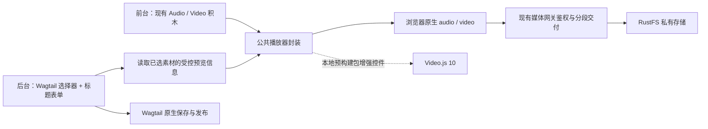

# 站内音视频播放器与分栏预览技术设计

**状态：AV-1（Vendor 同步）与 AV-2/AV-3（前台公共播放器与后台分栏预览）均已实施并通过隔离测试（`test_embeds_and_av_uploads.py`、`test_embed_playback.py`）；仅剩真实移动 Safari 等多终端兼容验收按需补测。** 功能范围以[需求规格](myblog_站内音视频播放器与分栏预览需求规格_RFC.md)为准。

**目标：** 音频和视频共用本地托管的播放器，Wagtail 后台右侧能试听或试看；左侧表单仍是唯一保存入口，源码栏只读。

## 1. 整体思路



- `content_blocks` 负责显示和编辑交互；`media_library` 仍负责素材、选择器、权限及文件交付。Blog、Guide、Project 不各写一套；第三方 `Embed` 不接入本播放器。
- 保留已有 `audio`、`video` 块名、媒体选择字段及 `title_override`。既有选择值照常保存，右侧预览状态和显示用 JSON 不入库。不改 SQL 表、MongoDB 历史数据及上传、发布、回收规则。Wagtail 若识别出块定义差异，先核对序列化原因，不靠篡改 `deconstruct()` 来压制差异。
- 首期采用 MP3、H.264/AAC MP4 验收。字幕、歌词、剪辑、转码、HLS、下载按钮和自定义放大弹窗不纳入；现有上传格式不因本次改造被批量禁用或改写。

## 2. 分三批实现

### AV-1：先验证官方离线包

**文件：** `myblog/static/vendor.lock.json`、`scripts/sync_vendor_assets.py`（只在现有脚本无法恢复所需目录时才调整）、[Vendor 管理指南](前端公共Vendor资产管理与升级指南.md)。

- [x] 在隔离小样中验证 Video.js 10 的 `@videojs/cdn` 预构建包，一页混放 MP3、横屏 MP4、竖屏 MP4；使用可合法分发的测试素材，不用旧站业务文件。确认音频、视频可同时初始化，开始播放后进度实际变化，跳进度后能继续播。
- [x] 核对精确版本、许可证、官方制品校验值和入口依赖。按已验证的目录结构锁定 `audio.js`、`video.js` 及其同版本依赖；入口与相对导入的共享模块不能拆散。优先用现有同步脚本恢复，不为此引入 React、构建流水线、统计插件或线上 CDN。
- [x] 在隔离的 `STATIC_ROOT` 实际执行生产设置的 `collectstatic`，通过 HTTP 核对静态入口及相对依赖。第三方包 `myblog/static/vendor/` 不入库。

**通过条件：** 开发静态路径和收集后的生产静态路径都能真实播放；停掉增强模块时原生 `controls` 仍可用。若离线包兼容不过，保留现有原生播放并报告卡点，不先在正式页面接入，也不关闭全站静态文件哈希。

**AV-1 验证结果：** `@videojs/cdn` 10.5.0 由 Vendor 脚本从 npm 归档校验恢复，保留入口及相对模块。同步时移除失效的调试映射声明，并修正 Vditor 的 Markmap 字体路径。同版本的旧安装若缺少安装规则指纹，`check` 会提示不匹配，`sync` 会重新安装。生产静态设置下在临时目录实际收集了 1663 个静态文件。Chrome 和 Chromium 的隔离小样已验证本地入口、哈希入口和原生控件均可播放 MP3、横屏 MP4、竖屏 MP4 并跳转续播。

### AV-2：接入公共前台积木

**文件：** 修改 `myblog/apps/content_blocks/blocks/media.py`、`static/content_blocks/css/media-blocks.css` 及 `templates/content_blocks/includes/_block_assets_js.html`；在该应用的静态目录新增 `js/media-player.js`。渲染断言放在 `tests/test_s3_blocks.py`。

- [ ] 服务端继续输出带 `controls` 的原生媒体标签，用 Django `reverse("media_gateway_asset", ...)` 生成素材和封面地址。输出标题仍转义；只在可信模板中提供播放器挂载标记。不开放可执行的 HTML、JS 或通用播放器参数，也不为第三方组件放宽全站 HTML 清洗规则。
- [ ] 公共封装只增强站内标记过的音视频元素。见到对应块才加载本地音频或视频模块；同类型入口只加载一次，成功后才切到增强控件。失败则恢复原生控件；文件本身播放失败时给出提示，不绕过网关。只在有可播放媒体时启用相关交互，不对整页绑定会干扰写作的快捷键。
- [ ] 通过素材自身的播放事件管理同页互斥：播放视频后暂停音频，反过来也一样。不自动播放；按浏览器能力提供倍速、音量、全屏及画中画；保留自然比例、深浅主题和可见键盘焦点。
- [ ] 新测试先断言原生 `controls`、受控地址、转义标题及视频封面引用，再补浏览器证据：博客、指南、项目共用相同页面行为；无站内媒体的页面不下载厂商包；纯第三方嵌入页面不启动本播放器。

**通过条件：** MP3 和 MP4 能真实播放、拖动进度并继续播放；授权请求的合法分段返回 `206` 和正确的 `Content-Range`，起点超出文件长度时验证 `416`。这一步需要分别看项目直供模式和部署所用的代理模式；Django 返回 `X-Accel-Redirect` 响应头不等于代理已成功交付字节。若现有网关不能满足，应另列后端修复，不用播放器补丁绕过。

### AV-3：接入 Wagtail 后台分栏

**文件：** 修改 `myblog/apps/content_blocks/blocks/media.py`，复用 `static/content_blocks/css/admin-split-editors.css`；新增 `templates/content_blocks/widgets/media_split.html` 和 `static/content_blocks/js/admin-media-split.js`，在已安装的 Wagtail 8.1 下核对 `StructBlock` 表单模板及 Telepath 的媒体资源注册。预览元数据放在 `myblog/apps/media_library/`；测试在 `tests/test_admin_split_editors.py`、`tests/test_embeds_and_av_uploads.py`。

- [ ] 左侧复用原来的选择器和标题字段，不复制第二份可提交表单。「源码」只显示从当前表单派生的 JSON，例如 `{"type":"video","asset_id":"<UUID>","title_override":"安装演示"}`。显示用 `textContent` 或等效转义，不能反向改表单，也不包含存储密钥、签名或对象路径。
- [ ] 新增一个后台只读的 `media_preview_metadata` 路由，输入为 `audio`/`video` 及当前选择器主键。复用 Wagtail 后台访问检查、现有素材实例选用策略和 `check_media_access()`，拒绝未授权和错误类型；不接受 URL 供服务端抓取。成功只返回 `kind`、`asset_id`（公共 UUID）、`title`、`src` 和 `poster`（向当前用户可交付时才返回，否则为 `null`）。`src` 和 `poster` 均从现有网关反解，不返回 RustFS 地址。响应不进共享缓存；文件请求仍独立通过网关鉴权，元数据通过不代表一定能播放。
- [ ] 首次编辑已有块、选择已有素材和「上传并选用」都从同一渠道读取预览信息。改标题只更新显示，不中断播放；切换或清除素材时停旧播放器、清理事件和请求；晚到的旧响应不得覆盖新选择。复制或排序后的块各自管理状态，窄屏采用上下排列。不需要 JS 时作者仍可使用原表单。
- [ ] 后台浏览器检查选择、取消、上传、换素材、清除、复制、排序、保存和重开。同一块快速连选两次，右侧必须显示第二次；取消选择不得清空已有素材。作者本人、其他作者、匿名访客分别核对受限素材；无权限、未选素材、缺文件和不支持的编码都有明确状态，预览不写页面版本、不改变素材可见性。

**通过条件：** 新素材可在文章保存前试听或试看，但仍是受限资产；只有 Wagtail 原有流程能改变页面发布状态。保存再打开时选择值和标题一致，既有历史仍能还原，音频、视频及视频封面仍登记 `MediaReferenceRecord`，有历史引用的文件仍受替换和删除保护。

**当前验证范围：** 在隔离的 Wagtail 测试站，Chrome 已用作者账号上传 MP3、切换横屏与竖屏视频、保存草稿、重新打开并发布测试文章。匿名读者页面中，MP3 和竖屏 MP4 均观察到跳转后续播，视频启动时音频暂停，两个网关地址的分段请求均返回 `206`。竖屏视频在组合操作中曾超时，随后单独复测从第 10 秒续播；重复操作的稳定性还未验收。375 像素视口下播放器未横向溢出，首页和纯文本文章未下载 Video.js。复制和排序、Firefox、真实移动 Safari 及生产媒体代理尚未完成实测。

## 3. 验证与回退

获得测试环境授权后，先执行下面的定向检查；在项目指定 WSL2 Python 环境运行。测试环境须单独确认 PostgreSQL 自动测试库、MongoDB、Redis 和媒体存储隔离，不能只看 `.env.test` 的文件名，也不能复用共享 `test_myblog`。

```bash
export MYBLOG_ENV_FILE=.env.test
PY=/root/anaconda3/envs/wagtailblog-test/bin/python
"$PY" -B manage.py check
"$PY" -B manage.py test tests.test_s3_blocks tests.test_embeds_and_av_uploads \
  tests.test_admin_split_editors tests.test_embed_playback
git diff --check
```

生产静态资源与浏览器验证单独记录：桌面 Chrome、Firefox 和真实移动 Safari；保存一条实际播放、拖动和权限拒绝的证据。不具备设备或真实代理环境时标记未验证，不用模拟视口或 HTTP 200 替代。`tests.test_s7_media_delivery` 含直接使用项目设置的旧测试，先核对其隔离配置，再作为专项回归，不默认一起跑。

播放器增强失败时继续用原生控件；分栏预览不稳时可撤回分栏模板、脚本和预览路由，保留原有表单。由于设计不改保存格式和媒体对象，回退不应需要重写历史文章。每批验收后更新说明书，记录实际实现结果、测试证据与仍未验证的事项，不把方案里的预期写成实测结论。
