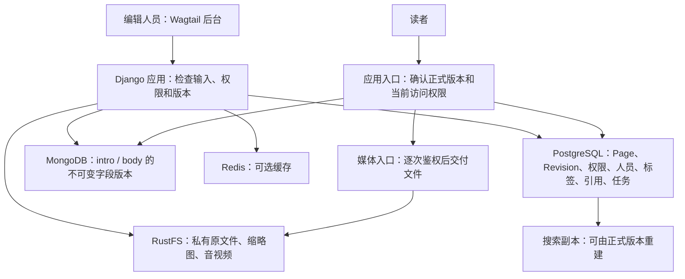
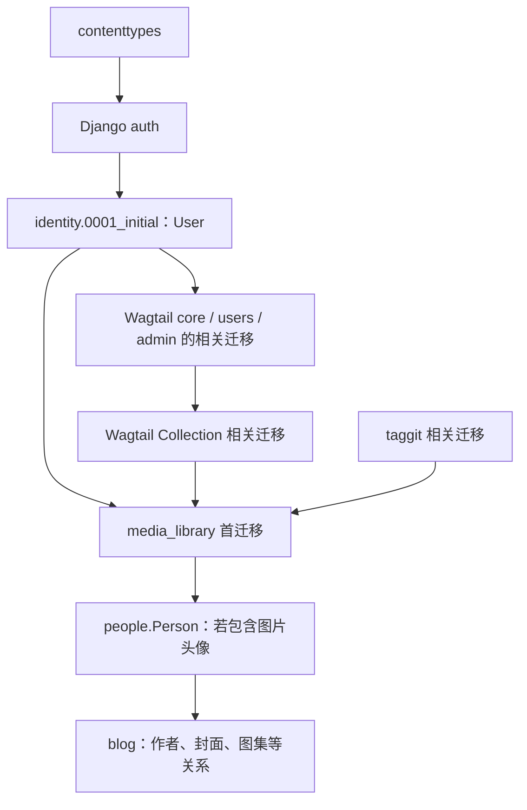
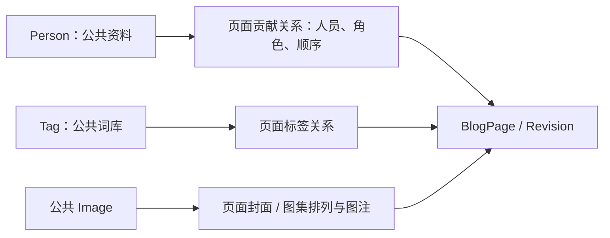
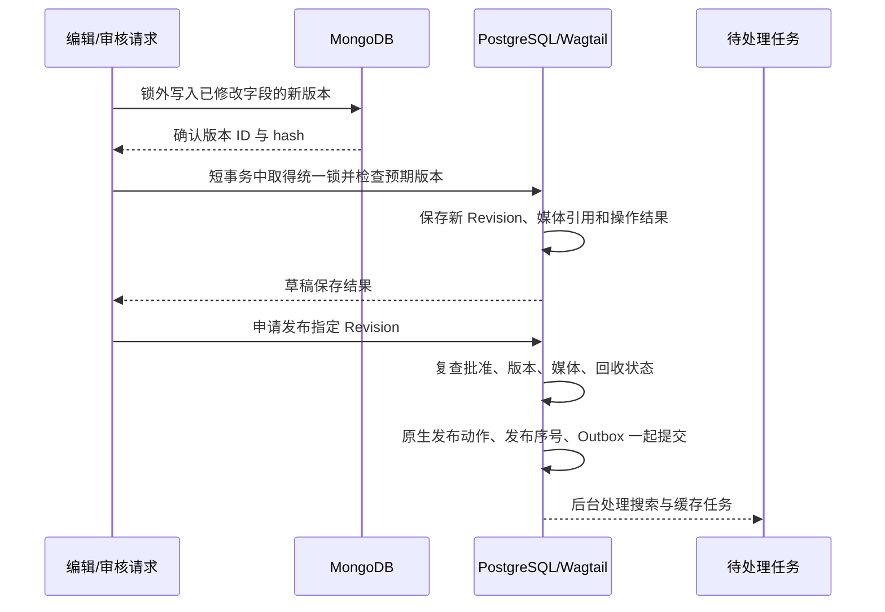
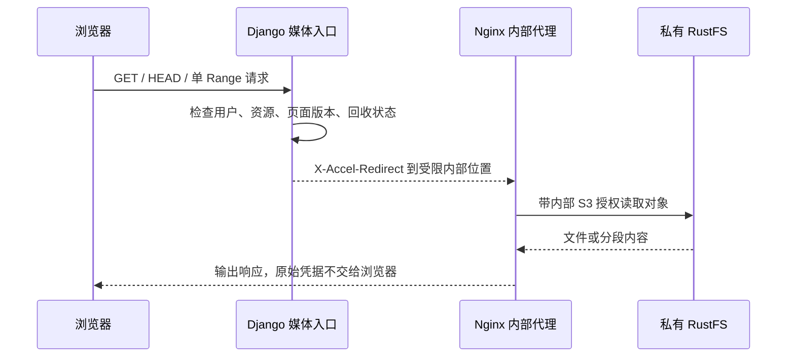
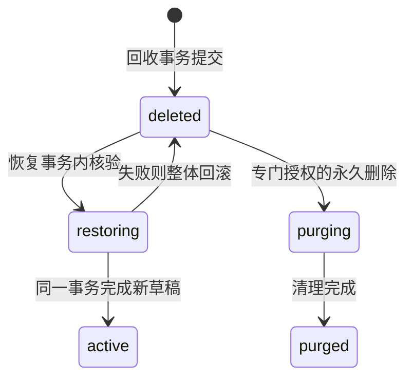

# myblog 第一阶段从零起步开发路线与学习指引

日期：2026-11-04。读者：懂基础 Python、HTTP 和数据库，刚开始学习 Django、Wagtail 的计算机专业学生。

**第一步不是写文章详情页，而是确定后台用户和公共媒体模型。第一处业务代码从 `identity/models.py` 中的 `User(AbstractUser)` 开始。** 先解决哪些表依赖用户、哪些内容属于一个页面版本，再逐步完成编辑、发布、媒体、回收、搜索和展示。

本文是一条学习与开发路线，不是全部功能的实现代码。本文中的“拟建文件”“模型草图”“建议练习”均指后续工作；本次只编写指引，不执行迁移、连接服务、提交、推送或部署。

## 读这份指引的方法

第一次读，先看第 1–3 章，回答“要做什么、现在有什么、从哪里开始”。随后只读当前小任务的“目标、为什么、初步设计、怎么验证、容易踩的坑”，通过检查再继续。遇到术语查第 6 章，不需要一开始就背完整个架构。

建议用一篇练习文章贯穿全过程：《我的 Django 学习笔记》。给它准备两位作者、两个标签、一段简介、一段正文、一张图片，后面再加入复杂表格和音视频。这样每次增加功能，都能在同一篇文章上观察变化。

资料按下面的用途查阅：

| 你想解决的问题 | 查阅资料 |
|---|---|
| 第一期到底有哪些功能 | [第一阶段需求规格说明书](myblog_第一阶段需求规格说明书_v1.0.md) |
| S1–S11 的工程边界、公共接口、数据职责 | [第一阶段技术方案](myblog_第一阶段技术方案_v1.0.md)，重点看 B–E 章 |
| 后续确认了哪些选择，如何精确恢复误删页面 | [十项决策与页面恢复契约完善报告](myblog_十项决策与页面恢复契约完善报告_2026-11-04.md) |
| 搜索参数、匹配、排序、统计和并发细节 | [统一搜索与组合筛选方案](myblog_统一搜索与组合筛选方案_SEARCH-V2-FILTER_2026-11-04.md) |
| 环境切换做过哪些检查 | [PostgreSQL 切换记录](myblog_PostgreSQL切换记录_2026-11-04.md) |
| 私有对象存储与媒体交付 | [RustFS 切换方案](myblog_RustFS切换方案_2026-11-03.md)及主技术方案 C 章 |

原需求书保留了一些早期“待确认”表述。阅读时结合后续确认记录：已经选择最小自定义 User 和媒体模型；HomePage 豁免成文日期，其他业务 Page 和栏目必填；第一期不开放独立 RawHTMLBlock，也不注册 Wagtail API v3。不要把早期的 SQLite、MySQL 或 MinIO 记录当成当前实现目标。

## 1. 先看全景：我们要做成什么样

### 1.1 从编辑人员和读者的操作理解系统

编辑人员登录 Wagtail 后台，创建文章，选择作者和标签，用不同内容块排版，保存草稿并预览。文章可以提交审核、安排发布时间、正式发布或下架。误删后进入回收站，可以回到原位置继续编辑。

读者打开文章，只看到已经正式发布的版本；可以按关键词、类型、栏目、标签和成文日期查找内容。查看图片、下载附件、播放音视频时，服务器还会检查文件访问权限。

Wagtail 是建立在 Django 上的内容管理系统。我们保留它原有的页面树、权限、版本、审核和发布流程，在必要位置接入外置正文和私有媒体，不另造一套文章发布系统。

**Revision 是“页面的历史版本”**，可以理解成一份保存下来的文章快照。**StreamField 是“自由组合的内容积木流”**，一篇文章可以依次放文字、代码、图片、表格等不同内容。**Block 是其中一种内容积木**，例如一个代码块。

### 1.2 四类存储各管什么



图中各模块属于同一个 Django 项目，不要求学生先搭建微服务。

| 存储 | 放什么 | 学生必须记住的边界 |
|---|---|---|
| PostgreSQL | 页面、Revision、发布状态、人员/标签关系、媒体元数据与引用、待处理任务 | Wagtail 的 `live` 和 `live_revision_id` 决定普通页面是否发布、发布哪个版本 |
| MongoDB | 简介 `intro`、正文 `body` 各自的不可变版本 | 只按 Revision 中的版本 ID 取内容，不能自己挑“最新版本”公开 |
| RustFS | 图片、附件、音频、视频等二进制文件 | 使用 S3 协议访问；桶私有，浏览器使用应用提供的受控地址 |
| Redis | 可丢弃、可重建的缓存 | 丢失缓存不能丢文章，也不能改变权限和正式版本 |

S3 是对象存储的访问协议；对象可以理解为“用一个 key 标识的文件”。RustFS 是本项目采用的对象存储产品。PostgreSQL 的媒体表保存对象标识和权限，文件字节并不存进这些表。

搜索副本也在 PostgreSQL 中，但它只是从正式内容生成的查询资料。副本可以重建，不能反过来决定文章是否上线。

### 1.3 第一期的完成画面与范围

第一期完成后，学生应能演示：写一篇混合内容文章，保存草稿、预览、审核并发布；发布后继续改草稿，读者仍看到旧正式版本；媒体权限改变会正确阻断或下架受影响页面；误删文章可回到原位置并恢复为草稿；搜索、栏目和归档只展示当前允许查看的正式内容。

评论、阅读量、推荐、前后篇、自动目录、阅读进度、左右侧栏和真正执行用户代码的沙箱留到后续。第一期仍需提供 CodeBlock 的运行模式界面和接口约定，但不能执行不可信代码。Elasticsearch 真实集成也在第二期，本期用 PostgreSQL 实现可用搜索。

## 2. 第一天：第一行代码到底写在哪里

### 2.1 先认清眼前的仓库

本次写作核对的代码基线为 `64e86460770e1e24b2ea7173c84136b2675fa690`，分支为 `main`。这只是阅读基线，不是本文的新提交。

| 当前已有文件 | 现在的实际作用 |
|---|---|
| `requirements.txt` | 声明 Django 6.1、Wagtail 8.1、psycopg、pymongo、boto3、Jieba 等依赖 |
| `myblog/settings/base.py` | 已使用 PostgreSQL，读取本地 env；尚未配置自定义用户和业务媒体模型 |
| `home/models.py` | 只有空的 `HomePage(Page)`，尚无 BlogPage |
| `home/migrations/0001_initial.py`、`0002_create_homepage.py` | 脚手架自带迁移文件，存在不代表已经执行 |
| `search/views.py` | 仍是 `Page.objects.live().search()`，不会自动搜索 Mongo 正文 |
| `myblog/urls.py` | 保留默认 documents 和 DEBUG media 路径，后续需要接管私有文件交付 |
| `Dockerfile` | 已移除自动 migrate；实际基础镜像仍为 Python 3.14/bookworm，尚未对齐已确认的 Python 3.13/trixie 目标 |
| `tests/test_database_settings.py` | 已有不连接数据库的配置测试 |

本次在指定 WSL2 环境离线读取到 Django 6.1.2、Wagtail 8.1、treebeard 5.3.1。服务准备记录标记 S0 已完成；本文没有重新连接服务，不能据此保证服务此刻可用，更不能说业务迁移和并发验收已完成。

**不要再运行一次 startproject 来覆盖当前目录。** `identity/`、`people/`、`blog/`、`media_library/` 等业务目录目前尚未建立，下面给出的是建设计划。

### 2.2 开工前的最小准备

1. 阅读 `AGENTS.md`，检查 Git 工作区、分支、远程地址，保留别人未提交的修改。
2. 确认使用新项目自己的数据库、桶和缓存范围；不复制旧站业务 App，不修改旧站数据。
3. 在 Windows 编辑；Python、检查和测试使用 WSL2 的 `wagtailblog-test` 环境。
4. 核对自定义用户、媒体模型与首迁移的依赖图，再安排数据库初始化。不能因为后台还打不开，就先用默认用户迁移。
5. 把当天目标缩成一句话：“完成最小 User 定义与离线检查”，而不是“今天实现博客系统”。

Windows 下可先执行只读检查：

```powershell
Set-Location F:\openclaw\workspace\wagtail\myblog
git status --short
git branch --show-current
git remote -v
```

进入 WSL2 后，执行任何 Python 命令前都先核对绝对路径：

```bash
cd /mnt/f/openclaw/workspace/wagtail/myblog
test "$(pwd -P)" = /mnt/f/openclaw/workspace/wagtail/myblog || exit 1
/root/anaconda3/envs/wagtailblog-test/bin/python --version
```

本地配置使用 `POSTGRES_DB/HOST/PORT/USER/PASSWORD`，进程环境优先于 env 文件。不要在命令、笔记或测试输出里打印密码。PostgreSQL 管理员是 `postgres`，MongoDB 管理员仍是 `root`，两个不能混用。

### 2.3 第一处代码：最小 User，而不是文章正文

下面是**未来获准实施 S1 时**的最小起步示例，本次没有创建这些应用文件。

先建立 `identity/__init__.py` 空文件和 `identity/apps.py`：

```python
from django.apps import AppConfig


class IdentityConfig(AppConfig):
    default_auto_field = "django.db.models.BigAutoField"
    name = "identity"
```

然后在 **`identity/models.py`** 写第一处业务模型：

```python
from django.contrib.auth.models import AbstractUser


class User(AbstractUser):
    """后台账户；公开作者资料由独立的 Person 管理。"""
```

在 `myblog/settings/base.py` 中接入：

```python
# 加到已有 INSTALLED_APPS 中，不替换原有应用列表。
INSTALLED_APPS += ["identity.apps.IdentityConfig"]
AUTH_USER_MODEL = "identity.User"
```

`AbstractUser` 已提供用户名、密码散列、用户组和权限等基础能力。此时不必加会员等级、作者简介或复杂权限体系。还要安排后台用户表单和 Wagtail 用户管理的兼容检查，类能导入不等于登录流程已通过。

**这三段示例不是完整 S1，更不是执行 migrate 的前提已经满足。** S1 还要确定自定义 Image、Document、Rendition 及 Audio/Video 模型，设置媒体模型配置，核对首迁移图。候选迁移必须让 User 在 `identity.0001_initial` 中创建；不能先初始化默认用户表，再临时切换。

当天可先交付：这些候选文件的代码审查结果、迁移依赖草图、离线检查结果和剩余问题。真正创建数据库表和后台登录验收，放在获准的隔离环境中执行。

### 2.4 第一天怎么检查，哪些命令先别跑

本仓库现有配置测试可以这样执行，它使用临时配置文件，不连接数据库：

```bash
/root/anaconda3/envs/wagtailblog-test/bin/python -m unittest discover -s tests -p test_database_settings.py -v
git diff --check
```

候选 User 编写后，可用 Python 的 `ast.parse` 只读检查语法。语法检查不负责证明模型关系、迁移或权限正确。

`manage.py check` 要在确认导入过程不会连接外部服务后使用；`manage.py check --database default` 明确涉及数据库检查。`manage.py test` 即使看起来是单测，也可能创建测试库和运行迁移，不能默认当作离线命令。

生成迁移的 `makemigrations`、应用迁移的 `migrate`、启动服务的 `runserver`，以及真实服务探针均遵守单独授权要求。自动测试库由 `POSTGRES_TEST_DB` 指定，默认 `test_myblog`；它和手工服务探针库 `myblog_test` 不是同一个用途。

## 3. 单线开发主线：为什么按 S1–S11 前进

### 3.1 先看一张施工图


这是**适合新手的串行学习顺序**。工程依赖不是每一对相邻任务都必须等待：原技术方案允许 S4 在 S2/S3 后独立推进，S5 并不严格依赖表格完成。学生先完成 S4 再做 S5，能减少同时处理的问题；不要把学习图误当成新的强制依赖合同。

| 建房阶段 | 小任务 | 完成后你应拿得出的东西 |
|---|---|---|
| 地基 | S1 用户/媒体模型，S2 公共接口 | 稳定身份、首迁移依赖图、各模块之间的数据约定 |
| 砌砖 | S3 基本 Block，S4 复杂 Table | 可以独立编辑、检查、显示和提取信息的内容积木 |
| 骨架 | S5 BlogPage | 合法页面树、成文日期、作者/标签/封面和图集关系 |
| 引擎 | S6 内容版本与发布 | 草稿、预览、批准、排期、正式文章各取正确版本 |
| 防盗门 | S7 私有媒体，S8 回收/恢复 | 文件逐次鉴权，历史引用防误删，错删能安全恢复 |
| 导览系统 | S9 搜索、栏目、标签、归档 | 统一条件和权限下查到正式内容 |
| 精装修与交房 | S10 详情页，S11 综合验收 | 可访问的阅读体验和有证据的故障恢复能力 |

“精装修”只表示主要 UI 在后期整合，安全、可测试性和无障碍基础要从前面开始做，不能等到 S11 才补。

### 3.2 三个最关键的先后关系

**为什么先定 User，再建媒体库？**

媒体需要记录上传者，Wagtail 页面和审核也会关联用户。它们的外键必须指向最终的用户模型。Django 的可替换用户依赖要求自定义 User 在自己应用的第一次迁移中建立；如果先按默认用户初始化，再换 User，会牵动已有外键和迁移历史。先定 User 是减少返工，不是说一张图片在概念上必须有公开作者。

**为什么 Mongo 正文设计要在 BlogPage 之前确定？**

BlogPage 必须提前知道：简介和正文不是在 Page 主表里随便覆盖的字符串，而是由每个 Revision 绑定的两个字段版本。所以 S2 先定外置内容格式、版本引用和读取接口，S3 按这个接口实现 Block，S5 再建立文章模型。**真实 Mongo 存取、双库失败处理和发布绑定在 S6 完成**，并不要求 S5 之前连接 Mongo 或完成整个发布流程。

**为什么搜索在生命周期之后做？**

搜索必须先知道“哪个版本正式上线、当前谁能看、页面是否在回收站”。如果先索引最新草稿，后面再补权限和下架，会使草稿关键词、标题、日期甚至数量提前泄露。S2 先预留公共查询接口；S9 才依赖 S6/S8 的规则建立和查询正式副本。

### 3.3 一个小任务怎样算完成

每次按以下循环工作，不把 S1–S11 一次性写完：

1. 读对应需求，列出一个正常例子和一个失败例子。
2. 确认这次允许修改的文件、使用的接口和允许的外部操作。
3. 先写能辨别对错的检查，再实现当前最小目标。
4. 跑定向检查；涉及 UI 就操作浏览器，涉及并发就用获准的真实数据库验证。
5. 记录“改了什么、运行什么、结果如何、还没验证什么”，通过后继续。

安排时间时，用验收结果决定何时进入下一步，不用“第几天必须写到搜索”倒逼跳过失败项。

## 4. S1–S11：每项需求的初步设计与练习

### S1：分开后台 User 和公开 Person，确定首迁移

**目标。** 先让后台账户稳定下来，同时确定公共媒体表的最小结构。公开人员资料的原则在这里定好，Person 的业务实现放到 S5。

**为什么这么做。** 作者可能是没有后台账户的合作人、老师或历史作者。把 User 直接当作者，会迫使每个作者拥有登录身份，也容易把邮箱等后台资料带到前台。署名为“审校”也不等于拥有 Wagtail 批准发布的权限。

**初步设计思路。**

| 对象 | 起步字段或能力 | 负责什么 |
|---|---|---|
| `identity.User` | 继承 `AbstractUser`，首期不增加业务字段 | 后台登录、Group、Permission |
| `people.Person`，S5 实施 | 建议 `public_id`、`name`、可选 `avatar`、`bio` | 对外公开的人物资料，不负责认证；准确字段需在候选模型中核定 |
| `media_library.Image/Document/Rendition` | 继承 Wagtail 对应 Abstract 基类，保留后台原生字段 | 从第一次迁移就使用选定媒体模型 |
| `media_library.Audio/Video` | 稳定资源 ID、文件版本/对象 key、格式、大小、上传者和访问策略等候选字段 | 全站公共音视频；不能按 Blog 单独建库 |

Person 的头像也是公共图片引用，公开时仍检查图片权限。`public_id` 可以采用 UUID，即便对象改名仍保有稳定身份；它不是认证令牌。

首次迁移的简化依赖图如下。箭头表示前者准备好，后者才能建立相关表：



这不是完整可执行迁移图。现有 `home.0001/0002`、Wagtail 的媒体原生分支和其他依赖仍需纳入真实图。`identity.0001` 不能反过来依赖 Person、媒体或 Page，否则可能形成循环。

实施入口：拟建 `identity/models.py`、`identity/apps.py`、`media_library/models/` 及对应测试；修改 `myblog/settings/base.py`。自定义媒体分别通过 `WAGTAILIMAGES_IMAGE_MODEL`、`WAGTAILDOCS_DOCUMENT_MODEL` 接入。Rendition 指向自定义 Image，保留 `(image, filter_spec, focal_point_key)` 唯一约束和原生后台表单能力。

同时核对 Dockerfile：目标为 Python 3.13/trixie，现文件还没对齐；启动不能自动 migrate。导入路径检查应防止共享 Conda 中旧站的 editable 包被误用。

**怎么验证检查。**

- 离线检查模型和设置；获准生成候选迁移后，用 `MigrationLoader(connection=None)` 核对完整依赖图，不连接数据库。
- 在获准的全新隔离测试库验证首次初始化、User/Group/Permission 和媒体外键；迁移图无环不能替代真实初始化。
- 实际操作登录、Wagtail 用户管理、媒体选择器和派生图，不能只看模型能导入。

**容易踩什么坑。** 调整 `INSTALLED_APPS` 顺序不能修复迁移依赖；仓库有迁移文件不等于数据库已经迁移。发现数据库已有内容时，先制定升级方案，不删除旧迁移、不直接切换用户模型重跑。

**过关产物：** 最小候选模型、完整依赖图、设置检查结果，以及单独获准后的空库初始化证据。

### S2：先约定内容积木、正文版本和权限接口

**目标。** 让后面的 Block、BlogPage、Mongo、媒体和搜索说同一种“数据语言”，但不在模块导入时连接服务。

**为什么这么做。** 如果 Markdown 直接生成任意 HTML，搜索只会抓网页字符串，媒体删除又只检查图片字段，三边得到的内容会不同。先统一接口，后面才知道怎样检查安全、提取正文和找到文件引用。

**初步设计思路。** 公共 Block 约定四件事；下面是接口草图，不是已存在实现：

```text
validate(value, context)          检查输入是否合法
render(value, context)            生成允许展示的内容
extract_text(value)               提取搜索需要的文字
extract_media_refs(value, path)   提取资源 ID 和内容中的位置
```

数据格式带 `schema_version`，即“这份数据按照第几版格式解释”。Block 类型名保持稳定，旧版本数据要能继续读取或明确报告不支持，不能换个名字就让历史文章失效。

外置字段引用至少约定 `document_uuid`、`field_name`、`version_id`、schema 和内容摘要。摘要是用于核对内容是否一致的 hash，不是展示给读者的文章简介。公共读取接口区分“公开正式版”和“有权限的草稿/历史预览”。

拟建位置：

- `content_blocks/contracts.py`：内容格式与四个接口。
- `external_content/contracts.py`：字段版本引用和读取错误约定。
- `content_lifecycle/access.py`：正式内容、预览和媒体上下文的权限边界。
- `discovery/contracts.py`：公共查询参数与结果格式，后续扩展到 `ContentQuery`。

公共模块不导入具体 BlogPage/GuidePage，也不自己挑一个“最新可见”版本。业务 Page 通过组合和注册使用公共能力，复用功能而不共享一份可修改的正文。

**怎么验证检查。** 用几份内存样例验证接口：正常文本能提取；未知 schema 明确失败；非法资源 ID 被拒绝；导入模块时禁止网络/数据库 IO，并确认守卫在导入之前生效。用最小的其他页面类型测试适配器验证可复用，不为测试实现完整 GuidePage。

**容易踩什么坑。** S2 不是先把数据库客户端写成全局单例并在 import 时连库，也不是把接口命名写好就算完成。字段归属、失败结果、权限上下文和格式兼容都需要样例。

**过关产物：** 四类接口、数据样例和离线契约检查，供 S3、S5、S6、S9 使用。

### S3：实现基本 StreamField Block，先保证输入和输出安全

**目标。** 完成富文本、Markdown、代码、Mermaid、媒体和嵌入的基础编辑与显示。图集由 Blog 组合公共图片能力，S5 再接入文章。

**为什么这么做。** 页面排版可以灵活，但编辑器输入不能因为“来自后台”就直接获得执行脚本的能力。XSS 是“把恶意脚本混入内容，让别人的浏览器执行”的攻击。

**初步设计思路。** 每种积木都走“输入检查 → 保留结构化原文 → 安全显示 → 文本/引用提取”。净化是只保留允许的 HTML 标签、属性和 URL 协议；不是简单删除字符串 `<script>`。

| Block | 第一阶段要完成的设计重点 |
|---|---|
| RichText | 链接、列表、必要排版及下划线；沿 Wagtail 扩展点实现允许的功能 |
| Markdown | 公式、表格、代码块和 Mermaid；转换后净化 HTML，检查链接协议与托管媒体标识 |
| Code | 一个 Block 两种模式；展示模式支持高亮、行号、复制、折叠；运行模式有编辑、stdin、stdout/error 和不可用提示，本期不执行代码 |
| Mermaid | 图表文本、渲染版本、预览、缩放/适配/全屏/折叠、主题、复制源码、SVG 安全导出和错误反馈 |
| Image/Document/Audio/Video | 保存公共资源 ID 和必要说明，不保存管理员密钥或永久直链；S7 接入真实受控交付 |
| Embed | 限定来源和嵌入格式，限制 iframe/CSP；服务端抓取还要防 SSRF |

Mermaid 是“用文本描述流程图的工具”。独立 MermaidBlock 和 Markdown 中标为 `mermaid` 的代码块共用同一套严格安全渲染器，不能一个安全、另一个允许任意脚本。SVG 是可含活动内容的矢量图片格式，导出也需净化。

SSRF 是“诱使服务器请求内部地址或不应访问的地址”。Embed 的来源检查不能只看用户输入开头，还应覆盖跳转和最终目标；具体受支持来源在实现时明确。

Markdown 中的普通代码块只用于展示，不自动变成运行型 CodeBlock。CodeBlock 的代码文本要按文本转义，`<script>` 应作为示例显示。不要对编辑器输入直接使用 `mark_safe` 来跳过检查。

第一期不提供独立 RawHTMLBlock；Markdown/Table 的受控 HTML 能力仍需保留。安全净化不能以删除所有图片 ID、公式或合并属性来“通过测试”。

拟建位置：`content_blocks/blocks/`、`content_blocks/renderers/`、对应模板、静态资源和测试。只有页面使用对应区块时才加载其脚本和样式。

**怎么验证检查。**

- 正常例子：同一篇示例内容显示富文本、下划线、Markdown 公式、代码、流程图和媒体选择结果。
- 安全例子：事件属性、危险 URL、嵌套 HTML、恶意 SVG/iframe 被阻断或净化；代码样例仍原样作为文本显示。
- 提取例子：搜索文字可读、媒体引用含稳定 ID 与位置；渲染和提取对相同格式有一致解释。
- 浏览器检查编辑、预览、错误提示、键盘操作；真实文件读取留到 S7 验收，不能用模拟成功替代。

**容易踩什么坑。** 净化要在真正输出 HTML 的路径生效，后台预览、Markdown 嵌套 Mermaid 和 SVG 导出都要覆盖。历史格式不认识时报告错误并保留原文，不把正文悄悄清空。

**过关产物：** 基础 Block、危险输入样例、文本/媒体提取结果和浏览器操作证据。

### S4：单独攻克复杂表格

**目标。** 支持合并/拆分单元格、增删复制行列、撤销/重做、链接、公共图片、LaTeX 数学、受控 HTML、对齐/宽度/样式，并在手机上横向滚动。

**为什么这么做。** 表格编辑既有数据结构又有复杂交互。拿一个只能填二维文本的简单 TableBlock，无法满足合并单元格、图片和公式要求；把这项工作独立出来，能避免 BlogPage 一边开发一边反复改正文格式。

**初步设计思路。** 先写样例，再评估编辑器。可用“单元格结构 + 受控内容节点”的模型草图：单元格记录位置、`rowspan/colspan`、内容和允许的样式。也可采用编辑器原生结构，但必须能稳定保存、校验并恢复历史格式，不能只靠编辑器生成的任意 HTML。

合并后的格子要能还原覆盖关系；拆分、删行列和粘贴要重新校验，拒绝重叠、越界或非法跨度。图片节点保存媒体 ID，公式节点保存 LaTeX 原文，不能只保留一张截图。支持的是数学排版，不是 Excel 的计算公式；首版也不做 CSV 导入导出。

```text
编辑器结构
  → 检查单元格布局、资源 ID、公式和样式
  → 保存带格式版本的数据
  → 输出允许的 table / tr / th / td 等结构
  → 外层容器 overflow-x: auto，手机横向滚动
```

HTML 净化允许安全的 `rowspan/colspan`，拒绝事件属性、危险协议和任意 CSS。初始设计可以采用受限样式选项，不能让学生直接输入任意 style。表头和图片替代文本也要能被辅助阅读工具理解。

拟建位置：`content_blocks/table/`、`static/content_blocks/table/` 和浏览器测试。编辑器库与净化库要按兼容性、许可、维护情况和上述功能验证后选定；本文不虚构已经安装或通过验收的库。

**怎么验证检查。** 建一张带双层表头、横纵合并、图片和公式的表；编辑、撤销、重做、保存、重新打开，再渲染到手机宽度。测试删掉跨行单元格经过的行、复制粘贴复杂范围、危险 HTML 和旧格式回放。搜索提取不能漏掉合法文字，媒体提取不能漏掉表格里的图片。

**容易踩什么坑。** 只测 JSON 能存入数据库，不能证明编辑器操作正确；只测桌面宽屏，不能证明手机可读；净化后合并关系丢失也属于功能失败。

**过关产物：** 表格格式约定、完整编辑功能和桌面/手机浏览器证据。

### S5：建立 BlogPage、成文日期和公共关联

**目标。** 把前面的积木装进文章模型，定义文章可以放在哪里、署名给谁、带哪些标签、使用什么封面和图集。

**为什么这么做。** Page 树负责栏目位置，Person/Tag 负责跨页面共享的人物和词库。区分这几件事，才能让一篇文章既属于某个目录，又能按类型、标签或日期查到。

**初步设计思路。** BlogPage 继承项目的公共页面基类 `CustomBasePage`；这个拟建基类仍继承 Wagtail Page，用来统一项目生命周期检查，不能另造树和发布体系。`BlogIndexPage` 是栏目页。父子类型要明确允许，文章不必全部放在 BlogIndexPage 下面。

```text
HomePage
├── BlogIndexPage：学习笔记
│   ├── BlogPage：Django 入门
│   │   └── BlogPage：迁移排错
│   └── BlogIndexPage：数据库
│       └── BlogPage：PostgreSQL 学习
└── BlogPage：关于这个站点
```

这是一个需经类型规则允许的例子，不代表 HomePage 可以接受任意类型。未来 GuidePage 等类型通过注册接入，本期不为画树就实现完整业务。

| BlogPage 内容 | 初步设计 |
|---|---|
| 标题、slug、SEO、发布状态 | 保留 Wagtail 原生字段和生命周期 |
| `authored_on` | 必填 `DateField`，创建时默认预填当天；编辑可改，不用 `auto_now/auto_now_add` |
| `intro` | BlogIntroBlocks，只组合公共 RichText/Markdown；内容外置 Mongo |
| `body` | BlogBodyBlocks，直接列出基本 Block；需要复合结构的图集才使用 StructBlock |
| 外置字段身份 | `document_uuid`、简介/正文版本指针等按 S2/S6 合同进入 Revision |
| 贡献人员 | 页面自己的有序关系：Person、角色、排序 |
| 标签 | 全站一个 Tag 词库，页面自己的关系随 Revision 保存 |
| 封面 | 可选的公共 Image 引用 |
| 独立图集 | 页面自己的有序图片关系与图注，前台放正文之后 |
| 正文图集 | body 中的多个组合块，各自保留排列和图注 |

成文日期表示“这篇内容写于哪一天”，发布时间表示“网站什么时候把它上线”。例如一篇 2025 年写的笔记，在 2026 年第一次发布，它的成文日期仍可为 2025 年。年月归档依据 `authored_on`，不能偷换成 `first_published_at`，也不能缺日期时自动回退。

HomePage 是站点入口，已确认豁免这一必填日期；BlogPage 和 BlogIndexPage 等业务页面仍必填。后台预填当天只是方便输入，保存前仍要验证有效值。

多人关系可用 `Orderable` 和 `ParentalKey` 等 Wagtail/modelcluster 机制建模。`ParentalKey` 表示“这条子记录属于父页面的整组编辑内容”，要配合版本序列化验证作者、顺序、角色是否真正进入 Revision；标签关系也同样验证，不能认为普通 ManyToMany 自动满足历史回放。



恢复旧版本时，恢复“当时选了哪些人和标签”，不回滚 Person 当前姓名、头像、简介和 Tag 当前名称。合并标签时保留旧 ID 到规范 ID 的对应关系，避免恢复历史内容又制造重复标签。**作者关系属于页面版本，共享资料属于公共对象。**

拟建位置：`people/`、`taxonomy/`、`blog/models/`、`blog/blocks.py` 和测试。此时可以验证模型、编辑结构和版本序列化；公开读取要等 S6 接通，不能先给访客上线一个直接读草稿的临时页面。

**怎么验证检查。**

- 合法树位置可创建，非法父子类型被拒绝；类型筛选和目录筛选能够独立理解。
- 成文日期为空被拒绝，重新编辑不自动覆盖旧日期；同日期用 Page ID 等次级键稳定排序。
- 两位作者调换顺序、修改角色，保存不同 Revision 后可正确回放；标签、封面和两类图集同样检查。
- 用 S2 的内存样例检查外置指针格式，S6 再证明真实 Mongo 与发布一致性。

**容易踩什么坑。** 不新建 Category 取代页面树；不把作者角色当审核权限；不把多个 Page 的 body 指向一个可随意修改的共享正文。仅调用 `.live()` 仍不能保证取到正式作者、日期和标签，下一步专门解决。

**过关产物：** 文章/栏目模型、树规则、日期规则，以及完整关系进入 Revision 的证据。

### S6：让 PostgreSQL Revision 精确绑定 Mongo 不可变版本

**目标。** 完成保存草稿、预览、审核、排期、发布、下架、复制和历史回退的版本适配，保证改草稿绝不改变正式文章。

**为什么这么做。** PostgreSQL 和 MongoDB 不能一起做一次普通数据库事务。事务是“让一组数据库改动一起成功或一起回退”的机制，但 PostgreSQL 的事务回滚不会撤销 Mongo 已写入的内容，更不会撤销 RustFS 上传。

**初步设计思路一：把一个页面版本拆成清晰的三份记录。**

```text
PostgreSQL：Page 42
  live = True
  live_revision_id = 101
  latest_revision_id = 102

PostgreSQL：Revision 101（正式 V1）
  authored_on = 2026-10-01
  作者/标签/封面/图集/SEO = V1 的关系与元数据
  intro_version_id = I1
  body_version_id = B1

PostgreSQL：Revision 102（草稿 V2）
  authored_on = 2026-10-15
  作者/标签/封面/图集/SEO = V2 的关系与元数据
  intro_version_id = I1       # 简介未改，复用
  body_version_id = B2        # 正文改了，新建版本

MongoDB：
  I1 = 简介原内容
  B1 = 正式正文原内容
  B2 = 新草稿正文
  三者保存后均不原位改写
```

读者从 `live_revision_id=101` 取元数据和关系，再按 I1/B1 取正文。编辑人员预览 Revision 102，才会看到 I1/B2。即使 Page 当前表行已含一些草稿字段，也不能拿它们拼进正式页面。

**【已确认方案 A：彻底脱水模式】**：为支撑千万级（10,000,000+）文章规模与长文高频编辑，PostgreSQL 的 `blog_blogpage` 物理行与 Revision 中的正文大 JSON 彻底脱水置换为 2 字节 `[]` 占位，单行仅存约 200 字节轻量元数据；大正文 100% 外置至 MongoDB 不可变集合 `content_field_versions`，通过 `hydrate_from_mongo()` 动态按版本指针水合恢复，彻底杜绝 TOAST 表膨胀。

Mongo 字段版本候选内容包括 `version_id`、`document_uuid`、`field_name`、schema、Block 格式版本、`content_hash`、payload、创建时间和操作 ID。每次读都核对“属于哪个页面、哪个字段、哪种格式、内容是否匹配”；仅凭 ID 找到一条记录不够。

**初步设计思路二：外置内容先确认，SQL 再记录完整结果。**



**Outbox 是“与业务数据一起存入数据库的待处理任务表”**。任务已落库后，即使进程在通知工作者前崩溃，扫描器仍能补处理。`on_commit` 可以唤醒工作者，但它本身不是持久任务表。首期按主方案用管理命令处理 Outbox，不要求先部署 Celery。

**幂等是“同一次操作重试多次，结果仍等于做了一次”**。用唯一 `operation_id` 标识一次请求；简介和正文写入再按字段区分。`OperationResult` 与业务改动一起提交，绑定操作者、动作、目标和输入摘要。同 ID、相同输入返回原结果，同 ID、不同输入拒绝。

| 中断位置 | 正确处理 |
|---|---|
| Mongo 写入失败或结果未知 | 按原操作/版本 ID 核对，再决定重试；未确认完整不能发布 |
| Mongo 成功，SQL 提交前失败 | SQL 回滚；Mongo 候选版本保留待对账，不立即删除 |
| SQL 提交结果因断连未知 | 按原 `operation_id` 查主库；不盲目另发一次发布，不谎报确定成功或失败 |
| SQL 已提交，搜索任务失败 | 文章发布事实不回滚；任务保留重试，搜索可暂时漏新内容 |
| 已保留正文缺失或 hash 不符 | 报告内容不可用，禁止用“Mongo 最新正文”或空字符串顶替 |

对账是“比较几种存储的记录，找出哪些已绑定、哪些残留、哪些缺失”。SQL 失败后留下的 Mongo/RustFS 对象只是待核对对象，不能立即推断为可删垃圾。

**初步设计思路三：所有冲突操作遵守同一锁顺序。**

锁是“让冲突操作依次处理同一数据”的机制。首期采用一条固定的 `ContentMutationGuard` 协调记录，先保证个人站的正确性。完整合同见恢复报告第 5.1 节，学习时记住：

```text
开始事务，设置 lock_timeout = 3s
  → ContentMutationGuard 固定行
  → RecycleBatch / RecycleEntry
  → Page
  → WorkflowState
  → TaskState
  → 媒体资源
  → 引用等附属行
  → discovery epoch
  → Outbox / OperationResult 与业务一起提交
```

同表按 ID 排序，媒体按固定类型再按 ID 排序；不涉及的行可略过，但不能换成相反顺序。树操作要在取得协调锁后重新确认受影响节点，包括相关兄弟、后代和别名，不能只锁根节点。协调记录缺失时拒绝变更，不能对空查询“加锁成功”。

3 秒是每次数据库锁等待上限，不是所有操作的总时长。超时要退出并回滚整个事务，返回可重试的忙碌状态，不在已经失败的事务里继续 SQL。Mongo 预写、大文件传输和图片计算放锁外。

缩略图工作者是明确例外：只取 Image 和生成记录的锁，不再反向取得 Guard/Page。发布与资源删除也锁对应 Image，因此要核对生成租约和资源状态，不能只靠一个唯一键。

**初步设计思路四：批准谁，就只能发布谁。**

后台按钮、审批工作流和定时任务必须走同一检查。批准时带上目标 Revision 和当前任务 ID，锁内重新核对；不能把“批准 V1”变成“随便发布现在最新的 V2”。PostgreSQL 的条件唯一索引能限制同时有效的工作流数量，但不替你保证批准版本正确。

保存修改要新建 Revision，不原位覆盖保留的 `Revision.content`，自动保存也要适配。复制页面则新建 Page 和 `document_uuid`，每个复制节点取得自己的字段归属；公共媒体、Person、Tag 可以继续共用。历史回退只生成新草稿，不改旧 Revision，不自动发布。

普通详情读取检查 Page/Site/祖先权限和回收状态，锁定要读的正式版本身份；取完 Mongo 后、发送响应前再核对发布序号和权限版本，变化时有限重试或拒绝。S9 搜索采用单次只读快照，有不同的取数边界，不把两者混成一个实现。

拟建位置：`external_content/store.py`、`revision.py`、`publication.py`、`outbox.py`，以及 `content_lifecycle/` 的协调和工作流适配。

**怎么验证检查。**

- 发布 V1，再改草稿 V2 的正文、日期、作者、标签和封面；读者看到的每个字段仍是 V1。
- 只改 body 时 intro 版本不变；预览旧 Revision 能取回旧字段版本。
- 测试审核后又编辑、旧表单保存、重复发布、旧定时任务、复制子树和历史回退。
- 注入 Mongo 超时、SQL 提交前失败、提交未知、Outbox 重复/乱序；核对数据保留和操作回执。
- 获准后用真实 PostgreSQL 独立连接、同步起跑点验证并发；Mock 和 SQLite 不能证明 PostgreSQL 行锁行为。

**容易踩什么坑。** `.live()` 只筛选页面状态，不自动给你正式版本的全部字段；`transaction.atomic()` 也不能包住 Mongo/RustFS。单例锁只能约束所有遵守入口的代码，不能保护绕开的原生调用或原始 SQL。

**过关产物：** 从草稿到正式版的完整版本对应、故障处理和真实并发证据。S7/S9 不能用尚未验证的“发布成功信号”代替这项合同。

### S7：接通私有媒体，保护历史引用

**目标。** 让四类媒体可上传、选择、预览、播放和下载，同时保证不能绕过权限或删掉历史文章仍需使用的文件。

**为什么这么做。** 上传成功不等于可以公开。图片可能含未公开材料，音视频可能属于受限页面，后台 Collection 权限也不等于读者可以下载原文件。默认私有能让编辑人员先确认，再由有权限的人公开。

**初步设计思路一：统一文件入口，每次请求检查。**

资源初始策略为 `restricted`，RustFS 桶保持私有；只有专门权限可以批准资源为 `public`。公开页面发布前检查全部托管引用，存在 restricted 资源就拒绝并指出字段/Block 位置。



Range 是“只请求文件的一段字节”，播放器拖进度条常用它。`X-Accel-Redirect` 是“应用告诉 Nginx 从内部位置交付文件”的响应头：Django 负责判断能不能读，Nginx 承担大文件传输，避免长时间占用 Python 同步工作进程。

内部路径必须配置 `internal`，公网不能直接访问；浏览器不能传任意桶、对象 key 或上游 URL。**这个响应头不会自动替私有 S3 请求签名**，仍需内部签名/授权方案，不能为了播放方便把桶公开。

本地按已确认方案采用 ASGI 异步流；ASGI 是支持异步请求处理的应用接口。目前仓库只有 WSGI 入口，需在 S7 新增和验证异步入口。boto3 是同步客户端，把 `async` 写在函数前不会让读取自动异步；如沿用它，要用有并发上限的线程池并正确关闭断连的流，不能整文件载入内存。

原图、Rendition、封面、下载、字幕、播放器、后台预览都要走受控交付地址。Rendition 是“按尺寸、裁剪等规则生成的图片版本”。要接管默认 `/documents/`、DEBUG `/media/`、模板 `.url` 和派生图直达路径，不能只改主播放器。

`GET`、`HEAD`、续传和条件请求都先鉴权，再处理 `206`、`304`、`416` 等响应。首期明确支持单 Range，多 Range 返回受控错误；测试 `Content-Range`、`If-Range`、无效范围及 HEAD 空响应体。默认 `Cache-Control: private, no-store`，不以公开缓存或浏览器可直接复用的签名 URL 替代逐次鉴权。

权限收回只能影响之后的新请求和续传；已经发送到读者设备上的字节无法召回。

**初步设计思路二：历史引用也算“仍在使用”。**

```text
Image 7
  ← Revision 101 的封面
  ← Revision 102 的 Markdown 图片
  ← 另一篇文章的 Table 单元格
  ← 回收站文章保存的旧版本

只要其中任一保留引用仍有效，就不能物理删除 Image 7。
```

`MediaReference` 是“哪些页面版本在哪个位置使用了哪些文件”的记录。提取器覆盖封面、图集、富文本、Markdown、Table、音视频和嵌套结构；保存 Revision 时，在同一 SQL 事务登记引用及提取器版本。提取结果缺失或格式不支持时，默认拒绝永久删除，而不是当作零引用。

当前正式、当前草稿、历史和回收站是可重叠的分类，不能把它们当四份互斥计数简单相加。资源替换用新资源/不可变文件版本和新 key，旧 Revision 仍能取到旧文件，不能覆盖同一对象 key。

**初步设计思路三：删除和公开改私有都要协调。**

- 媒体真正删除分两步：SQL 事务中核实零引用、无未完成保护任务，标记 `deleting` 并写 Outbox；后台再按操作 ID 和准确 key 删除对象、核对结果。失败保留记录重试。
- `ProtectedRustFSStorage.delete()` 拦截普通直接物理删除，原生文件清理信号和表单替换/批量派生图中的删除路径一并适配。不能只隐藏后台删除按钮。
- `public → restricted` 默认阻断并展示受影响正式页面；管理员二次确认后，同一 SQL 事务下架相关页面和必要的链式别名，取消相关排期，修改权限并记录任务和操作结果。
- 影响清单确认后若又有新引用，要锁内重查，不能只执行旧清单。文件入口之后的新请求立即按新权限拒绝，不等待搜索或 Redis 更新。

常用缩略图在锁外预生成，发布准备阶段确认必需规格就绪；生成失败保留草稿，不能一边持有全局协调锁一边算图上传。唯一冲突或 SQL 失败产生的候选对象保留待对账，不立即删除。

拟建位置：`media_library/access.py`、`delivery.py`、`references.py`、`wagtail_hooks.py`、受控存储实现、路由及对应测试。

**怎么验证检查。** 覆盖四媒体上传/选择/预览；匿名读私有资源、猜 ID、绕过内部地址、原图/派生图直链都失败；音视频拖进度条、HEAD/续传正确。历史/回收站引用阻止误删；同时发布与改私有、生成缩略图与删除要做真实并发。Nginx 内部代理、本地 ASGI、慢客户端、断连和内存峰值分别验证，不能用 RustFS 一次 Range 探针代替整条链路。

**容易踩什么坑。** `FileField.delete()`、`image.file.delete()` 和原生文件清理可能绕过业务流程；默认存储 `.url` 也可能绕过访问入口。应用保护无法约束 RustFS root 在控制台直接删除，运维删除还要单独核对和授权。

**过关产物：** 真实私有交付、历史引用保护、两步删除和媒体撤权联动证据。

### S8：受控回收站，错删后回到原位置

**目标。** 单页和整棵子树可回收、查看、恢复；正常恢复保留同一页面身份、父节点和兄弟位置，恢复后是未发布草稿。

**为什么这么做。** 硬删再重建会丢原 Page ID、历史 Revision、子树关系和引用。把文章直接搬进另一棵“垃圾树”，又会增加路径、权限和回迁冲突。已确认方案保留原树节点，通过回收记录和统一入口限制访问。

**初步设计思路一：页面还在原处，但不可普通访问和修改。**

```text
回收前                    回收后                    正常恢复后
栏目 A                    栏目 A                    栏目 A
├── 文章 B                ├── 文章 B（回收占位）      ├── 文章 B（未发布草稿）
│   └── 子文 C            │   └── 子文 C（回收）      │   └── 子文 C（未发布草稿）
└── 文章 D                └── 文章 D                 └── 文章 D
```

拟建 `RecycleBatch` 记录一次回收批次，`RecycleEntry` 记录每个节点：原 Page ID、父节点 ID、祖先、兄弟序列/左右邻居、slug、最新草稿 Revision、原正式 Revision、Mongo 字段指针、引用清单和状态版本。回收事实以有效 Entry 为准，不在 Page 上另加一套可独立裁决的 `is_deleted`。

Page 的树结构由 treebeard 管理，使用 `path/depth/numchild`；`url_path` 表示路由路径。框架 Page 不是简单的 `parent_id + sort_order` 邻接表。回收记录可以保存父 ID 和原序号快照，但不能把它们当成 Page 原生字段，更不能直接写回旧 path。

实际状态名沿恢复合同：



这里 `deleted` 表示“在回收站”，不是已经物理删除；`active` 表示“已退出回收站”，也不等于正式发布。`restoring` 只在同一个 SQL 事务里过渡，不能先提交一半，让读者看到半棵恢复树。

回收时保留位置和 slug，不调用 move、不删除 Page、不减少子节点计数。所有新建、复制、改名、移动和排序入口都要尊重占位；不能隐藏回收节点后让普通排序跨过去重新排。前台、搜索、后台普通选择器和深链接等入口同时限制，不能只隐藏 Explorer 列表。

删除前列出受影响子树；回收时下架目标子树，取消进行中的工作流，清理所有关联 Revision 的排期元数据。只改 `live=False` 或只下架父页不能证明子页和已领取的定时任务不会上线。

**初步设计思路二：正常一键恢复只做原位置恢复，冲突先停。**

| 检查到的情况 | 正确动作 |
|---|---|
| 原父存在、活动，位置和规则没变 | 保留节点原位，按回收前最新草稿生成新的未发布 Revision |
| 父节点也在回收站 | 先恢复父批次；同批父子按完整计划一起恢复 |
| 原父已物理删除 | 默认阻断；管理员可明确选择合法新父节点，不能凭猜测重建旧父 |
| 父节点已移动 | 显示旧位置与现位置，管理员明确接受变化或另作合法处置 |
| 父级只改名称/slug，父子关系没变 | 使用当前合法 URL 并提示差异，不回滚父级修改 |
| slug 被历史缺陷或绕过操作占用 | 不覆盖、不自动加后缀；管理员明确提交新 slug 后重验 |
| 删除前草稿 slug 与树节点 slug 不同 | 显示二者并要求明确选择，不能丢弃尚未发布的改址编辑 |
| 类型规则、权限、语言、深度或数量不合法 | 拒绝或由管理员提交合法新方案；不能跳过校验强行保存 |
| 兄弟占位漂移、位置锚点失效 | 停止“精确恢复”；管理员确认目标位置后再走原生树操作 |
| Page 已永久删除 | 不是普通可恢复状态，不复制一个同名新 Page 假装还原 |

原位置不是历史 `path` 字符串逐字相等，而是同 Page 身份、同父节点、受保护的相对顺序和子树关系。改变目标父节点、slug 或位置属于有记录的冲突处置，需要相应权限和明确输入。

普通恢复用回收前最新草稿，而不是默认选最后正式版，否则会丢失未发布编辑。原位通常不需要 `Page.move()`；获准的重新安置才用 Wagtail 原生移动方法，并验证整棵受影响树。

**初步设计思路三：内容、关系、树和状态一起验证。**

恢复在 S6 的统一锁顺序下执行，锁内重查批次、权限、版本、媒体和位置。按快照还原业务字段与 `ParentalKey` 关联，重算合法 URL，保存当前模型状态，再新建草稿 Revision。只反序列化 JSON 或只调用 `save_revision()`，不能替代这些步骤。

如冲突处置同时改 slug 和移动，适配器需按已核对的 Wagtail 时序先采用新 slug 再移动，保存主表/子表并更新后代 URL。`save(clean=False)` 只能用于经过显式校验的内部步骤，不能作为绕过冲突的捷径；准确实现继续查恢复合同。

恢复后的必要状态：

```text
live = False
live_revision_id = NULL
has_unpublished_changes = True
latest_revision_id = 本次新生成的草稿
旧批准和排期不可继续生效
原 Page ID / document_uuid / 历史 Revision / Mongo 旧字段版本保留
```

恢复用 POST 提交，携带操作 ID、预期记录版本和计划摘要；GET 只查看或预检。表单使用 CSRF 防护，也就是防止其他网站借已登录用户的身份偷偷发起修改请求。同一次恢复重复提交只返回原操作结果，不再生成一份草稿。

媒体引用保护始终连续保留，新草稿引用同事务登记。restricted 媒体在具备相应权限时可以恢复到后台草稿，但后续公开发布仍被阻止；不能为恢复成功把资源自动改 public。

举一个嵌套回收例子：先回收子页 B，再回收父页 A。恢复 A 时，只恢复 A 那次新增回收的节点；B 继续留在原来的回收批次。否则“一键还原父页”会误把更早有意删除的内容上线。

Alias 是“引用另一源页面内容的别名页面”，没有自己的普通 Revision。上述逐节点新建草稿流程不能直接套给它；未验证别名适配时拒绝相关批次，不能伪造 Revision。已支持的别名也不能因为源页恢复就自动上线。

**为什么恢复后必须是草稿？** 删除期间，访问权限、媒体权限、作者资料、标签和审核状态都可能变化。恢复只保证内容回来了，不代表重新获准发布；必须对新草稿按当前规则重新审核。

拟建位置：`content_lifecycle/recycle.py`、`deletion.py`、`wagtail_hooks.py`、公共 Page 守卫和测试。后台接管 PageViewSet 等真实入口，模型动作、QuerySet/级联删除保护、选择器和定时命令分别核对。永久删除有专门权限、确认和操作凭证，无自动清空期限。

**怎么验证检查。** 对照恢复报告 R01–R23 验收：单页/多层子树、正式 V1 加草稿 V2、父丢失、slug 冲突、类型变更、嵌套批次、重复请求、同时恢复/永久删除/媒体删除、旧审核/排期重放和直接 URL 绕行。检查 ID、父子关系、兄弟顺序、后代 URL、模型子表、引用、未发布状态，不只看成功提示。

**容易踩什么坑。** `page.delete()` 不是回收站；`pre_delete` 信号不是所有入口的完整方案；隐藏按钮也不能阻止批量或代码硬删。恢复失败不能留下部分活动节点，更不能用清空历史或删除 Mongo 对象补救。

**过关产物：** 原树回收、无冲突一键恢复、明确冲突处理、草稿状态和并发/绕过检查证据。

### S9：用 PostgreSQL 18 + Jieba 做统一中文搜索

**目标。** 搜索、标签、栏目、类型列表和年月归档共用 `ContentQuery`，只查当前允许查看的正式内容。

**为什么这么做。** 中文文本常没有空格，PostgreSQL 不会仅因为支持 Unicode 就自动懂中文分词。Jieba 把文本拆成可检索的词，PostgreSQL 保存和查询词索引，因此本期可以不部署 Elasticsearch；效果、容量和速度仍需样本与压测证明。

**初步设计思路一：先生成正式副本，再在同一候选范围内搜索。**

```text
正式 Revision
  → 精确读取对应 Mongo intro/body
  → 按公共 Block 协议提取允许公开的文字和正式元数据
  → Jieba 分词、技术词保护、长文分块
  → PostgreSQL PublishedSearchDocument / 文本块 / 标签关系
  → ContentQuery：权限 + 筛选 + A/B/C + 排序 + 分页和统计
```

`tsvector` 是“用于全文检索的词及位置信息”，GIN 是“帮助按词找到记录的倒排索引”。分词后结合 PostgreSQL `simple` 配置处理；原句字面包含可借助 `pg_trgm` 扩展，但它不代替中文分词，也不保证单字查询会加速。

查询前先确定候选范围 E：有效正式版本、当前 Page/Site/祖先权限、回收状态、类型、实际目录、标签、成文日期和指定 Page 等条件。跨维度 AND，同一维度类型多选 OR；Tag 支持 ANY/ALL。无关键词时走纯筛选，不强行分词。

栏目默认列全部后代，同时提供直属子栏目导航，可切换只看直属内容。按实际树范围筛选，不能只按 BlogPage 类型猜目录；归档按正式 `authored_on` 年月分组。

**初步设计思路二：A 原句 → B 分词 → C 受控同义词。**

假设查询“数据库 事务”，先归一化输入，再始终在同一个 E 内做模式选择：

| 模式 | 通俗解释 | 进入或扩展条件 |
|---|---|---|
| A 原句 | 同一合法文本段连续包含整个归一化查询 | 先查 A；有结果默认只展示 A |
| B 分词 | 必需概念组都命中，可分散在不同字段/块 | A 为零时进入；组间 AND，同组备选词 OR |
| C 受控同义词 | 每个组仍需满足，但允许人工审核的替代词 | 默认 auto 下 B 少于候选门槛 10 条才扩展；off 禁用，on 主动扩展 |

A 有 1–4 条时，保留 A，底部显示“展开分词匹配”按钮；点击后在独立补充区域显示去掉 A 的 B，不能自动混排，也不能由按钮顺便打开 C。A 达到 5 条不提供这项少量结果扩展；A 为零才走常规 B/C 路线。

B/C 的默认数量门槛和替代词上限属于要实测的工程参数，不因“10 项决策已确认”就全部变成冻结数字。B、C 都无结果就说明无结果，不删除必要概念凑数量。

同义词要有方向、领域和版本。例如只有人工词典明确允许时，才把某个缩写作为替代；不能默认把“数据库”等同于 PostgreSQL。Jieba 搜索模式产生的重叠子词也不能全部强制 AND，否则一条正常短语反而可能搜不到。

`C++`、`C#`、`WorkflowState`、`Django 6.1` 等专业词先保护再分词。`6.1` 不能误匹配成 `6.10`，不能把 `C++` 简化成 C。用户输入按普通文本处理，不直接当 SQL 或 tsquery 语法。

**初步设计思路三：版本、排序、数量和分页要一致。**

- Outbox 生成副本时携带目标 Revision 和发布序号；激活前锁内再查，旧任务不能覆盖新版本。索引延迟可漏新文章，不能返回已回收、下架、撤权或版本不匹配的旧文章。
- 正文、标题、日期、标签关系、摘要和高亮来自同一正式版本；Person/Tag 公共资料仍用当前值。
- A/B/C 等级先于分数或日期。无关键词默认 `-authored_on, -page_id`；相关度、日期排序按方案明确定义，不把 `ts_rank_cd` 称为 BM25。
- 列表、总数、筛选统计使用同一个最终集合 R，统计桶不单独重做 A/B/C，也不能把无权文章算进数量。
- 一次请求采用短 `REPEATABLE READ READ ONLY` 事务，即“在这次查询中始终读取同一份数据库快照”，统一列表、总数和统计。普通 `transaction.atomic()` 默认隔离级别不等于这个快照。
- 搜索以该快照的权限和发布状态为准，不额外套用 S6 详情页取完 Mongo 后的整份二次核对。缓存也必须按同一主库快照取得的身份/权限指纹和 epoch 校验，不能借快照规则跳过鉴权。

这个边界意味着：快照取得后才发生的下架或撤权，在下一次新查询中生效；本次搜索不承诺看到快照之后的变化。点击搜索结果后，详情页和媒体入口仍按各自规则重新鉴权。结果、摘要和统计须在事务内完整取出，不能退出后让模板继续懒查询；短事务里也不能调用 Mongo、RustFS 或做网络传输。

epoch 是“内容或权限变化时递增的代次编号”。游标是“下一页从上次排序位置继续的凭证”，应绑定条件、身份、Site、模式、配置和 epoch。仅因发布更新使 epoch 过期时，按已确认交互自动回到当前条件第 1 页并轻提示；身份或条件篡改等错误不能全部伪装成普通刷新。

**长文要分块。** 原句匹配使用归一化原文列，相邻块保留 256 字符重叠；分词得到的单列 `tsvector` 按不重叠边界切分，避免重复计分。重叠覆盖范围须结合查询长度限制或边界补查方案验证，不能声称任意长原句都会跨块命中。向量还有大小、词位置等上限，不能静默截断正文。索引节省比例必须实测，不能把“只留一列”直接等同于“真实空间一定减半”。

摘要先提供纯文本和高亮位置，模板转义后加固定 `<mark>`，不能直接输出不可信 HTML。Redis 只作可选缓存；索引故障返回可理解的不可用状态，不能退回草稿查询或显示虚假的 0 条。

拟建位置：`discovery/contracts.py`、`registry.py`、`models.py`、`query.py`、`projection.py`、分析/匹配/排序模块。现有 `search/views.py` 改为调用公共查询；Tag、Archive 和栏目也调用同一服务。搜索方案 Q1–Q8 是本任务内部顺序，重点先提取/权限，再匹配/索引，最后入口和容量验收。

**怎么验证检查。** 用正式版独有词、草稿独有词、回收站独有词做可见性测试；覆盖 A=0/1/4/5、手动 B 去重、B/C 门槛、禁用扩展、技术词、跨块边界和单字。组合 Tag ANY/ALL、类型、目录、日期和 Site，核对总数/统计/分页。模拟过期任务、重建遇发布、权限变化、缓存命中、游标过期，并在获准真实环境测 8GB 预算和冷/热缓存。

**容易踩什么坑。** `Page.objects.live().search()` 不会自动覆盖 Mongo；能存中文不等于会中文搜索；有 GIN 不等于搜索质量与并发通过。临时中文探针只验证基础能力，不能代替上述业务验收。

**过关产物：** 一套公共查询、可解释的 A/B/C、版本与权限一致的结果，以及搜索质量和资源证据。

### S10：完成居中单栏文章详情页

**目标。** 让读者在桌面和手机上清楚、顺畅地阅读完整文章。

**为什么这么做。** 前面已经确定正式版本和安全交付，模板现在可以专注排版和交互，而不必自己拼一套正文查询、权限判断和文件链接。

**初步设计思路。**

```text
居中单栏
  可选封面，没有则不占空白
  标题
  成文日期、贡献人员及角色、标签
  真实祖先链面包屑
  简介：短则全显，长则可展开
  正文：文字、代码、图、表、音视频混排
  页面独立图集
```

视图先取得 S6 已解析的正式页面内容，模板只使用这一份数据。预览明确走选定草稿/历史 Revision，不能为图方便在模板里重新查 `Page.objects.get()` 拿最新字段。面包屑按真实祖先链生成，并按访问规则处理不可公开祖先。

正文限制舒适行宽和边距；代码、复杂表格分别处理横向滚动，不让整个页面被撑宽。图片按实际布局使用已准备的 Rendition。加载 Mermaid、高亮、公式、播放器等资源时，依据页面实际 Block 按需加载。

简介按渲染后的高度决定是否折叠，不按 Markdown 字符数截断。采用渐进增强：原始 HTML 可读完整内容，JS 成功初始化后才加折叠行为。按钮使用 `aria-expanded` 等状态，收起时处理焦点，无脚本也能读全文。

Lightbox 是“点击图片后放大查看的灯箱”。支持键盘打开、左右切换、Esc 关闭，关闭后焦点回到原图；手机操作可用，两类图集的顺序与图注正确。图片和按钮需要合适的替代文本与可访问名称。

拟建位置：`blog/templates/`、`blog/static/` 和端到端测试。端到端是“从用户操作一直走到页面结果的完整流程”，例如后台发布后，用另一个匿名浏览器打开文章。

**怎么验证检查。** 桌面和手机宽度都检查短/长简介、无封面、长代码、复杂表格、坏图表和音视频；禁用 JS、只用键盘、打开/关闭灯箱。管理员预览 V2，同时匿名窗口仍看到 V1。对照设计截图和实际 DOM，而不是只看模板渲染无异常。

**容易踩什么坑。** `overflow: hidden` 把无脚本正文永久藏住；按字符串截断简介破坏公式/HTML；固定两层面包屑不适应嵌套；直接模板 `.url` 重新引入私有媒体直链。

**过关产物：** 响应式、键盘/无脚本可用、正式版/预览一致的详情页证据。

### S11：综合验收与故障演练

**目标。** 证明从编辑到公开、从误删到恢复、从故障到重试都能按规则工作，而不是只证明各个函数单独能运行。

**为什么这么做。** 真正危险的问题常出现在两个正确模块之间：SQL 回滚了但对象还在，发布完成了但搜索任务旧了，恢复回来了但排期又把它上线。综合验收负责找这些交界问题。

**初步设计思路。** 先准备获准的隔离测试资源、唯一测试数据前缀和可核对的操作记录，再按下面的矩阵演练。共享服务集成测试串行；每项内部需要验证并发时，使用受控的独立连接和同步点。

| 场景 | 必须看到的结果 |
|---|---|
| V1 发布后保存 V2 草稿 | 匿名详情、搜索、列表、归档和媒体上下文均不提前显示 V2 |
| 批准 V1 时出现新草稿 V2 | 不会把旧批准误用于 V2 |
| Mongo 超时/缺版本/hash 错误 | 不半发布、不改用最新内容；保留诊断和待对账记录 |
| SQL 提交前失败/提交结果未知 | 前者整体回滚；后者按原操作 ID 核对，不重复生成结果 |
| RustFS 上传/删除超时 | 保留准确 key、状态和待处理任务，不立即补删候选对象 |
| Redis 不可用、搜索副本延迟 | 权限和正式内容仍正确；明确限流/不可用，不放宽查询 |
| Outbox 重复、乱序、进程重启 | 重做不重复生效，旧任务不覆盖新状态 |
| 媒体改私有与页面发布同时发生 | 同锁顺序下得到单一合法结果；相关页面/链式别名和排期联动正确 |
| 回收、恢复、发布和永久删除竞争 | 不出现半棵活动树、丢失引用或自动复活 |
| 原生下载/预览/批量/API 绕行 | 无草稿、私有文件和普通硬删旁路；首期 API v3 路由不开放 |
| 私有媒体 HEAD/Range、慢客户端/断连 | 逐次鉴权，状态头正确，连接/内存资源可回收 |
| 备份后恢复到另一个隔离环境 | 正式 Revision、Mongo 版本、媒体对象与引用逐条对应；缺失时停止公开交付 |

备份不能只做 SQL。需要保留 Revision、Mongo 版本 ID/hash、媒体引用和 RustFS key 清单，并协调备份时间与一致性边界。SQL、Mongo、RustFS 不是一个原子快照；恢复后先对账，再重建搜索和缓存。额外残留对象保留待核对，不能因 SQL 恢复到过去就立即清理。

这项演练需要单独授权，不能把本节示例当作允许暂停服务、创建数据库或删除测试资源的指令。

**怎么验证检查。** 逐项关联需求书 AC-01–AC-35、恢复报告 R 系列和搜索方案的验收矩阵。报告记录候选代码 SHA/工作区状态、实际框架版本、测试资源范围、命令、断言和结果。真实锁测试使用 PostgreSQL，媒体交付测试走真实 Nginx/ASGI，UI 测试用浏览器；单测、服务探针和业务验收分开写。

**容易踩什么坑。** Docker healthy、一个 200 响应、镜像标签正确或 Git 已推送，都不能代替上述结果；服务准备阶段的历史“通过”也不能移用到新业务代码。

**过关产物：** 可重复的综合验收记录、失败恢复证据、尚未解决的缺陷清单。只有实际检查通过，才宣称对应能力完成。

## 5. 给学生的实践安排：每次只回答一个问题

### 5.1 五个学习里程碑

不设不切实际的固定工期；S6、S7、S8 的并发与故障通常比写模型花更多精力。

| 里程碑 | 学习范围 | 给老师或同学演示什么 |
|---|---|---|
| M1：先把依赖说清楚 | S1–S2 | 为什么 User 要先定，媒体/页面怎样依赖它，接口导入不连服务 |
| M2：内容会编辑、可安全显示 | S3–S5 | 积木和复杂表格、合法树、日期、多人角色和双图集 |
| M3：编辑与读者看到不同版本 | S6 | V1 正式上线，V2 继续编辑，旧批准不能发新草稿 |
| M4：资源和误删有保护 | S7–S8 | 私有媒体不能绕过，历史图片删不掉，文章原位恢复成草稿 |
| M5：能找、能读、能解释故障 | S9–S11 | 中文搜索/组合筛选、移动阅读、跨存储故障与恢复证据 |

### 5.2 每个小任务的四张便签

开工前写四句话即可：

1. **目标：** 例如“保存正文新草稿时，公众仍看到正式版”。
2. **做法：** 例如“新建 B2，草稿 Revision 指向 B2，正式指针仍是 R1”。
3. **怎么验证：** 例如“后台预览有新关键词，匿名详情/搜索都没有”。
4. **还没解决：** 例如“本轮只测顺序操作，真实 PostgreSQL 并发还未获准运行”。

代码和截图之外，还要留“失败例子”。例如恢复父节点失效时显示什么、操作回滚后哪些数据仍保留。失败结果清楚，才说明你理解了系统边界。

### 5.3 怎样向工程代理派一个可检查的小任务

后续实施可以按项目角色安排：Sol 制定与复核接口和证据，Gemini 做边界明确的常规实现，Terra 做未参与实现的独立审查，Argon 按需解决复杂框架/编辑器问题。每次看实际工具调用，不以配置名称证明模型已经执行。

任务包要写清：

```text
目标：只完成当前 S 编号中的一个可验收行为。
依据：具体需求章节、批准的接口和不变量。
文件归属：允许新增/修改的明确路径，其他文件只读。
允许 IO：纯文件/离线检查，或已明确授权的隔离服务。
验收：正常例子、失败例子、实际命令及应断言的结果。
交付：差异、结果、未验证项；不自行提交/推送/迁移/部署。
```

高风险变更由未参与实现的人独立审查。同一任务用原生代理消息，不为每次派发建立 handoff 或例行记忆页面。本文也不表示已经调用了这些模型：当前会话没有可用的原生代理派发入口，未额外调用 `gpt-6.1-sol`、Gemini 或独立审查代理。

## 6. 新手术语速查

下面用于查阅，不必一次记住；第一次接触时，先把词与对应的文件或行为联系起来。

| 术语 | 通俗理解 | 在本项目中的例子 |
|---|---|---|
| Django App | 一个按职责组织代码的模块 | `identity` 管后台账户，`people` 管公开人员 |
| Model / ORM | 用 Python 类描述表，并用对象方式查询 | `User`、`Person`；ORM 不会自动提供跨库事务 |
| Migration | 数据库结构随代码变化的步骤记录 | `identity.0001_initial` 创建 User |
| ForeignKey | 一条记录指向另一条记录 | 媒体上传者指向 User |
| AbstractUser | Django 提供的基础用户模型 | 保留原生认证能力，最小继承 |
| Page | Wagtail 页面树上的内容节点 | BlogPage 和 BlogIndexPage 都是页面 |
| Page 树 / slug | 页面父子位置 / URL 中的一段名称 | `学习笔记/django-intro/` |
| `specific` | 取得 Page 对应的具体业务类型 | 从基础 Page 转到 BlogPage；列表注意批量查询 |
| Revision | 保存下来的页面历史版本 | R1 正式，R2 草稿 |
| `live_revision_id` | 普通页面当前正式版本的指针 | 公众读 R1，即使最新已是 R2 |
| Workflow / Task | 审批流程 / 流程中的一次处理任务 | 批准指定 Revision，不能批准“随便一个最新稿” |
| StreamField / Block | 内容积木流 / 其中一种积木 | 文字后接代码，再接图集 |
| StructBlock | 有内部字段的组合积木 | 图集项由图片、图注等字段组成 |
| ParentalKey / Orderable | 随父内容成组编辑的关系 / 可排序子项 | 文章的多人署名、顺序和图注 |
| Collection | Wagtail 后台资源分组 | 控制后台操作范围，不自动授予前台下载权限 |
| Rendition | 原图的某种尺寸/裁剪版本 | 封面小图，同样受访问控制 |
| schema / hash | 数据格式版本 / 内容校验摘要 | 判断旧正文怎样解析、内容有没有错配 |
| `document_uuid` | 一篇外置内容的稳定身份 | 复制页面要换新身份，恢复原页保留 |
| Transaction / 行锁 | 一起提交回退 / 协调冲突写入 | 保存 Revision 与引用一起提交 |
| Idempotency | 同一次请求重复执行仍只生效一次 | 相同 operation_id 不生成第二份恢复草稿 |
| Outbox | 与业务数据一起落库的待处理任务表 | 发布后更新搜索，崩溃后可补处理 |
| Projection | 为查询生成的可重建副本 | PublishedSearchDocument，不是正式内容原件 |
| MVCC / REPEATABLE READ | 数据库保留可见版本 / 同请求稳定快照 | 搜索列表、总数、分桶看同一集合 |
| epoch / cursor | 变化代次 / 下一页位置凭证 | 发布更新让旧游标失效 |
| `tsvector` / GIN | 检索词及位置 / 倒排索引 | 配合 Jieba 搜中文 |
| S3 / RustFS / object key | 存储协议 / 本项目存储产品 / 文件标识 | 私有桶里一个不可变文件对象 |
| Range / X-Accel-Redirect | 分段字节请求 / 内部文件转发指示 | 拖动视频进度条，由 Nginx 交付 |
| ASGI / WSGI | 异步 / 传统同步应用接口 | 本地异步流与现有 WSGI 启动要分别核对 |
| XSS / SSRF | 浏览器被内容执行脚本 / 服务器被诱导请求不该访问的地址 | Markdown、Mermaid、Embed 的安全负例 |
| N+1 查询 | 查一次列表，又给每行各查一次关联 | 一页 20 篇文章反复查询作者和标签 |
| Reconciliation | 对照各存储核实完整性 | SQL 回滚后核查剩余 Mongo 版本和对象 |
| Lightbox / 渐进增强 | 图片放大层 / 基础内容可用后再加 JS 交互 | 键盘看大图、无 JS 仍读完整简介 |

## 7. 最容易犯的五类错误与核心铁律

### 7.1 五类典型错误

| 错误 | 会出现什么问题 | 正确改法 |
|---|---|---|
| 1. 把草稿新字段直接写进 Page 表，再用当前对象渲染正式内容 | 正文还是 V1，日期/作者/封面已变 V2，造成线上串版 | 正式入口统一解析 `live_revision_id` 的完整元数据、关系和 Mongo 指针；不要只修 body |
| 2. 删除文章或替换文件时直接调用 `file.delete()`，覆盖原对象 key | 历史/回收站文章图片丢失，SQL 回滚也找不回来 | 新文件新身份/新 key；完整历史引用检查；受控存储拦截；Outbox 两步物理删除 |
| 3. 用普通循环逐篇查父链、作者、标签和媒体 | 页面越多，查询次数越多，出现 N+1 | 使用树 QuerySet 范围查询，确认关系后批量 `select_related/prefetch_related`；用查询次数断言证明改进 |
| 4. 把三种存储放在 `atomic()` 里，以为失败全会回滚 | Mongo/RustFS 已写入，SQL 却失败；重试又生成新数据 | 锁外预写不可变对象、原操作 ID 核对、SQL 同事务保存结果与任务；残留保留待对账 |
| 5. 只在前台/后台按钮检查权限，直接输出编辑器 HTML 和媒体 URL | 深链接、预览、下载、Range、批量删除或搜索计数泄漏内容 | 统一服务与底层保护覆盖入口；安全渲染、逐次文件鉴权、完整回收隔离，并做直接绕过测试 |

树查询先使用 Wagtail 的 `descendant_of`、`child_of`、`get_ancestors` 等公开能力，再按实际场景做批量查询。不要为了消除循环直接读写 treebeard 的路径编码，或未经测量就加一堆缓存。

### 7.2 写代码时贴在屏幕旁的十条规则

1. **由 PostgreSQL/Wagtail 决定正式版本。** Mongo、Redis、搜索不另选一个上线版本。
2. **先定身份和首迁移，再初始化。** 默认用户迁移不能当成临时捷径。
3. **一个 Revision 对应完整内容。** 标题、日期、关系、简介和正文不能混用两个版本。
4. **保留版本不原位覆盖。** 新编辑新 Revision，新字段新快照，新文件新 key。
5. **SQL 回滚不会撤销外部写入。** 残留先对账，不立即物理删除。
6. **所有冲突操作统一取锁和校验预期版本。** 唯一约束、事务、幂等各司其职，不能互相替代。
7. **私有文件每次请求检查权限。** 上传成功、Collection 可见、拿到 URL 都不是下载许可。
8. **历史和回收站引用继续保护媒体。** 引用不完整时拒绝真正删除。
9. **恢复只生成未发布草稿。** 不复用旧批准，不恢复后自动上线，不猜冲突处理。
10. **检查结果按实际证据说话。** 本次候选代码、实际服务、实际命令与断言要对得上；未验证就写未验证。

## 8. 开发验收清单与本文的验证边界

### 8.1 第一阶段 S1–S11 全任务交付状态表

经过系统化串行推进与自动化测试验证，第一阶段 S1–S11 全套工程任务现已全部实现、通过 69 项单元/集成测试并推送到 `main` 分支：

- [x] **S1**：自定义 `identity.User`、公共 `media_library`（图片/文档/音视频）与 `ProtectedRustFSStorage` 拦截物理删，58 张核心表迁移落库。
- [x] **S2**：四大核心契约（Block、Mongo 外置指针、生命周期访问、统一发现查询）零外部 IO 规范定义。
- [x] **S3**：公共 StreamField 积木套件（RichText、Markdown、Code 展示与运行模式、Mermaid、Embed 白名单、媒体卡片），`nh3` 白名单净化。
- [x] **S4**：`CustomTableBlock` 复杂表格积木（单元格跨行跨列合并、XSS 净化保留属性、手机端独立横向滚动）。
- [x] **S5**：`CustomBasePage` 抽象基类、`Person` 独立公开作者、`Tag` 词库、`BlogPage` 与 `BlogIndexPage` 树层级与必填 `authored_on`。
- [x] **S6**：MongoDB 不可变正文版本快照、Wagtail Revision 外置指针绑定、`ContentMutationGuard` 3 秒超时行锁排他写协调。
- [x] **S7**：`MEDIA-REF-01` 媒体引用追踪（一票否决阻断误删）、`MEDIA-ACL-02` 公改私默认 409 阻断与确认连带下架、媒体网关 Range 206 续传。
- [x] **S8**：原树占位受控回收站、一键精准恢复至原位置并强制保持草稿态（`live=False`）、后台 Explorer 过滤与前台 404 隔离。
- [x] **S9**：全站统一中文搜索（PostgreSQL GIN + Jieba）、`SEARCH-CHUNK-02` 词向量单列不重叠分块、`SEARCH-MODE-02` A/B/C 分级与游标自动刷新。
- [x] **S10**：居中单栏文章详情页（`768px` 流式排版）、无封面不留空白、简介渐进增强折叠、文末独立画廊与键盘 Lightbox 灯箱。
- [x] **S11**：跨存储（PostgreSQL + MongoDB + RustFS + Redis）综合验收与故障演练、事务性 Outbox 消费与幂等、`CrossStorageReconciler` 全量数据对账。

### 8.2 本次写作的事实、建议和未验证项

**已核对的事实：** 当前仓库的模型、设置、迁移文件、搜索、URL、Dockerfile、依赖和角色配置；指定 WSL2 环境的框架版本；现行需求、技术方案、恢复合同与搜索方案。历史记忆只作定位线索，本文技术内容回读当前文件核对，不继承旧报告的授权。

**本文给出的建议：** 以一篇练习文章贯穿开发；学生串行完成 S1–S11；Person 字段和 Table 表示方式等标明为候选草图。这些帮助入门，不改变批准的生命周期、权限、失败处理和恢复合同。

**文档检查范围：** 检查章节覆盖、S1–S11 完整性、本地相对链接、Markdown 代码块闭合、起步 Python 示例语法、排版和 Git 空白问题。正文中的业务验收项仍是未来计划，具体执行结果以本次交付回复为准。

**仍未验证：** 业务迁移、真实服务现状、后台完整流程、PostgreSQL 业务并发、Mongo/RustFS 集成、Nginx/ASGI、搜索质量与容量、浏览器端流程、备份恢复。本文没有修改应用代码，不把文档检查写成 Django/Wagtail 功能验收。

后续开工从 S1 的最小模型与依赖审查开始；进入数据库操作前，先取得对应隔离环境和迁移授权。每完成一个可检查的小目标，再沿这条路线继续。
