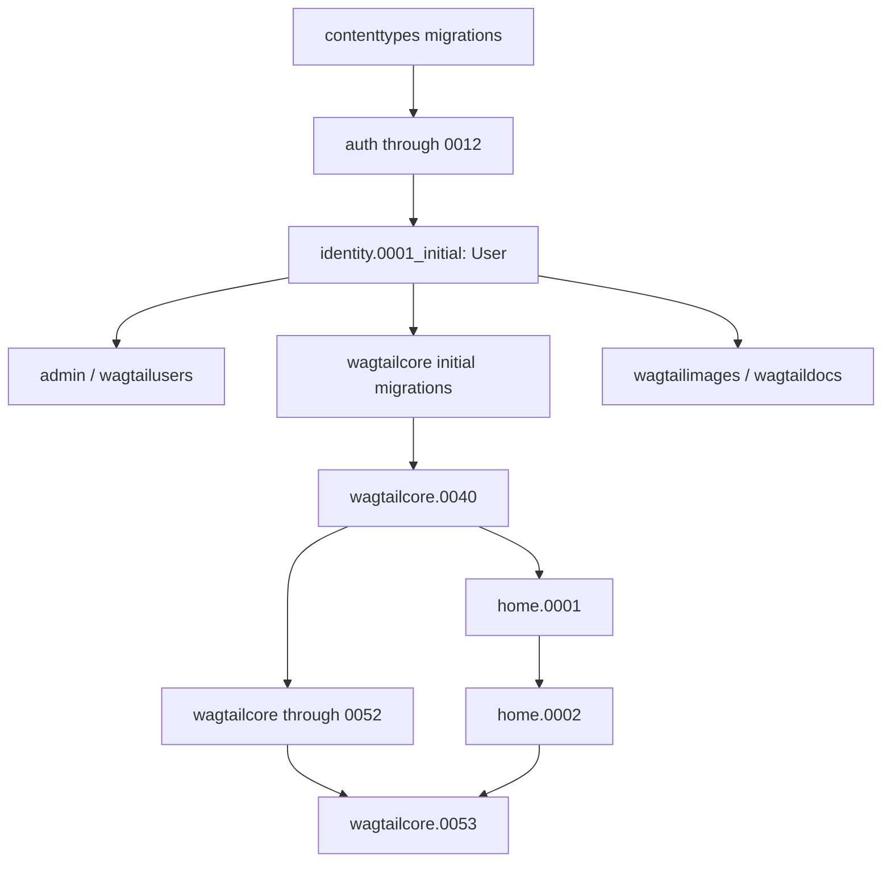
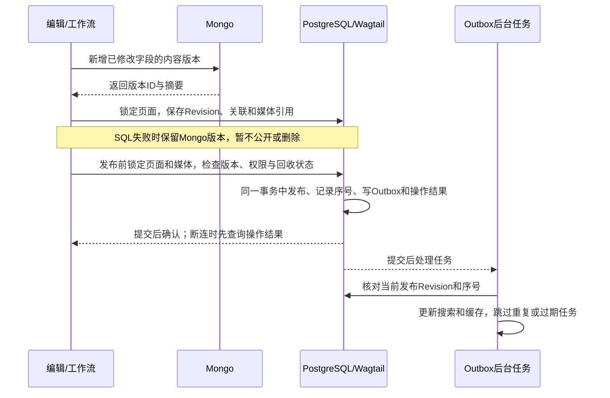
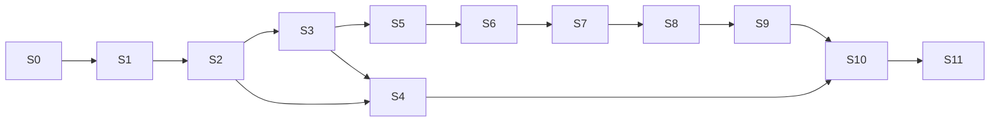

# myblog 第一阶段技术方案与实施顺序

日期：2026-11-04。状态：用户已正式确认全部 10 项优化决策（全部采用 A 选项），并特别强化了“受控回收站的页面恢复功能（错删还原到原树位置）”。本案经 gpt-6.1-sol 与 gemini-4-argon 闭环审查，S0 PostgreSQL 环境切换完成；业务开发和业务 schema 迁移尚未开始。
依据：两份 v1.0 需求文档、当前代码、已安装框架源码和技术审查。
通俗说明先看[六项技术审查与推荐方案](myblog_六项技术审查与推荐方案_2026-11-04.md)；
本文保留实现约定、任务顺序和验收条件。审查结论不代表业务功能已经通过测试。

第一阶段要完成：文章编辑和发布、公共媒体库、回收站、搜索及文章详情页。
先准备环境和基础模型，再逐项实现。本文给出设计和顺序，不代表功能已经完成，
也不代表已获准执行数据库迁移或部署。

阅读时记住四点：

- PostgreSQL 保存页面信息、权限和 Wagtail 的页面版本；MongoDB 保存简介、正文的不可变内容版本。
- Revision 是 Wagtail 保存的页面历史版本。读者只能看到已发布版本，不能看到更新中的草稿。
- 图片、附件和音视频由全站共用；读取和删除都要检查权限及页面引用。
- 每个小任务单独检查。测试失败先修复，再继续下一步。

## A. 已获授权和当前情况

最初的任务书要求只读检查。用户随后允许参考旧站配置、准备代理角色、
读取指定 `.env.test`，并为新项目创建数据库、缓存分区和存储桶。
此前用户已授权在 WSL2 准备本项目独立的 MySQL、Redis、MongoDB 和 RustFS，
并进行服务级连接、建库、建桶和集成探针验证。该授权不包含业务表迁移、
修改旧站、部署应用或 Git 提交/推送。
2026-11-04 曾获授权提交推送上一版方案；数据库切换阶段未包含 Git 提交/推送授权。
当前用户另行明确授权本次将说明书及需求附件提交、推送用于网页评审；该授权不包含代码、配置、迁移或部署。
用户现明确要求关系数据库全面切换 PostgreSQL，沿用本地密码、优先默认管理员；
本轮已授权并完成服务切换、依赖和本地配置接入、空库准备及服务探针。
旧 MySQL 确认归属后已停止并设 `restart=no`，容器、卷与回退备份保留。
授权不包含业务 schema 迁移、旧站修改、业务开发或部署。
本项目当前对象存储统一使用 RustFS 1.0.4，客户端使用 boto3 和 S3 协议；
MinIO 不再是当前产品，也不再作为应用对接方案。旧 MinIO 只在环境记录中
作为切换前的历史备份和回退来源。

### A.1 当前基础服务对接合同

| 服务 | 版本 | Windows/WSL2 地址 | 用户 | 数据范围 |
|---|---|---|---|---|
| PostgreSQL | 18.6（Debian `18.6-1.pgdg13+2`） | `192.168.20.5:5432` | 默认管理员 `postgres`，superuser 认证成功 | `myblog_dev`、`myblog_test`，UTF8；用户表/序列/物化视图均为零 |
| Redis | 8.10.3 | `192.168.20.5:6379` | `default` | DB9/DB11，分别对应 dev/test |
| MongoDB | 9.0.4 | `192.168.20.5:27017` | `root`，`authSource=admin` | `myblog_dev`、`myblog_test` |
| RustFS S3 API | 1.0.4 | `http://192.168.20.5:9000` | `root` | `myblog-dev`、`myblog-test` |
| RustFS 控制台 | 1.0.4 | `http://192.168.20.5:9001` | `root` | 与 S3 API 共用管理员 |

PostgreSQL 镜像为 `postgres:18.6-trixie`，已核查官方标签/摘要、导入校验并启动。
默认管理员认证、两个 UTF8 空库与 Windows TCP `192.168.20.5:5432` 已检查通过；
settings 3 项及服务脚本 8 项离线测试通过，修复隔离后 6 个真实凭据文件与 2 个客户端 env 测试前后哈希不变。
`local_services.py verify` / `activate` 通过 PostgreSQL 临时 CRUD、回滚、条件唯一索引，
Mongo 认证读写、Redis DB9/11 读写及 RustFS 私有上传、Range、读取、删除。
两库严格 Django/Wagtail 检查与中文临时 GIN 探针通过；这些结果不代表业务并发验收。
镜像摘要、测试覆盖凭据事件及修复经过见[PostgreSQL 切换记录](myblog_PostgreSQL切换记录_2026-11-04.md)。
MongoDB 9.0.4、Redis 和 RustFS 保持，MongoDB 管理员仍为 `root`，不能随 SQL 用户改成 `postgres`。
服务端口按合同发布到 WSL2 的 `0.0.0.0`，Windows 主机通过
`192.168.20.5` 访问。RustFS 桶保持私有，应用必须通过统一文件访问入口
完成权限检查，不能把管理员密钥或永久对象地址交给浏览器。

密码只在本地 env 中沿用，不写入追踪文档，不复制到命令、示例或检查输出。
方案只引用用户名、版本、端口、桶和数据库名称；本次不读取本地凭据附页。
项目用 `psycopg[binary]==3.3.7` 替代 mysqlclient 依赖声明，不卸载旧站共享 Conda 中的 MySQL 包或系统库。
settings 加载 `.env.local`，可用 `MYBLOG_ENV_FILE=.env.test` 切换，进程环境覆盖文件值。
数据库键为 `POSTGRES_DB/HOST/PORT/USER/PASSWORD`，Django 后端为 `django.db.backends.postgresql`。
Django 自动测试库由 `POSTGRES_TEST_DB` 指定，默认 `test_myblog`，与手工服务探针库 `myblog_test` 分开。
客户端 env 已删除旧 `MYSQL_*` / `MINIO_*` 键。
`scripts/check_local_postgres.py` 最初报告 `postgres.E005`，注册 `django.contrib.postgres` 后，
两库严格重跑为 0 issues / 0 silenced；dev 与 `MYBLOG_ENV_FILE=.env.test` 的
`manage.py check --database default --fail-level WARNING` 均为 0 issues。

| 项目 | 已记录的情况 |
|---|---|
| 工作目录 | Windows `F:\openclaw\workspace\wagtail\myblog`；WSL `/mnt/f/openclaw/workspace/wagtail/myblog` |
| Git | main；origin 为 `anc1996/myblog`；上一版方案已提交并推送，提交为 `b76aa0b1fe7d050216eff54e42d1a599b660249c` |
| Python/框架 | 指定 Conda 环境：Python 3.13.2、Django 6.1.2、Wagtail 8.1 |
| 应用设置 | 已接入本地 POSTGRES_*，settings 3 项单测、dev/test 严格检查通过；AUTH_USER_MODEL 和媒体业务尚未接入 |
| 数据库 | PostgreSQL myblog_dev/myblog_test 已建、UTF8，认证通过，用户表/序列/物化视图均为零；旧站迁移史未查 |
| 现有功能 | 搜索仍是 `Page.objects.live().search()`，不查 Mongo；默认 documents 和 DEBUG 媒体地址仍需改造 |
| 启动风险 | Dockerfile 已移除自动 migrate；未构建或运行应用启动流程；home.0001/0002 文件存在不代表已执行 |
| 依赖风险 | Conda 中有旧站 editable 包；须检查导入路径，禁止复用旧 app |

旧检查命令和结果集中保留在《环境与代理准备记录》。以下三段是切换前 MySQL 历史证据，
不能证明 PostgreSQL 已安装或通过检查；当前目标以本节 PostgreSQL 合同为准。

**历史：旧数据库版本太旧。** 原共享服务是 MySQL 8.0.41；本机 Django 6.1.2 的
`django/db/backends/mysql/features.py:65–70` 要求 MySQL ≥8.4，MariaDB ≥10.11。
创建数据库成功，不代表版本符合 Django 要求。
经用户授权，WSL2 已安装独立 MySQL 26.10.0，Django 已成功连接开发、测试空库并通过版本检查。
旧共享服务和先前创建的 8.0 空库保留，未升级或删除。

**历史：MySQL 驱动缺少系统库。** mysqlclient 2.2.7 的 MySQLdb 原先缺少
`libmariadb.so.3`，Conda lib 与系统标准 lib 目录均未发现该文件。
最初用已有的 PyMySQL 1.1.1 准备资源，没有替换 Django 的数据库驱动。
后来安装 `libmariadb3`（11.8.6），MySQLdb 已能导入，Django/MySQL 连接也已通过。
当时客户端依赖已写入 requirements.txt；当前项目声明改用 psycopg 3，共享环境旧包保留。

**历史：MySQL 审批中的唯一性限制。** 当时对两个空库执行 Django 数据库检查时，
`wagtailcore.WorkflowState` 各报告一次 `models.W036`：
MySQL 无法建立 `unique_in_progress_workflow` 条件唯一约束。
`scripts/check_local_mysql.py` 以 `fail_level="WARNING"` 保留失败，不静默屏蔽。
当时数据库能连接，但严格检查未通过。PostgreSQL 支持这里需要的条件唯一索引，
不能把旧 MySQL `models.W036` 写成 PostgreSQL 不支持；获准建表后仍需核查约束实际建立。
启用审批前，还要验证统一锁、幂等及批准 Revision 一致性，切换数据库不等于业务并发已经安全。

Conda 内旧 editable `wagtailblog2` 要求 `wagtail==8.0.1`，与新项目8.1冲突；
保留旧包未卸载，最新 `pip check` 仍失败，且仅报告这一条冲突。
新项目的导入路径和服务读写单独检查；不能因此声称整个 Conda 环境没有依赖冲突。

### A.2 第三方依赖准备

完整核查见《myblog_依赖核查与升级方案_2026-11-04》及《第三方依赖清单》。
当前共享 Conda 有旧站对 Wagtail 8.0.1 的固定要求，`pip check` 仍失败。
建议先确定独立环境，再更新 Django 6.1 补丁及网络、图片和内容渲染依赖；
Wagtail 保持 8.1，Taggit / Treebeard 等遵守它的版本上限。
RustFS 采用 boto3；Django 文件字段接入时声明 django-storages，
权限入口、历史引用和受控删除仍由应用实现。本轮已安装 psycopg 3.3.7，
将原环境已有的 jieba 0.42.1 列为直接依赖，项目声明共 8 项；其余升级建议尚未执行。

## B. 用户模型和第一次数据库迁移

新建 `identity` App，设置 `IdentityConfig.name/label = "identity"`。
【已确认 MODEL-P0-02】采用最小的 `User(AbstractUser)`，并设置 `AUTH_USER_MODEL="identity.User"`。
User 管登录；Person 管作者等公开人物资料，两者分开。继续使用 Django 的 Group/Permission 管理权限。
User 必须在 identity 的 `0001_initial` 中创建，不能依赖 people、home 或 wagtailcore。

箭头表示先执行；identity 节点目前未实现：

获准编写候选迁移后，先用 `MigrationLoader(connection=None)` 离线检查依赖，
不必连接数据库。上图省略了 taggit、媒体自定义迁移及合并迁移等分支，不能当成完整迁移图。
Wagtail 的用户外键会根据 `AUTH_USER_MODEL` 依赖 identity 的第一次迁移。
调整 `INSTALLED_APPS` 顺序不能替代迁移依赖。

`media_library` 首迁移还需依赖 User、taggit 和 Wagtail Collection（媒体集合）相关迁移；
Collection 表和根集合分别涉及 core.0024/0025。最终节点以候选迁移的离线依赖图为准，
不让 `identity.0001` 反向依赖媒体、Person 或 Page，避免循环。
自定义媒体不会自动移除 `wagtailimages/wagtaildocs` 的原生迁移分支。
本轮只核对现存源码，尚无 identity/media_library 候选迁移，不能报告“完整依赖图已通过”。

`home/0002_create_homepage.py:13–38` 删除默认首页、写固定树路径并创建 localhost Site；
`:56–58` 的 run_before 安排其在 Locale 模型引入前执行。
该文件与安装包模板相符，没有证据证明空白 PostgreSQL 必然失败；当前尚无 PostgreSQL 初始化测试。
它依赖初始页面树，撤销迁移也会删除首页和站点，所以不能对已有内容的库重新执行。
新 PostgreSQL 库已通过空库、版本及认证检查；后续初始化前仍需确定媒体模型并获准迁移。
如果发现数据库已经迁移过，应另写迁移方案，不能直接换 `AUTH_USER_MODEL` 后执行 migrate。

## C. 全站共用的媒体库

| 路线 | 收益 | 代价与约束 |
|---|---|---|
| 原生 Image/Document，加独立的权限、引用和下载服务 | 少改模型，能多用原生选择器、Collection 和派生图 | 权限需另表关联；删除、文件链接、派生图、下载和 API 都要检查 |
| 【已确认采用】第一次迁移就使用自定义 Image/Document/Rendition | 资源标识、权限和操作记录直接放入模型，便于扩展 | 迁移前需设置 WAGTAILIMAGES_IMAGE_MODEL/WAGTAILDOCS_DOCUMENT_MODEL；表单、选择器和迁移均需测试，权限和删除仍需单独实现 |

**【已确认 MODEL-P0-02】首迁移采用最小自定义 Image/Document/Rendition**，复用 AbstractImage、
AbstractDocument、AbstractRendition 的原生能力；Audio/Video 是全站公共模型。
自定义 Rendition 必须以 `image` 外键指向所选自定义 Image，使用
`related_name="renditions"`，并对 `(image, filter_spec, focal_point_key)` 设置唯一约束；
Rendition 是按尺寸等规则生成的图片版本。S1 要检查 `wagtailimages.E001`、
图片选择器、派生图生成和复用，不能只填写模型设置。
推荐自定义模型，是因为前次服务检查中新库没有业务表，而资源标识、权限和历史保留是首期重点；
代价是要维护模型迁移、后台表单和升级回归。这里的“自定义”指继承框架的 Abstract 基类，
不是重写上传、选择器或图片处理。Image/Document 表单保留原生 `admin_form_fields`。
两种路线都能做公共媒体，也都需要独立实现权限和删除保护；自定义模型本身不会自动提供这些能力。
不建立 BlogImage、BlogDocument 或其他按页面分裂的媒体库。

建议放入公共 `media_library` App。四类媒体共用权限检查和稳定资源标识，
各自保留合适的模型，不强行继承一个复杂的父模型。
图片派生图同样检查权限；文档通过专门入口下载；音视频支持通过权限检查的分段读取（Range）。

读取规则：

1. RustFS 桶保持私有；资源上传默认 restricted，只有专门权限能批准 public。
2. Collection 后台权限不等于前台文件读取权限；Page、Site、Collection 与资源策略各自校验。
3. 公开 Page 发布前验证所有托管引用，存在 restricted 媒体就拒绝并定位 Block/字段。
4. 原图、派生图、封面、音视频、字幕和下载，都经过统一文件访问入口（gateway）。
   首期由应用检查权限后转发文件内容；签名 URL 在有效期内通常不能即时撤回，不能替代此检查。
   Range/HEAD 每次都校验权限，支持 206（分段内容）和 416（范围无效）。
   【已确认 MEDIA-GATEWAY-02】为防止大体积音视频 Range 请求占满 Django/Gunicorn 的 Python 同步工作进程，生产环境由应用鉴权通过后返回 `X-Accel-Redirect` 头，由本机 Web 服务器反向代理向内网 RustFS 拉流；本地开发环境采用 ASGI 异步流交付。
5. 明确替换默认 `/documents/`、模板 `.url`、DEBUG `/media/` 及可直达 rendition 的入口；
   前台仅使用安全交付地址，后台预览仍须检查权限。API v3 首期建议不注册。
6. 【已确认 MEDIA-ACL-02】资源从 public 改为 restricted 时，**默认阻断修改**并列出受影响的已发布页面清单；仅在管理员二次确认连带下架时，才在同一个数据库事务中撤销相关页面的发布并下架级联别名页面，更新发布序号并写入 Outbox 和操作记录；文件入口立即拒绝无权访问。同时发生的发布操作锁定同一资源并重新检查。

文件交付先验证当前权限，再读取缓存或对象；首期使用 `Cache-Control: private, no-store`，
不配置可跳过鉴权的公共 CDN 缓存。已发送给浏览器的字节无法召回；
撤权保证之后的新请求和续传请求被重新检查，不宣称中途收回用户已下载的文件。

这里的事务指一组数据库操作一起成功或一起回退；锁用于协调同时发生的操作，避免相互冲突。

引用规则：记录哪些页面版本使用了哪些文件，防止删掉仍被使用的资源。

- `MediaReference` 保存资源、Page、Revision、字段版本、Block 路径与来源种类。
  当前发布/当前草稿/历史/回收站是视图分类，一个 Revision 可以同时具有多个状态。
- 提取器覆盖封面、两类图集、RichText、Markdown、Table、音视频与嵌套结构，
  托管引用使用稳定资源 ID；外站 URL 不冒充本地可保护资源。
- 保存 Revision 时，在同一个 SQL 事务内登记引用和提取程序版本。
  引用数据不完整、提取程序不支持或核对结果异常时，禁止真正删除文件，不能只依赖 Wagtail 默认引用索引。
- 后台、QuerySet 批量删除和级联删除都必须经过统一检查。
  管理员永久删除前，检查所有保留的 Revision 和回收站引用，并锁住资源，防止同时新增引用。
  文件替换必须生成新资源或不可变文件版本及新对象 key，旧 Revision 继续指向原文件，
  不能在同一 key 上覆盖。新建、历史恢复、复制和派生图生成均拒绝引用正在删除的资源。
  新增引用、恢复、复制、派生图登记和删除申请都先取得 D1.1 的同一协调锁，
  锁内再检查资源状态及完整引用；不能让“新增引用”和“零引用检查”分别加锁。
- Page 永久删除只移除其自己的引用；不会自动删除公共媒体或其他 Page 的引用。
  先在 SQL 中保存删除审批结果，再由后台任务删除 RustFS 对象并核对结果。
  SQL 操作失败时，不能把删除文件当作补救办法。
- 删除采用两步：先在 SQL 事务中确认零引用、标记 `deleting` 并写 Outbox；
  后台任务再核对操作 ID、资源状态和对象 key，删除原文件及受管派生文件，成功后记录完成。
  RustFS 超时或删除失败时保留删除记录，查询结果后重试；同一任务重复执行不能删除后来上传的文件。
  标记 `deleting` 后不允许重新引用，文件没有删除前也不能把该资源当成可恢复使用状态。
- 需要接管 Image、Rendition、Document 原生 `post_delete` 文件清理，
  统一走上述 Outbox；不能让默认清理任务与自建删除任务同时运行。
  【已确认保护防线】实现自定义 `ProtectedRustFSStorage` 继承存储后端，重写 `delete()` 方法拦截一切表单替换文件和业务代码的直接物理删除调用（仅供对账任务受控删除）；在应用启动时显式解绑原生 `post_delete_file_cleanup` 信号。
  只在无引用和受控流程允许时清理元数据，不先删除 SQL 记录而丢失核对依据。
- RustFS 管理员、控制台和直接 S3 删除可以绕过 Django 保护；这里保证的是应用受控路径。
  管理员运维删除仍须人工核对及备份，不把 root 身份误当成网站业务权限。

## D. 模块分工和内容处理流程

一个 Django 项目按 App 分工，第一阶段不拆成多个独立服务：

| App/模块 | 职责 | 不承担 |
|---|---|---|
| identity | 后台 User | 作者资料、会员业务 |
| people | 公共 Person | 登录权限 |
| taxonomy | 唯一 Tag 词库、合并重定向 | Category |
| media_library | 四类媒体的权限、文件读取和引用 | 决定页面是否发布 |
| content_blocks | 内容块的编辑、检查、显示、文本和引用提取 | 多个页面共用一份可修改正文 |
| external_content | Mongo 内容版本、关联 Revision、待处理任务 | 另建一套发布状态 |
| content_lifecycle | 统一读取、回收、恢复和永久删除 | 重写整个 Page 框架 |
| blog | BlogPage、BlogIndexPage、专属 Block 组合与模板 | 私有媒体库 |
| discovery | 搜索、标签、归档和栏目查询，以及查询用的内容副本 | 决定页面是否允许发布 |

接口建议：

- 每种内容块（Block）提供检查、显示、提取文本和提取媒体引用四个接口：
  `BlockContract.validate(value, context)`、`render(value, context)`、
  `extract_text(value)`、`extract_media_refs(value, path)`。类型名称保持稳定，并记录数据格式版本（schema）。
- BlogIntroBlocks 直接组合公共 RichText/Markdown；BlogBodyBlocks 直接列出基本块，
  不为统一外观强塞额外 StructBlock。正文图集是 Blog 自己的复合结构。
- 页面中的人物角色、排序、标签和独立图集都随 Revision 保存。
  公开显示时读取发布版本中的关联，不能读当前草稿关联表。
- 合并 Tag 时保留旧 ID 到新 ID 的对应关系，防止恢复旧 Revision 时重新带出已删除标签。
- 必填 `authored_on: DateField` 进入业务 Page/IndexPage 和 Revision；
  建议 HomePage 为入口而豁免，创建时可预填当天但仍需有效值，待确认。

### D1. Mongo 内容版本、页面保存和发布

Mongo 每个字段版本建议保存：
`version_id, document_uuid, model_label, field_name, schema_version, block_schema_versions,
content_hash, payload, created_at, operation_id`。
每次修改内容都新增版本，不直接改已有 payload。读取时核对所属页面、字段和内容摘要。
版本标识或 operation_id 必须唯一；重试同一次操作时，内容相同可重复执行，内容不同必须报错。
这就是幂等处理，目的是避免超时重试造成重复或覆盖。
首次保存草稿时生成稳定的 document_uuid，并同时保存到 SQL 和 Revision。
intro（简介）或 body（正文）没有变化时，可以复用原版本。
幂等键至少区分 `(operation_id, field_name)`，简介和正文可在一次保存中各生成一个版本；
同键重试必须核对 document_uuid、字段、内容摘要及数据格式，不能只比较一个版本 ID。

Wagtail Revision JSON 记录完整元数据/关系及
`intro_version_id/body_version_id`、摘要、schema 和 document_uuid。
页面是否发布、发布了哪个版本，由 Wagtail 的 `live/live_revision_id` 决定。
如另建 PostgreSQL 发布关联记录（envelope），它只能在同一事务内记录对应 Revision 和发布序号，
不能另行决定发布状态。
已保留的 Revision 内容不能原位覆盖；保存修改应创建新 Revision。
原生 `save_revision(overwrite_revision=...)` 可以改写已有 JSON，需在保存及自动保存适配中拦住，
并验证不会改掉正在审核、已发布或历史保留版本的内容和引用。

普通页面的读取顺序：

1. 检查页面、Site、父级页面的访问限制，以及页面是否在回收站。
2. 根据 `live_revision_id` 取得发布版本，恢复该版本的字段和关联。
3. 按版本 ID 读取 Mongo 内容，核对所属页面、字段和摘要，再显示。

读取开始时记录发布 Revision、发布序号和权限版本，取得 Mongo 内容后、发送响应前再核对；
中途发生发布、撤权或回收时，丢弃旧结果并有限重试或拒绝。
这里以响应提交前最后一次 SQL 权限和有效发布版本核对为准，缓存命中也要执行。
最后核对与网络发送无法原子完成；其后发生的撤权不承诺撤回已发送或在途字节。
各入口复用这一读取服务，不能详情页查正式版，而列表、封面或 SEO 偷读最新草稿。

例如：发布文章 A 后又保存草稿 B，读者仍应看到 A 的正文、日期、封面、标签、作者和 SEO。
Page 表里可能已经有 B 的字段，所以只筛选 `live=True` 不够。
草稿和历史预览读取获准查看的 Revision；缓存键区分预览/公开场景和版本，命中缓存前也要查权限。
发布内容缺失、关联错误或损坏时，明确返回不可用，不能用 Mongo 最新版本或空正文顶替。

Mongo 保存成功但 SQL 失败时，会留下暂未被引用的版本，标为 orphan 待核对，本阶段不直接删除。
Mongo 写入超时时，先按原版本 ID 核对摘要，再决定是否重试，不能换 ID 盲目重写。
发布只能引用已经确认保存的内容版本。
SQL 增加操作结果记录 `OperationResult`：以唯一 operation_id 绑定操作者、动作、页面及输入摘要，
和 Revision、媒体引用、Outbox 一起提交。重复请求返回已有结果；同 ID 不同输入则拒绝。
提交结果未知时，先按原 operation_id 查询主库；仍无法判定就返回“状态待确认”，
不声称成功或失败，也不删除 Mongo 版本或另起一次发布。重试要再次取得变更锁并查询结果。
保存和审核还携带预期 Revision/任务 ID，锁内检查后再操作，防止旧表单覆盖新内容。
Outbox 是待处理任务表，必须与业务数据在同一个 PostgreSQL 事务里保存。
`on_commit` 只负责唤醒后台任务；定时扫描负责补处理。用唯一事件 ID 和发布序号防止重复、旧任务覆盖新结果。
后台任务失败不改变已经发布的文章。

后台按钮、审批工作流和定时发布都必须执行同一套发布检查。
复制页面树时，每个节点新建 Page 和 document_uuid；内容可以复制，但必须关联新页面。
公共媒体、Person、Tag 继续共用。翻译和子树复制单独测试，不能照搬源页面的 owner。
恢复历史版本只生成草稿，保留旧关联和内容版本 ID，不恢复公共 Person/Tag 自身的旧数据，也不自动发布。
实现时还要测试多项操作同时发生的情况，并确定页面树锁、页面锁和资源锁的获取顺序。

### D1.1 PostgreSQL 上的审核并发

`WorkflowState` 的条件唯一约束按内容对象限制“进行中/需修改”的工作流数量；
PostgreSQL 支持用条件唯一索引建立该约束。旧 MySQL 的 `models.W036` 是历史后端限制，
不是 PostgreSQL 限制；未来获准迁移后应检查实际索引及重复写入负例，不能在空库探针阶段声称索引已建好。
该索引只限制工作流数量，不保证批准版本正确、请求幂等或媒体权限不冲突。
事务用于一起提交或回退，行锁才用于让相同对象的冲突操作依次执行；两者不能互相替代。

【已确认 MUTATION-LOCK-02】首期先保证正确性：增加一条固定的 SQL 协调记录 `ContentMutationGuard`，并在获取行锁时强制配置 `SET LOCAL lock_timeout = '3s'`，防止并发异常挂死连接。
所有页面生命周期、媒体引用和权限/删除变更先在事务中锁住它，再处理具体对象。
前台常用规格的缩略图（Rendition）在文章保存与发布时**预生成**；缩略图的写入仅靠唯一键与原图行锁保护，**不争抢全局页面协调锁**。
协调行须随后续获准的初始化准备好；缺失时拒绝变更，不能锁一个不存在的查询结果后继续执行。
它只负责排队，不保存第二套发布或工作流状态。之后按固定顺序锁 Page、
WorkflowState、TaskState 和媒体记录，同类按 ID 排序；涉及页面树的操作也先取得协调锁。
Mongo 内容预写和大文件传输放在锁外，锁内只做必要检查和数据库变更。
代价是后台变更串行；个人站首期先测实际等待时间，确有瓶颈再设计按对象拆锁。

提交审核时，锁内重新查询该内容对象的所有有效工作流，已有则复用或拒绝，
不只查相同 workflow_id。批准/拒绝时重新检查当前任务、目标 Revision、权限和状态，
过期请求拒绝，重复请求通过操作 ID 返回已有结果；最终发布继续经过同一套内容和媒体检查。

默认审核完成动作会调用 `get_latest_revision().publish()`，不能据此认定最新草稿已经获批。
推荐启用 `WAGTAIL_WORKFLOW_REQUIRE_REAPPROVAL_ON_EDIT = True`，编辑后重新审批；
同时通过 `WAGTAIL_FINISH_WORKFLOW_ACTION` 配置项目的审核完成入口。
该入口在协调锁内核对审核目标 Revision、页面最新 Revision 和本轮有效批准记录一致，
再检查 Mongo 内容、媒体权限和回收状态，最后调用原生发布。版本已变化就拒绝发布并要求重新审批；
仅开启重审设置不足以替代这些检查，也不能绕过多任务工作流本身的通过规则。
在统一基类 `CustomBasePage.publish()` 中重新校验 `approved_go_live_at`，防止定时发布命令 `publish_scheduled` 误发已回收页面；重写 `update_aliases()` 排除已回收 Alias 页面。

需要逐一验证的入口包括：提交/恢复/取消审核、批准/拒绝/重新分配、
直接发布、批量操作、定时发布、复制、别名同步和项目管理命令。
适配层须包住原生状态改变前的调用；只加后台按钮或一个 before hook 不足以覆盖模型层调用。
Wagtail 原有审批与发布仍执行，不能用独立状态机替代。
覆盖、锁顺序及真实 PostgreSQL 并发测试通过前，不开放相应业务入口。

验收至少使用不同数据库连接同时提交两次审核、同时批准/拒绝、批准期间回收页面、
同一操作重复请求以及死锁后重试，检查最多一个有效工作流、没有过期任务发布和重复副作用。
另测“V1 获批期间保存 V2”和多级审核中途编辑，确认旧批准不能直接发布新草稿。
SQLite 或 Mock 测试不能证明 PostgreSQL 行锁有效。当前尚未实现适配，也未执行这些并发测试。

**别名页面（Alias）要单独处理。** 它使用源页面内容，没有自己的 Revision。
建议 S6 增加 `AliasPublicationBinding`，记录 alias_page_id、最终源 Page ID、
源发布 Revision ID、源 document_uuid 和别名发布序号。它只跟随源发布状态，不能独立决定发布。
别名链必须有限且不能成环；链断裂或信息缺失时拒绝公开读取。

读取时，普通页用自己的发布 Revision，别名用关联的源发布 Revision。
两者统称 effective publication（实际使用的发布版本）。
别名和源页面各自的 Site、父级权限、回收状态和发布资格都要检查，
且关联版本必须等于源当前发布版本。地址和树位置仍归别名，Mongo 内容仍按源身份检查，
不能把 Mongo owner 临时改成 alias_page_id 或跳过检查。

源页面发布、下架、回收、修改权限时，在同一个 SQL 事务里更新或作废别名关联；
旧关联更新前停止公开读取。搜索副本记录别名 Page ID、实际发布 Revision 和序号，
同时检查别名和源，不能只比较别名为空的 live_revision_id。
别名转普通页时保留 Page ID，但新建 document_uuid、自身 Revision，并重新关联外置内容。
S6 必须测试原生 create_alias/update_aliases/convert_alias 入口是否都执行这些规则。
验证完整前不开放这些入口；是否启用别名另记 ADR，不影响独立页面复制。

### D2. 回收站、恢复和永久删除

| 路线 | 原 ID/Revision | 主要问题 |
|---|---|---|
| 页面留在原位置，标记为已回收 | 直接保留 | 所有读写、父级检查、排期工作流和后台列表都要识别回收状态 |
| 移入隐藏树 | 可保留 | move 会影响 path/url、Site、父类型约束与权限，恢复及并发复杂 |
| 独立快照/保留表 | 需额外重建策略 | 原生 FK/ID/Revision/树恢复成本最大，容易退化为硬删后重建 |

**【已确认 RECYCLE-DISCOVERY-02】采用第一种做法：页面留在原树位置标记为已回收，并提供完整的页面恢复功能。**
`RecycleEntry/RecycleBatch` 记录原父页面 ID、原兄弟相对顺序、树路径快照、子树根、节点集合和操作标识。
原 Page 与 Revision 保留，但所有回收节点都不能发布。
有子页面时，强制整棵子树一起移入回收站。

后台删除、批量操作、业务代码和管理命令统一调用回收服务。

**三层后台与模型拦截网：**
1. **模型基类守卫（`CustomBasePage`）**：重写 `publish()`（校验自身与祖先无未激活 RecycleEntry）、`delete()`（无受控凭证直接抛异常）、`copy()`（递归复制时拒绝静默复制回收子页，并在 `exclude_fields_in_copy` 中剔除 `document_uuid`）、`update_aliases()`（排除已回收别名页）。
2. **`PageViewSet` 路由网关**：接管路由分发层，统一拦截 20+ 个无 Hook 单页管理视图；重写 `set_page_position_view_class` 防止拖拽排序跨越已回收占位节点；重写 `search_view_class` 过滤后台页面搜索。
3. **Wagtail Hooks 补齐**：注册 `construct_explorer_page_queryset`、`construct_page_chooser_queryset`、`construct_homepage_panels`、`construct_homepage_summary_items`、`before_serve_page` 等 10+ 个钩子。

**页面恢复功能（Restore）核心契约：**
1. **状态机流转**：`active` -> `recycled` -> `restoring` -> `active`（草稿态）。
2. **四类冲突判定与处理**：
   - 父节点失效：原父节点被删或已被回收时，阻断恢复，提示先恢复父级或管理员指定新父节点（重新校验 `can_exist_under`）；
   - slug 冲突：原父节点下已有同名页面时，提供 `slug_overrides` 改名恢复；检测同批次兄弟之间 slug 互撞；
   - 兄弟顺序恢复：优先复原至原占位，兄弟变化时定位至合法锚点；
   - 树深度检查：校验迁移后路径长度不超过 `MP_Node` 上限（255 字符）。
3. **时序与主表同步修复**：
   - 恢复若需改 slug 且移动树，必须**先在内存设置新 slug（`clean=False`）再执行树移动**，防止 `MovePageAction` 校验旧 slug 抛出 `ValidationError`；
   - 用快照反序列化后，必须显式调用 `draft.set_url_path(parent)` 并先执行 `draft.save(clean=False)` 将 `Page` 主表、业务字段及 `ParentalKey` 子表落库，随后更新后代 `url_path`；
   - 调用 `save_revision()` 生成标记为 `myblog.restore_draft` 的全新草稿版本。
4. **未发布草稿态保障**：恢复后**严格保持 `live=False`、`has_unpublished_changes=True`、`live_revision=None`**，绝不恢复即自动上线；重新激活 `MEDIA-REF-01` 媒体引用保护计数。
真正永久删除时，既要有专门权限，也要有删除服务签发并校验的操作凭证。

删除前显示受影响的子页面、权限和定时发布任务。执行时，在事务中锁定相关节点并重查页面树版本，
显式清空所有关联 Revision 的 `approved_go_live_at`，取消进行中的审批工作流，调用已验证的原生下架流程，再更新引用、Outbox 和操作记录。
直接 `update(live=False)` 不等于执行了完整下架流程。
发布、移动、新建子页面、复制、别名同步和定时任务都要检查自身及父级是否已回收。

回收期间保留原 slug（地址中的页面名称），不允许其他页面占用。

**【已确认 RECYCLE-RETENTION-03】回收站保留与彻底销毁契约：**
1. **30 天超期物理清理（WSL2/本地自愈适配）**：
   - 页面移入回收站后软删除保留 30 天，30 天内随时原位一键恢复；
   - 针对开发机/WSL2 非 24 小时开机场景，采用**时间戳惰性比对机制**：开机后管理员进入后台回收站列表或启动服务时，系统自动计算 `recycled_at <= now - 30天`，自动触发受控物理销毁（清空 SQL 行并擦除 MongoDB 正文版本）；同时提供 `purge_expired_recycled_pages` 管理命令供定时调度；
   - 回收站界面展示“已滞留 X 天 / 剩余 Y 天自动销毁”，剩余不足 3 天时标红预警；管理员在后台随时可点击“立即彻底销毁”。
2. **前台访问拦截与编辑引导**：
   - 未登录公开访客访问回收页面：100% 返回 HTTP 404 Not Found，保护内容隐私与 SEO；
   - 已登录后台编辑人员访问：返回专属友好提示面板（“该页面已于 YYYY-MM-DD 移入受控回收站，点击前往恢复”）。
3. **媒体库引用防删联动**：
   - 处于回收站待恢复期的页面所引用的图片、文档及视频，在媒体库中严格受保护并阻断删除，提示“该资源正被回收站中的页面《xxx》引用，在页面彻底销毁或解除引用前禁止删除”。
4. **历史草稿修剪与发布全量保护（Draft Pruning）**：
   - **绝对保护原则**：凡是**曾经正式发布过（或本次转为发布）**的页面，其生命周期内的所有历史草稿与修订版本 **100% 永久无限保留，严禁任何自动修剪**，确保政企级内容溯源与审计；
   - **纯废弃草稿滑动窗口**：仅从未正式发布过的纯草稿页面，保存草稿版本数上限为 20 个；保存第 21 个草稿时，以滑动窗口（FIFO）自动淘汰解除最早的草稿版本。
5. **恢复冲突处置（父栏目与网址）**：
   - 父栏目同在回收站时：恢复弹窗允许管理员二选一（① 连带恢复父栏目；② 选择其他正常栏目作为新父级重新挂载恢复）；
   - 网址（slug）冲突时：系统自动推荐 `原名字-restored`，弹窗展示并支持管理员直接修改为未占用网址一键完成恢复。

### D3. 搜索、归档和缓存

按 SEARCH-V2-FILTER 补充需求，搜索、Tag、栏目、类型列表与 Archive 共用 `ContentQuery`；
所有 Page 类型通过注册协议接入，公共模块不导入 Blog/Guide 业务模型。
详细接口、算法、索引、统计和验收集中在
[统一搜索与组合筛选方案](myblog_统一搜索与组合筛选方案_SEARCH-V2-FILTER_2026-11-04.md)，避免不同文档各写一套规则。
本轮只完善文档，没有实现该服务或改动现有搜索代码。

**查询。** Site、类型、当前树范围、Tag、正式成文日期、指定 Page 和权限共同限制候选；
维度之间 AND、类型多选 OR、Tag 支持 ANY/ALL。类型与树位置独立，不要求 BlogPage 位于 BlogIndex 下。
无关键词可纯筛选；日期闭区间，来自正式 Revision，不从当前草稿读取。

**匹配。** 推荐严格回退：候选范围内 A 原句命中时只显示 A；A 为零查 B 分词，
B 少于建议门槛 10 条或用户主动扩展时加入 C 受控同义词，不用无关内容凑数量。
【已确认 SEARCH-MODE-02】当模式 A 命中条数在 1–4 条时，前台列表默认仅展示 A，并在底部提供“展开分词匹配结果（模式 B）”按钮，不自动强行混排；A 为零直接进入 B 模式。
每个必需概念组之间 AND，同组备选词 OR；Jieba 搜索模式重叠子词不能全部强制 AND。
有词时严格按 A/B/C 等级再排分数或日期，无词默认 `-authored_on, -page_id`。

**技术。** PostgreSQL `PublishedSearchDocument` 保存有效发布身份、正式元数据与 Tag，
外置 intro/body 从该 Revision 精确绑定的 Mongo 版本提取。
Jieba 技术词保护、`simple`/`tsvector`/GIN 用于词检索，`pg_trgm` 辅助原句字面包含；
它不替代分词，也不能保证单字查询提速。长文分块并保留位置，不静默截断。
【已确认 SEARCH-CHUNK-02】仅归一化原文列保留 256 字符重叠用于模式 A 原句匹配；分词生成的 `tsvector` 全文列严格按不重叠边界切分，保留单列 `tsvector`，避免重复计分并直接节约 50% GIN 索引空间。
评分明确包含字段权重、专业词、顺序词距、长度与受控 DF/IDF，不能把 `ts_rank_cd` 称作 BM25。
若独立跨块字符偏移窗口 `O` 在压测中超时，允许降级为 `ts_rank_cd` 内置词距。
词典、提取器、同义词、评分及索引代次一起版本化；本轮不创建扩展或业务索引。

**版本与权限。** Outbox 幂等维护可重建副本，旧任务不得覆盖新发布。
正文、标题、日期、Tag 关系、摘要和高亮均对应同一正式版本；Person/Tag 共享资料使用当前有效值。
当前 Site、树、祖先权限、回收和别名源资格同步检查。
索引延迟可以暂漏新内容，不得输出已下架或撤权页面，纯列表/归档也不能绕过。
列表、总数、动态统计使用同一合法集合；默认统计保留当前维度条件，不能每个桶重新回退搜索模式。
【已确认 SEARCH-RANK-02 / RECYCLE-DISCOVERY-02】采用单次 `REPEATABLE READ READ ONLY` 短事务一次性保证列表、总数与分桶完全一致，省去末尾二次主库核对；若因内容发布导致 epoch 变化使游标失效，前端自动刷新回当前条件的第 1 页并轻提示。

原方案“不承诺同义词”的范围现由受控 C 模式补充；不因此承诺语义、拼音或在线 AI 搜索。
已有 `scripts/check_postgres_search.py` 临时表结果只证明基础中文匹配，
不证明 A/B/C、业务索引、长文、权限、统计或相关度已验收。

Redis 首期只做可选缓存，数据丢失后可重新生成；暂不引入 Celery。
Outbox 先由专门的管理命令处理；定时发布使用 Wagtail 原生命令，调度方式需获批准。
Redis 不可用时，按限定范围读取原数据，仍检查权限，不能无限制增加数据库负担。
回收和权限修改立即生效，不能等缓存过期时间（TTL）结束。

### D4. 前后端分离与 RESTful JSON API 契约

前端通过 AJAX / Fetch 访问后端标准 JSON API，后端全权负责多存储水合、分词检索、缓存加速与安全防刷。

**已实现的 API 接口清单：**

| 接口 | 方法 | 请求参数 | 返回形态与关键字段 | 缓存与限流规则 |
|---|---|---|---|---|
| `/api/v1/search/` | GET | `query`, `tag`, `type`, `year`, `month`, `cursor`, `page`, `page_size`, `secondary`, `expand` | `{total_count, page_size, next_cursor, cursor_reset, expansion_used, secondary_used, show_expand_button, items, facets, archive_groups}` | Redis Epoch 瞬时失效缓存（300s，代次隔离）；滑动窗口限流 60次/分/IP |
| `/api/v1/posts/<slug>/` | GET | `slug` (路径参数) | `{status, epoch, data: {id, title, slug, url, authored_on, intro, featured_image, authors, tags, blocks, safe_html}}` | Redis Epoch 瞬时失效缓存（600s，代次隔离）；滑动窗口限流 120次/分/IP |
| `/api/v1/posts/` | GET | `page`, `page_size`, `tag` | `{total_count, current_page, page_size, total_pages, has_next, has_prev, items}` | Redis Epoch 缓存（180s）；滑动窗口限流 60次/分/IP |
| `/api/v1/guides/` | GET | `topic`, `difficulty`, `page`, `page_size` | `{total_count, current_page, page_size, total_pages, has_next, has_prev, items}` | Redis Epoch 缓存（180s）；滑动窗口限流 60次/分/IP |
| `/api/v1/guides/<slug>/` | GET | `slug` (路径参数) | `{status, epoch, data: {id, title, slug, url, topic, difficulty, estimated_minutes, last_reviewed_at, is_outdated, outdated_warning, summary, featured_image, authors, tags, steps_toc, blocks, safe_html, related_guides}}` | Redis Epoch 瞬时失效缓存（600s）；滑动窗口限流 120次/分/IP |
| `/api/v1/pages/<page_id>/comments/` | GET | `sort` (hot/latest), `page`, `page_size` | `{status, total_count, current_page, page_size, total_pages, items: [{id, author, safe_html, like_count, dislike_count, reply_count, user_reaction, created_at, is_editable}]}` | 校验页面受限权限（受限页私有 no-store）；未受限走动态缓存；限流 60次/分/IP |
| `/api/v1/pages/<page_id>/comments/post/` | POST | `content`, `parent_id`, `reply_to_comment_id`, `contact_website` (蜜罐) | `{status: "success", data: {id, status, is_publicly_visible, can_edit_until}}` | 蜜罐静默丢弃；Redis 用户/IP 滑动窗口限流（故障时 503 熔断）；细粒度页级共享锁 (FOR SHARE) |
| `/api/v1/comments/<root_id>/replies/` | GET | `root_id` (路径参数) | `{status: "success", root_id, reply_count, items}` | 懒加载二级回复；按首次批准时间递增排序 |
| `/api/v1/comments/<id>/react/` | POST | `reaction` (1赞, -1踩, 0取消) | `{status: "success", data: {like_count, dislike_count}}` | 同一用户互斥唯一；禁止自赞自踩；F() 原子更新 |
| `/api/v1/comments/<id>/edit/` | POST | `content` (新正文) | `{status: "success", data: {comment_id, version_number, status}}` | 5 分钟编辑时限校验；生成新 CommentVersion (pending)；排他覆盖旧 pending 版本 |
| `/api/v1/comments/<id>/delete/` | POST | - | `{status: "success", message: "评论已成功下架删除"}` | 仅作者或审核员有权操作；软删除下架，父级 reply_count 联动扣减 |

**核心技术契约：**
1. **分页机制（游标 + 页码兼容）**：底层核心采用 `next_cursor`（Base64 编码当前 Epoch 与 offset，杜绝百万级深分页性能瓶颈）；同时支持前端传 `page` 参数（如 `page=2`），后端自动折算对应游标偏移。
2. **正文双形态输出（Dual Output）**：
   - `blocks`：从 MongoDB 精准水合提取的原始 StreamField 结构化积木数组，便于前端深度定制渲染；
   - `safe_html`：后端预先组装并经过 XSS 白名单净化的完整安全 HTML 字符串，便于前端直接无缝容器填充。
3. **Redis Epoch 动态代次瞬间失效**：
   - 缓存 Key 格式为 `api:search:{epoch}:{hash}` 与 `api:post:{epoch}:{slug}`；
   - 依赖 `ContentDiscoveryEpoch` 版本号机制，当后台有发布、下架、回收或恢复时，`epoch` 原子自增，旧缓存瞬间整体作废，新内容零 TTL 延迟立即可见，同时承载万级并发。
4. **安全防刷与 CORS 保护**：
   - 采用 Redis ZSET 毫秒级滑动窗口限流；超限返回 HTTP 429 与 `Retry-After` 头；Redis 异常时 Fail-Open 降级放行；
   - 所有 `/api/v1/` 响应携带标准 CORS 跨域响应头。
已准备 dev DB9/test DB11 和命名空间；逻辑库共享同一 Redis 服务，
不能声称是独立实例。禁用 FLUSHDB/FLUSHALL，测试只能按自己的唯一前缀处理数据。
若以后引入 broker/result DB，先另行核对占用，不能沿用旧站编号。

### D3.2 【已确认】专题指南与技术专栏体系 (guides App)

### D3.3 【已确认】全站通用评论互动与审核风控系统 (comments App)

实现解耦、全站各类 Page 通用、具备企业级防刷风控的评论与二级回复体系：

**1. 全站通用 Page 外键挂载 (C-01 & C-02)**：
- 直接外键关联基类 `wagtailcore.Page`（`null=True, on_delete=models.SET_NULL, related_name="site_comments"`），`BlogPage`、`GuidePage` 等全站所有页面直接开箱通用；
- 严禁使用 `ParentalKey`，彻底消除页面复制、翻译克隆评论的污染；
- 表中冗余存储 `page_document_uuid` 与 `page_title_snapshot`，当页面被 30 天物理销毁时评论平滑降级展示为 `[页面已永久销毁]`，杜绝 500 崩溃并保留审核存证；
- 统一守卫 `get_accessible_comment_page`：强校验 `depth > 1`、`allow_comments=True`、当前 `Site` 归属、未回收与已上线，并 100% 执行 `PageViewRestriction` 权限校验（受限页面的评论 API 附加 `no-store` 头且禁用公共缓存）。

**2. 扁平两级反嵌套与原子状态跃迁计数 (C-04 & C-05)**：
- 结构约束：`parent` 恒指向顶级根评论，`reply_to_comment` 记录直接回复目标，`replied_to_user` 记录被回复人，杜绝递归嵌套导致的性能雪崩；
- 根评论优先锁 (Parent-First Lock)：回复和审批子评论必须先锁根评论，强校验根评论已公开存活；
- `is_publicly_visible` 布尔跃迁计分法：仅在可见性发生 `False <-> True` 翻转时才对根评论累加差值；**已上线评论编辑 V2 审批时差值为 0，彻底杜绝审批新版本导致 reply_count 翻倍**。

**3. 不可变版本化审核与防盲批 CAS (C-03)**：
- 5 分钟安全编辑窗口内修改评论生成全新 `CommentVersion` 记录；
- V2 待审核期间，前台继续稳定展示旧已批准的 V1 正文；
- 审核批准强校验 `expected_version_id == comment.pending_version_id`，杜绝管理员审阅期间作者提交新版本导致的“盲批覆盖漏洞”。

**4. 互斥点赞与非负约束 (C-05)**：
- `CommentReaction` 唯一约束 `(comment, user)`，禁止自评自赞；
- 数据库级 `CheckConstraint` 强制保障 `like_count >= 0`、`dislike_count >= 0`、`reply_count >= 0`。

**5. 防垃圾风控与安全净化 (C-08)**：
- **蜜罐防御**：表单内置 `contact_website` 隐藏字段，机器人提交则静默返回 200 丢弃；
- **Fail-Closed 熔断限流**：单用户 60 秒限 5 次，单 IP 60 秒限 20 次；先查后写杜绝自我锁死；Redis 异常时 503 阻断写；
- **独立 nh3 白名单**：严禁 `img/video/audio/table/div` 等富媒体标签注入；链接强制追加 `rel="nofollow ugc noopener noreferrer"`。

**6. Wagtail 8.1 审核控制台安全加固 (C-06)**：
- `CommentViewSet(ModelViewSet)` 彻底剪除 `add/edit/delete/copy` 路由，标题点击重定向至 `inspect` 只读视图；
- 重写 `Comment.delete()` 默认阻断物理硬删；注册独立权限 `comments.moderate_comment`。

**7. 细粒度页级共享锁 (C-07)**：
- 评论写事务在 `lock_timeout = '3s'` 下对目标 `wagtailcore_page` 行加 `FOR SHARE`，兼顾页面回收/销毁互斥与全站评论高并发。

实现结构化教程、系统配置指南的专栏体系，并深度集成既有底层：

**数据模型与积木组件：**
1. `GuideTopic` (Snippet)：专栏主题分类，具备唯一 slug 且带 `models.PROTECT` 防级联误删。
2. `GuideIndexPage` (Page)：专栏聚合大厅，支持按主题与难度筛选，默认按 `last_reviewed_at` 倒序。
3. `GuidePage` (Page)：专栏详情页，继承 `CustomBasePage`，正文 `body` 彻底脱水至 MongoDB（SQL 列保持 `[]`）。
4. 全站通用教程与卡片积木（已下沉至 `content_blocks.blocks.structured`，供 BlogPage、GuidePage 等全站共享复用）：
   - `CustomLeadBlock` (`lead`：导读与先决条件卡片)
   - `CustomStepBlock` (`step`：实操步骤卡片，含步骤配图受控网关交付与 Pygments 高亮复制按钮，实现了 `MEDIA-REF-01` 引用追踪)
   - `CustomTipBlock` (`tip`：技巧预警 Callout 卡片，支持 tip/info/warning/danger)
   - `CustomFaqBlock` (`faq`：排错与疑难问答对)
   - `CustomReferenceBlock` (`reference`：官方权威外链卡片)
   - 全面实现 `BlockContract`（纯文本提取供搜索分块，XSS 白名单 `nh3` 安全净化）；
   - `BlogBodyBlocks` 与 `GuideStreamBlock` 统一装配全套 15 个全站公共积木，彻底避免重复造轮子。

**业务与安全契约：**
1. **决策一（技术复核时效检查）**：`last_reviewed_at` 超过 365 天未复核的文章，前台与 API 自动注入时效预警提示（`⚠️ 本指南最后技术复核于 X 年前...`）。
2. **决策二（发布门禁）**：保存草稿时宽容允许无主题、无步骤；正式发布（`live=True`）时强校验必须绑定 `topic` 且正文必须包含至少 1 个 `step` 操作步骤块。
3. **全生命周期保障**：享有 `CustomBasePage` 提供的 30 天原树受控回收站、误删一键恢复与网址冲突自动改名。
4. **统一检索接入**：通过 `GuidePageAdapter` 将教程步骤、代码与正文分块索引至 PostgreSQL GIN 倒排索引（`type_key = "guide"`）。

### D3.1 【已确认】方案 A：彻底脱水模式（PostgreSQL 零大文本与 MongoDB 动态水合）

为支撑千万级（10,000,000+）文章规模与长文高频编辑，彻底杜绝大正文导致 PostgreSQL TOAST 表膨胀、内存缓冲池击穿及 WAL 复制风暴，正式确定并落地**方案 A【彻底脱水模式】**：
1. **保存与发布管线（Dehydration）**：
   - 当文章保存草稿或发布时，自动提取 `intro` 与 `body` 完整积木流；
   - 100% 外置持久化至 MongoDB `content_field_versions` 集合，生成带有 SHA-256 签名校验的不可变快照；
   - 在 PostgreSQL `wagtailcore_revision.content` 中仅记录轻量版本指针 `_external_field_pointers`（包含 `version_id`、`content_hash`）；
   - **PostgreSQL 物理存储彻底脱水**：PostgreSQL 主表 `blog_blogpage` 的 `intro` 和 `body` 物理列，以及 `revision.content` 中的正文大字典，全部脱水置换为 2 字节 `[]` 占位；PostgreSQL 单行体积缩小 99% 以上（仅约 200~300 字节），千万级数据量仅占用约 3 GB，可整体常驻内存极速响应。
2. **动态水合管线（Hydration）**：
   - 读者访问前台页面或调用搜索提取时，通过 `hydrate_from_mongo()` 动态通过有效版本指针从 MongoDB 水合提取真实积木流；
   - 管理员在后台编辑页面时，通过 `get_latest_revision_as_object()` 从最新草稿指针中水合正文到编辑器表单；
   - 搜索索引投影统一采用 Wagtail 对外公开路由接口 `page.get_url()`（如 `/tech/...`），彻底避免底层内部树路径（`/home/tech/...`）导致的 404 错误。

### D4. 编辑器和文章页面

RichText（含下划线）、Markdown（数学/表格/代码/Mermaid）、Image/Document/Audio/Video/
Embed 分别测试输入检查、危险内容清理、显示、文本及引用提取；页面用到哪些区块才加载对应资源。
CodeBlock 一个块两模式：展示支持高亮/行号/复制/折叠；运行模式提供编辑、stdin、
stdout/error 的状态约定及服务不可用提示，首期不执行不可信代码。
复杂 Table 单独实现：合并/拆分单元格，增删复制行列，撤销/重做，插入链接、图片、公式，
允许的 HTML，以及对齐、尺寸、样式和手机端横向滚动。不能用原生简易表格替代这些需求。
Mermaid 独立块与 Markdown 中的 Mermaid 代码块共用显示程序，使用相同安全限制，覆盖预览、缩放/适配/全屏/折叠、
主题、源代码复制、SVG 安全导出，以及便于辅助工具读取的错误提示。
Embed 只接受允许的来源，服务端抓取要防止 SSRF（借服务器请求不该访问的地址）。
外链文件不属于本地媒体库，不能当作受本地权限保护的资源。
【已确认 SCOPE-PAGE-02】首期不提供独立 RawHTMLBlock，Table/Markdown 仍满足其限定白名单安全 HTML 需求；首期不开启 Wagtail API v3。
HomePage 豁免必填成文日期 `authored_on`，其余所有业务 Page 和栏目 IndexPage 必填，后台新建默认预填当天。
运行容器 Dockerfile 统一对齐为 `python:3.13-slim-trixie`，在测试和启动入口加入项目导入路径守卫。

详情页采用居中单栏，显示发布版本的成文日期、贡献人员、标签、可选封面和实际父级路径面包屑。
简介按显示高度决定是否折叠；禁用 JS 仍可读全文，展开按钮正确设置 aria-expanded 并处理焦点。
独立图集放在正文后；正文中可放多组图集，各自保存顺序和图注。
Lightbox（点击图片后放大查看）支持键盘和手机操作。
评论、反应、阅读量、推荐、前后篇、TOC、阅读进度及左右栏继续后置。

## E. 分步实施和检查

下表中 S0 已完成，S1 及以后为计划，计划路径不代表文件已存在。编号表示一个可单独检查的小任务。
默认由 Gemini 实现、Sol 制定和复核接口约定；复杂框架问题按需交给 Argon。
用户模型、跨数据库操作、删除和权限安排 Terra 独立审查。
本轮四个具名角色均已派发只读任务，宿主模型选择与配置一致，状态见 [.codex/README.md](../.codex/README.md)。
后续仍逐次检查实际选择和结果；路由不符或失败时明确重新指派，不静默替换模型。

| 小任务/前置任务 | 拟建或修改的路径 | 要完成和检查的内容 |
|---|---|---|
| S0 PostgreSQL 环境切换（完成） | 环境依赖说明、requirements、infra、settings、scripts/check_local_postgres.py、scripts/check_postgres_search.py | 18.6 启动/认证、UTF8 两空库、Windows TCP、11 项离线测试、凭据文件哈希不变、四服务探针、两库严格检查与中文临时 GIN 探针通过；旧 MySQL 已停；无业务 schema 迁移 |
| S1 用户/媒体模型；依赖 S0 | identity/*、media_library/models/*、settings、Dockerfile、对应 migrations/tests | 先确认 User/媒体设计；检查迁移依赖、移除自动 migrate、测试空库初始化；执行迁移另授权 |
| S2 公共接口；依赖 S1 | content_blocks/contracts.py、external_content/contracts.py、content_lifecycle/access.py、discovery/contracts.py | 约定内容块格式、发布内容读取、媒体权限和查询参数；测试模块导入时不访问外部服务 |
| S3 基本 Block；依赖 S2 | content_blocks/blocks/*、renderers/*、static/*、tests/* | 富文本、Markdown、Code、Mermaid、四类媒体、Embed；测试危险输入和无法提取的内容 |
| S4 Table 编辑器；依赖 S2/S3 | content_blocks/table/*、static/content_blocks/table/*、浏览器测试 | 复杂表格全部确认功能；不能只靠 Python 单测 |
| S5 Blog/公共关联；依赖 S2/S3 | people/*、taxonomy/*、blog/models/*、blog/blocks.py、tests/* | Page 树、日期、Person/Tag/封面/双图集，Revision 关系与 Tag 合并重定向 |
| S6 内容版本/发布；依赖 S5 | external_content/store.py、revision.py、publication.py、outbox.py；content_lifecycle/协调与工作流适配；tests/* | intro/body 独立保存；接入协调锁和操作结果；覆盖预览、审核、排期、复制及恢复，测试双库故障与真实并发 |
| S7 媒体读取/保护；依赖 S5/S6 | media_library/access.py、delivery.py、references.py、wagtail_hooks.py、urls/tests | RustFS 四类媒体、Range/Rendition、权限变更、历史引用、文件删除检查 |
| S8 回收/恢复；依赖 S6/S7 | content_lifecycle/recycle.py、deletion.py、wagtail_hooks.py、tests/* | 单页/子树回收、终止排期、后台/批量/QuerySet 删除检查；恢复后不发布，冲突时拒绝 |
| S9 搜索/栏目/归档；依赖 S6/S8 | discovery/contracts.py、registry.py、models.py、query.py、projection.py 等；search/Tag/Archive/栏目入口 | 按 SEARCH-V2-FILTER 方案 Q1–Q8 实施统一公共查询、A/B/C、组合筛选、技术词/长文、等级及相关度、统计游标和安全展示；复核正式版本、权限、重建与8GB资源 |
| S10 详情及整体 UI；依赖 S4/S7/S9 | blog/templates/*、blog/static/*、端到端测试 | 单栏/intro/面包屑/媒体/Lightbox/无脚本/键盘/移动证据 |
| S11 整体验收；依赖前述任务 | tests/integration/*、验收报告 | 四服务故障、同时操作、HTTP/API绕过检查、数据核对和恢复演练；建库成功不等于功能通过 |

每次只实现一个可单独验收的目标，失败先修复，不把 S1–S11 整包交给一个代理。
共享 settings、urls 和 migrations 由主代理逐项整合，避免互相覆盖。
业务实现仍须按 Conventional Commits 流程先检查和审查后提交；本次提交仅依据用户对方案文档及需求附件的单独授权。
回退可用功能开关、停用后台任务或恢复已验证的备份；用户模型、历史内容和媒体不能盲目反向迁移。

| AC（需求验收编号） | 对应任务 | 必须检查的内容 |
|---|---|---|
| 01 | S1 | 新库 User/Group/Permission 与迁移依赖无冲突，Person 独立 |
| 02–05 | S5 | 合法/非法树位置，日期非空，多人排序角色，统一 Tag 创建/合并 |
| 06 | S5/S6/S9 | 草稿改日期/作者/Tag/封面后，详情、列表和计数仍为旧正式版 |
| 07–11 | S6 | 独立字段版本、预览/发布/撤销/审核/排期、逐节点复制、历史恢复 |
| 12–14 | S3/S4 | Block 全部确认功能；运行代码不执行；XSS/SSRF/HTML 表格合并负例 |
| 15–17 | S7 | 四媒体、受限引用阻止发布、原图/派生图/Range/下载/API直链绕行 |
| 18–20 | S7/S8 | 两种 Page 共用媒体；历史和回收站引用保护；引用记录不可靠时拒绝删除 |
| 21 | S5/S10 | 独立图集与多个正文图集，排序/图注/Revision/Lightbox |
| 22–24 | S8 | 单页/子树恢复、父/slug/权限/并发冲突；所有普通硬删入口被拒绝 |
| 25–27 | S9 | 类型/Tag/目录组合、正式 Mongo 独有词命中、草稿词不命中、成文日期稳定归档 |
| 28 | S10 | 单栏、封面、intro、真实面包屑、混排、响应式与可访问交互 |
| 29 | S6/S11 | Mongo超时/SQL失败/提交未知/重复乱序事件，不能半发布或公开草稿 |
| 30–31 | S7–S11 | RustFS/Redis失败、权限变更与缓存、Web/API/Feed一致的公共边界 |
| 32 | S1/S11 | 启动不自动 migrate；所有迁移、服务变更、部署有单独授权证据 |
| 33 | S7 | 【R30】链式别名 `MEDIA-ACL-02` 下架受影响页面与排期联动完整闭环 |
| 34 | S8 | 【R24-R28】回收站原树占位、改名/树迁移恢复主表子表同步、拖拽排序与批量操作防穿透 |
| 35 | S7 | 【R29】`ProtectedRustFSStorage` 拦截表单物理删除与并发缩略图孤儿保护 |

检查分三类：E1 检查源码、接口、依赖和配置；E2 检查纯逻辑与模型，导入前就禁止外部读写；
E3 连接指定的独立数据库、桶和缓存前缀，测试真实服务。Django TestCase 可能访问数据库，不自动属于 E2。
目前完成的是 S0 环境切换和服务检查，具体结果见[PostgreSQL 切换记录](myblog_PostgreSQL切换记录_2026-11-04.md)；
历史环境记录正文保持原样，业务表迁移、媒体播放、业务并发及整体验收尚未完成。
新项目使用独立 PostgreSQL；不能拿旧 MySQL 的服务探针证明 PostgreSQL 兼容或并发通过。

### S12 全站多页面通用订阅（RSS 2.0 / Atom 1.0）与时间线归档（Timeline Archive）系统

落实架构契约与多页面通用扩展规范：
1. **全站多页面通用接入（零核心硬编码，支持任意未来 xxPage）**：
   - 扩展 `discovery/contracts.py` 的 `PublicListingCapabilities` 能力声明契约；
   - 任何当前模型（`BlogPage`, `GuidePage`）及未来任意新增模型（如 `ProjectPage`, `NewsPage`, `ArticlePage`），只需在各自 App 中定义 TypeAdapter 并声明 capabilities，即可自动接入全站订阅与归档；
   - 栏目聚合页（`BlogIndexPage`, `GuideIndexPage`）显式配置 `feed_enabled=False, archive_enabled=False`，物理阻断栏目聚合页污染订阅文章流。
2. **全维度 RSS 2.0 与 Atom 1.0 订阅体系**：
   - 订阅路由：`/feed/`（全站订阅）、`/feed/type/<slug>/`（按内容类型）、`/feed/tag/<slug>/`（按标签）、`/feed/author/<slug>/`（按作者）、`/feed/topic/<slug>/`（按专题/分类）；
   - Atom 1.0 专属路径：`/feed/atom/`、`/feed/atom/type/<slug>/` 及 `?format=atom` 参数；
   - 标准规范合规：严格遵循 RFC 4287 (Atom 1.0) 与 RFC 822 (RSS 2.0)，发布时间统一转换为 UTC，条目 ID 采用稳定 `urn:uuid:{document_uuid}`，`
` 强制标记为 `type="text"` 杜绝富文本二次注入，清洗 XML 1.0 非法控制字符；
   - 弱 ETag 与 304 极速响应：基于全局 `ContentDiscoveryEpoch` 生成弱 ETag (`W/"feed:v1:s{site_id}:e{epoch}:{dim}:{slug}:{fmt}:{today}"`)，结合 Django `get_conditional_response` 主库短查询核验，命中时瞬间返回 HTTP 304 Not Modified（零 XML 序列化、零正文水合开销）。
3. **全站时间线归档系统（Timeline Archive Framework）**：
   - 接口挂载：`GET /api/v1/archives/`；
   - 组合筛选：支持按 `type`, `tag`, `topic`, `year` 过滤；
   - 高性能聚合：采用 PostgreSQL SARGable 左闭右开区间 `[start_date, next_period_start)` 与 `TruncMonth("authored_on")` 统计年月分桶；
   - 同样支持弱 ETag 与 HTTP 304 协商缓存。
4. **Wagtail 8.1 刚性生命周期安全守卫（BLK-01 至 BLK-08 闭环）**：
   - 别名页（Alias）剔除：`alias_of_id is not None` 页面严禁入流，防止读者收到重复推送；
   - 回收站与祖先回收穿透防御：`content_lifecycle.public_access` 批量切分 Treebeard 物化路径，祖先处于回收站或具体表 `is_recycled=True` 的页面 100% 阻断；
   - 权限受限页（`PageViewRestriction` 密码/私有组）100% 阻断，严防私密文章泄露；
   - 未来排期防御：`authored_on__lte=timezone.localdate()`，未到上线日期的文章严禁入流；
   - 草稿泄漏防御：投影服务仅从 `live_revision.as_object()` 提取稳定发布快照，内存脏草稿或在途编辑绝不外泄；
   - 全局 Epoch 联动：页面发布、下架、树移动、权限变更及维度标签修改均在同一事务中递增 `ContentDiscoveryEpoch`。

### E.1 备份、恢复和跨存储对账计划

PostgreSQL 采用 `pg_dump` 自定义格式保存逻辑备份，计划用 `pg_restore` 恢复到另一个隔离库；
先核对工具与服务器版本、角色/权限、扩展、编码、约束和数据完整性，不覆盖现库。
备份须同时保存 Revision、Mongo 字段版本 ID/摘要、媒体引用和 RustFS 对象 key 的核对清单，
并协调 Mongo、RustFS 的备份时间及写入暂停/一致性边界；单份 SQL 备份不是三种存储的原子快照。
恢复后逐条核对正式 Revision 的外置版本、对象及引用，缺失时停止公开交付，
额外对象保留待对账，不因 SQL 回滚或恢复就直接物理删除；Redis 和搜索在核对后重建。

**【已确认 RECONCILE-CROSS-STORAGE-01】跨存储离线对账与受控清理契约：**
1. **服务实现与命令**：核心服务 `CrossStorageReconciler` (`content_lifecycle/reconciliation.py`)，集成管理命令 `python manage.py reconcile_cross_storage`。
2. **四方深度一致性审计 (`--audit`)**：全量核验 PostgreSQL 已发布页面的 `live_revision`、MongoDB 外置正文版本的存在性与 SHA-256 哈希防篡改、Discovery 搜索副本版本同步状态、以及 Media 引用完整性。
3. **MongoDB 废弃草稿正文 GC (`--clean-mongo-gc`)**：未被任何有效 Revision、回收站快照或别名引用的孤儿字段版本，必须在 MongoDB 滞留满 7 天（默认 `--grace-days 7`）才执行物理安全清理，杜绝误伤在途未保存草稿。
4. **RustFS (S3) 零引用媒体对账与擦除 (`--clean-orphan-media`)**：全站无任何引用且创建超 30 天的孤儿媒体资源，默认仅为 Dry-Run 审计预览（输出清单与预计释放容量，绝不擅自删除底层文件）；只有管理员明确传入 `--force-delete` 时，才受控调用 `ProtectedRustFSStorage._controlled_physical_delete` 擦除 S3 文件字节并移除数据库记录。

## F. 确认决策汇总与后续验证职责

用户已正式确认全部 10 项优化决策（全部采用 A 选项），并特别强化了页面恢复功能。各模块落实职责如下：

| 事项 | 当前推荐 | 下一步由谁完成 |
|---|---|---|
| P0-A 用户 | 【已确认】`identity.User(AbstractUser)`；Person 独立 | 工程侧准备候选模型、离线依赖图和获准后的空库验证 |
| P0-B 媒体模型 | 【已确认】最小自定义 Image/Document/Rendition，统一在 media_library | 工程侧编写自定义媒体模型与 ProtectedRustFSStorage |
| 审核并发与锁 | 【已确认】ContentMutationGuard 设 3s 超时，缩略图预生成 | 工程侧完成入口适配、CustomBasePage 守卫及真实并发测试 |
| 内容版本与恢复 | 【已确认】Revision 绑定 Mongo 不可变版本；错删原树位置恢复为草稿 | 工程侧实现 RecycleEntry 状态机与恢复主表同步流程 |
| 媒体交付与删除 | 【已确认】X-Accel/ASGI Range 交付；公改私默认阻断确认下架；拦截物理删 | 工程侧验证 Range 交付、下架联动与 RustFS 故障对账 |
| 统一搜索优化 | 【已确认】A 模式 1–4 条展开 B；单列 tsvector；单快照 REPEATABLE READ；游标自动刷新 | 工程侧实现 ContentQuery 注册协议与 GIN 索引原型 |
| 多代理 | 保留四角色；每次核对路由和结果 | 主会话派发、整合并如实记录，不要求用户证明模型身份 |

本轮已授权并完成 PostgreSQL 服务切换、配置接入、空库准备与服务验证；不包含业务开发、业务 schema 迁移或部署。
容量和响应指标（SLA）通过实际测试确定，不编造数字。

## G. 已做什么，还没做什么

- **历史已准备**：代理角色、`.ai-memory.toml`、AGENTS 协作规则、旧关系库服务和两份被 Git 忽略的本地 env；这些前次探针不证明 PostgreSQL 已通过。
- **S0 完成**：PostgreSQL 18.6、psycopg 3 和 POSTGRES_* 已接入，认证、UTF8 空库、Windows TCP、11 项离线测试、四服务探针、两库严格检查与中文临时 GIN 探针通过；旧 MySQL 已停并保留容器、卷和回退备份。
- **测试事件**：单测隔离错误曾覆盖凭据，已从切换前备份恢复并逐一核对容器；隔离和拒绝覆盖修复后，6 个凭据文件及 2 个客户端 env 测试前后哈希不变。详细经过见《PostgreSQL 切换记录》。
- **旧站未改**：只读参考代码与配置；env 仅选必要服务项，未复制 AI、邮件、ES 密钥或功能开关。
  新项目使用自己的资源名和 Django secret，settings 已接入本地 env。
- **业务未做**：尚未实现业务代码、模型和迁移，未运行 migrate/makemigrations/runserver 或部署应用。
- **验证边界**：业务并发、完整搜索集成、性能和恢复演练未做。最新 `pip check` 仍仅有旧站 Wagtail 版本冲突；8 个改动 Python 文件语法编译、5 份 Codex TOML 解析及 Compose config 通过。
- **记录边界**：历史记忆用于辅助检查，不能继承旧报告的通过数字或授权。
  未写 wiki 页面、跨项目消息或 handoff，未改全局配置。
- **检查和 Git**：上一版方案及准备文件已推送至 main，提交 `b76aa0b`。
  本次文档评审提交不包含服务切换代码、配置及测试文件。
  原需求书和设计任务书仅在顶部补充数据库最终状态；历史环境正文和 JSON 保留，不把历史结果写成本轮 PostgreSQL 测试通过。
