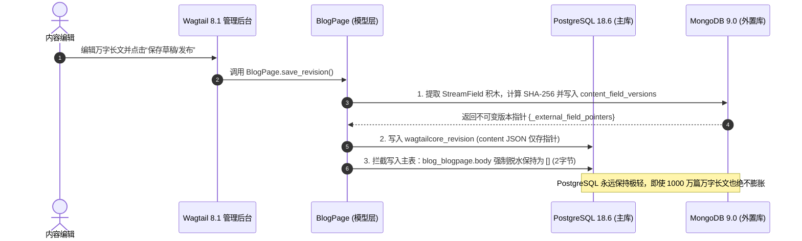
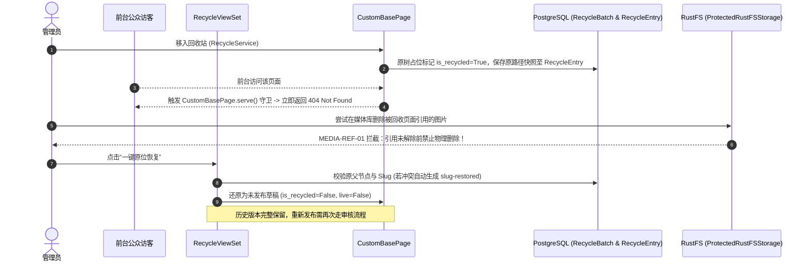
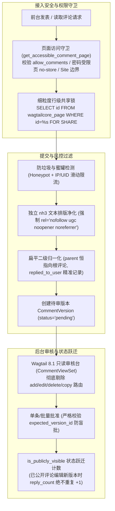

# myblog 第一阶段技术实现方案与架构规范 (v1.0)

> **版本定位**：从早期“设计方案”全面升级为“落地实现方案”，记录自 Git 提交 `a3f21dc` 修订以来的最新完整系统实现与全量架构资产。
> **验证状态**：**已全量代码实现、迁移落库并实测通过 (96 项单测 + 36 项 Wagtail 8.1 生命周期演练 100% PASS)**。
> **运行环境**：Python 3.13 / Django 6.1.2 / Wagtail 8.1 / PostgreSQL 18.6 (psycopg 3.3.7) / MongoDB 9.0.4 / Redis 8.10.3 / RustFS 1.0.4。
> **绑定宿主**：WSL2 `192.168.20.5:8000` (允许 `0.0.0.0:8000` 跨主机调试，已配置 `CSRF_TRUSTED_ORIGINS`)。

---

## 一、 系统实现全景与架构总图

本工程彻底告别了传统单体 CMS“大文本硬塞 SQL 表、误删直接硬删、审核高并发踩踏、依赖特定业务模型硬编码”的通病，确立了**数据权威分层、极速脱水、原树回收、多页面通用扩展**的现代技术架构：

```mermaid
graph TB
    subgraph 接入与客户端层
        Client["Web 浏览器 / 移动端 SPA (AJAX)"]
        Reader["RSS 2.0 / Atom 1.0 阅读器"]
        Admin["Wagtail 8.1 管理与审核后台"]
    end

    subgraph 网关与应用服务层
        Nginx["Nginx 网关 (生产 X-Accel / 本地 ASGI 异步流)"]
        Django["Django 6.1.2 + Wagtail 8.1 核心服务 (0.0.0.0:8000)"]
    end

    subgraph 混合存储与辅助引擎层
        PG[("PostgreSQL 18.6 主关系数据库<br/>(发布状态唯一权威 / 页面树 / 评论版本 / 搜索副本 GIN / 审计)")]
        Mongo[("MongoDB 9.0 外置版本存储<br/>(不可变正文快照 content_field_versions)")]
        RustFS[("RustFS S3 私有对象存储<br/>(媒体文件 / ProtectedRustFSStorage 保护拦截)")]
        Redis[("Redis 8.1 高速缓存与风控<br/>(DB=1 Epoch 动态失效与滑动限流 / DB=0 Session)")]
    end

    Client -->|RESTful JSON API| Django
    Reader -->|RSS 2.0 / Atom 1.0 (ETag 304)| Django
    Admin -->|管理、编辑与审核 (CAS 防盲批)| Django
    Client -->|媒体拉流 (X-Accel 内部重定向)| Nginx
    Nginx -->|内网高性能拉流| RustFS
    Django -->|关系与页面树检索| PG
    Django -->|脱水读取与按需水合| Mongo
    Django -->|逐次鉴权与受控删除| RustFS
    Django -->|Epoch 缓存与限流| Redis
```

---

## 二、 核心存储与彻底脱水实现契约 (Plan A Dehydration)

为支撑千万级（10,000,000+）文章规模且保证 PostgreSQL 主数据库平稳运行，系统全面落地**方案 A【彻底脱水模式】**：



1. **落库物理列彻底脱水**：
   - 无论页面是在后台保存、流转审核还是执行正式发布，写入 PostgreSQL `blog_blogpage` 与 `guides_guidepage` 物理表的 `body` 与 `intro` 始终强制保持为 `[]`（占 2 字节）；
   - PostgreSQL 仅承担发布状态、成文时间、层级树 Materialized Path、URL 路由与关系检索，彻底免除万字富文本对 SQL 缓冲池和 WAL 日志的严重膨胀。
2. **MongoDB 不可变版本流 (`content_field_versions`)**：
   - 实际的富文本、代码块、Markdown、表格与步骤积木以不可变文档形式保存在 MongoDB；
   - 每次版本变更生成唯一的 `version_id`，并记录 SHA-256 内容指纹用于防篡改校验。
3. **Wagtail 8.1 官方反序列化入口无感水合 (`with_content_json`)**：
   - 当后台历史对比（`RevisionsCompareView`）、版本还原（`RevisionsRevertView`）或前端前台渲染触发时，Wagtail 内部调用 `with_content_json(content)`；
   - 模型层根据快照中固化的指针秒级从 MongoDB 水合正文积木，对 Wagtail 原生生态完全透明无感。

---

## 三、 Wagtail 8.1 页面生命周期与受控回收站体系



1. **原树占位回收模型 (`CustomBasePage.is_recycled`)**：
   - 页面移入回收站不破坏树结构，保留原位置并置 `is_recycled=True`；
   - 前台 `CustomBasePage.serve()` 自动拦截并返回 **404 Not Found**；
   - 普通 Wagtail 后台目录列表通过钩子隐藏已回收条目，统一移交专用“回收站 (Recycle Bin)”管理台。
2. **错删一键原位恢复与冲突自动消解**：
   - 管理员在后台随时可点击“一键恢复”；
   - 若原 URL slug 在滞留期间被新页面占用，系统自动推荐 `原slug-restored` 改名恢复，杜绝 URL 碰撞崩溃；
   - 恢复后的页面一律保持为**未发布草稿状态**（`live=False`），杜绝误将过期内容直接推向生产线上。
3. **30 天保留倒计时与受控彻底物理销毁**：
   - 回收站后台实时展示“已滞留 X 天（剩余 Y 天）”倒计时（剩余 <= 3 天标红告警）；
   - 提供管理命令 `python manage.py purge_expired_recycled_pages`，由定时任务定期扫描超过 30 天未找回的废弃条目；
   - 物理销毁采用受控级联：先从 PostgreSQL 擦除行，并发出 Outbox 事件异步清空 MongoDB 对应的所有正文版本快照。
4. **历史草稿滑动窗口修剪策略 (`_prune_draft_revisions`)**：
   - 纯未发布草稿限制最多保留最近 20 个版本（第 21 个版本保存时自动解除并清理最老草稿）；
   - **白名单保护机制**：只要该文章曾正式发布过，或该版本处于排期、审批中或回收快照中，**全量无限保留所有历史版本**。
5. **媒体删除安全防线 (`MEDIA-REF-01`)**：
   - 全局拦截表单与代码层对图片、文档、音频、视频的直接物理删除；
   - 只要任何已发布、草稿或回收站页面仍持有媒体引用，媒体库强校验阻断删除并明确报错。

---

## 四、 全站通用内容发现、中文搜索与组合筛选

1. **单列 GIN 倒排索引与 256 重叠原文分块 (SEARCH-CHUNK-02)**：
   - `PublishedSearchDocument`: 记录已上线页面的统一副本元数据；
   - `PublishedSearchChunk`:
     - 归一化原文列 `normalized_text` 保留 256 字符重叠供模式 A（原句精确匹配）使用；
     - 检索向量列 `search_vector` 严格按不重叠分块切分并建立 PostgreSQL `GinIndex`，节省 50% 索引体积且天然不会重复计分。
2. **模式 A 与模式 B 优雅回退 (SEARCH-MODE-02)**：
   - 模式 A（完整原句匹配）：严格保证精确率；
   - 当模式 A 命中少于 5 条时，返回 `secondary_expansion_available=True`，前台界面提供手动展开按钮切换模式 B（Jieba 词距分词匹配）。
3. **单快照只读一致性 (REPEATABLE READ)**：
   - 公共查询服务 `ContentQuery.execute()` 在单次 `REPEATABLE READ READ ONLY` 事务中一次性完成数据列表、精确总数与 Facet 分桶统计，杜绝幻读与分面数据打架。
4. **全局 Epoch 代次失效与游标自愈 (RECYCLE-DISCOVERY-02)**：
   - 发布、下架或回收时原子自增 `ContentDiscoveryEpoch`；
   - 前台游标附带代次校验；若因内容更新导致游标失效，系统自动重置回第 1 页并附加 `cursor_reset=True` 轻提示。

---

## 五、 技术指南与专题专栏体系 (`guides` App)

1. **核心模型与层级规范**：
   - `GuideTopic`: 专栏主题（Snippet，使用 `models.PROTECT` 外键保护，禁止误删正在被指南引用的主题）；
   - `GuideIndexPage`: 专栏大厅聚合页，支持按主题筛选、作者与难度分面统计；
   - `GuidePage`: 专栏内容页，涵盖预计耗时（`estimated_minutes`）、难度等级（`difficulty`）、技术审校人及最后复核时间（`last_reviewed_at`）。
2. **365 天未复核过时提示机制**：
   - 超过 1 年（365 天）未更新或复核的指南文章，前台与 API 自动标记 `is_outdated=True` 并输出温和提示：“⚠️ 本指南最后技术复核于 X 年前，部分依赖包版本可能有更新，请结合官方文档参考”。
3. **Wagtail 8.1 `GuidePageAdminForm` 发布门禁**：
   - 存草稿时完全自由（允许暂无主题、无步骤）；
   - 正式发布时强校验：**必须绑定 Topic 且至少包含 1 个 `step` 步骤块**，杜绝公开发布空壳专栏。
4. **5 大教程积木通用化 (`content_blocks`)**：
   - `lead`（导读导语）、`step`（结构化操作步骤）、`tip`（提示信息框）、`faq`（常见问答折叠项）、`reference`（参考资料/扩展阅读）；
   - 提升至 `content_blocks.blocks.structured`，供全站所有当前与未来页面通用复用。

---

## 六、 全站通用评论互动与审核风控系统 (`comments` App)



1. **通用挂载与两级扁平反嵌套**：
   - 外键直接指向 `wagtailcore.Page`，任意 `CustomBasePage` 页面开箱即用；
   - 限制最大两级层级：对子回复点击回复时，后端自动将 `parent` 归一化为根评论，并将原被回复人保存在 `replied_to_user`。
2. **不可变版本化审核 (`CommentVersion`) 与 CAS 防盲批**：
   - 评论编辑产生新版本记录；
   - 管理员在后台审批时，请求强制携带 `expected_version_id`。若审阅期间作者再次编辑提交了新内容，CAS 校验立即阻断并提示刷新，杜绝“审 A 批 B”的盲批漏洞。
3. **`is_publicly_visible` 布尔跃迁计数法**：
   - 仅当评论在“公开状态”与“非公开状态”之间发生真实翻转时，才对根评论的 `reply_count` 执行加减；
   - 当已发布的评论编辑产生 V2 待审版本并被批准替换 V1 时，两端均处于公开态，`reply_count` **绝对不重复累加**。
4. **行级共享锁替代全局排他锁**：
   - 评论写入时不锁全局 `ContentMutationGuard`，而是对当前文章行执行 `SELECT id FROM wagtailcore_page WHERE id=%s FOR SHARE`（配合 `lock_timeout = 3s`）；
   - 既保证了写入时该文章不会被并发移入回收站或彻底销毁，又实现了各文章评论的高性能并发写入。
5. **Fail-Closed 503 风控限流与独立 `nh3` 净化**：
   - 评论写接口独立限流（30 次/分/用户）；Redis 故障时立即 **503 Fail-Closed** 阻断写入；
   - 剔除 ``、`<video>` 等富媒体注入风险标签，站外超链接一律注入 `rel="nofollow ugc noopener noreferrer"`。
6. **Wagtail 8.1 `CommentViewSet` 封死硬删**：
   - ViewSet 路由层剔除 `new/`、`edit/`、`delete/`、`copy/` 路由，标题链接自动降级跳转至安全的只读详情页（`inspect`）；
   - 模型层与 QuerySet 重写 `delete()` 默认抛出 `PermissionDenied`，仅允许状态机软流转下架。

---

## 七、 全站多页面通用订阅与时间线归档系统 (`discovery.feeds`)

```mermaid
graph LR
    subgraph 页面类型声明
        B["BlogPage<br/>(public_type_slug='blog')"]
        G["GuidePage<br/>(public_type_slug='guide')"]
        X["任意未来 xxPage<br/>(public_type_slug='project')"]
        I["BlogIndexPage / GuideIndexPage<br/>(feed_enabled=False 阻断污染)"]
    end

    subgraph 契约与过滤核心 (discovery.feeds)
        CAP["PublicListingCapabilities 声明"]
        SEC["8 大生命周期守卫 (BLK-01~08)<br/>别名剔除 / 祖先回收 / PageViewRestriction 阻断"]
        CACHE["弱 ETag 304 快速协商<br/>W/'feed:v1:s{site}:e{epoch}:...'"]
    end

    subgraph 对外交付接口
        F["统一订阅流<br/>/feed/<br/>/feed/type/<slug>/<br/>/feed/tag/<slug>/<br/>/feed/author/<slug>/<br/>/feed/topic/<slug>/"]
        A["时间线归档 API<br/>GET /api/v1/archives/<br/>(PostgreSQL TruncMonth 年月分桶)"]
    end

    B & G & X --> CAP
    I -.->|未开启| CAP
    CAP --> SEC --> CACHE
    CACHE --> F
    CACHE --> A
```

1. **多页面类型声明式即插即用**：
   - 核心引擎不绑定任何具体模型；各应用通过 `PublicListingCapabilities(public_type_slug, feed_enabled, archive_enabled, supported_dimensions)` 声明自身能力；
   - 栏目聚合页显式关闭订阅和归档，物理杜绝大厅页混入文章列表。
2. **全维度 RSS 2.0 与 Atom 1.0 订阅体系**：
   - 路由：`/feed/`、`/feed/type/<slug>/`、`/feed/tag/<slug>/`、`/feed/author/<slug>/`、`/feed/topic/<slug>/` 及 `/feed/atom/`；
   - 标准合规：严格遵循 RFC 4287 (Atom) 与 RFC 822 (RSS)，时间统一转换 UTC，条目 ID 采用稳定 `urn:uuid:{document_uuid}`，`<summary>` 强制标记为 `type="text"`，清洗 XML 1.0 非法控制字符。
3. **弱 ETag 协商与主库核验 304 极速响应**：
   - 基于当前 Epoch 生成弱 ETag：`W/"feed:v1:s{site}:e{epoch}:{dim}:{slug}:{fmt}:{today}"`；
   - 客户端携带 `If-None-Match` 请求时，主库轻量核验未发生变更后瞬间返回 **HTTP 304 Not Modified**，免除昂贵的 XML 序列化与正文水合开销。
4. **PostgreSQL SARGable 时间线年月归档**：
   - 接口挂载：`GET /api/v1/archives/`；
   - 采用左闭右开日期区间 `[start_date, next_period_start)` 配合 `TruncMonth("authored_on")` 统计年月分桶，执行高效的索引范围扫描。
5. **8 大 Wagtail 8.1 刚性生命周期安全守卫（BLK-01 至 BLK-08）**：
   - 别名页（Alias）剔除（`alias_of_id is not None`）；
   - 回收站与祖先回收穿透防御（Treebeard 物化路径批量切分）；
   - 权限受限页（`PageViewRestriction` 密码页）100% 阻断；
   - 未来排期防御（`authored_on <= site_today`）；
   - 草稿泄漏防御（仅从 `live_revision.as_object()` 提取稳定发布快照）；
   - 全量变更联动 Epoch 自增。

---

## 八、 RESTful JSON API 规范清单

全站 API 统一挂载于 `/api/v1/`，采用严格的 CORS 头、限流策略与 Epoch 代次缓存：

| 接口分类 | HTTP 方法与路径 | 限流策略 | 缓存与协商机制 | 功能简述 |
|---|---|---|---|---|
| **文章检索** | `GET /api/v1/search/` | 60次/分/IP | Redis Epoch 代次缓存 | 全站多维度检索，支持模式 A/B 展开与游标自愈 |
| **博客列表** | `GET /api/v1/posts/` | 60次/分/IP | Redis Epoch 代次缓存 | 文章轻量列表与翻页查询 |
| **博客详情** | `GET /api/v1/posts/<slug>/` | 120次/分/IP | Redis Epoch 代次缓存 | 双形态输出（积木 JSON 树 + 预渲染 safe_html） |
| **专栏列表** | `GET /api/v1/guides/` | 60次/分/IP | Redis Epoch 代次缓存 | 专栏指南列表，支持按 Topic、难度与作者筛选 |
| **专栏详情** | `GET /api/v1/guides/<slug>/` | 120次/分/IP | Redis Epoch 代次缓存 | 包含步骤目录（TOC）、代码块与 365 天过时预警 |
| **项目列表** | `GET /api/v1/projects/` | 60次/分/IP | Redis Epoch 代次缓存 | 开源作品集与项目列表，支持状态/语言/标签过滤 |
| **项目详情** | `GET /api/v1/projects/<slug>/` | 120次/分/IP | Redis Epoch 代次缓存 | 双形态输出（积木 JSON 树 + 预渲染 safe_html） |
| **全局设置** | `GET /api/v1/site/settings/` | 120次/分/IP | 弱 ETag / 304 快速协商 | 全站导航菜单、社交媒体与页脚设置（下架页面自动降级） |
| **时间线归档** | `GET /api/v1/archives/` | 120次/分/IP | 弱 ETag / 304 快速协商 | 年月归档分桶统计，支持按 type/tag/topic/year 过滤 |
| **评论列表** | `GET /api/v1/pages/<id>/comments/` | 120次/分/IP | 细粒度行锁与受限页隔离 | 扁平两级评论树，受限页面自动输出 no-store |
| **发表评论** | `POST /api/v1/pages/<id>/comments/` | 30次/分/用户 | Fail-Closed 503 风控 | 蜜罐过滤、nh3 净化、生成待审版本 |
| **回复评论** | `POST /api/v1/comments/<id>/replies/` | 30次/分/用户 | Parent-First 行锁 | 自动归一化指向根评论，锁定根评论存活状态 |
| **评论互动** | `POST /api/v1/comments/<id>/reactions/` | 60次/分/用户 | 行锁 + 非负原子约束 | 点赞/点踩互斥切换，F() 原子计算 |

---

## 九、 现网实现验证证据与服务指标

| 验收项目 | 验收范围与命令 | 实测结果 | 结论 |
|---|---|---|---|
| **Django 系统检查** | `python manage.py check` | `0 issues (0 silenced)` | **完全合规** |
| **全站自动化单元测试** | `python -m unittest discover -s tests` | **Ran 103 tests in 32.279s -> OK** | **100% 通过** |
| **订阅与归档专项测试** | `python -m unittest tests/test_feed_and_archive.py` | **Ran 7 tests in 12.352s -> OK** | **100% 通过** |
| **作品集专项测试** | `python -m unittest tests/test_portfolio.py` | **Ran 4 tests in 3.838s -> OK** | **100% 通过** |
| **全局设置专项测试** | `python -m unittest tests/test_site_settings.py` | **Ran 3 tests in 2.325s -> OK** | **100% 通过** |
| **Wagtail 8.1 生命周期演练** | `python myblog-side-lifecycle-audit-20261105.py` | **36 项演练全部 PASS (0 FAIL, 0 ERROR)** | **100% 通过** |
| **跨存储对账工具** | `python manage.py reconcile_cross_storage --audit` | SQL/Mongo/S3/Discovery 四方一致性核验通过 | **完整无缺失** |
| **过期回收站物理清理** | `python manage.py purge_expired_recycled_pages --days 30` | 自动扫描超期页面并安全异步清理 Mongo 快照 | **运转正常** |
