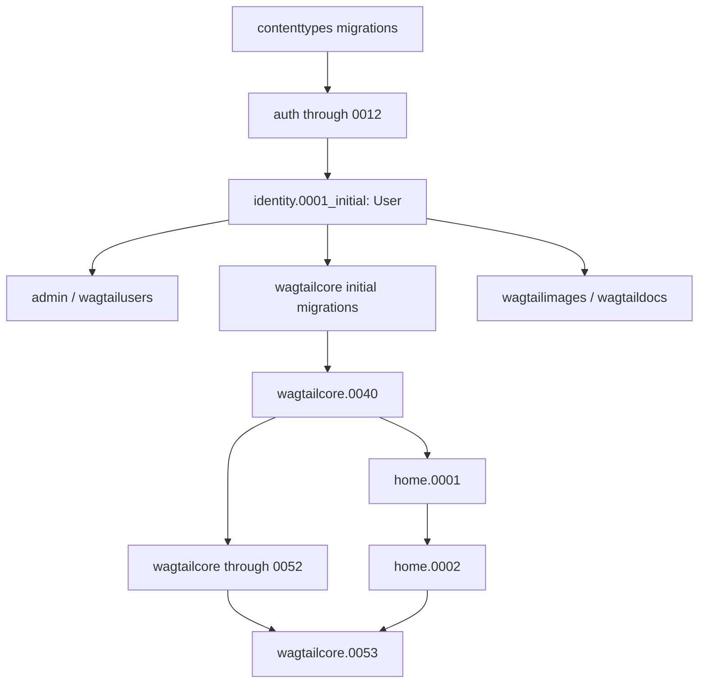
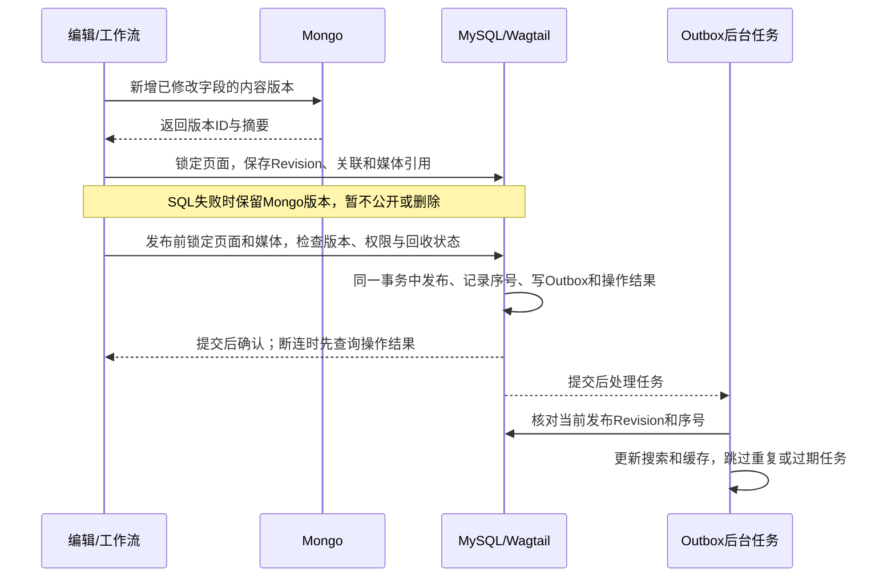
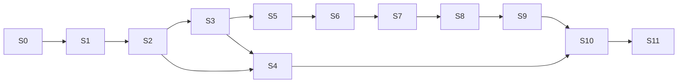

# myblog 第一阶段技术方案与实施顺序

日期：2026-11-04。状态：基础服务已准备，业务代码和数据库表迁移尚未开始。
依据：两份 v1.0 需求文档、当前代码和环境检查，以及已完成的代理审查。
初次方案中，Sol 完成用户模型检查和代理配置；Terra 当时未完成媒体审查。
本轮另完成 RustFS 文档与依赖方案的只读复核，不代替业务实现和运行验收。

第一阶段要完成：文章编辑和发布、公共媒体库、回收站、搜索及文章详情页。
先准备环境和基础模型，再逐项实现。本文给出设计和顺序，不代表功能已经完成，
也不代表已获准执行数据库迁移或部署。

阅读时记住四点：

- MySQL 保存页面信息、权限和 Wagtail 的页面版本；MongoDB 保存简介、正文的内容版本。
- Revision 是 Wagtail 保存的页面历史版本。读者只能看到已发布版本，不能看到更新中的草稿。
- 图片、附件和音视频由全站共用；读取和删除都要检查权限及页面引用。
- 每个小任务单独检查。测试失败先修复，再继续下一步。

## A. 已获授权和当前情况

最初的任务书要求只读检查。用户随后允许参考旧站配置、准备代理角色、
读取指定 `.env.test`，并为新项目创建数据库、缓存分区和存储桶。
用户已授权在 WSL2 准备本项目独立的 MySQL、Redis、MongoDB 和 RustFS，
并进行服务级连接、建库、建桶和集成探针验证。该授权不包含业务表迁移、
修改旧站、部署应用或 Git 提交/推送。
2026-11-04 用户另行授权将本次方案和相关准备文件提交并推送至 Git，供工程和架构审核；该授权不包含应用部署或业务表迁移。
本项目当前对象存储统一使用 RustFS 1.0.4，客户端使用 boto3 和 S3 协议；
MinIO 不再是当前产品，也不再作为应用对接方案。旧 MinIO 只在环境记录中
作为切换前的历史备份和回退来源。

### A.1 当前基础服务对接合同

| 服务 | 版本 | Windows/WSL2 地址 | 用户 | 数据范围 |
|---|---|---|---|---|
| MySQL | 26.10.0 | `192.168.20.5:3306` | `root` | `myblog_dev`、`myblog_test` |
| Redis | 8.10.3 | `192.168.20.5:6379` | `default` | DB9/DB11，分别对应 dev/test |
| MongoDB | 9.0.4 | `192.168.20.5:27017` | `root`，`authSource=admin` | `myblog_dev`、`myblog_test` |
| RustFS S3 API | 1.0.4 | `http://192.168.20.5:9000` | `root` | `myblog-dev`、`myblog-test` |
| RustFS 控制台 | 1.0.4 | `http://192.168.20.5:9001` | `root` | 与 S3 API 共用管理员 |

服务端口均发布到 WSL2 的 `0.0.0.0`，Windows 主机通过
`192.168.20.5` 访问。RustFS 桶保持私有，应用必须通过统一文件访问入口
完成权限检查，不能把管理员密钥或永久对象地址交给浏览器。

明文密码不放入可提交方案。当前本地密码表位于被 Git 忽略的
`说明书/myblog_本地服务凭据_不提交.md`，其中记录 MySQL、Redis、MongoDB
和 RustFS 的管理员密码。方案只引用用户名、版本、端口、桶和数据库名称。

| 项目 | 已记录的情况 |
|---|---|
| 工作目录 | Windows `F:\openclaw\workspace\wagtail\myblog`；WSL `/mnt/f/openclaw/workspace/wagtail/myblog` |
| Git | main；origin 为 `anc1996/myblog`；基线 `e3b5a82c21f9a9e6919c99343065d61d21d7411c`，两份暂存需求文档保留 |
| Python/框架 | 指定 Conda 环境：Python 3.13.2、Django 6.1.2、Wagtail 8.1 |
| 应用设置 | 仍用 SQLite 和本地文件存储设置，尚未配置 AUTH_USER_MODEL；新 env 尚未接入 settings |
| 数据库 | 新 MySQL 的 myblog_dev/myblog_test 已创建、零业务表；未发现本项目 SQLite 文件，旧库迁移史未查 |
| 现有功能 | 搜索仍是 `Page.objects.live().search()`，不查 Mongo；默认 documents 和 DEBUG 媒体地址仍需改造 |
| 启动风险 | 应用 Dockerfile 含自动 migrate，尚未运行；home.0001/0002 文件存在不代表已执行 |
| 依赖风险 | Conda 中有旧站 editable 包；须检查导入路径，禁止复用旧 app |

各项检查命令和结果集中保留在《环境与代理准备记录》，这里不重复列出。

**已解决：数据库版本太旧。** 原共享服务是 MySQL 8.0.41；本机 Django 6.1.2 的
`django/db/backends/mysql/features.py:65–70` 要求 MySQL ≥8.4，MariaDB ≥10.11。
创建数据库成功，不代表版本符合 Django 要求。
经用户授权，WSL2 已安装独立 MySQL 26.10.0，Django 已成功连接开发、测试空库并通过版本检查。
旧共享服务和先前创建的 8.0 空库保留，未升级或删除。

**已解决：MySQL 驱动缺少系统库。** mysqlclient 2.2.7 的 MySQLdb 原先缺少
`libmariadb.so.3`，Conda lib 与系统标准 lib 目录均未发现该文件。
最初用已有的 PyMySQL 1.1.1 准备资源，没有替换 Django 的数据库驱动。
后来安装 `libmariadb3`（11.8.6），MySQLdb 已能导入，Django/MySQL 连接也已通过。
客户端依赖已写入 requirements.txt。

**仍待解决：审批中的唯一性限制。** 对两个空库执行 Django 数据库检查时，
`wagtailcore.WorkflowState` 各报告一次 `models.W036`：
MySQL 无法建立 `unique_in_progress_workflow` 条件唯一约束。
`scripts/check_local_mysql.py` 以 `fail_level="WARNING"` 保留失败，不静默屏蔽。
也就是说，数据库能连接，但严格检查仍未通过。
启用审批前，还要验证多人同时操作时如何防止重复的进行中工作流。升级数据库没有自动解决此问题。

Conda 内旧 editable `wagtailblog2` 要求 `wagtail==8.0.1`，与新项目8.1冲突；
保留旧包未卸载，因此整个共享 Conda 的 `pip check` 仍不通过。
新项目的导入路径和服务读写单独检查；不能因此声称整个 Conda 环境没有依赖冲突。

### A.2 第三方依赖准备

完整核查见《myblog_依赖核查与升级方案_2026-11-04》及《第三方依赖清单》。
当前共享 Conda 有旧站对 Wagtail 8.0.1 的固定要求，`pip check` 仍失败。
建议先确定独立环境，再更新 Django 6.1 补丁及网络、图片和内容渲染依赖；
Wagtail 保持 8.1，Taggit / Treebeard 等遵守它的版本上限。
RustFS 采用 boto3；Django 文件字段接入时声明 django-storages，
权限入口、历史引用和受控删除仍由应用实现。本轮未实际升级依赖。

## B. 用户模型和第一次数据库迁移

新建 `identity` App，设置 `IdentityConfig.name/label = "identity"`。
先用最小的 `User(AbstractUser)`，并设置 `AUTH_USER_MODEL="identity.User"`。
User 管登录；Person 管作者等公开人物资料，两者分开。继续使用 Django 的 Group/Permission 管理权限。
User 必须在 identity 的 `0001_initial` 中创建，不能依赖 people、home 或 wagtailcore。

箭头表示先执行；identity 节点目前未实现：

获准迁移后，用 MigrationLoader（Django 的迁移依赖读取工具）核对实际顺序；
上图省略了 taggit、合并迁移等辅助项。
Wagtail 的用户外键会根据 `AUTH_USER_MODEL` 依赖 identity 的第一次迁移。
调整 `INSTALLED_APPS` 顺序不能替代迁移依赖。

`home/0002_create_homepage.py:13–38` 删除默认首页、写固定树路径并创建 localhost Site；
`:56–58` 的 run_before 安排其在 Locale 模型引入前执行。
该文件与安装包模板相符，没有证据证明空白 MySQL 必然失败。
它依赖初始页面树，撤销迁移也会删除首页和站点，所以不能对已有内容的库重新执行。
新库目前没有业务表，适合后续初始化；版本和驱动问题已解决，仍需先确定媒体模型并获准迁移。
如果发现数据库已经迁移过，应另写迁移方案，不能直接换 `AUTH_USER_MODEL` 后执行 migrate。

## C. 全站共用的媒体库

| 路线 | 收益 | 代价与约束 |
|---|---|---|
| 原生 Image/Document，加独立的权限、引用和下载服务 | 少改模型，能多用原生选择器、Collection 和派生图 | 权限需另表关联；删除、文件链接、派生图、下载和 API 都要检查 |
| 第一次迁移就使用自定义 Image/Document/Rendition | 资源标识、权限和操作记录直接放入模型，便于扩展 | 迁移前需设置 WAGTAILIMAGES_IMAGE_MODEL/WAGTAILDOCS_DOCUMENT_MODEL；表单、选择器和迁移均需测试，权限和删除仍需单独实现 |

**推荐首迁移采用最小自定义 Image/Document/Rendition**，复用 AbstractImage、
AbstractDocument、AbstractRendition 的原生能力；Audio/Video 是全站公共模型。
自定义 Rendition 必须以 `image` 外键指向所选自定义 Image，使用
`related_name="renditions"`，并对 `(image, filter_spec, focal_point_key)` 设置唯一约束；
Rendition 是按尺寸等规则生成的图片版本。S1 要检查 `wagtailimages.E001`、
图片选择器、派生图生成和复用，不能只填写模型设置。
推荐自定义模型，是因为新库还没有业务表，而资源标识、权限和历史保留是首期重点。
如果更重视减少维护，也可选择第一条路线；必须在第一次迁移前确定。
不建立 BlogImage、BlogDocument 或其他按页面分裂的媒体库。

建议放入公共 `media_library` App。四类媒体共用权限检查和稳定资源标识，
各自保留合适的模型，不强行继承一个复杂的父模型。
图片派生图同样检查权限；文档通过专门入口下载；音视频支持通过权限检查的分段读取（Range）。

读取规则：

1. RustFS 桶保持私有；资源上传默认 restricted，只有专门权限能批准 public。
2. Collection 后台权限不等于前台文件读取权限；Page、Site、Collection 与资源策略各自校验。
3. 公开 Page 发布前验证所有托管引用，存在 restricted 媒体就拒绝并定位 Block/字段。
4. 原图、派生图、封面、音视频、字幕和下载，都经过统一文件访问入口（gateway）。
   首期由应用检查权限后转发文件内容；签名 URL 在有效期内通常不能即时撤回，不能替代此检查。
   Range/HEAD 每次都校验权限，支持 206（分段内容）和 416（范围无效）。
5. 明确替换默认 `/documents/`、模板 `.url`、DEBUG `/media/` 及可直达 rendition 的入口；
   前台仅使用安全交付地址，后台预览仍须检查权限。API v3 首期建议不注册。
6. 资源从 public 改为 restricted 时，在同一个数据库事务中撤销相关页面的发布，
   更新发布序号，并写入待处理任务表（Outbox）和操作记录；文件入口立即拒绝无权访问。
   同时发生的发布操作也要锁定同一资源并重新检查。这项下线规则仍待设计决策记录（ADR）确认，
   不能先改权限，再等后台任务处理页面暴露问题。

这里的事务指一组数据库操作一起成功或一起回退；锁用于协调同时发生的操作，避免相互冲突。

引用规则：记录哪些页面版本使用了哪些文件，防止删掉仍被使用的资源。

- `MediaReference` 保存资源、Page、Revision、字段版本、Block 路径与来源种类。
  当前发布/当前草稿/历史/回收站是视图分类，一个 Revision 可以同时具有多个状态。
- 提取器覆盖封面、两类图集、RichText、Markdown、Table、音视频与嵌套结构，
  托管引用使用稳定资源 ID；外站 URL 不冒充本地可保护资源。
- 保存 Revision 时，在同一个 SQL 事务内登记引用和提取程序版本。
  引用数据不完整、提取程序不支持或核对结果异常时，禁止真正删除文件，不能只依赖 Wagtail 默认引用索引。
- 后台、QuerySet 批量删除和级联删除都必须经过统一检查。
  管理员永久删除前，检查所有保留的 Revision 和回收站引用，并锁住资源，防止同时新增引用。
- Page 永久删除只移除其自己的引用；不会自动删除公共媒体或其他 Page 的引用。
  先在 SQL 中保存删除审批结果，再由后台任务删除 RustFS 对象并核对结果。
  SQL 操作失败时，不能把删除文件当作补救办法。
- 原生 Image 的 post_delete 文件清理也必须经过上述检查。

## D. 模块分工和内容处理流程

一个 Django 项目按 App 分工，第一阶段不拆成多个独立服务：

| App/模块 | 职责 | 不承担 |
|---|---|---|
| identity | 后台 User | 作者资料、会员业务 |
| people | 公共 Person | 登录权限 |
| taxonomy | 唯一 Tag 词库、合并重定向 | Category |
| media_library | 四类媒体的权限、文件读取和引用 | 决定页面是否发布 |
| content_blocks | 内容块的编辑、检查、显示、文本和引用提取 | 多个页面共用一份可修改正文 |
| external_content | Mongo 内容版本、关联 Revision、待处理任务 | 另建一套发布状态 |
| content_lifecycle | 统一读取、回收、恢复和永久删除 | 重写整个 Page 框架 |
| blog | BlogPage、BlogIndexPage、专属 Block 组合与模板 | 私有媒体库 |
| discovery | 搜索、标签、归档和栏目查询，以及查询用的内容副本 | 决定页面是否允许发布 |

接口建议：

- 每种内容块（Block）提供检查、显示、提取文本和提取媒体引用四个接口：
  `BlockContract.validate(value, context)`、`render(value, context)`、
  `extract_text(value)`、`extract_media_refs(value, path)`。类型名称保持稳定，并记录数据格式版本（schema）。
- BlogIntroBlocks 直接组合公共 RichText/Markdown；BlogBodyBlocks 直接列出基本块，
  不为统一外观强塞额外 StructBlock。正文图集是 Blog 自己的复合结构。
- 页面中的人物角色、排序、标签和独立图集都随 Revision 保存。
  公开显示时读取发布版本中的关联，不能读当前草稿关联表。
- 合并 Tag 时保留旧 ID 到新 ID 的对应关系，防止恢复旧 Revision 时重新带出已删除标签。
- 必填 `authored_on: DateField` 进入业务 Page/IndexPage 和 Revision；
  建议 HomePage 为入口而豁免，创建时可预填当天但仍需有效值，待确认。

### D1. Mongo 内容版本、页面保存和发布

Mongo 每个字段版本建议保存：
`version_id, document_uuid, model_label, field_name, schema_version, block_schema_versions,
content_hash, payload, created_at, operation_id`。
每次修改内容都新增版本，不直接改已有 payload。读取时核对所属页面、字段和内容摘要。
版本标识或 operation_id 必须唯一；重试同一次操作时，内容相同可重复执行，内容不同必须报错。
这就是幂等处理，目的是避免超时重试造成重复或覆盖。
首次保存草稿时生成稳定的 document_uuid，并同时保存到 SQL 和 Revision。
intro（简介）或 body（正文）没有变化时，可以复用原版本。

Wagtail Revision JSON 记录完整元数据/关系及
`intro_version_id/body_version_id`、摘要、schema 和 document_uuid。
页面是否发布、发布了哪个版本，由 Wagtail 的 `live/live_revision_id` 决定。
如另建 MySQL 发布关联记录（envelope），它只能在同一事务内记录对应 Revision 和发布序号，
不能另行决定发布状态。

普通页面的读取顺序：

1. 检查页面、Site、父级页面的访问限制，以及页面是否在回收站。
2. 根据 `live_revision_id` 取得发布版本，恢复该版本的字段和关联。
3. 按版本 ID 读取 Mongo 内容，核对所属页面、字段和摘要，再显示。

例如：发布文章 A 后又保存草稿 B，读者仍应看到 A 的正文、日期、封面、标签、作者和 SEO。
Page 表里可能已经有 B 的字段，所以只筛选 `live=True` 不够。
草稿和历史预览读取获准查看的 Revision；缓存键区分预览/公开场景和版本，命中缓存前也要查权限。
发布内容缺失、关联错误或损坏时，明确返回不可用，不能用 Mongo 最新版本或空正文顶替。

Mongo 保存成功但 SQL 失败时，会留下暂未被引用的版本，标为 orphan 待核对，本阶段不直接删除。
Mongo 写入超时时，先按原版本 ID 核对摘要，再决定是否重试，不能换 ID 盲目重写。
发布只能引用已经确认保存的内容版本。
Outbox 是待处理任务表，必须与业务数据在同一个 MySQL 事务里保存。
`on_commit` 只负责唤醒后台任务；定时扫描负责补处理。用唯一事件 ID 和发布序号防止重复、旧任务覆盖新结果。
后台任务失败不改变已经发布的文章。

后台按钮、审批工作流和定时发布都必须执行同一套发布检查。
复制页面树时，每个节点新建 Page 和 document_uuid；内容可以复制，但必须关联新页面。
公共媒体、Person、Tag 继续共用。翻译和子树复制单独测试，不能照搬源页面的 owner。
恢复历史版本只生成草稿，保留旧关联和内容版本 ID，不恢复公共 Person/Tag 自身的旧数据，也不自动发布。
实现时还要测试多项操作同时发生的情况，并确定页面树锁、页面锁和资源锁的获取顺序。

**别名页面（Alias）要单独处理。** 它使用源页面内容，没有自己的 Revision。
建议 S6 增加 `AliasPublicationBinding`，记录 alias_page_id、最终源 Page ID、
源发布 Revision ID、源 document_uuid 和别名发布序号。它只跟随源发布状态，不能独立决定发布。
别名链必须有限且不能成环；链断裂或信息缺失时拒绝公开读取。

读取时，普通页用自己的发布 Revision，别名用关联的源发布 Revision。
两者统称 effective publication（实际使用的发布版本）。
别名和源页面各自的 Site、父级权限、回收状态和发布资格都要检查，
且关联版本必须等于源当前发布版本。地址和树位置仍归别名，Mongo 内容仍按源身份检查，
不能把 Mongo owner 临时改成 alias_page_id 或跳过检查。

源页面发布、下架、回收、修改权限时，在同一个 SQL 事务里更新或作废别名关联；
旧关联更新前停止公开读取。搜索副本记录别名 Page ID、实际发布 Revision 和序号，
同时检查别名和源，不能只比较别名为空的 live_revision_id。
别名转普通页时保留 Page ID，但新建 document_uuid、自身 Revision，并重新关联外置内容。
S6 必须测试原生 create_alias/update_aliases/convert_alias 入口是否都执行这些规则。
验证完整前不开放这些入口；是否启用别名另记 ADR，不影响独立页面复制。

### D2. 回收站、恢复和永久删除

| 路线 | 原 ID/Revision | 主要问题 |
|---|---|---|
| 页面留在原位置，标记为已回收 | 直接保留 | 所有读写、父级检查、排期工作流和后台列表都要识别回收状态 |
| 移入隐藏树 | 可保留 | move 会影响 path/url、Site、父类型约束与权限，恢复及并发复杂 |
| 独立快照/保留表 | 需额外重建策略 | 原生 FK/ID/Revision/树恢复成本最大，容易退化为硬删后重建 |

**推荐先验证第一种做法：页面留在原位置，标记为已回收。**
`RecycleEntry/RecycleBatch` 记录原父页面、顺序、子树根、节点集合和操作标识。
原 Page 与 Revision 保留，但所有回收节点都不能发布。

后台删除、批量操作、业务代码和管理命令统一调用回收服务。
再用 ORM 的 pre_delete 信号拦住普通 QuerySet 和级联永久删除。
信号挡不住 `_raw_delete`、直接 SQL 或数据库管理员操作，应用代码必须禁止绕过；
运维操作仍需单独授权并记录。S8 要检查调用位置，并测试后台、批量和 ORM 的非法删除是否被拒绝。
真正永久删除时，既要有专门权限，也要有删除服务签发并校验的操作凭证。
还必须检查框架的完整删除流程，不能只重写一个 `Page.delete()` 就认为保护完整。
本机 Wagtail `models/pages.py:883–885` 委托 `DeletePageAction`；
`actions/delete_page.py:33–45` 记录后代后进入底层 delete，属于硬删除，
也说明单独拦住某个后台按钮不足以保护整棵树。

删除前显示受影响的子页面、权限和定时发布任务。执行时，在事务中锁定相关节点并重查页面树版本，
取消排期和进行中的审批，调用已验证的原生下架流程，再更新引用、Outbox 和操作记录。
直接 `update(live=False)` 不等于执行了完整下架流程。
发布、移动、新建子页面、复制、别名同步和定时任务都要检查自身及父级是否已回收。

没有子页面时，允许只回收本页；有子页面时，须明确选择整棵子树，方案仍待确认。
如果要保留可见的子页面，另行设计移动方式，不能自动把它们提升到上一级。
回收期间保留原 slug（地址中的页面名称），不允许其他页面占用。
恢复时保留 ID、子树和历史，重新检查 slug、父页面、页面类型、权限及同时发生的操作。
恢复后默认不发布，回收站不设置自动清空期限。

### D3. 搜索、归档和缓存

第一阶段不用 Elasticsearch。建议在 MySQL 建 `PublishedSearchDocument`，
保存从发布 Revision 提取的 title/intro/body 文本，并记录 page_id、revision_id、
generation（发布序号）、页面类型和成文日期。这份搜索副本也称投影。
Outbox 负责更新它；丢失后可从发布内容重建。摘要不能直接输出 Markdown 中未经处理的 HTML。
先用参数化的文本包含查询，多个词都须匹配（AND），支持中文子串。
搜索的是正式正文的副本；原生 `.search()` 不会自动查询 Mongo。
实测性能不足后，再考虑 MySQL 全文索引或第二阶段的 ES，不预先承诺吞吐量。

统一 `ContentQuery` 参数：关键词、允许的类型标识、Tag、Site、root_page、
直属/后代、authored_on 范围、排序和分页；结果包含稳定 page_id、正式 revision_id。
先检查搜索副本是否对应当前发布 Revision，再检查 Page/Site 权限和回收状态，
最后计算数量、摘要、年月分组和地址。过期副本不能显示；更新延迟可以暂时漏掉新内容，但不能泄露内容。
标签和日期也读取正式副本。默认按 `-authored_on, -page_id` 排序，其他排序只允许预先列出的选项。
栏目默认显示所有后代页面，并提供直属子栏目导航；也可切为仅直属页面。
按类型查询全站内容时，不要求页面位于 BlogIndex 下。

Redis 首期只做可选缓存，数据丢失后可重新生成；暂不引入 Celery。
Outbox 先由专门的管理命令处理；定时发布使用 Wagtail 原生命令，调度方式需获批准。
Redis 不可用时，按限定范围读取原数据，仍检查权限，不能无限制增加数据库负担。
回收和权限修改立即生效，不能等缓存过期时间（TTL）结束。
已准备 dev DB9/test DB11 和命名空间；逻辑库共享同一 Redis 服务，
不能声称是独立实例。禁用 FLUSHDB/FLUSHALL，测试只能按自己的唯一前缀处理数据。
若以后引入 broker/result DB，先另行核对占用，不能沿用旧站编号。

### D4. 编辑器和文章页面

RichText（含下划线）、Markdown（数学/表格/代码/Mermaid）、Image/Document/Audio/Video/
Embed 分别测试输入检查、危险内容清理、显示、文本及引用提取；页面用到哪些区块才加载对应资源。
CodeBlock 一个块两模式：展示支持高亮/行号/复制/折叠；运行模式提供编辑、stdin、
stdout/error 的状态约定及服务不可用提示，首期不执行不可信代码。
复杂 Table 单独实现：合并/拆分单元格，增删复制行列，撤销/重做，插入链接、图片、公式，
允许的 HTML，以及对齐、尺寸、样式和手机端横向滚动。不能用原生简易表格替代这些需求。
Mermaid 独立块与 Markdown 中的 Mermaid 代码块共用显示程序，使用相同安全限制，覆盖预览、缩放/适配/全屏/折叠、
主题、源代码复制、SVG 安全导出，以及便于辅助工具读取的错误提示。
Embed 只接受允许的来源，服务端抓取要防止 SSRF（借服务器请求不该访问的地址）。
外链文件不属于本地媒体库，不能当作受本地权限保护的资源。
建议首期不提供独立 RawHTMLBlock，Table/Markdown 仍满足其限定安全 HTML 需求，待确认。

详情页采用居中单栏，显示发布版本的成文日期、贡献人员、标签、可选封面和实际父级路径面包屑。
简介按显示高度决定是否折叠；禁用 JS 仍可读全文，展开按钮正确设置 aria-expanded 并处理焦点。
独立图集放在正文后；正文中可放多组图集，各自保存顺序和图注。
Lightbox（点击图片后放大查看）支持键盘和手机操作。
评论、反应、阅读量、推荐、前后篇、TOC、阅读进度及左右栏继续后置。

## E. 分步实施和检查

下表是计划，路径不代表文件已存在。S0、S1 等编号表示一个可单独检查的小任务。
默认由 Gemini 实现、Sol 制定和复核接口约定；复杂框架问题按需交给 Argon。
用户模型、跨数据库操作、删除和权限安排 Terra 独立审查。
Gemini 路由尚未验证时，由实际可用的代理或主代理执行，并如实记录。

| 小任务/前置任务 | 拟建或修改的路径 | 要完成和检查的内容 |
|---|---|---|
| S0 环境准备（已准备独立服务） | 环境依赖说明、requirements、infra | MySQL ≥8.4、MySQLdb 导入、连接指定新库、不导入旧 app；现存警告见 A 节 |
| S1 用户/媒体模型；依赖 S0 | identity/*、media_library/models/*、settings、Dockerfile、对应 migrations/tests | 先确认 User/媒体设计；检查迁移依赖、移除自动 migrate、测试空库初始化；执行迁移另授权 |
| S2 公共接口；依赖 S1 | content_blocks/contracts.py、external_content/contracts.py、content_lifecycle/access.py、discovery/contracts.py | 约定内容块格式、发布内容读取、媒体权限和查询参数；测试模块导入时不访问外部服务 |
| S3 基本 Block；依赖 S2 | content_blocks/blocks/*、renderers/*、static/*、tests/* | 富文本、Markdown、Code、Mermaid、四类媒体、Embed；测试危险输入和无法提取的内容 |
| S4 Table 编辑器；依赖 S2/S3 | content_blocks/table/*、static/content_blocks/table/*、浏览器测试 | 复杂表格全部确认功能；不能只靠 Python 单测 |
| S5 Blog/公共关联；依赖 S2/S3 | people/*、taxonomy/*、blog/models/*、blog/blocks.py、tests/* | Page 树、日期、Person/Tag/封面/双图集，Revision 关系与 Tag 合并重定向 |
| S6 内容版本/发布；依赖 S5 | external_content/store.py、revision.py、publication.py、outbox.py、tests/* | intro/body 独立保存且旧版本不修改；预览、审核、定时发布、复制、历史恢复；测试双库失败及同时操作 |
| S7 媒体读取/保护；依赖 S5/S6 | media_library/access.py、delivery.py、references.py、wagtail_hooks.py、urls/tests | RustFS 四类媒体、Range/Rendition、权限变更、历史引用、文件删除检查 |
| S8 回收/恢复；依赖 S6/S7 | content_lifecycle/recycle.py、deletion.py、wagtail_hooks.py、tests/* | 单页/子树回收、终止排期、后台/批量/QuerySet 删除检查；恢复后不发布，冲突时拒绝 |
| S9 搜索/栏目/归档；依赖 S6/S8 | discovery/models.py、query.py、projection.py；search/views.py、blog 列表模板 | Mongo 正式正文的搜索副本、条件组合、计数/分页/权限；副本重建及旧任务测试 |
| S10 详情及整体 UI；依赖 S4/S7/S9 | blog/templates/*、blog/static/*、端到端测试 | 单栏/intro/面包屑/媒体/Lightbox/无脚本/键盘/移动证据 |
| S11 整体验收；依赖前述任务 | tests/integration/*、验收报告 | 四服务故障、同时操作、HTTP/API绕过检查、数据核对和恢复演练；建库成功不等于功能通过 |

每次只实现一个可单独验收的目标，失败先修复，不把 S1–S11 整包交给一个代理。
共享 settings、urls 和 migrations 由主代理逐项整合，避免互相覆盖。
获准提交后，先检查和审查，再按 Conventional Commits 格式提交；当前不执行 commit/push。
回退可用功能开关、停用后台任务或恢复已验证的备份；用户模型、历史内容和媒体不能盲目反向迁移。

| AC（需求验收编号） | 对应任务 | 必须检查的内容 |
|---|---|---|
| 01 | S1 | 新库 User/Group/Permission 与迁移依赖无冲突，Person 独立 |
| 02–05 | S5 | 合法/非法树位置，日期非空，多人排序角色，统一 Tag 创建/合并 |
| 06 | S5/S6/S9 | 草稿改日期/作者/Tag/封面后，详情、列表和计数仍为旧正式版 |
| 07–11 | S6 | 独立字段版本、预览/发布/撤销/审核/排期、逐节点复制、历史恢复 |
| 12–14 | S3/S4 | Block 全部确认功能；运行代码不执行；XSS/SSRF/HTML 表格合并负例 |
| 15–17 | S7 | 四媒体、受限引用阻止发布、原图/派生图/Range/下载/API直链绕行 |
| 18–20 | S7/S8 | 两种 Page 共用媒体；历史和回收站引用保护；引用记录不可靠时拒绝删除 |
| 21 | S5/S10 | 独立图集与多个正文图集，排序/图注/Revision/Lightbox |
| 22–24 | S8 | 单页/子树恢复、父/slug/权限/并发冲突；所有普通硬删入口被拒绝 |
| 25–27 | S9 | 类型/Tag/目录组合、正式 Mongo 独有词命中、草稿词不命中、成文日期稳定归档 |
| 28 | S10 | 单栏、封面、intro、真实面包屑、混排、响应式与可访问交互 |
| 29 | S6/S11 | Mongo超时/SQL失败/提交未知/重复乱序事件，不能半发布或公开草稿 |
| 30–31 | S7–S11 | RustFS/Redis失败、权限变更与缓存、Web/API/Feed一致的公共边界 |
| 32 | S1/S11 | 启动不自动 migrate；所有迁移、服务变更、部署有单独授权证据 |

检查分三类：E1 检查源码、接口、依赖和配置；E2 检查纯逻辑与模型，导入前就禁止外部读写；
E3 连接指定的独立数据库、桶和缓存前缀，测试真实服务。Django TestCase 可能访问数据库，不自动属于 E2。
目前完成的是环境准备和服务检查，具体结果见环境记录；业务表迁移、媒体播放、业务并发及整体验收尚未完成。
新项目使用独立 MySQL；不能拿旧 MySQL 8.0 的测试结果证明 Django 6.1 兼容。

## F. 开始业务实现前需要确认的事项

环境安装已获授权并完成独立服务准备，不再重复要求安装 MySQL 8.4。以下业务设计仍需确认：

1. 保持 Django 6.1/Wagtail 8.1；启用审批前处理 A 节所列 MySQL 条件唯一约束问题。
2. 首迁移使用 identity.User；选自定义 Image/Document/Rendition，或原生模型加外置策略。
3. 回收站先让页面留在原位置并标记；有子页面时明确回收整棵子树；永久删除页面、文件分别要求专门权限。
4. HomePage 日期豁免、业务创建预填当天、首期不启用 API v3 和独立 RawHTMLBlock。
5. public 媒体改 restricted 时同步撤销受影响 Page 发布，保留草稿与历史的处置策略。

原需求 F01–F12 已确认的部分继续保留，不重复询问。
Redis 只做缓存、MySQL 保存搜索副本等是推荐做法，确认对应任务后再实现。
容量和响应指标（SLA）通过实际测试确定，不编造数字。

## G. 已做什么，还没做什么

- **已准备**：代理角色、`.ai-memory.toml`、AGENTS 协作规则、独立服务和两份被 Git 忽略的本地 env。
- **旧站未改**：只读参考代码与配置；env 仅选必要服务项，未复制 AI、邮件、ES 密钥或功能开关。
  新项目使用自己的资源名和 Django secret，默认 settings 尚未加载新 env。
- **业务未做**：尚未实现业务代码、模型和迁移，未运行 migrate/makemigrations/runserver 或部署应用。
- **记录边界**：历史记忆用于辅助检查，不能继承旧报告的通过数字或授权。
  未写 wiki 页面、跨项目消息或 handoff，未改全局配置。
- **检查和 Git**：详见环境记录。最初只读阶段未运行 Docker，后续按授权安装服务；
  没有 Git add/commit/push，HEAD 和原有暂存需求文件保留。
