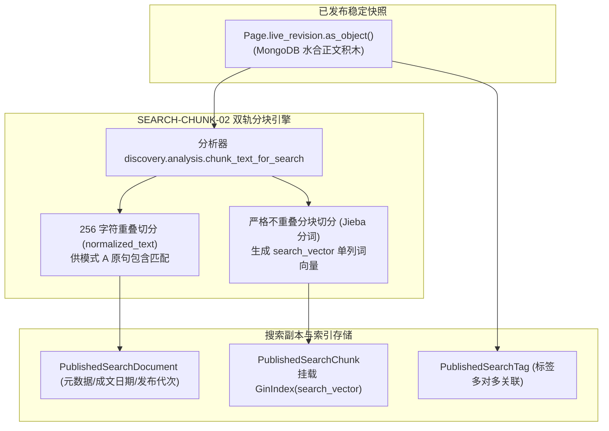
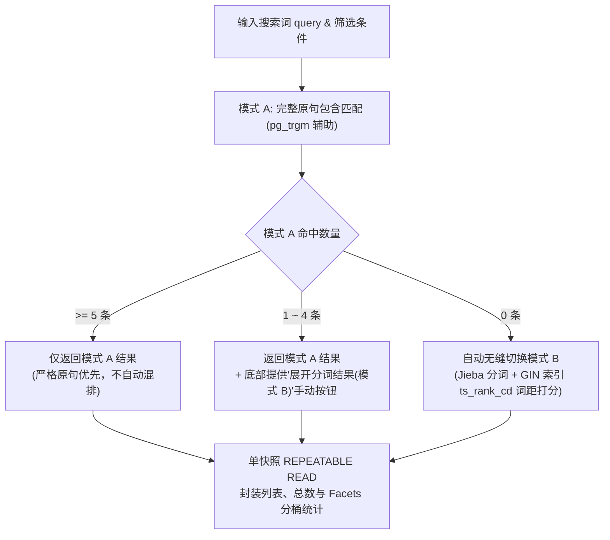

# myblog 全站统一内容发现与中文检索系统工程规范 (Universal Discovery & Search RFC)

| Document Attributes | Specification Details |
|---|---|
| **Subsystem Identifier** | `discovery.search` Hybrid Full-Text & Faceted Search Engine |
| **Document Classification** | Google Engineering Architecture RFC / Production Specification |
| **System Status** | **Implemented & Verified** (已扩展支持多维作者/日期筛选与混合分页；全站现有 54 份 `tests/test_*.py` 测试模块，早期“96 项单测 + 36 项演练”为第一阶段历史基线) |
| **Core Algorithms** | SEARCH-CHUNK-02 (256-Overlap Raw + Non-Overlap GIN), SEARCH-MODE-02 (Dual-Mode A/B Fallback) |
| **Transaction Model** | MVCC Single-Snapshot `REPEATABLE READ READ ONLY` (Zero Ghost/Skew Reads) |
| **Cache & Invalidation** | `ContentDiscoveryEpoch` Atomic Invalidation + RECYCLE-DISCOVERY-02 Auto-Reset Cursor |
| **Host Service** | PostgreSQL 18.6 GIN Inverted Index + Jieba Tokenizer (No External Search Cluster) |

---

## 1. Context, Goals & Architectural Invariants (背景、目标与设计不变性)

### 1.1 背景与核心痛点
传统企业级内容检索系统在面对中文混合内容与多维组合筛选时，往往依赖重量级的外部检索引擎（如 Elasticsearch、Solar），导致：
1. **双写一致性与网络延迟问题**：跨存储网络同步链条脆弱，内容发布与下架容易在搜索端产生延迟可见性脏读；
2. **文本重叠与分词冲突**：原句精确匹配（模式 A）需要保留上下文重叠，而分词全文检索（模式 B）若保留重叠会导致倒排索引体积翻倍且分词重复计分失真；
3. **读写幻读与分面统计失真**：翻页、总数计算与多维分桶（Facets）分步执行导致快照不一致。

### 1.2 核心工程目标 (Goals)
- **Zero Additional Search Cluster (零独立检索集群)**：完全基于 PostgreSQL 18.6 原生 GIN 倒排索引与 Jieba 分词构建，无需引入外部搜索引擎；
- **Plan A Storage Isolation (方案 A 脱水隔离)**：搜索副本表 (`PublishedSearchDocument`) 仅索引已发布快照 (`live_revision`)，未发布草稿与回收站内容物理阻断；
- **Optimized Storage Chunking (SEARCH-CHUNK-02 优化分块)**：归一化原文保留 256 字符重叠供模式 A 使用；全文检索分块严格不重叠切分并建 GIN 索引，省去 50% 索引体积；
- **Single-Snapshot Repeatable Read (单快照只读一致性)**：列表、精确总数与 Facets 分桶统计在单一 `REPEATABLE READ READ ONLY` 事务中一次性完成；
- **Dynamic Cursor Invalidation (RECYCLE-DISCOVERY-02 游标自愈)**：发布/下架自动自增全局 Epoch，失效游标自动重置回第 1 页并轻提示。

---

## 2. 检索数据架构与分块规范 (Data Architecture & SEARCH-CHUNK-02)



### 2.1 数据库模式定义 (PostgreSQL Schema)
1. **搜索文档主表 (`PublishedSearchDocument`)**：
   - `page_id`: 关联页面 ID，建立 `(page_id, index_generation)` 唯一约束；
   - `document_uuid`: 稳定跨存储业务 UUID；
   - `effective_revision_id`: 当前生效的发布版本 ID；
   - `authored_on`: 成文日期（建立 B-Tree 索引）；
   - `is_live`, `is_recycled`: 状态标志（建立复合索引 `(is_live, is_recycled, authored_on)`）；
   - `root_path`, `depth`: 树层级路径，支持栏目子树范围过滤。
2. **文本分块子表 (`PublishedSearchChunk`)**：
   - `field_name`: 字段标识（`title`, `intro`, `body`, `summary`）；
   - `chunk_index`: 分块序号（0, 1, 2...）；
   - `normalized_text`: 归一化文本（相邻块保留 256 字符滑动重叠，供模式 A 原句精确查找）；
   - `search_vector`: 单列 `tsvector`，严格按不重叠边界切分分词，挂载 `GinIndex`（杜绝重复计分，节省 50% 空间）。
3. **标签关联表 (`PublishedSearchTag`)**：
   - 记录 `(document_id, tag_id, tag_name, tag_slug)`，建立唯一约束与倒排索引。

---

## 3. 混合查询引擎与双模式回退 (Query Engine & SEARCH-MODE-02)



### 3.1 模式 A 与模式 B 协同执行规范 (SEARCH-MODE-02)
- **模式 A (原句精确匹配)**：
  - 核心逻辑：对 `PublishedSearchChunk.normalized_text` 执行原句包含判断，`pg_trgm` 提供子串索引加速；
  - 适用场景：长句检索、专业代码函数名（如 `select_for_update`）、精准技术术语；
  - 返回策略：模式 A 有结果时列表只展示 A，杜绝分词混排对精确结果的稀释。
- **模式 B (词距分词匹配)**：
  - 核心逻辑：使用 Jieba 进行中文分词，基于 PostgreSQL `simple` 配置生成查询词向量，结合 `ts_rank_cd`（考虑词距与覆盖度）计算相关性得分；
  - 适用场景：自然语言短语、跨词模糊查询。
- **手动展开机制**：
  - 当模式 A 命中数处于 `1 ~ 4` 条时，API 返回 `secondary_expansion_available=True`，前端界面底部渲染“展开包含相关分词的更多结果（模式 B）”按钮。

### 3.2 单快照只读事务 (REPEATABLE READ READ ONLY)
- `ContentQuery.execute()` 核心执行块（必须在进入 `atomic()` 之前先判断 `not connection.in_atomic_block` 并处理 `TestCase` / 嵌套快照状态机，不可进入 `atomic()` 后再判断）：
  ```python
  is_outer_testcase = False
  if connection.in_atomic_block:
      if all(getattr(b, "_from_testcase", False) for b in connection.atomic_blocks):
          is_outer_testcase = True
      elif getattr(connection, "_in_discovery_snapshot", False):
          pass
      else:
          raise RuntimeError("ContentQuery cannot be called inside a foreign read-write atomic transaction block.")

  should_manage_atomic = not connection.in_atomic_block
  atomic_ctx = transaction.atomic() if should_manage_atomic else transaction.atomic(savepoint=is_outer_testcase)

  with atomic_ctx:
      if connection.vendor == "postgresql" and should_manage_atomic and not is_outer_testcase:
          with connection.cursor() as cur:
              cur.execute("SET LOCAL TRANSACTION ISOLATION LEVEL REPEATABLE READ READ ONLY; SET LOCAL statement_timeout = '2000ms';")
      # 执行查询、精确 Count 与 Facets 分桶聚合，严格基于同一 MVCC 快照
  ```
- 杜绝传统 `READ COMMITTED` 隔离级别下，先查 Count 再查 Page 发生数据并发插入/删除导致的总数不匹配。

---

## 4. 全局 Epoch 缓存与游标自愈 (RECYCLE-DISCOVERY-02)

1. **Epoch 驱动的动态缓存失效**：
   - 全局表 `ContentDiscoveryEpoch` 维护自增代次 `epoch`；
   - 页面发布、撤销发布、移入回收站、物理销毁、修改权限（`PageViewRestriction`）、移动页面树位置均在事务提交前调用 `ContentDiscoveryEpoch.increment_epoch()`；
   - 搜索 API 缓存键附带当前 Epoch（`api:search:{epoch}:{hash}`），发生任何变更时旧代次缓存零 TTL 瞬间失效。
2. **游标自愈与轻提示契约**：
   - 游标 `cursor` 内部经过安全 Base64 编码，包含 `epoch` 与 `offset`；
   - 当客户端携带旧游标发起翻页请求时，服务端比对发现 `cursor_epoch != current_epoch`；
   - 触发自愈逻辑：自动将 `offset` 重置为 `0`（回退第 1 页），并在响应载荷中注入 `cursor_reset=True`，前台弹出轻提示：“当前筛选条件下的文章有更新，已自动为您刷新为最新列表”。

---

## 5. 生产接口契约与数据结构 (API Specifications)

### 5.1 检索接口：`GET /api/v1/search/`
- **限流策略**：`myblog/apps/api/views.py:search_api` 挂载 `@ratelimit_api(scope="search", max_requests=60, window_seconds=60)`（Redis 故障时 Fail-Open 放行；前台网页路由 `/search/` 当前未挂载 `@ratelimit_api`）。
- **查询参数 (QuerySpec)**：
  | 参数 | 类型 | 必填 | 默认值 | 说明 |
  |---|---|---|---|---|
  | `query` | string | 否 | `""` | 搜索关键词（注意接口参数名为 `query`，非 `q`） |
  | `type` | string | 否 | `None` | 内部内容类型 `type_key`（如 `blog_page`、`guide`、`project`） |
  | `tag` | int | 否 | `None` | 数字标签 ID（非字符串 slug，内部以 `isdigit()` 解析） |
  | `year` | int | 否 | `None` | 成文年份过滤 |
  | `month` | int | 否 | `None` | 成月份过滤（需搭配 year） |
  | `cursor` | string | 否 | `None` | 翻页游标（未传时支持 `page` 参数自动折算 offset 游标） |
  | `page_size` | int | 否 | `10` | 每页条数（上限 50） |
  | `secondary` | string | 否 | `"none"` | `"words"` 强制触发模式 B 手动展开 |
  | `expand` | string | 否 | `"auto"` | 控制模式 C 扩展（`auto` / `off` / `on`） |
- **实际顶层响应结构 (JSON，无额外 `data` 嵌套层)**：
  ```json
  {
    "status": "success",
    "epoch": 28,
    "query": "PostgreSQL",
    "total_count": 42,
    "page_size": 10,
    "next_cursor": "ZXBvY2g9Mjgmb2Zmc2V0PTEw",
    "cursor_reset": false,
    "expansion_used": false,
    "secondary_used": false,
    "show_expand_button": true,
    "items": [
      {
        "id": 215,
        "title": "PostgreSQL 18 存储引擎与事务隔离全景解析",
        "url": "/tech/postgresql-18-architecture/",
        "authored_on": "2026-11-01",
        "type_key": "blog_page",
        "summary": "PostgreSQL 18 是关系数据库领域的标杆之作...",
        "match_mode": "A",
        "highlights": ["..."],
        "tags": [{"id": 1, "name": "PostgreSQL", "slug": "postgresql"}]
      }
    ],
    "facets": {
      "types": [{"key": "blog_page", "label": "博客文章", "count": 30}],
      "tags": [{"id": 1, "name": "PostgreSQL", "slug": "postgresql", "count": 15}],
      "years": [{"year": 2026, "count": 42}]
    },
    "archive_groups": []
  }
  ```

### 5.2 前台全站搜索页：`GET /search/` (`myblog/apps/search/views.py`)
- 支持首屏 SSR 与 AJAX 局部刷新（`X-Listing-Response: fragment-v1` / `XMLHttpRequest` / `format=partial`），当前未挂载 `@ratelimit_api`。
- 相比 `/api/v1/search/`，`/search/` 已进一步扩展支持：
  - **搜索范围与多标签**：`query`（兼容 `q`）、`title_only`（`0`/`1` 仅搜标题）、多选 `tag`（支持数字 ID 或 slug/名称，多值重复或逗号分隔）；
  - **多维作者筛选**：多选 `author`（规范作者 slug，最多 10 位）、`author_role`（`major` / `co_author` / `other_contrib`，受 `AUTHOR_DISCOVERY_ENABLED` 控制）；
  - **时间快捷窗与精确区间**：`days`（`7` / `30` / `365`）、`date_from` / `date_to`（ISO 日期）、`year` / `month`、`sort`（`relevance` / `authored_desc` / `authored_asc`）；
  - **混合分页与真双向游标**：支持 `v2:` 签名 Keyset 游标（兼容旧 Base64 offset 游标）、有界浅页直跳（`page`，超限返回 HTTP 422）、`seek_date` 与 `seek_direction="oldest"`。

---

## 6. 现网就绪指标与实测证据 (Verification Evidence)

| 验证项 | 验证命令与范围 | 实测结果 | 生产结论 |
|---|---|---|---|
| **搜索与分词专项测试** | `tests/test_s9_search.py` | 早期 13 项基线通过；后续随通用发现演进持续扩充 | **核心能力已落地** |
| **搜索 RESTful API 测试** | `tests/test_api_v1.py` | 覆盖 `/api/v1/search/` 游标翻页、Epoch 缓存失效与限流 | **核心能力已落地** |
| **作者筛选与混合分页测试** | `tests/test_author_discovery.py`、`tests/test_pagination_and_calendar_archive.py` | 覆盖 `/search/` 多选作者、角色、`days`、`date_from/to`、`title_only` 与 `v2:` Keyset 游标 | **扩展能力已落地** |
| **全站测试套件规模注记** | `tests/test_*.py` | 早期“96 项测试 PASS”为第一阶段历史基线记录；当前 `tests/` 已扩充至 54 份 `test_*.py` 模块（本轮仅作文档同步，未重跑全量测试） | **历史基线已标注** |
