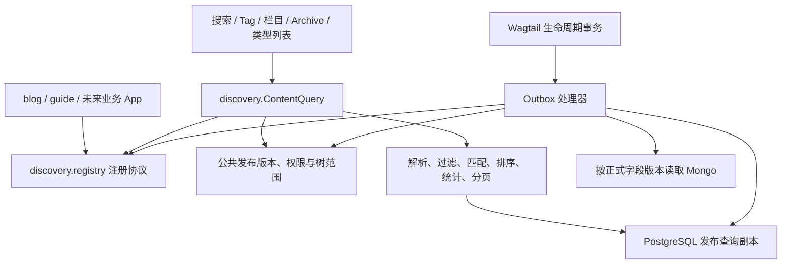

# myblog 统一搜索与组合筛选方案

日期：2026-11-04。对应需求：SEARCH-V2-FILTER；状态：**架构建议，尚未实现**。
依据是[补充需求原文](需求附件/SEARCH-V2-FILTER.md)和[第一阶段主方案](myblog_第一阶段技术方案_v1.0.md)。
原文按字节存档，没有润色。仓库尚未找到原文提及的独立 SEARCH-V2 正文，不能声称已核对其全部要求。
本轮只修改方案；不修改应用、数据库、迁移、Compose 或索引，不安装服务。

## 1. 目标与需要澄清的地方

建一套 `ContentQuery` 公共内容查询服务。搜索、Tag、栏目、年月归档和类型列表只改变参数与模板。
BlogPage、GuidePage 和未来类型通过注册接入，复用分词、版本、权限、排序、分页和统计。
第一阶段继续使用 PostgreSQL 18、Jieba 和现有基础设施；不增加 Elasticsearch、mongot 或独立搜索进程。
“索引可重建”表示可以恢复，不表示索引丢失后仍有完整搜索结果。
`Revision` 是页面的历史版本；`Outbox` 是与业务数据一起保存的待处理任务表；
“发布副本”是从正式版本整理出的查询数据，用于提速，不能决定页面是否发布。

需求整体合理。以下是需要明确的含义和成本，不代表取消功能。**表中推荐均待技术评审，没有冒充产品已确认细节。**

| 问题 | 推荐规则与取舍 |
|---|---|
| SEARCH-12 要求 A 命中才停止，SEARCH-14 又要求 A/B/C 分级 | A 有结果时只显示 A，不用 B/C 填满一页；A 为零才查 B。B 少于 10 条或主动扩展时加入 C，B/C 分级显示。若希望三个等级始终混排，需要另改回退规则 |
| “日期优先”是否允许新 C 排在旧 B 前面 | 有关键词时始终先排等级，再在等级内按所选日期方向排序，界面注明“同匹配等级内按日期”。纯筛选直接按日期 |
| 数据变化时仍要求翻页完全不重不漏 | 数据与权限不变时保证稳定遍历；变化后使旧游标失效，提示刷新。不给跨 HTTP 请求保留长数据库事务，也不保留已经撤权的快照 |
| “词语区分度”是否由 `ts_rank` 自动提供 | 不提供。增加明确的 DF/IDF 因子；DF 是当前合法候选中含该查询概念的文档数，IDF 用它衡量词的稀有程度。它增加统计成本，不称为 BM25 |
| 每次都计算所有维度的精确数量，同时低延迟 | 支持精确统计，但按页面所需维度请求、设超时、测真实规模。超时返回不可用，不把估算或截断值当精确总数 |
| 原句匹配能否由分词或三元组相似度代替 | 不能。A 检查归一化原文的连续包含；`pg_trgm` 只辅助找候选。C++、版本号还要检查技术词边界 |
| 所有入口依赖异步副本时，新发布内容能否立即出现在列表 | 当前简化路线允许搜索、Tag、Archive 暂时漏新项；不能漏标这个成本。若要求列表即时完整，可在发布事务同步正式元数据，正文索引仍异步，继续共用 ContentQuery，需单独评审 |

10 条是 C 自动扩展的候选门槛，与每页大小、当前第几页无关；门槛和默认自动扩展开关需评审。
不论哪个阶段，不能放宽用户筛选、必需关键词或权限来凑数量。若拒绝自动扩展，保留用户主动扩展入口。

### 技术路线比较

| 路线 | 优点 | 局限 |
|---|---|---|
| **推荐：公共服务 + PostgreSQL 发布副本** | 复用已有数据库；原句、组合过滤和统计能在 SQL 内完成；可逐项解释 | 需要自行实现中文处理、版本同步和排名；复杂统计与长文需要压测 |
| 直接复用当前 `Page.objects.live().search()` | 入口简单 | 当前入口没有 Mongo 正式正文、完整权限、A/B/C 和统一统计，不能直接满足需求 |
| 现在部署 Elasticsearch/MongoDB Search | 可比较更多搜索能力 | 多一个服务及同步链，不解决发布与权限合同；本轮不采用，第二阶段 ES 评估保留 |

## 2. 公共模块及依赖方向

以下文件是计划，不表示已经创建。`discovery` 内可依赖 Wagtail 和公共生命周期接口，
不能导入 `blog.models`、`guide.models`，也不能通过 `if BlogPage` 分支识别业务。



| 计划模块 | 负责什么 |
|---|---|
| `discovery/contracts.py`、`registry.py` | 参数、结果、类型标识和适配器注册，不访问外部服务 |
| `publication.py`、`access.py` | 复用 `content_lifecycle` 的有效发布版本、祖先限制、Site 和回收判断，不另建权限规则 |
| `extraction.py`、`projection.py` | 从正式版本提取文本、日期、Tag；维护发布副本 |
| `analysis.py`、`synonyms.py` | 归一化、技术词、Jieba 概念组和受控同义词 |
| `filters.py`、`matching.py`、`ranking.py` | SQL 过滤、A/B/C、评分与排序白名单 |
| `query.py`、`facets.py`、`presentation.py` | 编排查询、精确统计、归档和安全摘要；视图不另写查询分支 |

适配器在业务 App 的启动注册阶段提交：
`type_key`（稳定类型标识）、`model_label`、`schema_version`、`extractor_version`、
`extract(published_snapshot)`、`text_fields`（字段名/用途）、允许的额外筛选项及 `weight_profile`。
`published_snapshot` 是公共服务已校验的正式 Revision 和外置字段引用，不是当前可变 Page 实例。
适配器返回统一的 `PublishedPayload`：标题、intro/body 文本段、技术词及位置、成文日期、Tag ID 和展示字段。
URL 由公共展示层结合当前合法树位置生成；别名按主方案 D1.1 使用实际发布版本。

核心服务只拿已注册对象，不反向加载业务 App。重复类型标识、未声明字段、非法权重和数据格式不一致直接拒绝。
新增类型需要其提取器、模板和少量适配测试，不需要再开发搜索引擎。
额外业务过滤必须提供可用于 SQL 的白名单表达式，复用列表、计数和统计；禁止先取全量结果再用 Python 回调过滤。
额外文本字段仍提取成同合同的带字段标识文本段，归入评审过的权重配置，不另建独立检索体系。
只有满足公共日期、正式版本等合同的内容类型才注册；Home 等导航入口不因继承 Page 就自动进入结果。
首期用 Guide 和一个测试用 Xx 类型验证协议，不要求提前实现完整 Guide 业务。

## 3. `ContentQuery` 公共合同

公共入口建议为 `ContentQuery.execute(spec, context) -> QueryResult`。
它是应用内部接口，不等于现在开放新的 HTTP API。

| 输入 | 语义 |
|---|---|
| `q` | 可省略或空白；非空但只有无效符号时返回校验错误，不退成“全部内容” |
| `type_keys[]` | 已注册类型，多选 OR；未知类型报错，不静默忽略 |
| `site_id` | 默认当前站点；只能选择 `context` 允许的站点 |
| `root_page_id`、`tree_scope`、`include_root` | `descendants` / `children`；默认全部后代、排除根自身。包含根时仍须满足其他条件 |
| `page_id` | 可限定单页；与其他条件 AND，不绕过 Site、树或类型 |
| `tag_ids[]`、`tag_mode` | ANY 默认任意命中；ALL 必须包含全部，先归并 Tag 合并映射并去重 |
| `extra_filters` | 注册的业务筛选参数；必须显式限定支持这些筛选的类型，不支持的跨类型组合报错，不能忽略条件扩大结果 |
| `year`、`month`、`date_from`、`date_to` | 正式 `authored_on`；日期闭区间，年月与起止条件取交集；非法日期/反向区间报错 |
| `sort` | `relevance` / `authored_desc` / `authored_asc`；有词默认 relevance，无词默认 authored_desc |
| `expand` | `auto` / `off` / `on`，只控制符合回退条件后的 C，不越过 A 命中停止规则 |
| `facets[]`、`group_by` | 显式申请类型/Tag/栏目/年份/月份计数；归档只允许既定分组 |
| `page_size`、`cursor` | 建议默认 20、最大 50；使用下一页游标，不承诺任意深页跳转 |

`context` 由服务端构建：访问者、当前 Site、允许站点、会话访问凭证、请求标识及权限版本。
客户端不能提交 `can_view=true`、任意 SQL、任意排序字段或任意 model label。
输入数量和长度设上限；候选建议为原始及归一化后的 q 均不超过 256 字符、
16 个查询概念、10 种类型、20 个 Tag。
超限明确报错，不静默删除条件。这些是待负载验证的初值。

同类多选 OR、不同维度 AND；Tag 的 ALL 是明确例外。空 Tag 列表表示不按 Tag 限制。
树范围使用当前合法 `path/depth`：直属为后代且 `depth=root.depth+1`，包含根时另加根本身。
Page 类型与位置独立，BlogPage 不必位于 BlogIndexPage 下；实际合法父子类型仍由模型规定。
Wagtail `PageQuerySet.in_site(site)` 本质是站点根后代范围，嵌套站点可重叠，不把 Site 当作互斥的 Page 外键。
站点和根范围取交集，同一 Page 只返回一次；首期每次一个 Site，跨站界面后续另定。

各入口只组装参数：

| 消费者 | 传入公共服务的条件 |
|---|---|
| 全站搜索 | q + 用户选择的类型/栏目/Tag/日期 |
| BlogIndexPage | root=self、descendants、type=blog，可切 children |
| Guide 列表 | type=guide，可按栏目限制，不另建索引 |
| Tag 页面 | tag_ids=[当前 Tag]，允许继续组合其他条件 |
| Archive | year/month 或日期范围，按需 group_by，允许类型和栏目条件 |

视图负责表单与模板，不能额外使用 `Page.objects.live()` 拼出另一套结果或数量。
只改展示不改变查询语义，空关键词列表也必须经过同一版本及权限检查。

## 4. 正式发布副本、权限与同步

### 4.1 保存什么

| 计划数据 | 用途 |
|---|---|
| `PublishedSearchDocument` | 每 Page、索引配置代次一条；有效源 Page、Revision、发布序号、内容摘要、类型、正式标题/日期/展示数据及各协议版本 |
| `PublishedSearchTag` | 对应发布副本与已归并 Tag 的关系，唯一 `(document_id, tag_id)`，不读取草稿关联 |
| `PublishedSearchChunk` | field、逻辑文本段、块序号、归一化文本、原文偏移映射、召回词向量和评分词向量，支持长文 |
| `ContentDiscoveryEpoch` | 内容发现版本号；公开查询相关变化在同一 SQL 事务中递增，用于发现并发变化和使游标失效 |

副本记录 `contract_version/tokenizer_version/dictionary_hash/synonym_version/ranking_version/index_generation`。
查询匹配激活的同一组版本；修改词典先构建新代次、核对完整性后再原子切换，不混查新旧词元。
同义词查询扩展若不改变索引词元，可只切查询版本并使旧游标失效；规则改变词元时必须重建。

标题、日期等 Page 专属展示值来自**同一正式 Revision**；封面、人员和 Tag 的选择、排序等关系也取该版本。
Person 姓名、头像等共享资料及 Tag 名称使用当前有效公共值，不随 Page 恢复历史而回滚。
共享资料变化须更新 epoch；若副本冗余保存这些值，同一事务更新或使其失效，不能保留过期展示。
Tag 名称与合并映射属于公共词库；词库变化触发版本号和对应副本更新。
合并同步期间，查询端对选中 ID 和发布关联双方使用同一当前规范 ID 映射；不能只规范查询条件，漏掉尚未重建的旧关联。
Page 当前行只用于发布资格、当前树/路由等必要状态，不拿其中可能属于新草稿的标题或日期展示。

### 4.2 哪些页面可查

先在主 PostgreSQL 建可用范围 E：注册类型、当前 Site/树范围、有效发布版本、当前访问资格及非回收状态。
普通页检查 `live/live_revision_id`；别名检查主方案的 `AliasPublicationBinding`、源与别名双方资格。
副本必须匹配当前有效发布 Revision 和发布序号，否则从搜索、纯列表和统计一起排除。
发布新版本而索引尚未就绪时允许暂时漏项；页面详情仍由原发布读取服务处理，不能回退成旧副本。
此时 total_count 是已就绪合法集合的精确数量，不代表全站全部正式内容；界面可提示内容正在同步，
不返回未授权范围的待处理条数。索引整体不可用时返回故障，不能把它装成正常的空结果。

访问规则覆盖祖先限制、登录要求、组访问、密码会话凭证、源页/别名及 Site 策略。
Wagtail `.public()` 只排除受限树，不能代替“当前登录用户确实有权读”的完整判断。
匿名入口使用 public 范围；登录或密码授权查询在同一个公共权限适配中完成相应 SQL 判定，
不能因为已登录就展示所有 restricted 页面。未支持的限制类型拒绝，不先计数再逐条丢掉。

权限、树和 Site 使用当前有效规则；Tag、日期和文本使用正式 Revision。
所以移动页面可立即改变栏目与访问范围，但草稿改 Tag 不能提前改变筛选。
栏目导航名称也取允许公开的版本，不能把当前草稿父标题用于筛选标签或面包屑。

### 4.3 Outbox 与失败

1. 发布、撤销发布、回收/恢复、移动、别名、权限、Site 和 Tag 合并操作，沿用统一生命周期协调流程。
   同一事务保存业务状态、发布序号、Outbox 事件并递增 discovery epoch；外置内容预写仍在事务外。
2. 处理器取得 `(page_id, expected_revision_id, expected_generation)`，只读取该正式 Revision 指向的 Mongo intro/body。
   校验 document_uuid、字段版本、schema 和 hash，不使用 Mongo 的“最新正文”。
3. 在锁外提取/分块；写入事务中再按统一锁顺序核对当前发布版本、身份和配置代次。
   一次替换该 Page 的元数据、Tag 和全部文本块，并递增 epoch；完整成功才激活。
4. 事件 ID 唯一；同一发布序号重做必须内容一致。旧任务、删除后重试、别名身份变化不得覆盖新副本。
   下架/回收先由当前资格即时拦截，再异步清理索引；恢复不自动发布。
5. Mongo 不可读、提取失败、数据库提交失败时保留待重试记录，报告延迟；不用空正文、草稿或旧副本假装完成。

不改变正式发布状态来迁就搜索失败。索引缺失/损坏不能把查询服务降级到现有草稿字段。
重建按有效正式身份分批读 Mongo、写新代次，记录进度；处理并发 Outbox，
激活前检查缺失、版本和计数。旧代次只在核验后清理，不删除 Mongo 历史或 RustFS 对象。

## 5. 原句、分词与受控同义词

### 5.1 先处理输入与技术词

显示保留原文；匹配使用版本化规则：Unicode NFKC、大小写归一、合并连续空白，保留有意义的标点。
HTML/Markdown 先按公共 Block 协议提取可公开的纯文本；不跨标题、简介、正文或不同逻辑文本段拼出原句。
句子跨同一段的物理分块仍可匹配，跨代码/段落的边界不凭空连接。

先识别保护词，再用 `jieba==0.42.1` 精确模式形成查询概念组。
`C++`、`C#`、`Django 6.1`、`WorkflowState`、`PostgreSQL 18` 需要可重复样例和词典。
例如 C++ 使用受控索引词 `techcpp`，版本号保留层级及边界；6.1 不误判为 6.10，C++ 不退成 C。
受控索引词必须通过 PostgreSQL `simple` 的实际词元检查，并防止与普通正文字符串碰撞。

索引可增加 Jieba 搜索模式的子词帮助召回，但同一概念内部的备选词是 OR，
**不能把搜索模式产生的重叠子词全都列为必需 AND，也不能把其人工排列当作原文词距。**
评分用精确模式词元和原文位置；长度统计按主词元，不把扩展子词重复计算。
停用词表及专业词表固定版本；只剩停用词/无效符号时提示有效关键词不足，不自动返回全部。
用户输入不是 tsquery 语法；引号、括号、`& | !`、SQL 通配符等按明确的普通文本规则处理并转义。

### 5.2 模式判定只做一次

先应用权限、发布版本、Site、树、类型、Tag、日期等全部条件，得到同一个 E。
模式判定在 E 中进行，发生在分页、统计分桶之前；优化器可调整物理执行顺序。

| 模式 | 成员条件 | 何时执行 |
|---|---|---|
| A，等级 0 | 单个合法文本段连续包含整个归一化 q，技术词同时满足边界 | 非空有效 q 先查 A；有任何合法命中就只输出 A |
| B，等级 1 | 每个必需查询概念组都至少有一个直接词命中，组间 AND，可分布在不同字段或块 | A 为零；不因普通 OR 召回大量只含常见词的内容 |
| C，等级 2 | 每组为“原词 OR 受控同义词”，组间仍 AND；至少实际使用一次同义替换，排除已有 B | A 为零、expand 不为 off；on 主动扩展，auto 仅在 B 少于门槛时扩展 |

原句 A 使用参数化字面包含匹配，`pg_trgm` 候选必须由原文复核；不使用相似度阈值冒充连续命中。
中文单字/短词无有效全文词元时，B 可按原概念做受限字面包含；仍保留所有条件和概念 AND。
技术标识按保护词匹配，不能以忽略标点的三元组相似度替代。只含技术符号但无合法保护词的输入报错。

C 词典只含人工审核的方向、领域、版本和替代词；“数据库”不自动等同于某个数据库产品。
每组建议最多 3 个替代，总计最多 24 个；不递归扩展，不调用在线 AI 猜词，不删除任何必需组。
结果按 Page 去重，最小等级决定 `match_mode`；返回扩展提示及实际替代词。
B=0、C=0 就显示无结果；expand=off 始终不查 C，auto 且 B≥门槛时也不查 C。
无词查询走 FILTER 模式，跳过 A/B/C、分词与文本评分。

## 6. 排名算法与索引

### 6.1 严格等级优先，分数只在等级内比较

相关度顺序：`match_tier ASC, score_key DESC, authored_on DESC, page_id DESC`。
日期倒序：`match_tier ASC, authored_on DESC, page_id DESC`；日期正序改为 ASC。
FILTER 没有等级，直接按日期和同方向 Page ID 排序；空词选择 relevance 时规范为 authored_desc 并回显。
不以任意大 boost 替代等级。不同类型共用公式、相同量纲和受限的字段权重配置，
不得让某个类型自行把基础分放大 100 倍。评分配置变化使游标失效。

候选评分公式如下，系数是可解释的初值，须用标注集校准：

```text
score = 0.55 × F + 0.20 × T + 0.15 × O + 0.10 × I
F：标题/简介/正文的 ts_rank_cd 长度归一化分数，默认字段比例 1.0 / 0.4 / 0.1。
T：专业词组在标题、简介、正文中的加权覆盖率，未含专业词的查询取 0。
O：原文中顺序一致、距离较近的独立概念覆盖；单概念取 0，不跨字段或段落制造邻近。
I：按 DF/IDF 加权的字段覆盖，稀有概念在重要字段命中更有区分力。
```

**成员匹配和局部评分分开。** B/C 在整篇文档检查必需概念 AND；F 对每个概念组分别构造评分查询，
组内合法备选词 OR，不把全部组的 AND 查询传给单个字段或块。
例如“Django”在标题、“迁移”在正文仍可命中，两个字段各自为已命中的概念贡献分数。

每字段、每概念组先用 `ts_rank_cd(..., normalization=33)`，即对数长度修正及 `rank/(rank+1)` 缩放，
取该字段最佳块的分数；未命中的组记 0，再对全部必需组求平均，得到字段分数。
C 的直接词与同义词分别评分，取“直接词分数”和“同义词分数 × 0.6”的较大值，不把两者相加。
最后按固定权重对字段分数求加权平均，缺失字段记 0；额外文本字段使用已评审的权重配置。
不累加重复块或扩展子词，避免长文反复灌词得分；不能用 `rank>0` 再次过滤成员，A 的原句资格也不依赖 F。
F、T、O、I 均在 0–1 范围内，算法版本统一保存，不能由业务适配器返回不受控的分数。
T 对查询中的专业概念取命中字段最高权重，再求平均；同义命中折减规则与 I 相同。
O 使用独立概念的原文偏移：同段内找覆盖概念数最多、随后跨度最短的顺序窗口，
按覆盖率乘距离折减；没有顺序窗口取 0。跨块偏移必须还原，同一概念的子词只算一次。
高成本位置计算在 SQL 的命中范围内完成；不能偷偷只重排前 100 条再宣称是全局精确排名。

I 在合法候选 E 中计算 N 和每个概念的文档频率 df，Page 去重：
`idf=min(8, 1+ln((N+1)/(df+1)))`。
df 按该次查询启用的组内备选词求文档并集，不能把同一页的多个词或块相加；N=0 时不计算评分。
每个概念取命中字段的最高权重，再用 idf 加权求平均；C 同义命中乘候选系数 0.6。
只查询有限个概念，不建立一套草稿语料统计；不能从未授权文档计算 df 后把变化泄露给普通用户。
候选变化使统计失效。结果含分数是解释用值，不是相似概率，也不称为 BM25。
概念组的全局覆盖是成员资格，B/C 必需组覆盖不足就排除；字段覆盖用于区分同样满足全部概念的结果。
`score_key` 用统一精度的定点整数生成、排序并写入游标，避免传输浮点数后改变同分顺序。

### 6.2 PostgreSQL 查询和长文

| 数据/索引 | 计划用途与限制 |
|---|---|
| 文档唯一 `(page_id, index_generation)` | 避免同一代次重复页面，关联当前有效发布身份 |
| 文档 B-tree：代次、类型、日期、Page ID | 结构化过滤与日期分页；根据执行计划决定组合，不为所有条件排列建索引 |
| Tag 双向 B-tree 和唯一关系 | ANY 用 EXISTS；ALL 按去重后的选中 Tag 数校验，避免关联放大计数 |
| Page 的 path/depth 及 Site 根范围 | 复用树查询；跨 Site 移动立即重新取当前范围 |
| 分块召回 `tsvector` + GIN | 词组查询；不同必需概念可用不同块的 EXISTS，不要求所有词在一块 |
| 归一化原文 `gin_trgm_ops` | A 和受限字面包含；短模式可能没有有效三元组，不能承诺索引一定提速 |

不能把任意长正文直接塞进一个向量：PostgreSQL 单向量小于 1MB、位置最大 16383，
同词最多记录 256 个位置。候选分块上限取 8KiB UTF8 或 2048 个主词元，先到者切分；
还要检查实际向量字节和位置，超限继续拆分，不截断正文或吞掉错误。
保留 field、逻辑段号和归一化位置到展示原文的映射；大小写、空白和 NFKC 处理后仍能准确高亮。
同段块之间重叠 256 个归一化字符，覆盖归一化 q 最大 256 字符的跨块 A；
因向量超限再次拆分时也必须保留重叠。技术词边界读取原段上下文，不能把物理块边缘当成词边界。
重叠部分不重复计词或排名；必需词分散到不重叠块也应能 B 命中。原段边界仍不可跨越。
高频词超过单词位置上限时，F 的词频视为封顶，精确位置特征使用独立偏移，不宣称向量保留了全部位置。

GIN 负责召回，不直接输出相关度排序；大候选集仍需评分、排序和精确计数。
使用 SQL/ORM 参数、EXISTS、按文档去重和批量展示查询，避免 N+1 及 Python 全文遍历。
`pg_trgm` 属 PostgreSQL 扩展，不是另一个 pip 库；本轮没有安装扩展或创建上述表及索引。
扩展、分块、跨块 AND/原句、评分表达式必须在后续获准的原型任务里实测后才冻结实现。

## 7. 数量、分页、摘要与归档

`QueryResult` 建议包含：
`items, total_count, facets, archive_groups, next_cursor, match_policy, expansion_used,
normalized_filters, query_version, corpus_epoch, index_status`。
单条包含 `page_id, effective_revision_id, type_key, title, url, authored_on,
summary, highlights, match_mode, score_key, tags, column_metadata`。
不返回未授权页面的占位条数、标题、旧摘要或隐藏 Tag 计数。

### 7.1 一个最终结果集合

E 决定候选，A/B/C 决定最终集合 R；总数、所有统计、摘要和分页都从同一个 R 派生。
默认 facets **保留当前维度自身条件**，不提供“假设取消 Tag 后会有多少条”的另一套计数。
分桶不能重新决定 A/B/C，也不能在桶内补 B/C；界面注明“当前结果中的数量”。
多 Tag 或多个祖先栏目可重叠，一个页面可以同时计入多个桶，因此桶数相加不一定等于 total_count。
统计均 COUNT DISTINCT page_id，受限栏目/名称不出现；当前已选但无命中的合法选项可显示 0。
栏目桶默认是当前 root 的直属可见栏目（无 root 时为当前 Site 根的直属可见栏目），每桶统计其后代与可匹配的自身；
只生成该层或配置指定的有限栏目桶，不为整棵树的每个节点重复统计。未属于这些桶的直属内容仍计入 total_count。
纯筛选的 R 是 E；Archive 用 R 的正式 authored_on 分组，日期范围先过滤再分组。
未来若做忽略本维度的统计，必须另设协议，不能把它与当前计数混为一谈。

### 7.2 翻页与并发

首期推荐完整排序键的 keyset cursor（按上一条排序位置继续），不使用任意深 OFFSET。
游标签名并绑定规范化条件、访问者/会话权限指纹、Site、排序、模式策略、分词/评分配置、epoch 和过期时间。
建议有效期 10 分钟；参数或身份改变就拒绝，不能用匿名游标读取登录内容。
第一页判定模式与扩展，后续页保持；不因为某页只剩 2 条就重新选择搜索模式。

一次请求用短只读 REPEATABLE READ 事务统一匹配、总数、分桶和分页快照；
`transaction.atomic()` 默认 READ COMMITTED，不能冒充它已经提供相同快照。
结束快照后，在主库做一次当前 epoch 和访问者权限指纹核对，再提交响应。
发布、下架、权限、祖先/树/Site、Tag 合并、投影激活和配置切换均须覆盖版本更新；
用户组/会话凭证变化也改变权限指纹。命中缓存时同样核对。
最终指纹必须由主库与当前会话重新取得，不能只复用 `request.user` 已缓存的组或权限属性。
发生变化时丢弃**整份**结果、数量与摘要，最多重算一次，仍变化则返回 `results_changed`，不删几条后保留旧总数。

跨请求 epoch 变化则旧游标失效，提示刷新。不能同时保证“永远保持旧快照”与“撤权立即不可见”。
最终检查之后与网络发送无法原子完成，不承诺撤回已经在途的字节。
全局 epoch 对个人站容易检查，但会使无关页面更新也中断翻页；流量变大后再评估分范围版本。
若必须传统页码或严格历史快照，需要另作技术决策，不能把稳定排序当成已经解决。

### 7.3 摘要、高亮与缓存

摘要从同一正式副本按命中位置截取。返回纯文本和高亮区间，模板先转义文本再输出固定 `<mark>`，
不直接信任 Markdown HTML、`ts_headline` 返回的 HTML 或用户提供的标签。
A 高亮连续原句；B/C 用原文位置，高亮同义命中并标明扩展；技术词和 Unicode 偏移必须可回读验证。
无词列表使用该正式版本的简介或固定纯文本节选，不生成虚假命中说明。

首期不依赖 Redis 维护正确性；可缓存限量结果 ID/分数及统计，键包含查询、身份范围、配置与 epoch。
缓存不替代当前权限检查。登录/密码受限结果不进入匿名共享缓存；索引或查询超时明确返回不可用，
不显示“0 条”来掩盖故障，也不退回无权限过滤的查询。

## 8. 8GB 资源初始预算与怎么验证

以下按 8GB = 8×10⁹ 字节、约 7.45GiB 保守计算；实际以部署环境可用内存为准，
不要把 8GB 和 8GiB 混用。此表是整机候选预算，**不是本轮已修改的 Compose 限额或性能承诺**。
当前服务限额及 60 个 PostgreSQL 连接上限不在本轮改动，实施前另评审。

| 项目 | 候选预算 |
|---|---:|
| 操作系统、文件缓存及余量 | 2GiB |
| PostgreSQL（缓存、连接、查询合计） | 1.5GiB |
| Django/Gunicorn 和常规 Outbox | 0.75GiB |
| MongoDB | 0.75GiB |
| RustFS | 1GiB |
| Redis | 0.25GiB |
| 单个分批重建任务额外余量 | 0.5GiB |
| 合计 | 6.75GiB，按 8GB 计算余下约 0.70GiB 应对峰值 |

搜索初值：同时最多 2 个重查询，后续有限排队；单 SQL 超时建议 1.5 秒，请求总预算 3 秒；
只计算请求的 facets。达到超时就返回明确失败，不返回部分数量、半份统计或局部排名。
`work_mem` 候选 4MiB，不能理解为每连接总内存：排序、哈希、并行工作者可分别消耗。
首期不靠增加并行工作者、连接数和 work_mem 解决慢查询。重建单进程、每批约 50 页，
按实际正文大小调整，避免一次加载整库 Mongo。
双代索引及重建临时文件会增加磁盘使用，激活前估算两代数据、索引、WAL 和临时空间，空间不足先停止任务。

压测矩阵先固定数据规模和并发，建议 1万/10万页，包含多类型、多层树、多 Tag、长文及大量常见词。
分别测冷/热缓存、1/5/10 并发、A/B/C/纯筛选、单字、ALL Tag、全部 facets、重建与上传并存。
记录 `EXPLAIN (ANALYZE, BUFFERS)`、候选/扫描行数、p50/p95/p99、超时率、CPU、RSS、磁盘临时文件与索引体积。
这些命令会真正执行查询，留给获准的隔离数据环境；本轮没有运行。
首个可讨论目标为热缓存常用查询 p95≤500ms、含所需统计 p95≤1s；必须附数据规模和机器条件，
未达标就优化或协商边界，不删掉权限、准确计数或偷偷截取结果来达标。

## 9. 验收与实施顺序

### 9.1 必须设计的测试

| 覆盖 | 用例与检查 |
|---|---|
| 附件 1/2/17 | Blog、Guide 及测试 Xx 注册；搜索/Tag/Archive/栏目只调用 ContentQuery；公共模块不导入业务模型，禁止复制查询链 |
| 3/4/5/8/9 | 原句同时组合年份、类型、后代、Tag；范围外原句不影响范围内 A/B/C，更不能返回 |
| 6 | descendants/children/include_root、page_id、嵌套 Site、移动前后；类型与树位置独立 |
| 7 | ANY/ALL、多 Tag 去重、Tag 合并、无命中；不因多对多 JOIN 放大页数 |
| 10/11 | A=0进入B，A>0不补B；B门槛与C；无词纯筛选及仅符号校验，页大小不影响模式 |
| 12/13 | 字段权重、专业词、IDF、重复灌词、长短文；跨字段/块AND仍能局部评分；B必须匹配必需概念；高分C不得排在B前 |
| 14 | 草稿单独改 title/Tag/date/intro/body，列表、数量、归档、摘要和高亮继续使用旧正式版本 |
| 15 | 下架、祖先限权、组/密码会话变化、回收、别名源变化，覆盖列表/total/facets/缓存/下一页 |
| 16 | 同分、日期同值、空页；游标篡改/身份切换；并发发布或移动时整份重算/失效，不泄露旧计数 |
| 18 | 上述负载矩阵、短模式退化、长文分块、跨块原句与跨块AND，检查查询计划、内存和延迟 |
| 补充 | 同义词方向、领域及expand开关；C++/C#/版本号/标识；中文无空格、Unicode/HTML安全、词典和索引代次切换；Person当前共享资料与历史Page关系 |
| 跨存储 | Mongo缺失/hash错误、Outbox重复/乱序/中断、重建遇发布、权限变化、提交结果未知和损坏索引 |

准备至少 60 个由人标注的查询，含原句、中文短词、专业词、中英版本号及无相关结果。
同时保存必需命中、必须排除和成对排序断言，报告 P@10、nDCG@10、原句召回和误扩展率。
P@10 是前 10 条的相关比例；nDCG@10 还检查更相关的条目是否靠前。
权限泄露、错误正式版本、等级倒置为零容忍；其他质量门槛在同一标注集和数据规模下评审，不以单个演示句验收。

### 9.2 开发顺序与独立审查

| 小任务 | 计划文件/依赖 | 完成证据 |
|---|---|---|
| Q1 合同和注册 | `discovery/contracts.py/registry.py`，接主方案 S2 | 参数、版本、反向依赖检查及三个类型的纯逻辑契约测试 |
| Q2 正式提取和权限范围 | `publication.py/access.py/extraction.py`，依赖 S6/S8 | 草稿元数据隔离、祖先/Site/别名、拒绝未知权限；不同入口同范围 |
| Q3 分析和匹配原型 | `analysis.py/synonyms.py/matching.py` | 技术词、概念组、A/B/C、分块边界；经授权的临时数据性能验证，不能直接用原型替代业务 |
| Q4 发布副本和重建 | `models.py/projection.py`、获准后的候选迁移 | 约束、Outbox幂等/乱序、原子替换、双代重建、epoch覆盖；实际迁移另授权 |
| Q5 组合查询与排名 | `filters.py/ranking.py/query.py` | ALL/ANY、跨块AND、DF范围、统一评分、白名单排序和等级断言 |
| Q6 分页统计与展示 | `facets.py/presentation.py` | 精确计数、相同事务快照、游标失效、安全摘要和整份结果并发重算 |
| Q7 全部入口接入 | `search/views.py`、Tag/Archive/栏目视图和模板 | 删除各入口自建的公开查询路径，端到端同一条件同一结果 |
| Q8 资源与质量验收 | 隔离 PostgreSQL/Mongo 集成、标注集及压测报告 | 安全负例、搜索质量、资源峰值、失败恢复；不过关不宣称完成 |

Sol 复核公共接口、算法和发布合同；Gemini 按批准任务实施；Terra 独立找权限、计数、乱序与并发反例；
Argon 仅在 Wagtail 生命周期接入困难时介入。代理不得自行连接服务，真实集成测试由主会话按授权串行执行。

## 10. 本轮结果与尚未解决的事项

本轮已把统一架构、组合条件、A/B/C、评分、索引、同步、统计、分页、资源与测试写成可审查合同。
主方案 D3 及简明稿同步指向本文件；附件原文保持不变。
先前临时表的中文匹配检查只证明基础能力，未验证本方案的分词边界、IDF、pg_trgm、分块和业务权限。

落地前需确认的技术选择：表 1 的模式/日期/游标解释，C 自动扩展门槛，
评分初值和标注门槛，压测规模/预算，以及是否确需传统页码。
这些已有推荐，不再要求用户重新决定“是否公共查询、是否保护草稿”等已确认功能。
原 SEARCH-V2 若另有正文，需补对照其特有条款；不能按未提供内容补造需求。
数据库表、扩展、迁移、服务配置和应用接入均未执行；本轮 Git 提交仅包含文档。

### 本轮文档审查记录

Sol 完成需求审查和算法复核，指出并补正了跨字段/块的局部评分、归一化查询长度、
再次拆块的重叠、技术词边界及 GB/GiB 预算问题。
Terra 完成首轮审查；第二轮调用因模型认证失败未完成，不能记为独立复核通过，
后续一致性由主会话继续核对。上述记录均是文档审查，不是业务测试或性能验收。

文档检查使用 WSL2 指定 Conda 环境的 Python 内联脚本（`python -X utf8 -`）：
6 份文档、27 个本地链接、代码围栏及尾随空白检查通过，存档附件 SHA256 与原文件一致。
`git diff --check` 通过；HEAD 保持 `b76aa0b1fe7d050216eff54e42d1a599b660249c`。
本轮没有 Python 应用变更，未执行 Django 检查、业务测试或服务探针。

### 核对依据

本轮只读核对依赖声明及安装源码：Django 6.1.2 `django/contrib/postgres/search.py` 的
`SearchRank/SearchHeadline`；Wagtail 8.1 `wagtail/query.py` 的 `public/in_site/child_of/descendant_of`。
Context7 文档查询失败，改核对官方 PostgreSQL 手册与本机版本源码，没有据此升级依赖。
官方依据供后续实施复查：

```text
https://www.postgresql.org/docs/18/textsearch-controls.html
https://www.postgresql.org/docs/18/textsearch-limitations.html
https://www.postgresql.org/docs/18/pgtrgm.html
https://www.postgresql.org/docs/18/transaction-iso.html
https://www.postgresql.org/docs/18/runtime-config-resource.html
https://github.com/fxsjy/jieba/tree/v0.42.1
https://docs.wagtail.org/en/8.1/reference/pages/queryset_reference.html
```
